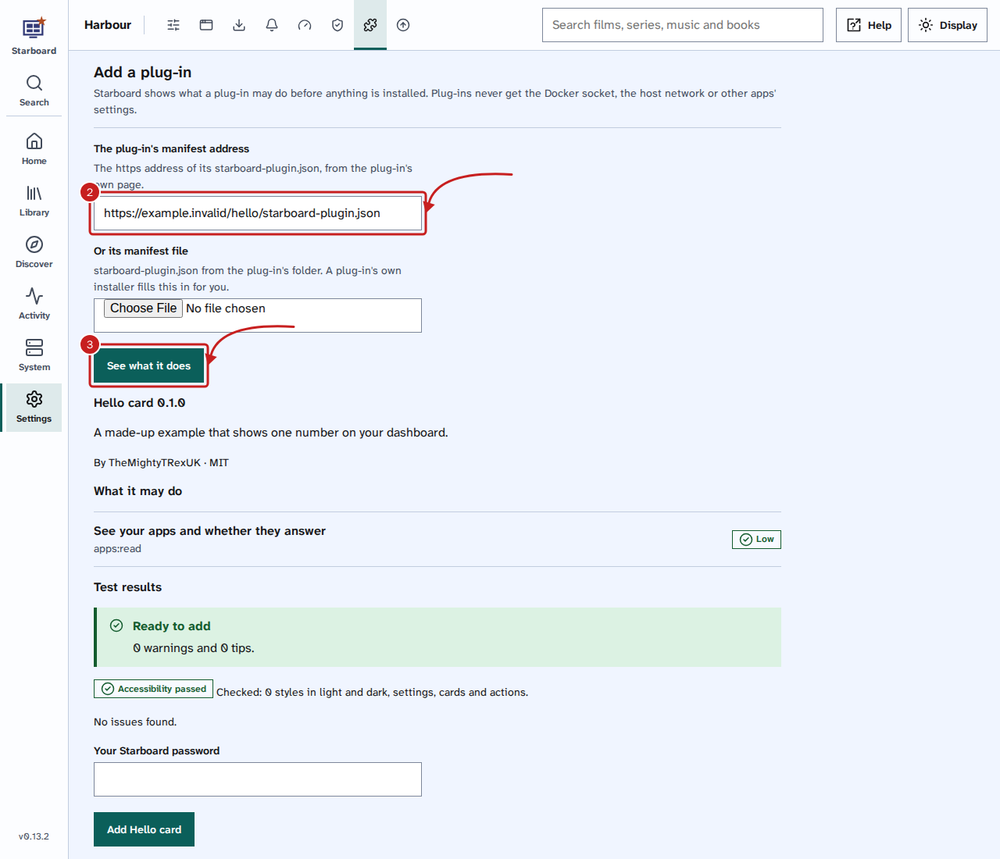
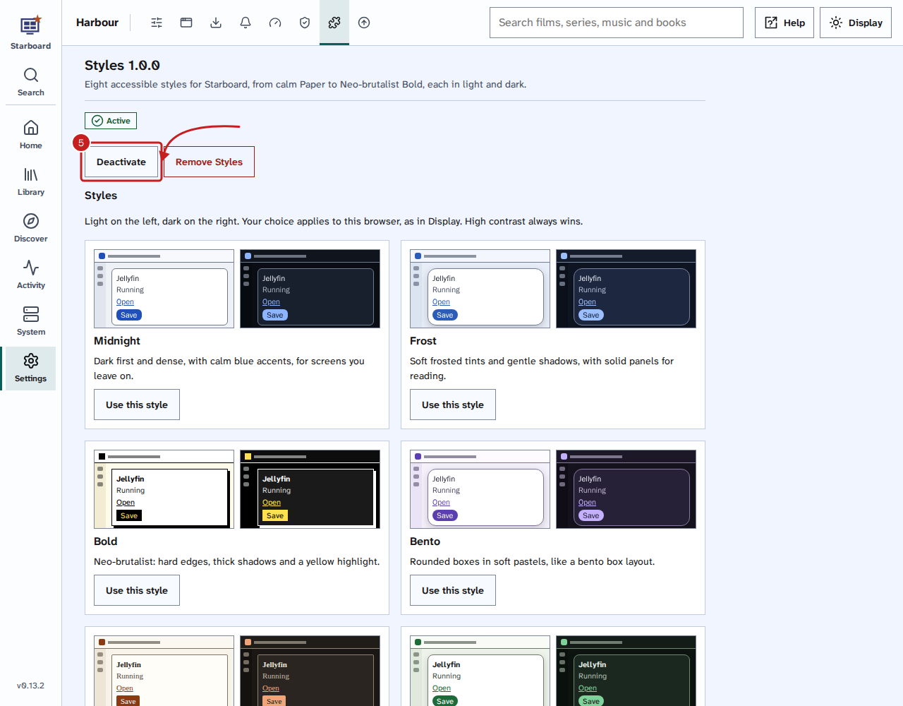
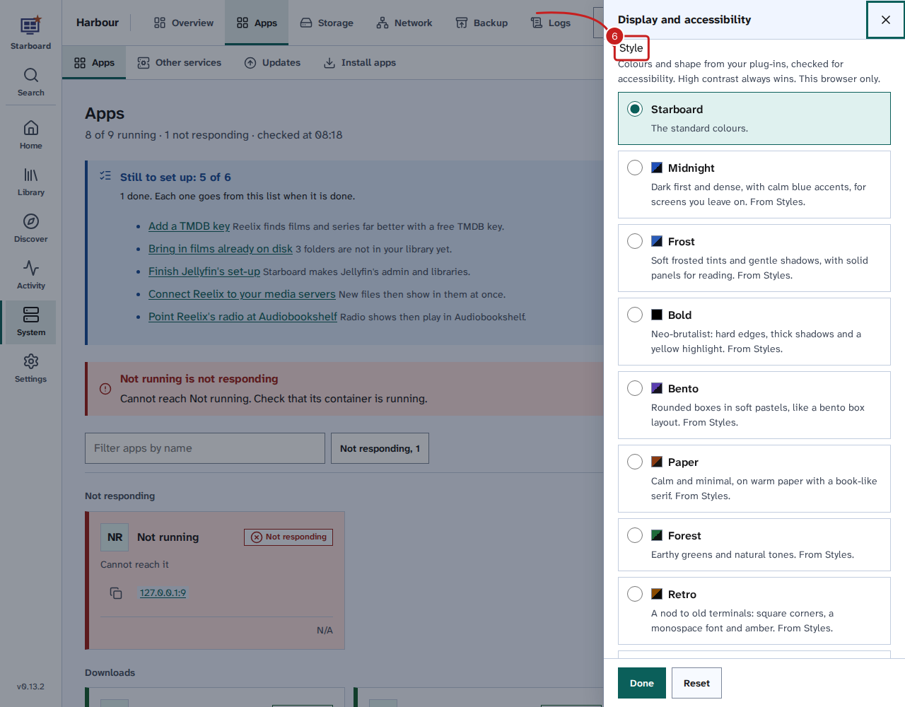
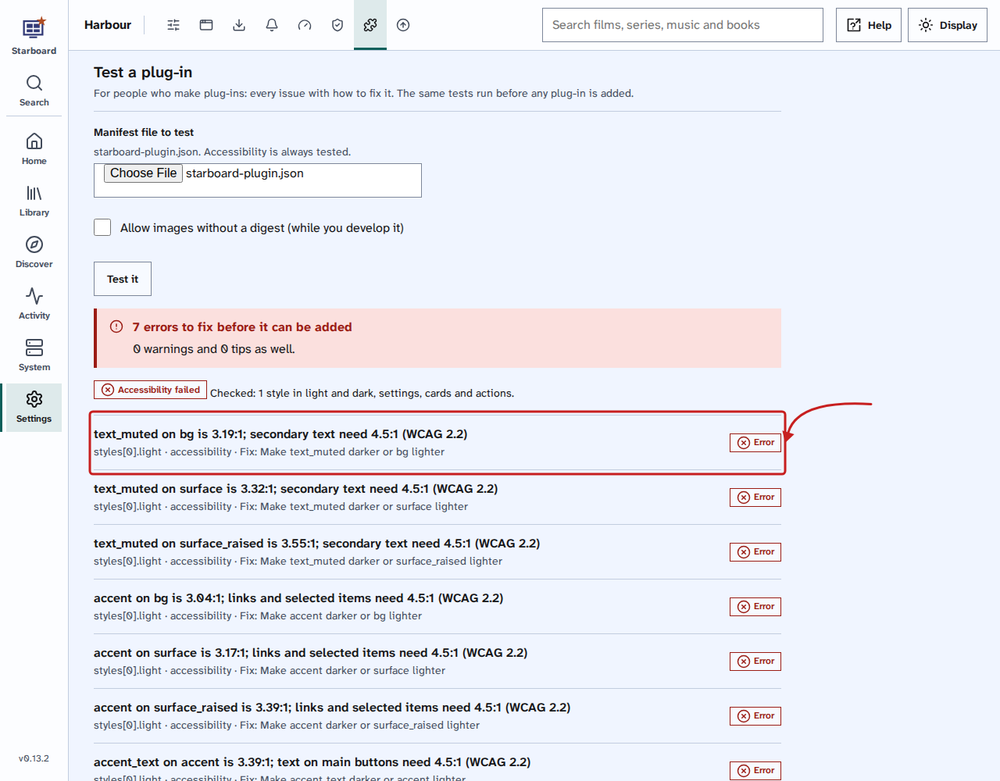

[Help centre](../README.md) · Plug-ins · how-to

# Add a plug-in

Add a plug-in to give Starboard something new, such as Live TV or more styles to choose from. Starboard shows
what the plug-in may do and tests it before anything is added. At the end, the plug-in is active and what it adds
is ready to use.

## Before you begin

- The plug-in is in the **Catalogue**, or you have its manifest address, its `starboard-plugin.json` file or its
  installer. Plug-ins you can add are also listed in [The plug-in collection](../basics/plugin-collection.md).
- You know your Starboard password. Adding and removing a plug-in ask for it.
- To understand what a plug-in can and cannot do first, read
  [What a plug-in can change](../basics/what-plugins-can-change.md).

## Steps

1. Go to **Settings**, then **Plug-ins**, then **Catalogue**. The catalogue lists the plug-ins built into
   Starboard, the Starboard plug-ins collection by kind, and the plug-ins in any catalogue you added.
2. Find the plug-in and select **Install…**. For a plug-in built into Starboard, select **Add** and its name.
   A plug-in that is not in any catalogue can be added by its address: read
   [Add a plug-in by its address](#add-a-plug-in-by-its-address).
3. A slide-out opens. It says the plug-in is installed at your own risk, then lists what it **can see**, what it
   **can change**, what it **can reach**, what it runs and what it can never reach. Read it all.

   

4. To go ahead, enter your Starboard password and select **Install** and the plug-in's name. To stop, select
   **Cancel**: nothing is installed.
5. The plug-in's own tab opens, under **Settings**, then **Plug-ins**. Select **Activate**. Its state changes
   to **Active**. To stop it later, select **Deactivate**.

   

6. For a plug-in with styles: select **Display** in the header of any page, then choose a style under **Style**.
   The page changes straight away. You can also select **Use this style** on the plug-in's own tab. Read
   [Change text size, theme and other display settings](display-and-accessibility.md#choose-a-style-from-a-plug-in).

   

### Manage your plug-ins

**Settings**, then **Plug-ins**, then **Manage** lists every plug-in you added, with its state, **Settings**,
**Activate** or **Deactivate**, and **Remove**. Each plug-in also has its own tab after **Catalogue**, with its
settings, what it may do, and **Remove** at the foot.

### Add a catalogue from a link

A catalogue is a list of plug-ins that someone publishes as one file, `catalogue.json`. Add one, and its
plug-ins show on the **Catalogue** page next to the Starboard plug-ins collection. Adding a catalogue installs
nothing: each plug-in still shows its warning before it is installed.

1. On the page of the person or project that makes the plug-ins, copy the catalogue's address. It starts with
   `https://` and usually ends with `catalogue.json`, such as
   `https://raw.githubusercontent.com/TheMightyTRex/starboard-plugins/main/catalogue.json`.
2. Go to **Settings**, then **Plug-ins**, then **Catalogue**.
3. Under **Catalogue sources**, paste the address into **Catalogue address**, then select **Add catalogue**.
   Starboard reads it and says how many plug-ins it lists.
4. Its plug-ins show above, in their own section, named after the catalogue.

Starboard reads each catalogue at most once a day. To take one off, select **Remove** next to it under
**Catalogue sources**. Plug-ins you already installed from it stay. The Starboard plug-ins collection is always
there and cannot be removed. Starboard reads 10 catalogues at most.

Only add catalogues from people you trust. Starboard did not make the plug-ins in them.

### Add a plug-in by its address

On the **Catalogue** page, under **Add one from elsewhere**, paste the address of the plug-in's
`starboard-plugin.json` into **The plug-in's manifest address**, or choose the file in **Or its manifest file**.
Select **See what it does**, read the test results, then select **Install** and its name. Carry on from step 3.

### With the plug-in's own installer

Some plug-ins come with an installer. Run it on any computer with Python, such as `python3 install.py`, and enter
your Starboard's address, such as `http://192.168.1.20:8095`. Your browser opens the **Catalogue** page with the
plug-in already shown under **Add one from elsewhere**. Select **Install** and its name, then carry on from step 3.

## Test a plug-in

If you make plug-ins, test one before you share it. In **Settings**, then **Plug-ins**, then **Catalogue**, under **Test a plug-in**,
choose its `starboard-plugin.json` and select **Test it**. Starboard lists every issue with where it is, what is wrong and
how to fix it. Accessibility is always tested: every style in light and dark, and the words people read.

## Things to note

- Styles apply to the browser you choose them in, like the rest of **Display**.
- Some plug-ins add cards to the dashboard. Read [Use and change the dashboard](use-the-dashboard.md).
- **High contrast**, text size, wider spacing, underlined links and reduced motion always win over a style.
- **Remove** and the plug-in's name stops the plug-in and its containers, and stops its key working. Its folder
  is kept in `data/plugins/.removed`, so you decide when to delete it.
- **Deactivate all plug-ins** deactivates every active plug-in at once, if something goes wrong.

## If it does not work

- **"This plug-in cannot be added":** read the test results under it. The plug-in's maker needs to fix each error.
- **"That is not a plug-in catalogue":** the address is not a `catalogue.json`. Check you copied the catalogue's
  address, not the address of its web page.
- **"This catalogue did not answer":** Starboard shows the list from the last time it did, and tries again the
  next day.
- **"Starboard has no access to Docker here":** plug-ins that run containers need Docker access. Read
  [Change what Starboard can access](change-what-starboard-can-access.md). Plug-ins with only styles do not.
- **A style does not change anything:** check that **High contrast** is inactive in **Display**, and that the
  plug-in is **Active**.

## Find out more

- [Write a plug-in](../basics/write-a-plugin.md)
- [What a plug-in can change](../basics/what-plugins-can-change.md)
- [The plug-in collection](../basics/plugin-collection.md)
- [How Starboard keeps your server safe](../basics/how-starboard-keeps-you-safe.md)

<!-- footer: download rights -->

---

**Download only what you have the right to.** Use the download apps only for files you have the right to download,
such as open-source software, works in the public domain and your own backups. Downloading films, series, music or
books without the copyright holder's permission is against the law in the UK and most other countries. Starboard
does not host or provide any files, and you are responsible for what you download.

<!-- /footer -->
