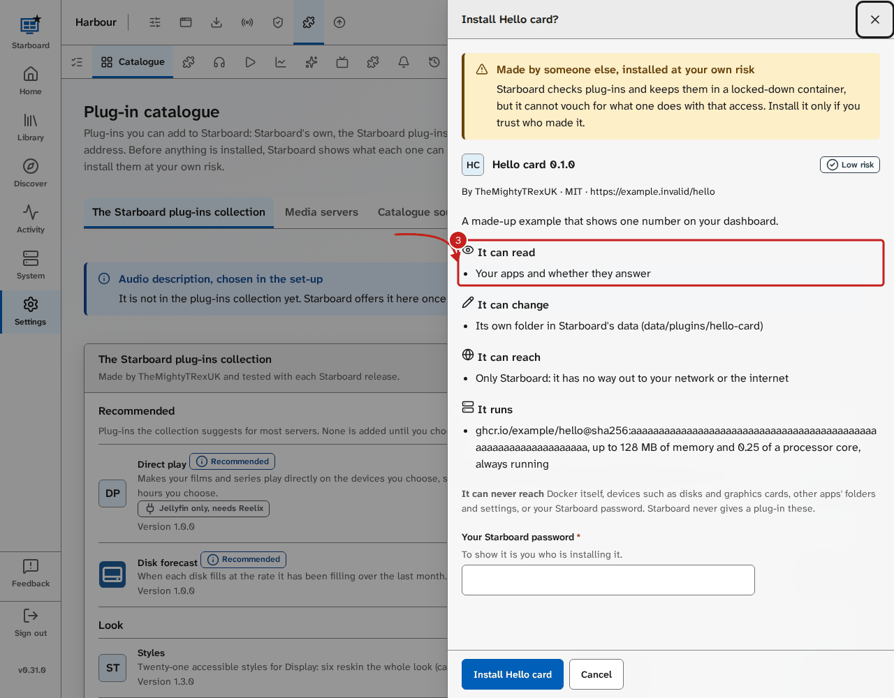
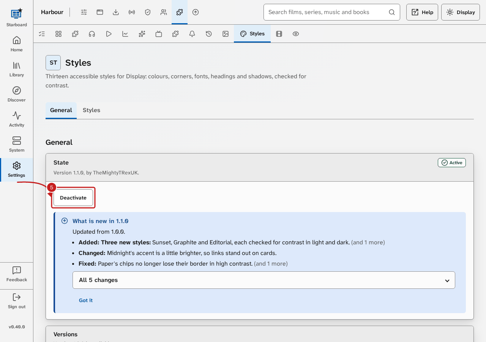
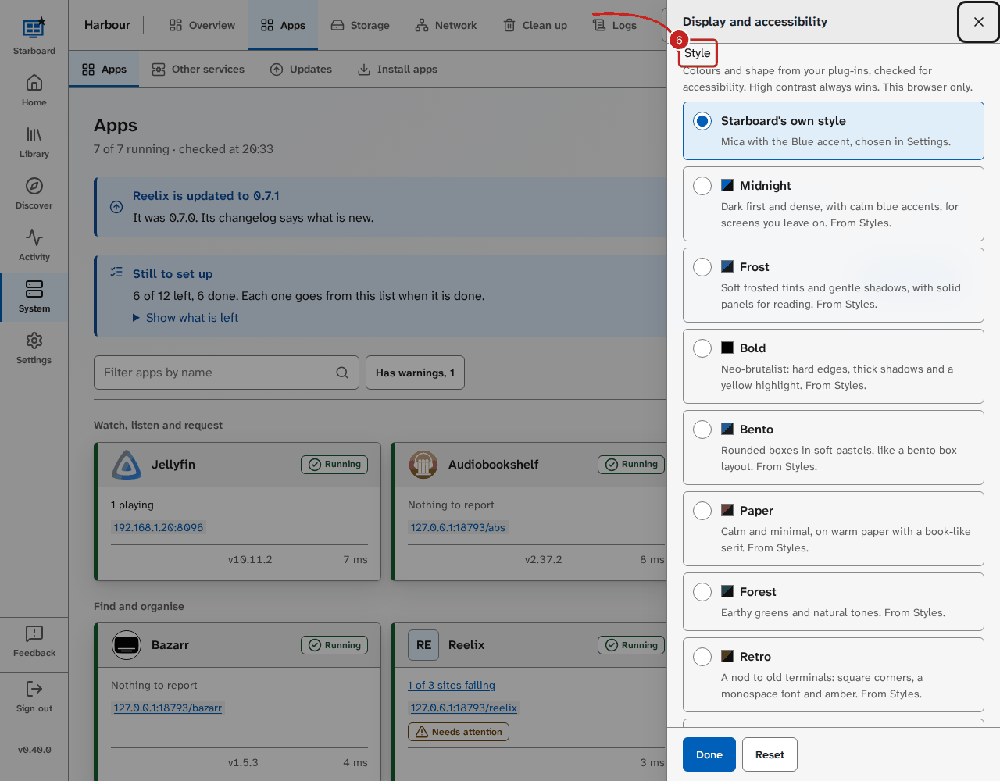
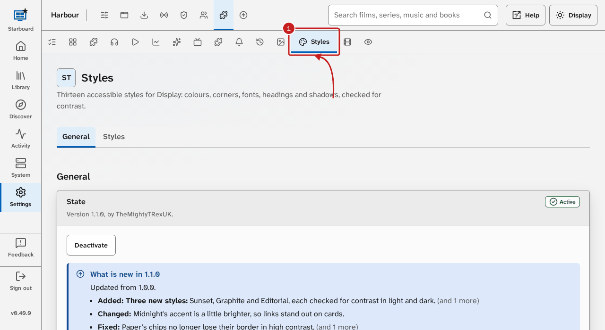
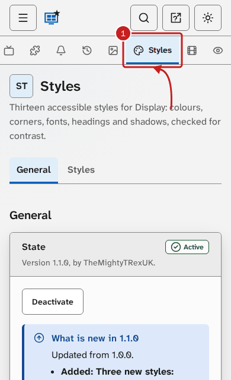
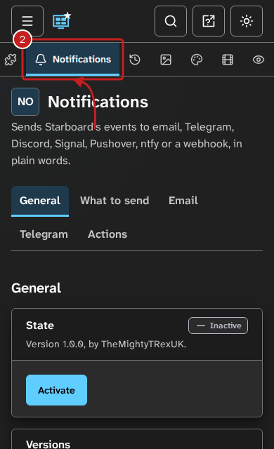
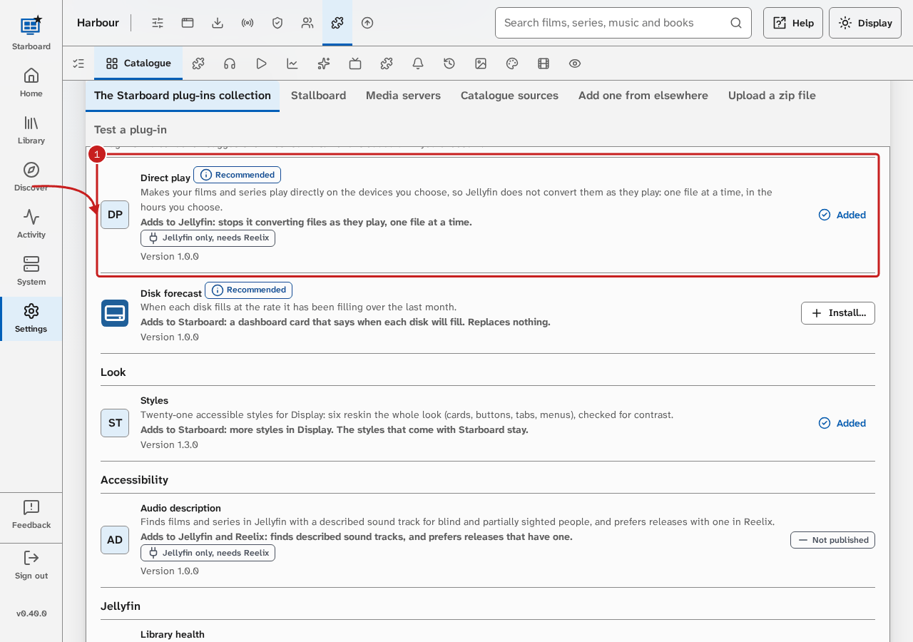
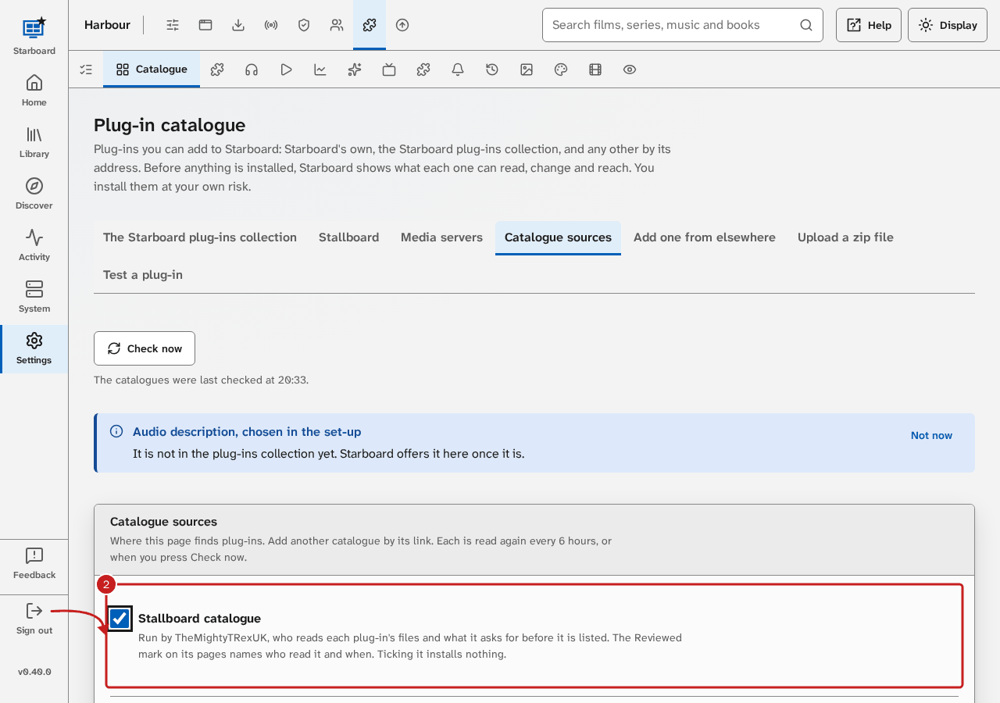
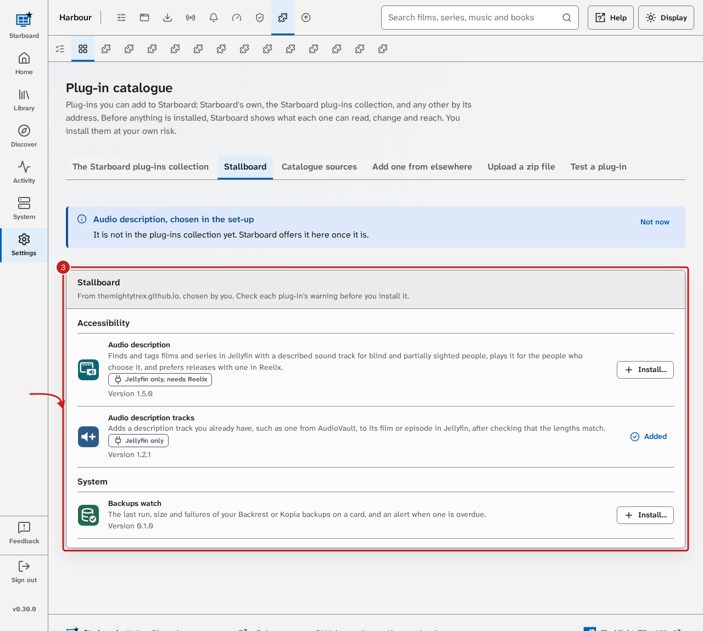
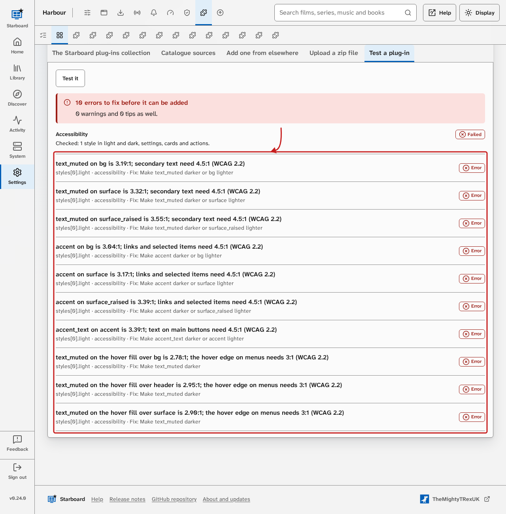

[Help centre](../README.md) · Plug-ins · how-to
<!-- help: plugins / adding -->

# Add a plug-in

Add a plug-in to give Starboard something new, such as Live TV or more styles to choose from. Before it adds
anything, Starboard shows what the plug-in may do and tests it. At the end, the plug-in is active and what it adds
is ready to use.

## Before you begin

- The plug-in is in the **Catalogue**, or you have its manifest address, its `starboard-plugin.json` file or its
  installer. Plug-ins you can add are also listed in [The plug-in collection](../basics/plugin-collection.md), and you can browse them in the [Stallboard plug-in store](https://themightytrex.github.io/stallboard/).
- You know your Starboard password. Adding and removing a plug-in ask for it.
- To understand what a plug-in can and cannot do first, read
  [What a plug-in can change](../basics/what-plugins-can-change.md).

## Steps

1. Go to **Settings**, then **Plug-ins**, then **Catalogue**. The catalogue lists the plug-ins built into
   Starboard, the Starboard plug-ins collection by kind, and the plug-ins in any catalogue you added.
2. Find the plug-in and select **Install…**. For a plug-in built into Starboard, select **Add** and its name.
   To add a plug-in that is not in any catalogue, use its address. Read
   [Add a plug-in by its address](#add-a-plug-in-by-its-address).
3. A slide-out opens. It says you install the plug-in at your own risk. Then it lists what the plug-in **can read**,
   **can change** and **can reach**, what it runs and what it can never reach. Read it all.

   

4. To go ahead, enter your Starboard password and select **Install** and the plug-in's name. To stop, select
   **Cancel**: nothing is installed.
5. The plug-in's own tab opens, under **Settings**, then **Plug-ins**. Starboard activates the plug-in, and its
   state is **Active**. A plug-in that needs settings first says what to enter. Save them, then select **Activate**.
   To stop it later, select **Deactivate** in **General**, **State**.

   

6. For a plug-in with styles: select **Display** in the header of any page, then choose a style under **Style**.
   The page changes straight away. You can also select **Use this style** on the plug-in's own tab. Read
   [Change text size, theme and other display settings](display-and-accessibility.md#choose-a-style-from-a-plug-in).

   

### Manage your plug-ins

**Settings**, then **Plug-ins**, then **Manage** lists every plug-in you added. Each one shows its state, **Settings**,
**Activate** or **Deactivate**, and **Remove**. Each plug-in also has its own tab after **Catalogue**. Its first
tab, **General**, has a card each for **State**, **Versions**, **Jobs** (when it has any), **What it may do** and
**Remove**. Its other tabs hold its settings, its own screens and its styles.

### Find a plug-in's tab by its icon

Each plug-in you add has its own tab in **Settings**, then **Plug-ins**, after **Catalogue**. Every tab has its own
icon, drawn in the same line style as the menu's other icons, such as a bell for **Notifications** and a palette for **Styles**.
A plug-in that has no icon of its own in Starboard shows a puzzle piece. On a phone, and whenever the names do not fit,
the tabs show icons only. The names are still there:

1. Select the icon. The tab you are on shows its name beside the icon, and the bar under it marks it as the current tab.
2. Move to a tab with the keyboard (press **Tab**). The tab with focus shows its name too.
3. On a computer, point at an icon to read its name as a tooltip. A screen reader reads the name of every tab.

Each tab is at least 44 pixels wide, the size of a fingertip. Scroll the row sideways to reach the rest.

### Check which system a plug-in needs

Some plug-ins work with one system only, such as a plug-in for Jellyfin. Starboard says so in words, next to the
plug-in's name, so you know before you install it. You can read the tag in three places:

- the **Catalogue**
- the list under **Settings**, **Plug-ins**, **Manage**
- the plug-in's own **General** tab, in the **State** card, on the **What it needs** line

1. In the **Catalogue**, find the tag under the plug-in's description, such as **Jellyfin only**, **Plex or Emby** or
   **Needs Reelix**.
2. When that system is not on this Starboard, a line under the tag says why, such as "Needs Jellyfin, which this
   Starboard does not use". You can still install the plug-in, for example to add Jellyfin next.
3. A plug-in you already installed whose system has gone says **Waiting** on its **General** tab and in **Manage**. It is not
   stopped, and it keeps its settings. It carries on when that system is back. **Ready to update** shows the same tag.

A plug-in's maker can name the system in its manifest. For older plug-ins Starboard works it out from what they may use,
such as Jellyfin's key. Read [The `requires` field](../developers/plugin-manifest-reference.md#what-it-needs-requires).

### Add the Stallboard catalogue

Stallboard is a second catalogue, run by TheMightyTRexUK, that lists plug-ins made by other people. Before a plug-in is listed, a person reads
its files and what it asks for. The **Reviewed** mark on Stallboard's own pages names who read it and when. The
catalogue is off until you tick it. Ticking it installs nothing, and each plug-in still shows what it asks for before
you install it.

1. Go to **Settings**, then **Plug-ins**, then **Catalogue**.
2. Under **Catalogue sources**, tick **Stallboard catalogue**. Starboard says "Stallboard catalogue added".
3. Open the new **Stallboard** tab, which lists its plug-ins by kind. Select **Install** next to one to read its warning.

To stop reading it, clear the tick. Plug-ins you already installed from it stay. Starboard reads it at most once a day,
like any other catalogue.

### Add a catalogue from a link

A catalogue is a list of plug-ins that someone publishes as one file, `catalogue.json`. Add one, and its
plug-ins show on the **Catalogue** page next to the Starboard plug-ins collection. Adding a catalogue installs
nothing: each plug-in still shows its warning before it is installed.

1. On the page of the person or project that makes the plug-ins, copy the catalogue's address. It starts with
   `https://` and usually ends with `catalogue.json`, such as
   `https://raw.githubusercontent.com/TheMightyTRex/starboard-plugins/main/catalogue.json`.
2. Go to **Settings**, then **Plug-ins**, then **Catalogue**.
3. Under **Catalogue sources**, paste the address into **Catalogue address**, then select **Add catalogue**.
   Starboard reads it and says how many plug-ins it lists.
4. Its plug-ins appear in their own section of the Catalogue, named after the catalogue.

Starboard reads each catalogue at most once a day. To take one off, select **Remove** next to it under
**Catalogue sources**. Plug-ins you already installed from it stay. The Starboard plug-ins collection is always
there and cannot be removed. Starboard reads 10 catalogues at most.

Only add catalogues from people you trust. Starboard did not make the plug-ins in them.

### Add a plug-in by its address

On the **Catalogue** page, under **Add one from elsewhere**, paste the address of the plug-in's
`starboard-plugin.json` into **The plug-in's manifest address**. Or choose the file in **Or its manifest file**.
Select **What it does**, read the test results, then select **Install** and its name. Carry on from step 3.

### From a zip file

A private plug-in, such as On demand, comes as a zip file instead of an address. On the **Catalogue** page, under
**Upload a zip file**, choose the zip and select **Check the zip**. Read
[Add a plug-in from a zip file](add-a-plugin-from-a-zip-file.md).

### With the plug-in's own installer

Some plug-ins come with an installer. Run it on any computer with Python, such as `python3 install.py`, and enter
your Starboard's address, such as `http://192.168.1.20:8095`. Your browser opens the **Catalogue** page with the
plug-in already shown under **Add one from elsewhere**. Select **Install** and its name, then carry on from step 3.

## Test a plug-in

If you make plug-ins, test one before you share it. In **Settings**, then **Plug-ins**, then **Catalogue**, under **Test a plug-in**,
choose its `starboard-plugin.json` and select **Test it**. Starboard lists every issue with where it is, what is wrong and
how to fix it. Accessibility is always tested: every style in light and dark, and the words people read.

## Things to note

- Styles apply to the browser you choose them in, like the rest of **Display**.
- Some plug-ins add cards to the dashboard. Read [Use and change the dashboard](use-the-dashboard.md).
- **High contrast**, text size, wider spacing, underlined links and reduced motion always win over a style.
- **Remove** and the plug-in's name stops the plug-in and its containers, and stops its key working. Its folder
  is kept in `data/plugins/.removed`, so you decide when to delete it.
- **Deactivate all plug-ins** deactivates every active plug-in at once, if something goes wrong.

## If it does not work

- **"This plug-in cannot be added":** read the test results under it. The plug-in's maker needs to fix each error.
- **"That is not a plug-in catalogue":** the address is not a `catalogue.json`. Check you copied the catalogue's
  address, not the address of its web page.
- **"This catalogue did not answer":** Starboard shows the list from the last time it did, and tries again the
  next day.
- **"Starboard has no access to Docker here":** plug-ins that run containers need Docker access. Read
  [Change what Starboard can access](change-what-starboard-can-access.md). Plug-ins with only styles do not.
- **A style does not change anything:** check that **High contrast** is inactive in **Display**, and that the
  plug-in is **Active**.

## Find out more

- [Add a plug-in from a zip file](add-a-plugin-from-a-zip-file.md)
- [Write a plug-in](../basics/write-a-plugin.md)
- [What a plug-in can change](../basics/what-plugins-can-change.md)
- [The plug-in collection](../basics/plugin-collection.md)
- [How Starboard keeps your server safe](../basics/how-starboard-keeps-you-safe.md)

<!-- footer: download rights -->

---

**Download only what you have the right to.** Use the download apps only for files you have the right to download.
Examples are open-source software, works in the public domain and your own backups. Downloading films, series, music or
books without the copyright holder's permission is against the law in the UK and most other countries. Starboard
does not host or provide any files, and you are responsible for what you download.

**Need help?** Ask on the [Starboard Discord support server](https://discord.gg/xN9bf2H4vv).

<!-- /footer -->
