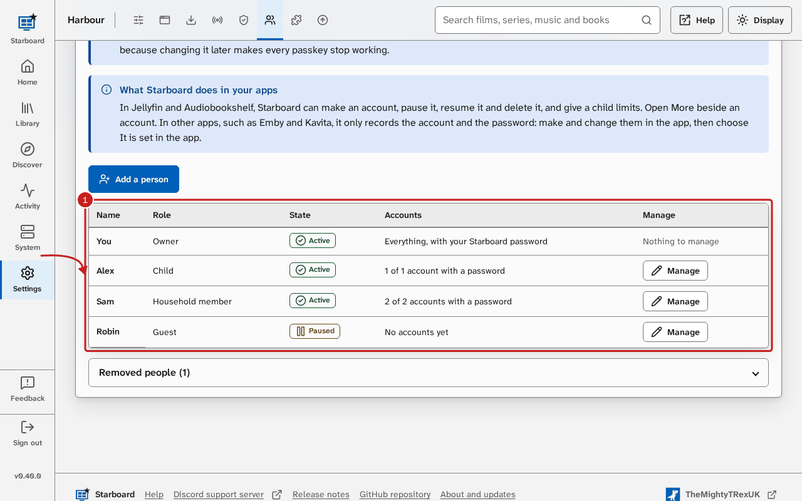
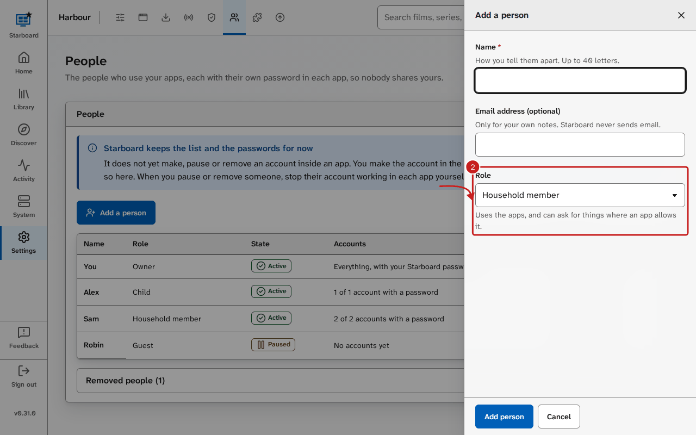
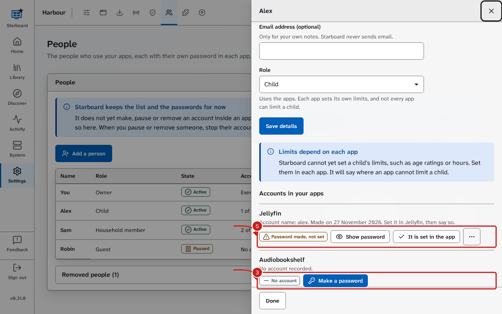
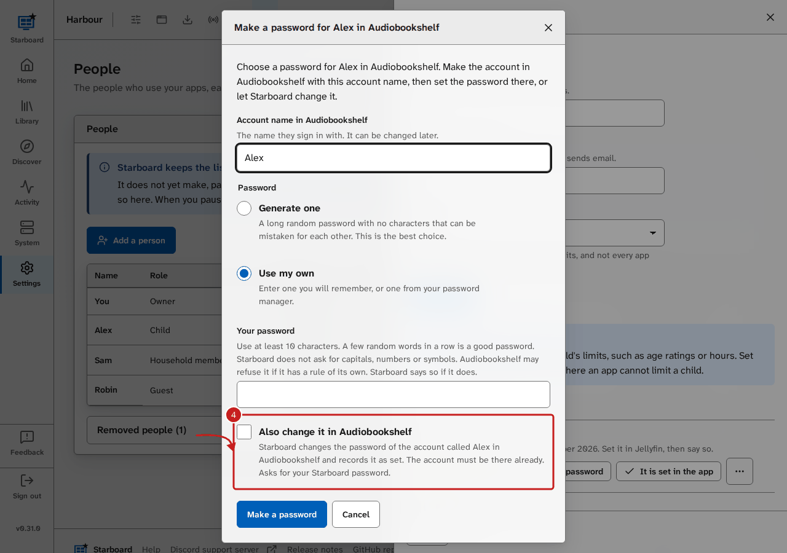
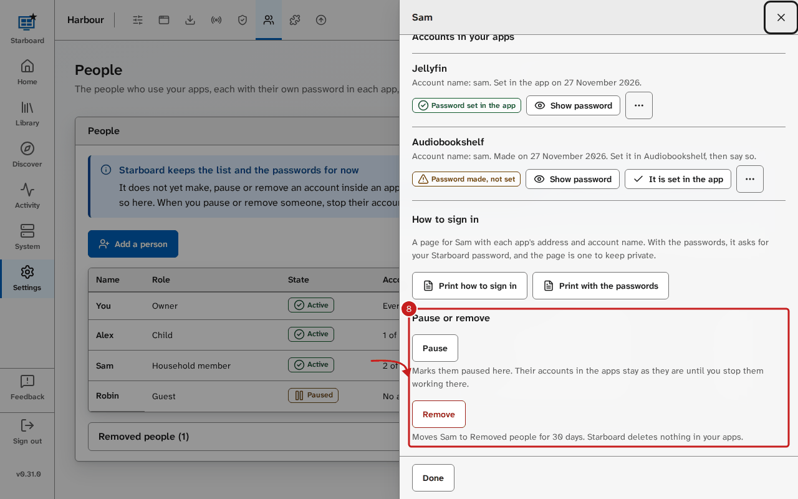

[Help centre](../README.md) · Apps · how-to
<!-- help: use / apps -->

# Add the people who use your apps

**People** lists everyone who uses your apps, such as your family and guests. For each person and each app, Starboard
makes a long password that no one else has. Nobody has to share your password or a weak one.

Starboard stays yours alone. People cannot sign in to Starboard or open it. They use your apps, such as
Jellyfin and Audiobookshelf, and Starboard keeps the list.

Starboard does not yet make, pause or remove an account inside an app. You make the account in the app, set the
password Starboard made, and tell Starboard you did. A later version will do this for you.

## Before you begin

- Add the apps people use in **Settings**, then **Manage apps**, such as Jellyfin, Audiobookshelf, Kavita or Navidrome.
  Download apps and tools are never listed, because only you use them.
- Have your Starboard password ready. Starboard asks for it each time you show a password.
- Have a password manager ready, or a pen and paper. Starboard shows each password only when you ask.

## Steps

1. Go to **Settings**, then **People**. The first row is you, the owner, and you do not need to change it.

   

2. Select **Add a person**. Enter a **Name**, choose a **Role** and select **Add person**. The email address is
   optional and is only for your own notes: Starboard never sends email.

   

3. Select **Manage** on the person's row. Under **Accounts in your apps**, find the app and select **Make a password**.

   

4. Check the **Account name**, which is the name the person signs in with. Then choose the password:
   - **Generate one** is the best choice: a long random password.
   - **Use my own** lets you enter your own, of at least 10 characters. Starboard asks for nothing else, no capitals, numbers or symbols, because a longer password is stronger than a complicated short one. A few random words in a row is a good password.
   - For Jellyfin, Emby and Audiobookshelf, tick **Also change it in the app**. Starboard then changes the password of the account in the app for you, and records it as set. The account must be there already, and Starboard asks for your Starboard password first.

   

5. Select **Make a password**. Then select **Show password**, enter your Starboard password and select **Show password**. Select **Copy**. In the app, make the account with that name and set the password. Skip this if you ticked **Also change it in the app** and the account was already there.
6. Back in Starboard, select **It is set in the app**. The account now says **Password set in the app**, so you know which accounts are done.
7. To give the person their details, select **Print how to sign in**. The page lists each app's address and the
   account name. **Print with the passwords** asks for your Starboard password first. Keep a page with passwords
   private, and throw it away once the passwords are in a password manager.
8. To stop someone using your apps, select **Manage** and use **Pause or remove**. The last section says what each choice does.

   

## Reset a password

1. Select **Manage** on the person's row, then select **More** beside the app, then **Reset the password**.
2. Choose **Generate one** or **Use my own**, and tick **Also change it in the app** where it is offered.
3. Enter your Starboard password. Starboard always asks for it before it replaces a password.
4. Select **Reset the password**. Starboard forgets the old password. If you did not tick **Also change it in the app**, the old password stays right in the app until you set the new one there, so set it and then select **It is set in the app**.

For other apps, such as Kavita, Starboard has no way to change a password, so the page says so. Change it in the app, then select **It is set in the app**. Starboard only records it.

## Pause, remove or put back

- **Pause** marks a person as paused, such as when they are away. Starboard does not change their accounts. Stop them working
  in each app.
- **Remove** moves the person to **Removed people** for 30 days. Starboard keeps the record and the passwords in case
  it was a mistake, and changes nothing in your apps. Stop their accounts working in each app yourself.
- **Put back** brings a removed person back, with their accounts as they were.
- **Forget for good** is possible after 30 days. It asks for your Starboard password, and deletes the record and
  every password Starboard kept for the person. It does not delete anything in your apps, such as what they watched
  or read.

## Things to note

- **Roles** are for your own sorting for now. A **Child** has no limits yet, because each app sets its own, such as an age
  rating. Set them in the app. Starboard will say where an app cannot limit a child, so you do not think a child is
  protected where they are not.
- A generated password has 24 letters and numbers, with none that could be mistaken for another, such as the letter O and the number 0. Each
  person has a different password in each app.
- A password you enter must have at least 10 characters. Jellyfin and Audiobookshelf set no minimum of their own, and Kavita needs at least 6, so 10 suits all three. For any other app, Starboard does not know the rule, so the app may still refuse a password, and Starboard says so.
- Starboard changes a password in an app with the app's own admin key. It was written from the apps' documentation and has not yet been tried against a real Jellyfin, Emby or Audiobookshelf. Emby's own documentation does not say what its change needs, so after the first change in any app, check that the person can sign in.
- Starboard keeps the passwords in a file only Starboard can read, in its data folder. They are never in a Settings
  backup, a log, an address or an error message. A full backup keeps them, as it keeps your apps' keys.
- Starboard keeps up to 50 people.
- Nothing runs in the background for this page. Starboard reads the list when you open the page or change a person.
- When you reset a password, Starboard forgets the old one.
- If you set a password in an app and Starboard does not know, select **It is set in the app** so the page is right.

## Find out more

- [Add an app](add-an-app.md)
- [Change your password](change-your-password.md)
- [Use Starboard's API](use-starboards-api.md)

<!-- footer: download rights -->

---

**Download only what you have the right to.** Use the download apps only for files you have the right to download.
Examples are open-source software, works in the public domain and your own backups. Downloading films, series, music or
books without the copyright holder's permission is against the law in the UK and most other countries. Starboard
does not host or provide any files, and you are responsible for what you download.

**Need help?** Ask on the [Starboard Discord support server](https://discord.gg/xN9bf2H4vv).

<!-- /footer -->
