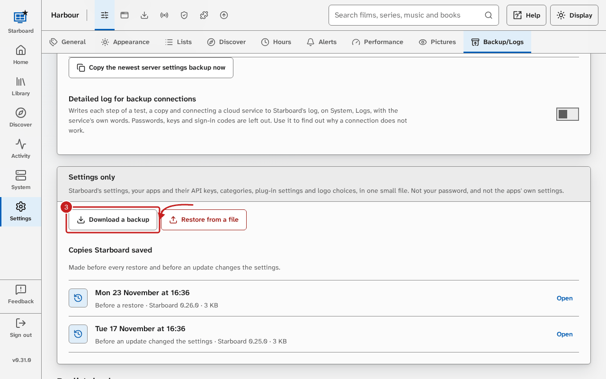
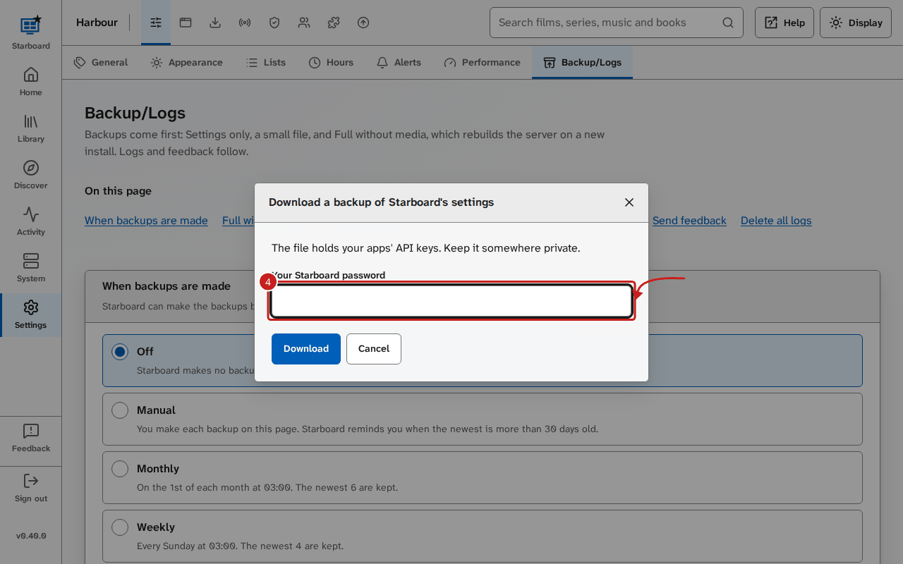
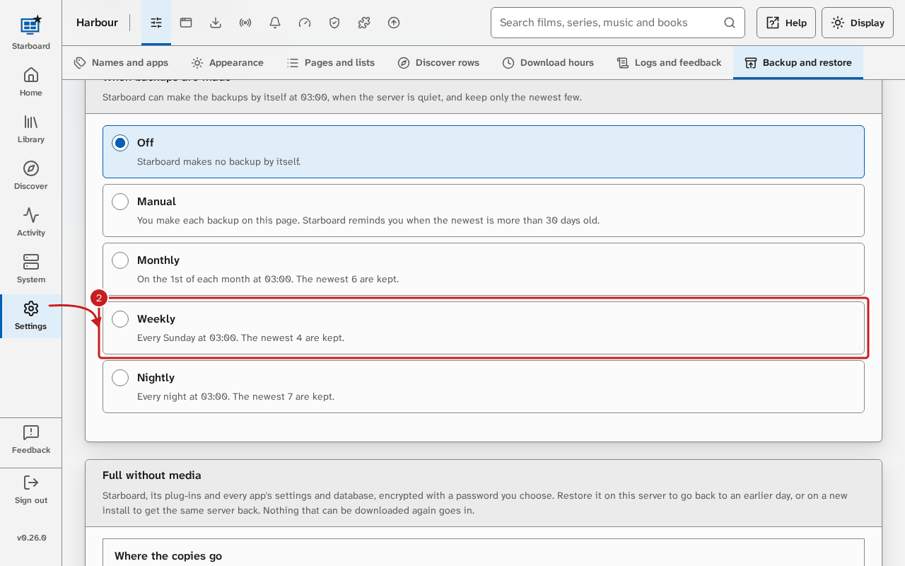

[Help centre](../README.md) · Backup and restore · how-to
<!-- help: use / backups -->

# Back up and restore Starboard's settings

Download Starboard's settings as one file, and put them back from that file later. The file holds your
apps, their API keys, your categories and your other settings.

## Before you begin

- You know Starboard's password. Starboard asks for it before every download and every restore.

## Steps

### Download a backup

1. Go to **Settings**, then **General**, then **Backup/Logs**.
2. Find **Starboard's settings**.
3. Select **Download a backup**.

   

4. Starboard asks for **Your password**. Enter it and select **Download**.

   

Your browser saves a file named like `starboard-settings-2026-11-03.json`, with the date you made it.
Starboard shows "Backup downloaded" and how many apps it holds.

### Restore from a file

1. Go to **Settings**, then **General**, then **Backup/Logs**.
2. In **Starboard's settings**, select **Restore from a file**.
3. Choose the backup file you downloaded.
4. Starboard asks **Restore Starboard's settings?** and says how many apps the file holds and when it was
   made. Enter **Your password** and select **Restore settings**.

Starboard shows **Settings restored** and how many apps it put back.

### Choose when backups are made

1. Go to **Settings**, then **General**, then **Backup/Logs**.
2. Under **When backups are made**, choose one. It saves at once and Starboard shows "Saved".

   

| Choice | What Starboard does |
|---|---|
| **Off** | Makes no backup by itself. |
| **Manual** | You make each backup on the page. Starboard reminds you when the newest is more than 30 days old. |
| **Monthly** | On the 1st of each month at 03:00. The newest 6 are kept. |
| **Weekly** | Every Sunday at 03:00. The newest 4 are kept. |
| **Nightly** | Every night at 03:00. The newest 7 are kept. |

If the server was off at the time, Starboard makes the backup once when it starts again: a nightly or weekly one
up to a day late, and a monthly one at any time before the next 1st.

## Things to note

- The backup holds your apps' API keys. Keep the file somewhere private, such as a USB stick you keep at
  home, and do not share it.
- The backup never holds your password or anyone's sign-in. A restore leaves both as they are.
- A restore replaces all your apps, categories and settings with the ones in the file.
- Before every restore, Starboard saves a copy of the settings you had. To go back, read
  [Restore a saved copy of your settings](restore-a-saved-copy.md).
- You can restore a backup made by an older version of Starboard. Starboard brings it up to date as it
  restores: a choice that no longer exists goes back to its default, and an app of a kind Starboard no
  longer knows becomes a plain link.
- This backup covers Starboard only, not your other apps or your media. For the whole server, read
  [Back up the whole server](back-up-the-server.md).
- To keep a copy of each full backup somewhere else, such as Google Drive, OneDrive or your own Nextcloud, read
  [Copy backups to a cloud service](copy-backups-to-a-cloud-service.md).
- If Starboard installed Reelix, **Reelix's backups** on the same page makes and restores Reelix's own
  backups. Starboard asks for Reelix's password first. Read [Reelix's own backups](reelix-backups.md).
- To go back to an earlier day on this server, apps and all, read
  [Make and restore a full backup](make-and-restore-a-full-backup.md).

## If it does not work

- **"That password is not right":** check Caps Lock and enter it again.
- **"That file is not a Starboard backup":** choose the file you downloaded with **Download a backup**. It
  ends in `.json`.

## Find out more

- [Restore a saved copy of your settings](restore-a-saved-copy.md)
- [Move Starboard to a new computer](../guides/move-starboard-to-a-new-computer.md)
- [Back up the whole server](back-up-the-server.md)
- [Make and restore a full backup](make-and-restore-a-full-backup.md)
- [Copy backups to a cloud service](copy-backups-to-a-cloud-service.md)
- [What an API key is](../basics/what-is-an-api-key.md)

<!-- footer: download rights -->

---

**Download only what you have the right to.** Use the download apps only for files you have the right to download.
Examples are open-source software, works in the public domain and your own backups. Downloading films, series, music or
books without the copyright holder's permission is against the law in the UK and most other countries. Starboard
does not host or provide any files, and you are responsible for what you download.

**Need help?** Ask on the [Starboard Discord support server](https://discord.gg/xN9bf2H4vv).

<!-- /footer -->
