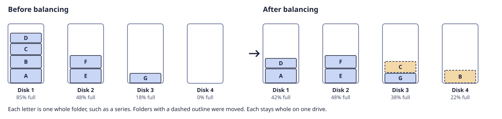
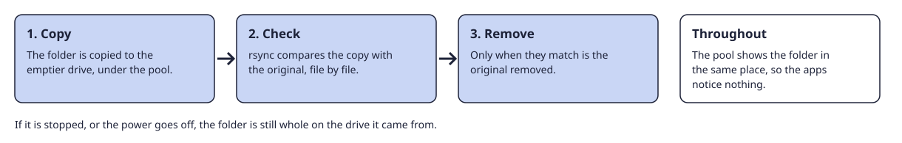
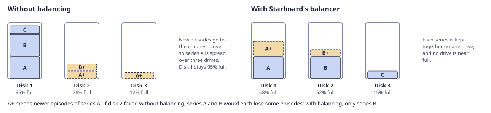

[Help centre](../README.md) · Your server · how-to

# Balance the files

Balancing moves whole folders, such as a series, from fuller drives to emptier ones in the pool. The pool shows
every file in the same place all the time, so the apps notice nothing.

## Before you begin

- The pool has two drives or more. Read [Add a drive to the pool](add-a-drive-to-the-pool.md).
- Have your Starboard password ready.
- Balancing can take hours: about 1 hour for each 280 GB moved. It runs at low priority, so films still play.

## Steps

1. Go to **System**, then **Storage**, then **Pool**.
2. Select **Balance the files**.
3. Under **Balancer**, select **Starboard's balancer (recommended)**.
4. Leave **Pause during download hours** selected to keep the drives free for downloads at those times. Read
   [Set download hours](set-download-hours.md).
5. Select **Continue to Check**. Nothing moves yet.
6. Read the check: each drive before and after, and the folders it moves.
7. Select **Continue to Confirm**, enter your Starboard password and select **Start balancing**.
8. Wait, or go back to the Pool page. **Last change** shows how many folders have moved. To stop, select
   **Stop after this folder**.

## How it works

Each folder is copied to the emptier drive, checked against the original, then removed from the fuller one:

- The balancer moves the biggest folder that fits from the fullest drive to the emptiest one. It stops when
  every drive is within 5 percentage points of the same fill, or no folder fits.
- A folder is three levels down in the pool, such as `media/tv/A series`. Loose files higher up move on their
  own.
- Folders changed in the last hour stay where they are, because a download may still be writing them.
- If it is stopped, or the power goes off, the folder being moved is still whole on the drive it came from.
  Folders already moved stay moved.

## What happens without balancing

The pool works without balancing. New files go to the drive with the most free space, so the drives even out
slowly. Until they do:

- **A series ends up on several drives.** If one drive fails, many series lose a few episodes each, instead of a
  few series being lost whole, which a parity drive can rebuild.
- **The old drives stay nearly full.** A drive over 90% full is slower, and files that grow may have nowhere to
  go on it.
- **One drive does most of the work**, because every new file goes to it.

## mergerfs.balance

`mergerfs.balance` is a balancer from the mergerfs-tools project. It is not installed with Starboard. It moves
single files until the drives are even, so a series can end up spread over several drives, and it has no check
before it starts. To use it, install it from the [mergerfs-tools project](https://github.com/trapexit/mergerfs-tools),
then select it under **Balancer**.

## If it does not work

- **Nothing needs moving:** the drives are already within 5 percentage points of each other.
- **No Balance the files button:** the pool has only one drive.
- **Some folders were left where they were:** they changed while being moved, or the same folder was already on
  the other drive. Balance again later.
- **It is paused:** it is download hours. It carries on when they end.

## Find out more

- [Add a drive to the pool](add-a-drive-to-the-pool.md)
- [Take a drive out of the pool](take-a-drive-out-of-the-pool.md)
- [What a drive pool is](../basics/what-is-a-drive-pool.md)

<!-- footer: download rights -->

---

**Download only what you have the right to.** Use the download apps only for files you have the right to download,
such as open-source software, works in the public domain and your own backups. Downloading films, series, music or
books without the copyright holder's permission is against the law in the UK and most other countries. Starboard
does not host or provide any files, and you are responsible for what you download.

<!-- /footer -->
