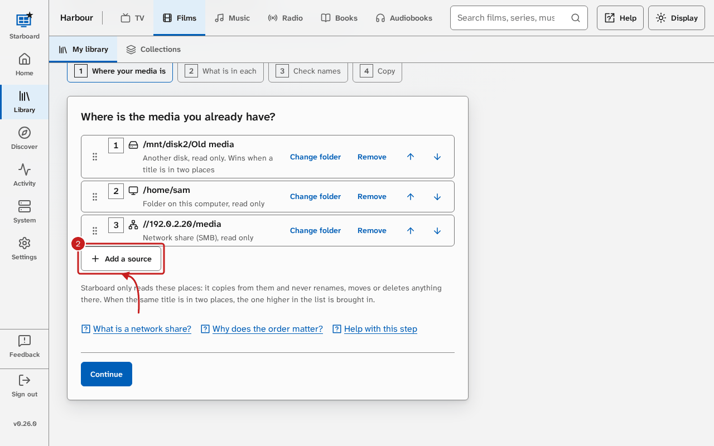
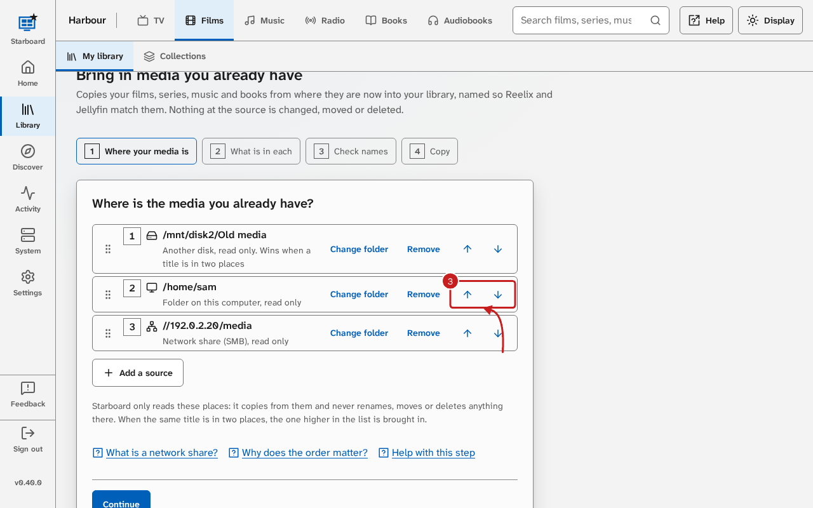
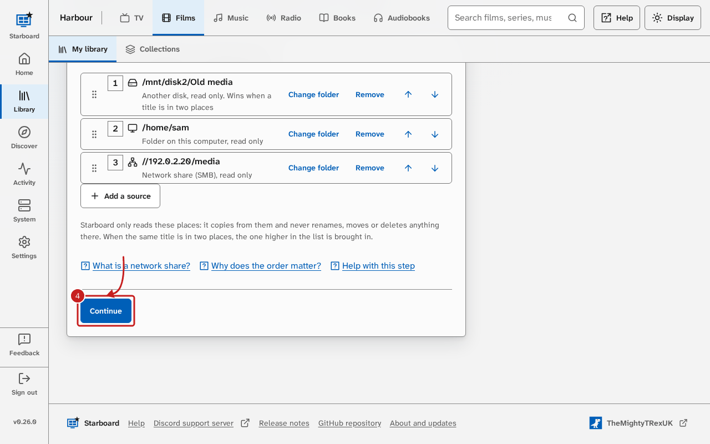

[Help centre](../README.md) · Library · how-to
<!-- help: start / move -->

# Bring in media you already have

**Bring in media** copies the films, series, music, books and audiobooks you already have into Starboard's media
folder. It tidies and names them so that Reelix and Jellyfin match them. It reads from folders on this computer,
another disk, a network share, OneDrive or Google Drive. Starboard only reads your media where it is now. It never
renames, moves or deletes it.

You can do it as you set up Starboard. This is an optional step, after you choose where your media goes. Or do it
later from **Library**, **Bring in media**, or **Still to set up** on the dashboard.

## Before you begin

- Your media folder has room for the copies. Starboard says how much space is needed before it copies anything.
- For a network share, you know its address and, if it needs them, a user name and password. A Windows computer or
  a NAS uses an address such as `//192.0.2.20/media`. NFS uses an address such as `192.0.2.20:/export/media`.

## Steps

1. Go to **Library**, then select **Bring in media**. In the set-up, the step comes after **Storage**.
2. **Where your media is:** select **Add a source**. Choose a place: **This computer**, one of your disks, a
   network share, **Another network share** to add one, or OneDrive or Google Drive. Open folders until you reach the
   one with your media, then select **Use this folder**. Each folder shows its size and what is in it.

   

3. Add every place your media is in. Put them in order with **Move up** and **Move down**. If the same title is
   in two places, Starboard brings in the one higher in the list. Select **Continue**.

   

4. **What is in each:** Starboard checks inside each place and counts the films, series, music, books and
   audiobooks it finds. If it is wrong about a folder, change it in **Change** beside that folder, or for the whole
   place in **Everything in it is**. Select **Continue**.

   

5. **Check names:** each title has its new name and place, checked with Reelix. They are in three lists:
   - **Matched:** ready to copy.
   - **Needs attention:** choose the right match, or **Leave it where it is**, then select **Save**.
   - **Left where it is:** with why, such as a sample, a second copy, or not media.
   Under them, the space needed and what is free. Select **Continue**.
6. **Copy:** check the table, then select **Start copying**. (In the set-up, the copy starts once the apps are
   running.)
7. The copy runs in the background. Its progress is on the dashboard and in **Activity**, **Downloads**. Select
   **Pause** to stop it for now and **Carry on** to go on. When it finishes, the report lists what Starboard copied,
   what needs attention and what it left where it is, each with what to do. Select **Got it**.

## How files are named and placed

- Films: **Films**, `Title (Year)/Title (Year).mkv`.
- Series: **Series**, `Title (Year)/Season 01/Title - S01E01.mkv`.
- Music: **Music**, by artist and album. Books and audiobooks: by author and title.

Subtitles, artwork and `.nfo` files go with their film or episode. Samples, extras, system files and leftovers
such as `thumbs.db`, `.txt` and `.url` files stay where they are. Once copied, Reelix adds each title to your
library and gives every file Reelix's own name.

## Things to note

- **Nothing at your sources changes.** Shares are connected read only and folders are only read. Taking a place
  off the list changes nothing there either.
- **Exact copies are brought in once.** When two files are the same, Starboard copies one and lists the other under
  **Left where it is**.
- **A title already in your library** is left where it is, and a file already in the media folder is never
  written over.
- **Space:** Starboard checks the space before copying and again as it goes, and always keeps 10 GB free. If the
  disk fills up, the copy stops cleanly: free some space, then select **Carry on**.
- **It goes gently.** The copy runs at the lowest priority, one at a time, so your server stays quick. It carries
  on where it was after a restart.
- **Link films and series on the same disk instead of copying them** is off to start with. When it is on, Starboard links a film or
  episode on the same disk as your media folder instead of copying it, so it uses no extra space. The library file is
  then the same file as the original, so anything that changes the file's contents changes the original too. Music,
  books and audiobooks are always copied, so their originals never change. On a pool whose disks are different, a
  link cannot be made and the file is copied instead; the report says so.
- **OneDrive and Google Drive:** choose one as a place and sign in. Starboard asks only to read your files, and never
  receives your password. For OneDrive, choose **Complete on the phone** (when it is offered) or **Complete in this
  browser**. For Google Drive, only **Complete in this browser** works. Google lets apps read the files you already have
  only when you sign in in a browser. The files are copied down to a folder on your media disk first, so they need
  twice their space until you remove that folder. At the end it is moved to `.starboard-holding` in your media folder,
  and the report says where.

## Find out more

- [Install apps with Starboard](install-apps.md)
- [Move from Radarr, Sonarr and the others to Reelix](move-your-apps-to-reelix.md)
- [Check free space and what is using it](check-storage.md)

<!-- footer: download rights -->

---

**Download only what you have the right to.** Use the download apps only for files you have the right to download,
such as open-source software, works in the public domain and your own backups. Downloading films, series, music or
books without the copyright holder's permission is against the law in the UK and most other countries. Starboard
does not host or provide any files, and you are responsible for what you download.

**Need help?** Ask on the [Starboard Discord support server](https://discord.gg/xN9bf2H4vv).

<!-- /footer -->
