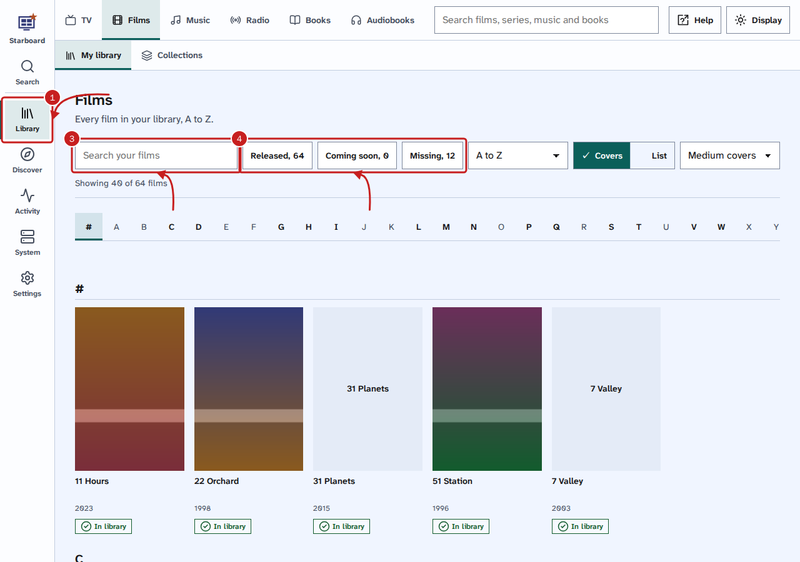
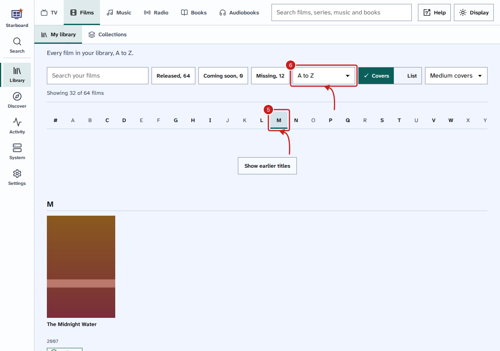
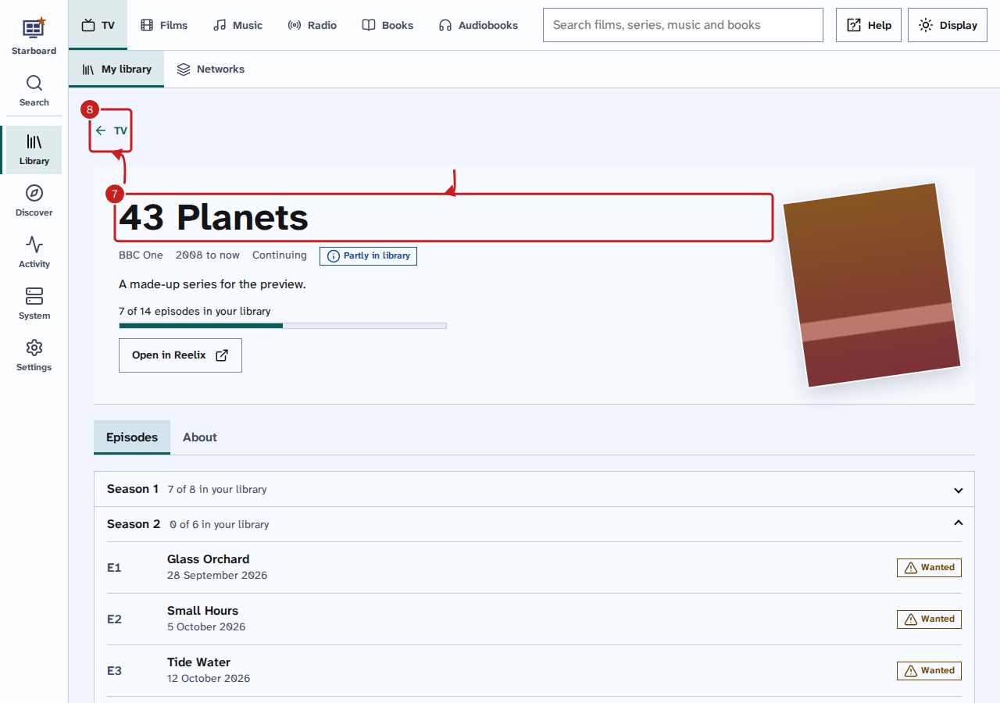
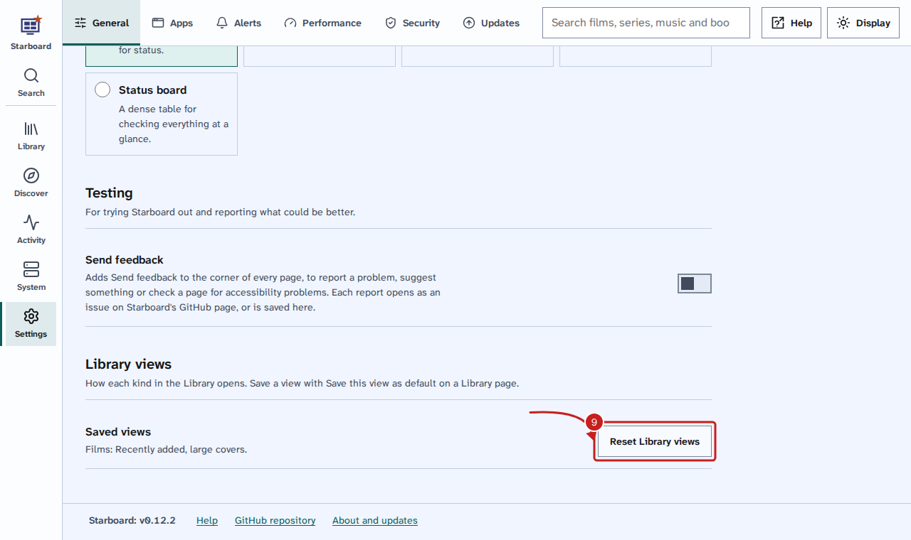

[Help centre](../README.md) · Everyday use · how-to

# Browse your library

The Library shows everything Reelix holds: TV, films, music, radio, books and audiobooks. Each kind has a wall of
covers with an A to Z list, and each film, series, artist, show or book has its own page with its episodes,
albums or reading order.

## Before you begin

- Reelix is in Starboard with its key. Install apps adds it for you. Read [Install apps](install-apps.md).
- To mark titles as watched, Jellyfin is in Starboard with its key.

## Steps

1. Select **Library** in the side menu, or in the menu on a phone.
2. Choose a kind in the menu along the top: **TV**, **Films**, **Music**, **Radio**, **Books** or **Audiobooks**.
   **My library** shows them all as covers, A to Z.
3. Optional: to find one title, type part of its name in **Search your films** (or series, books and so on).
   The wall shows only what matches as you type.
4. Optional: to show only some, select a filter, such as **Missing** or **Coming soon**. Each filter says how many it
   holds. Select it again to show everything.

5. Optional: to jump to a letter, select it in the row of letters, such as **M**. Letters with
   nothing under them are greyed out and cannot be selected.
6. Optional: to change the order, choose **A to Z**, **Recently added** or **Year** in the sort list. Choose
   **Covers** or **List**, and **Small covers**, **Medium covers** or **Large covers**.

7. Select a title to open its page. It shows the name, what it is, how much of it you have, and:
   - **Episodes** for a series or radio show, with each one's number, date and whether you have it. A series
     with more than one season shows each season on its own, with how many of its episodes you have. The newest
     season is open; select another season's name to open it.
   - **Reading order** for a book in a series.
   - **Albums** for an artist.
   - **Collection** for a film in a collection.
   - **About**, with the details Reelix knows.
8. To go back, select the back link with the kind's name, such as **Films**.

### Get, follow or delete a title

A title's page has buttons for what Reelix can do with it. Each one shows only when it applies.

- **Get it**, or **Get the missing episodes** for a series: Reelix searches for it now. A season you do not
  have all of has **Get the** number **missing**.
- **Choose a download**, for a film you do not have or a season: Reelix lists what its sites have, best first.
  Select **Get this one**. A copy Reelix turned down says why, and has **Get it anyway**.
- **Follow** or **Stop following**: whether Reelix keeps looking for new episodes, releases or books.
- **Watched** or **Not watched**: from Jellyfin. Select it to change it, for a title, a season or an episode.
  It shows only when Jellyfin has the title.
- **Delete**: Reelix stops following the title and takes it out of your library. Tick **Delete its files too**
  to remove the files as well.

## Keep your favourite view

When you change the order, the layout, the cover size or a filter, **Save this view as default** appears. Select
it, and that kind always opens that way, on any device you sign in from. To go back to A to Z with medium covers,
go to **Settings**, then **General**, and select **Reset Library views**.

## Things to note

- To add something new, use **Search**: it looks in your library first, then finds what you do not have yet.
  Read [Search for and add films, series, music and books](search-and-add.md).
- **Networks**, **Collections**, **Stations**, **Series** and **Authors** group the same titles another way.
  Select a group to show its titles on the wall.
- Something added in the last few minutes may take a moment to appear. Starboard reads the list again from
  Reelix when it is more than five minutes old.
- Covers come through Starboard, so your browser never contacts the image sites. To show plain tiles instead,
  go to **Settings**, then **Performance**, activate **Advanced settings**, and deactivate **Posters on Coming up
  and the Library**.
- With the keyboard, Tab reaches the letter row once. Use the arrow keys to move along the letters, and Enter to
  jump. The page moves to that letter's heading.

## If it does not work

- **Add Reelix with its key first:** Starboard has no Reelix with a key. Install Reelix with
  [Install apps](install-apps.md), or add it in **Settings**, then **Apps**, then **Manage apps**, with its key.
  Read [Find an app's API key](find-an-api-key.md).
- **Showing what Starboard read last time:** Reelix did not answer the last time Starboard asked. The page shows
  the list from before, and Starboard tries again in a few minutes. Check that Reelix is running on the **Apps**
  page.
- **There are no films in Reelix yet** (or series, books and so on): Reelix holds none of that kind. Find some with
  **Search** and add them.
- **A cover shows only the title:** the image site did not send a picture, or covers are inactive.
- **Reelix could not search** in **Choose a download**: read the message under it. Check that Reelix has sites
  to search. Read [Choose the sites Reelix searches](choose-sites-to-search.md).

## Find out more

- [Search for and add films, series, music and books](search-and-add.md)
- [Follow radio shows and podcasts](follow-radio-shows.md)
- [Find out what is coming up](coming-up.md)
- [Find and get what is missing](get-what-is-missing.md)

<!-- footer: download rights -->

---

**Download only what you have the right to.** Use the download apps only for files you have the right to download,
such as open-source software, works in the public domain and your own backups. Downloading films, series, music or
books without the copyright holder's permission is against the law in the UK and most other countries. Starboard
does not host or provide any files, and you are responsible for what you download.

<!-- /footer -->
