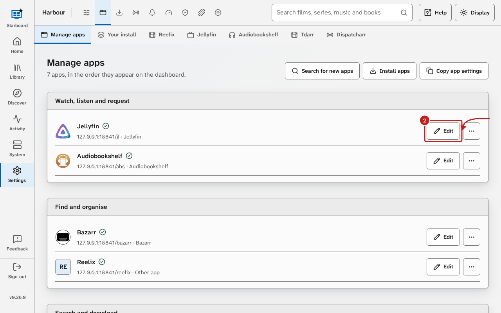
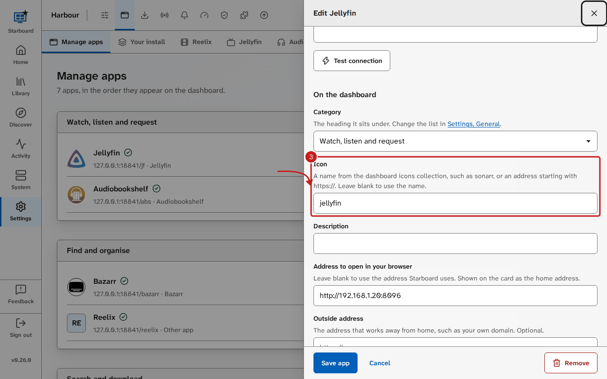
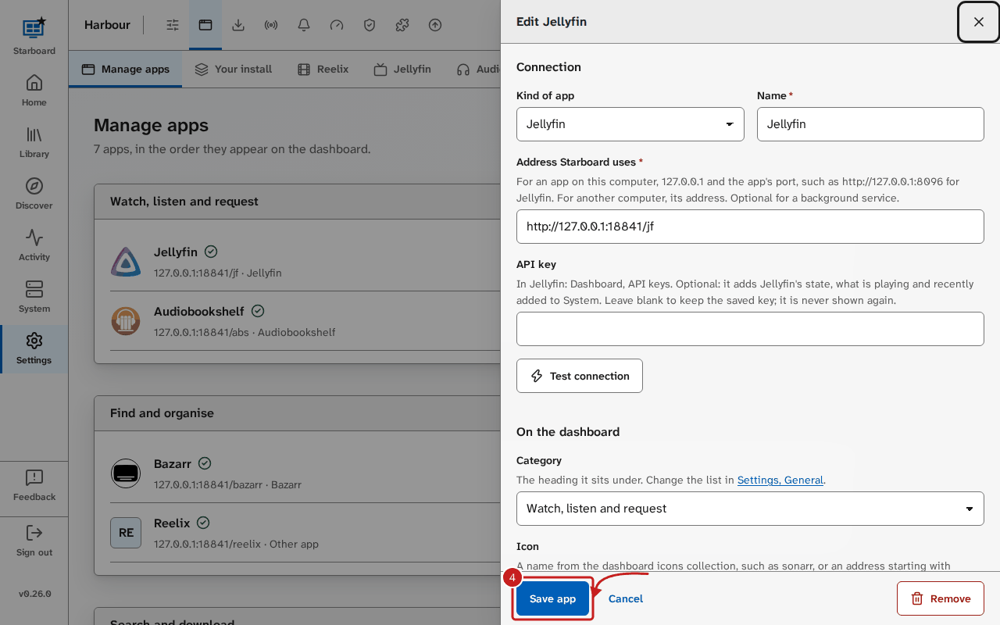

[Help centre](../README.md) · Apps · how-to
<!-- help: use / dashboard -->

# Change an app's icon

Starboard picks each app's icon from the app's name. You can choose another: a name from the dashboard-icons
collection, the web address of a picture, or a picture file of your own.

## Before you begin

- The app is in Starboard. Read [Add an app](add-an-app.md).
- To use your own picture, you need an SVG or PNG file and a way to copy it to the server. Read
  [The terminal: entering commands](../basics/the-terminal.md) if you have not used one.

## Steps

### Use an icon from the collection or the web

1. Find the icon's name in the [dashboard-icons collection](https://github.com/homarr-labs/dashboard-icons). The
   name is the file name without its ending, such as `jellyfin` or `home-assistant`.
2. Go to **Settings**, then **Apps**, then **Manage apps**, and select **Edit** for the app.

   

3. In **Icon**, enter the name. Or enter the full address of an SVG or PNG picture, starting with `https://`.

   

4. Select **Save app**, or **Save and continue** for Sonarr, Radarr, Lidarr and Readarr. Starboard downloads
   the icon once and keeps a copy.

   

### Use your own picture

1. Name your picture with lowercase letters, numbers and hyphens only, such as `my-music.svg` or
   `my-music.png`. Choose a name the collection does not use, so that Starboard does not mix it up with an
   icon it has saved.
2. Copy it into the `data/icons` folder inside the Starboard folder on the server. With the ready-made image,
   that is the `data/icons` folder next to `compose.image.yaml`.
3. In the app's **Edit** panel, enter the name without its ending in **Icon**, such as `my-music`.
4. Select **Save app**.

## Things to note

- Leave **Icon** empty to go back to the icon Starboard picks from the app's name.
- If Starboard finds no icon, the card shows two letters from the app's name instead.
- Starboard downloads icons only while **The dashboard-icons collection, for app icons** is active. It is in
  **Settings**, **Updates**, on the **What Starboard can access** tab. When it is inactive,
  Starboard uses only icons it has saved and your own files. Read
  [Change a switch in Starboard](change-what-starboard-can-access.md#change-a-switch-in-starboard).
- A downloaded icon can be up to 300 KB.

## If it does not work

- **The icon must be a name such as sonarr, or an address starting with https://:** use only lowercase letters,
  numbers and hyphens, or an address that starts with `https://`.
- **The card still shows two letters:** check that the name is spelt as in the collection. Starboard waits a
  day before it tries a missing name again. Until then, use your own file or a web address.

## Find out more

- [Change or remove an app](change-or-remove-an-app.md)
- [Choose a design for the Apps page](choose-a-design.md)
- [Organise apps into categories](organise-categories.md)

<!-- footer: download rights -->

---

**Download only what you have the right to.** Use the download apps only for files you have the right to download,
such as open-source software, works in the public domain and your own backups. Downloading films, series, music or
books without the copyright holder's permission is against the law in the UK and most other countries. Starboard
does not host or provide any files, and you are responsible for what you download.

**Need help?** Ask on the [Starboard Discord support server](https://discord.gg/xN9bf2H4vv).

<!-- /footer -->
