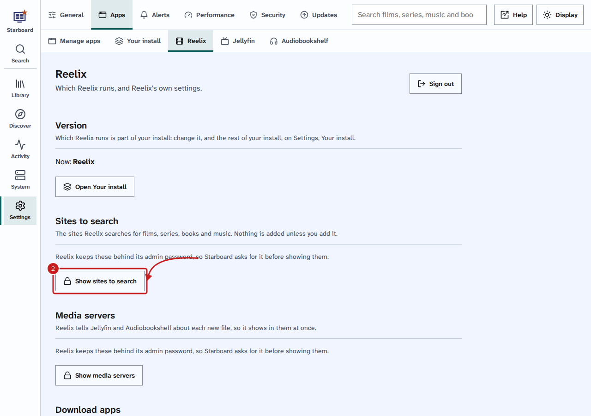
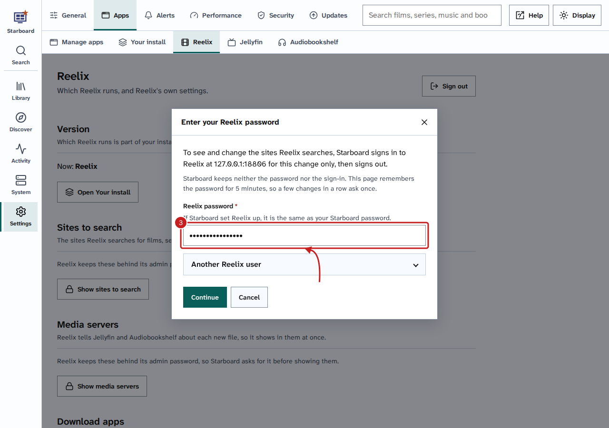
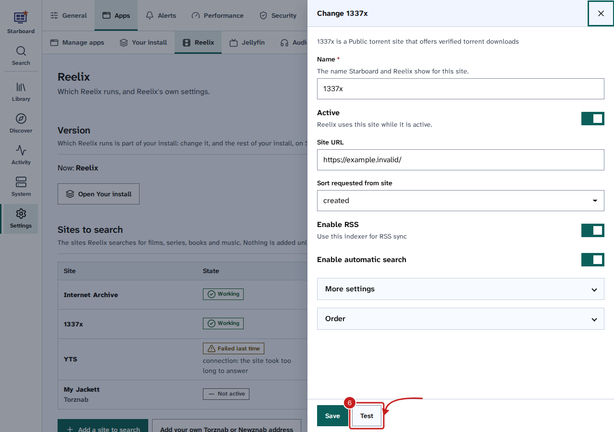

[Help centre](../README.md) · Apps · how-to

# Change Reelix's settings in Starboard

Reelix's sites to search, media servers and download apps show in Starboard, in **Settings**, **Reelix**, so you do
not need Reelix's own pages for them. The forms come from Reelix itself, so a setting Reelix adds shows here too.

Reelix keeps these settings behind its admin password. Starboard does not keep that password: it asks for it, signs
in to Reelix for that one change, then signs out again. The page remembers the password for 5 minutes, so a few
changes in a row ask once.

## Before you begin

- Reelix is on your dashboard. [Install apps](install-apps.md) adds it, or add your own in **Settings**, **Apps**,
  **Manage apps**.
- You know Reelix's admin password. If Starboard set Reelix up, it is the same as your Starboard password.

## Steps

1. Go to **Settings**, then **Apps**, then **Reelix**.
2. Under **Sites to search**, **Media servers** or **Download apps**, select the **Show** button.

   

3. Type your **Reelix password**, then select **Continue**. If your Reelix admin user is not called `admin`, open
   **Another Reelix user** and type its name first.

   

4. Starboard lists what Reelix has, with each one's state. To change one, select the **More** button (three dots)
   beside it, then **Change**. To add one, select the **Add** button under the list.
5. Change the fields. **More settings** holds the ones most people leave as they are.
6. Select **Test**. Reelix tries the settings and says whether they work.
7. Select **Save**.

   

## Things to note

- A secret, such as an API key or a password, shows empty when you change something. Leave it empty to keep the
  one Reelix has. If you change the address, Reelix asks for the secret again.
- **Remove** asks first. Reelix stops using that one and forgets its settings.
- Starboard keeps only a manager key for Reelix, which cannot change these settings. That is why it asks for the
  admin password each time: an admin key could do anything Reelix can do.
- The words in the forms are Reelix's own.

## If it does not work

- **Reelix did not accept that password:** check it and type it again. If you changed Reelix's admin password in
  Reelix, use that one.
- **Too many attempts:** wait 15 minutes, then try again.
- **Reelix is not on your dashboard:** add Reelix first, as in Before you begin.
- **Reelix could not be asked:** check that Reelix is running on **Apps**.

## Find out more

- [Choose the sites Reelix searches](choose-sites-to-search.md)
- [Connect Reelix to Jellyfin and Audiobookshelf](connect-reelix-to-media-servers.md)
- [Switch between the two versions of Reelix](switch-reelix-version.md)

<!-- footer: download rights -->

---

**Download only what you have the right to.** Use the download apps only for files you have the right to download,
such as open-source software, works in the public domain and your own backups. Downloading films, series, music or
books without the copyright holder's permission is against the law in the UK and most other countries. Starboard
does not host or provide any files, and you are responsible for what you download.

<!-- /footer -->
