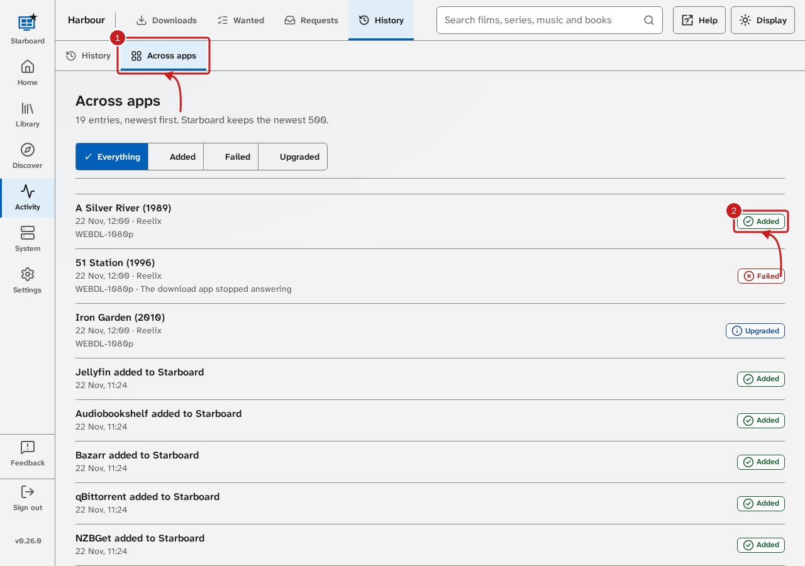
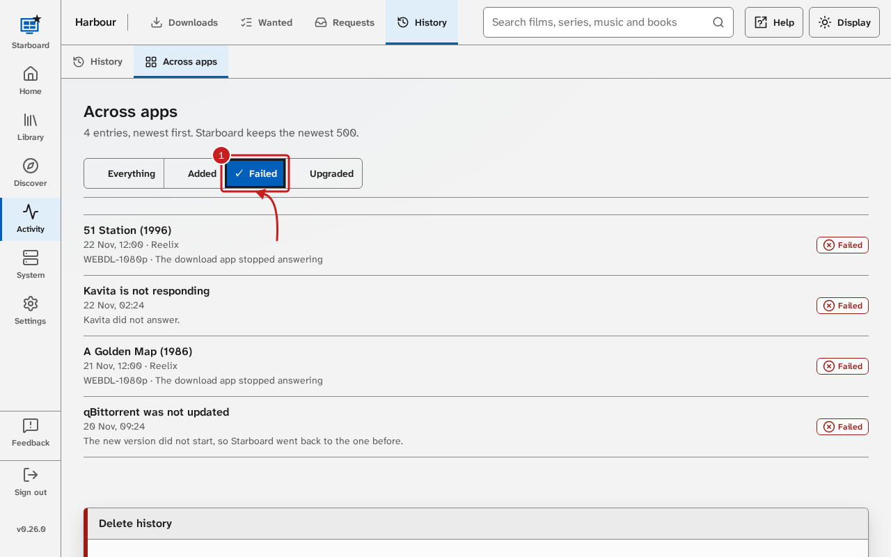
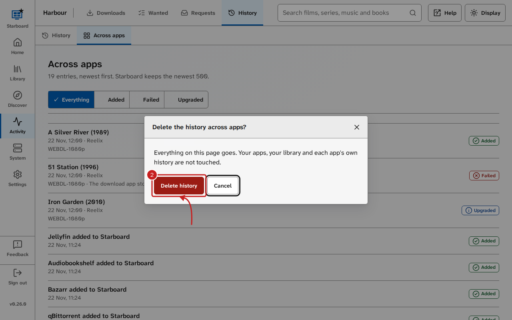

[Help centre](../README.md) · Everyday use · how-to
<!-- help: use / library -->

# Check what was added, failed and upgraded across your apps

**Activity**, then **History**, then **Across apps** is one short list of what happened on your server: what was
added, what failed and what was upgraded, in every app, newest first. Starboard keeps the newest 500 entries.

## Before you begin

- At least one app is in Starboard. Read [Add an app](add-an-app.md).
- Nothing needs activating. The list fills by itself as things happen.

## Steps

### Check what happened

1. Go to **Activity**, then **History**, then **Across apps**. The page says how many entries it holds.
2. Read down the list. Each entry has what happened, when, the app, and a chip that says **Added**, **Failed** or
   **Upgraded**. A failed entry also says why, when the app gave a reason.

   

3. Optional: select **Show more** at the end of the list for older entries.

### Show only one kind

1. Select **Added**, **Failed** or **Upgraded**. The list shows only that kind.
2. Select **Everything** to show every entry again.

   

### Delete the history

1. At the end of the page, under **Delete history**, select **Delete history**. Starboard asks **Delete the
   history across apps?**
2. Select **Delete history** to confirm, or **Cancel** to keep it.

   

Your apps, your library and each app's own history are not touched. Entries from before the moment you deleted do
not come back.

## What each kind means

| Kind | What it holds |
|---|---|
| **Added** | A film, episode, album or book an app added to your library; an app added to Starboard; a plug-in added |
| **Failed** | A download that failed or could not be added to the library; an update that did not work; an app that stopped responding; a disk problem; a backup that failed |
| **Upgraded** | A film or episode replaced by a better copy; an app, a plug-in or Starboard updated to a newer version |

## Things to note

- **It is small on purpose.** Starboard keeps the newest 500 entries in one file, usually under 100 KB and never
  more than half a megabyte. When there are more, the oldest go. For everything Reelix did, go to **Activity**,
  then **History**, then **History**.
- **It costs nothing while you are not using it.** Starboard runs no extra check for this list. It writes an
  entry when work it already does finishes: an update, an alert, adding an app. What your apps added, upgraded or
  could not download is read from each app's own history only when you open the page.
- **Apps that stopped responding, disk problems and failed backups** appear only while
  **Watch in the background** is active with those alerts chosen. Read [Activate alerts](activate-alerts.md).
- **Personal details are removed** from every entry, as in Starboard's log: addresses, email addresses and keys.
  Titles and app names stay.
- **The weekly summary** counts the week's entries: how many were added, failed and upgraded. Read
  [Get a weekly summary](weekly-summary.md).

## If it does not work

- **The list is empty:** nothing has happened since this page arrived, or the history was deleted. Entries appear
  as your apps add, fail or upgrade something.
- **A note says an app did not answer:** its newest entries are not in the list yet. Open the page again when the
  app answers. Read [An app is not responding](app-not-responding.md).

## Find out more

- [Pause, resume and remove downloads](manage-downloads.md)
- [Update your apps](update-your-apps.md)
- [Get a weekly summary](weekly-summary.md)

<!-- footer: download rights -->

---

**Download only what you have the right to.** Use the download apps only for files you have the right to download,
such as open-source software, works in the public domain and your own backups. Downloading films, series, music or
books without the copyright holder's permission is against the law in the UK and most other countries. Starboard
does not host or provide any files, and you are responsible for what you download.

<!-- /footer -->
