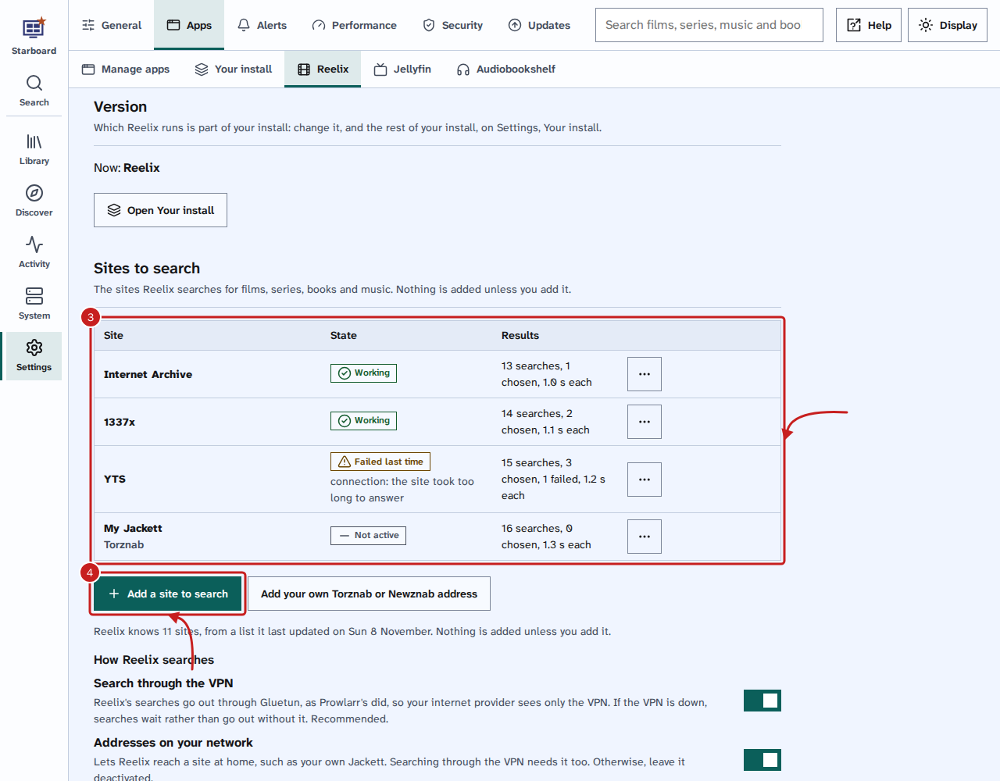
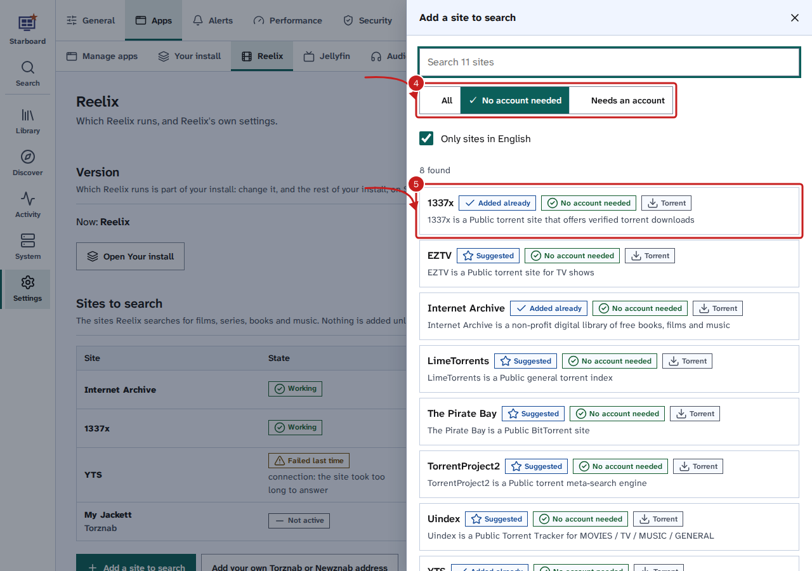
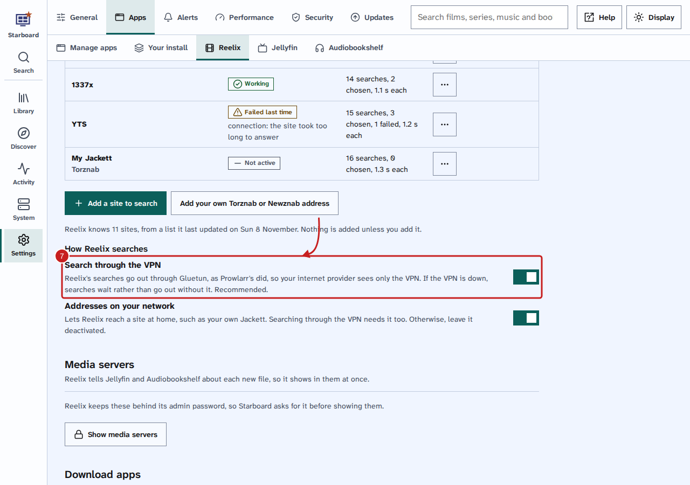

[Help centre](../README.md) · Apps · how-to

# Choose the sites Reelix searches

Reelix finds films, series, books and music by searching sites that list them, then hands the best copy to your
download app. Nothing is added unless you add it. Add, test and remove sites in **Settings**, **Apps**,
**Reelix**, under **Sites to search**.

## Before you begin

- Reelix is on your dashboard.
- You know Reelix's admin password. If Starboard set Reelix up, it is the same as your Starboard password.
- For a site that needs an account, you have its user name and password, or its API key.

## Steps

1. Go to **Settings**, then **Apps**, then **Reelix**.
2. Under **Sites to search**, select **Show sites to search**. Enter your Reelix password, then select
   **Continue**.
3. Read the list. **State** says whether each site is working. **Results** says how many searches it answered
   and how many downloads Reelix chose from it.

   

4. Select **Add a site to search**. Enter part of a site's name, or choose **No account needed** to list only
   public sites. **Only sites in English** is ticked to start with. **Suggested** marks the sites Install apps
   offers.
5. Select a site. Its form opens: select **Test**, then **Save**.

   

6. To use your own Jackett or Prowlarr, or a Usenet search site you have an account with, select **Add your own
   Torznab or Newznab address**. Choose **Torznab** or **Newznab**, then enter its address and API key.
7. Under **How Reelix searches**, keep **Search through the VPN** active if you have the VPN. It is
   recommended.

   

## Things to note

- **Search through the VPN** sends only Reelix's searches through Gluetun. Your internet provider sees only the
  VPN, which matters because some providers block these sites. If the VPN is down, searches wait rather than go
  out without it. Starboard activates it when it installs Reelix with the VPN.
- **Addresses on your network** lets Reelix reach a site at home, such as your own Jackett. Searching through
  the VPN needs it too. Otherwise, leave it inactive.
- **Resting until** means the site failed several times, so Reelix waits before it tries again.
- The **Sites to search** step in Install apps and the terminal set-up offers a short list of public sites and
  your own address. Nothing is ticked for you.
- Use these sites only for files you have the right to download where you live.

## If it does not work

- **The test did not pass:** the site may be down, or blocked by your internet provider. Activate **Search
  through the VPN**, then test again.
- **Reelix does not reach addresses on your own network:** activate **Addresses on your network**, then add
  the site again.
- **Needs an account:** add the user name and password, or the API key, from your account on that site.

## Find out more

- [Change Reelix's settings in Starboard](change-reelix-settings.md)
- [Install apps with Starboard](install-apps.md)

<!-- footer: download rights -->

---

**Download only what you have the right to.** Use the download apps only for files you have the right to download,
such as open-source software, works in the public domain and your own backups. Downloading films, series, music or
books without the copyright holder's permission is against the law in the UK and most other countries. Starboard
does not host or provide any files, and you are responsible for what you download.

<!-- /footer -->
