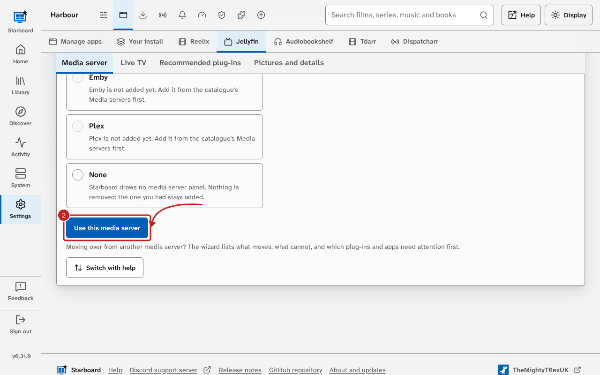
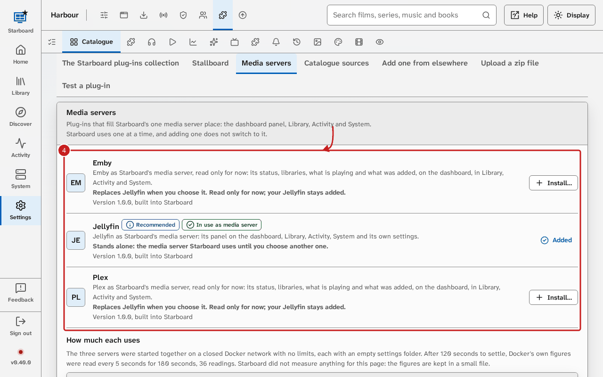

[Help centre](../README.md) · Jellyfin and Audiobookshelf · how-to
<!-- help: use / media -->

# Choose your media server

Starboard shows one media server at a time: its panel on the dashboard, what is playing in Activity, Play and Watched in
Library, and its status in System. Jellyfin is that media server, as a plug-in built into Starboard that is added for
you, with the address and key you already saved. You can check that it answers, choose another one or none, and go back
in one step for 24 hours. Starboard never switches by itself.

## Before you begin

- You can sign in to Starboard.
- To use Emby or Plex, add its plug-in from the catalogue's **Media servers** tab, and add the app itself in **Manage
  apps** with its address and key, as set out under **Use Emby or Plex** below. Read [Add a plug-in](add-a-plugin.md).

## Steps

### Check that your media server answers

1. Go to **Settings**, then **Apps**, then **Media server**.
2. Under **In use**, read the name and the state: **In use**, **Not set up** or **None**.
3. Select **Check it now**. Starboard asks the media server to answer and says what it found: its version and its libraries.

   

### Choose another media server, or none

1. Under **Choose a media server**, select the one to use. One that is not added yet cannot be selected, and says so.
2. Select **Use this media server**, then **Use** in the box that opens.
3. Starboard asks the new media server to answer first. If it does not, nothing changes and the page says why. If it does,
   it becomes your media server and the old one stays added, with its address and key.

   

### Use Emby or Plex

Emby and Plex are built into Starboard like Jellyfin, and read only for now: Starboard shows their status, libraries, what is
playing and what was added, on the dashboard, in Activity and in System. Play in Jellyfin, Watched, Live TV and the other
Jellyfin tools stay with Jellyfin.

1. Go to **Settings**, then **Plug-ins**, then **Catalogue**, then the **Media servers** tab. Select **Install** beside
   **Emby** or **Plex**, read **What it may do**, enter your Starboard password and select **Install**.
2. Go to **Settings**, then **Apps**, then **Manage apps**. Add the app as an **Other app** with the icon `emby` or `plex`,
   the address Starboard uses to reach it, and its key. For Emby, make a key in its dashboard under **API keys**. For
   Plex, use its token: in Plex's web app open an item, then **Get info**, then **View XML**, and copy the value after
   `X-Plex-Token=` from the address.
3. Go to **Settings**, then **Apps**, then **Media server**, choose it and select **Use this media server**. Starboard
   checks that it answers first.

Starboard sends the key in a header, never in an address, so it does not reach a log.

### Go back

For 24 hours after a change, **The way back** says which media server you had.

1. Select **Go back to** and its name. Starboard does not ask the old media server first, so you are never stuck.

   

### Find the media server plug-ins

1. Go to **Settings**, then **Plug-ins**, then **Manage**.
2. Find **Jellyfin** in **Your plug-ins**. It says **Built into Starboard**, **Active** and **In use as media server**.

   

3. Select **Settings** beside it. The **Media server** card says what Jellyfin does for Starboard. Select
   **Open Jellyfin settings** for its address, your user, Live TV, metadata and its own plug-ins.

   

4. For the list of media servers Starboard has, select **Catalogue**, then the **Media servers** tab. Jellyfin is
   **Recommended**. Adding another one does not switch to it.

   

## What to expect

- The media server in use stays active, so its plug-in has no **Deactivate** or **Remove** button until you choose another
  one or none. **Deactivate all plug-ins** leaves it on.
- With **None**, the dashboard panel, Library's **Play** and **Watched** and Activity's now playing are not drawn.
  Nothing is removed.
- If you never had Jellyfin, it is added but not active, and says it is not set up. If you removed it on purpose,
  Starboard does not add it again.
- Nothing runs for a media server plug-in, so it uses no extra container and no memory of its own. Your Jellyfin settings and backups restore
  as before.

## If it does not work

- **The dashboard says Jellyfin is not set up:** add its address and API key in **Manage apps**. Read
  [Find an app's API key](find-an-api-key.md).
- **Jellyfin is missing from Manage:** you removed it earlier. Select **Install** beside it in the catalogue's
  **Media servers**.
- **A new media server did not answer:** nothing changed. Read the reason on the page, fix its address or key in
  **Manage apps**, then try again.

## Find out more

- [Add a plug-in](add-a-plugin.md)
- [Set up free Live TV in Jellyfin](set-up-live-tv.md)
- [Find an app's API key](find-an-api-key.md)

<!-- footer: download rights -->

---

**Download only what you have the right to.** Use the download apps only for files you have the right to download,
such as open-source software, works in the public domain and your own backups. Downloading films, series, music or
books without the copyright holder's permission is against the law in the UK and most other countries. Starboard
does not host or provide any files, and you are responsible for what you download.

**Need help?** Ask on the [Starboard Discord support server](https://discord.gg/xN9bf2H4vv).

<!-- /footer -->
