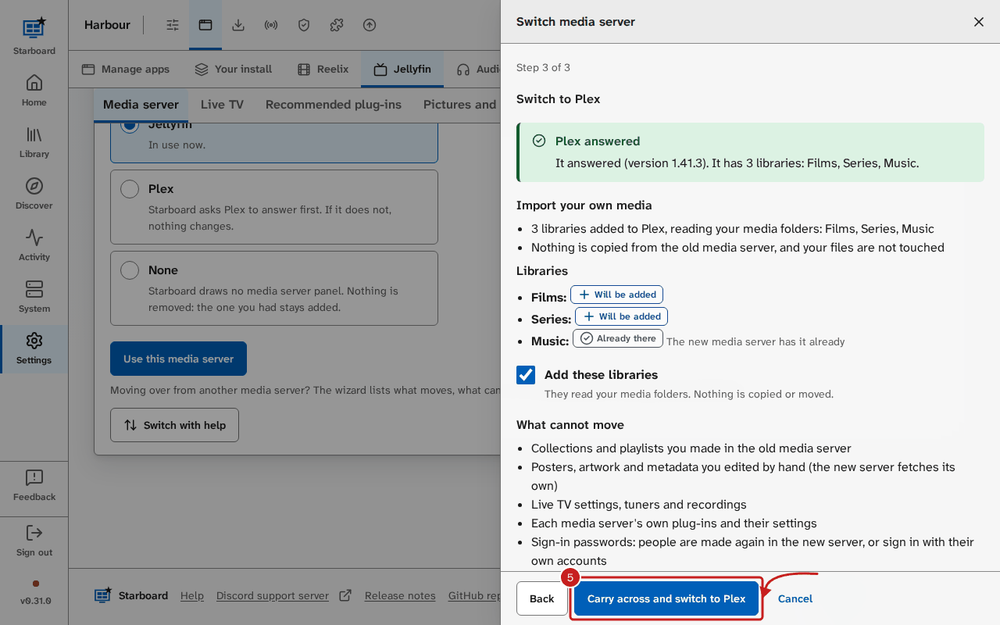
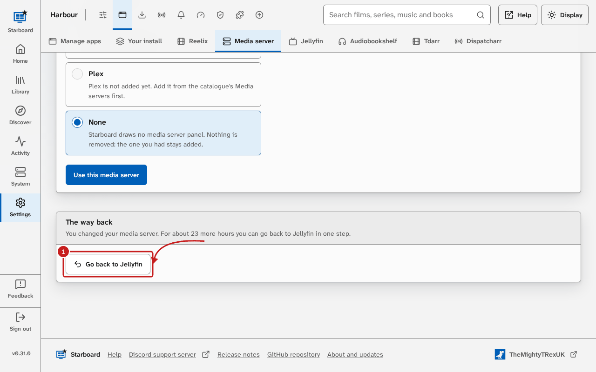

[Help centre](../README.md) · Jellyfin and Audiobookshelf · how-to
<!-- help: use / media -->

# Choose your media server

Starboard shows one media server at a time: its panel on the dashboard, what is playing in Activity, Play and Watched in
Library, and its status in System. Jellyfin is that media server, as a plug-in built into Starboard that is added for
you, with the address and key you already saved. You can check that it answers, choose another one or none, and go back
in one step for 24 hours. Starboard never switches by itself.

## Before you begin

- You can sign in to Starboard.
- To use Emby or Plex, add its plug-in from the catalogue's **Media servers** tab, and add the app itself in **Manage
  apps** with its address and key, as set out under **Use Emby or Plex**. Read [Add a plug-in](add-a-plugin.md).

## Steps

### Check that your media server answers

1. Go to **Settings**, then **Apps**, then the tab named for your media server: **Jellyfin**, **Plex** or **Emby**, or
   **Media server** when none is in use. Find **In use**.
2. Under **In use**, read the name and the state: **In use**, **Not set up** or **None**.
3. Select **Check it now**. Starboard asks the media server to answer and says what it found: its version and its libraries.

   

### Choose another media server, or none

1. Under **Choose a media server**, select the one to use. One that is not added yet cannot be selected, and says so.
2. Select **Use this media server**, then **Use** in the box that opens.
3. Starboard asks the new media server to answer first. If it does not, nothing changes and the page says why. If it does,
   it becomes your media server and the old one stays added, with its address and key.

   

### Use Emby or Plex

Emby and Plex are built into Starboard like Jellyfin, and each is a kind of app in Manage apps with its own form, check
and icon. They are read only for now: Starboard shows their status, libraries, what is
playing and what was added, on the dashboard, in Activity and in System. Play in Jellyfin, Watched, Live TV and the other
Jellyfin tools stay with Jellyfin.

1. Go to **Settings**, then **Plug-ins**, then **Catalogue**, then the **Media servers** tab. Select **Install** beside
   **Emby** or **Plex**, read **What it may do**, enter your Starboard password and select **Install**.
2. Go to **Settings**, then **Apps**, then **Manage apps** and select **Add an app**. In **Kind of app**, choose **Emby** or
   **Plex**. Starboard names it for you and shows the usual address. Enter the address Starboard uses to reach it and its
   key. For Emby, make a key in its dashboard under **API keys**. For Plex, use its token: in Plex's web app open an item,
   then **Get info**, then **View XML**, and copy the value after `X-Plex-Token=` from the address.

   

   Select **Test connection**. Starboard asks the server for its version, then asks for something only the key allows, so a
   wrong key shows as a problem here and not later. Select **Add app**.

   

3. Go to **Settings**, then **Apps**, then the media server tab, choose it and select **Use this media server**. Starboard
   checks that it answers first.

Starboard sends the key in a header, never in an address, so it does not reach a log.

### Switch with the wizard

The wizard is for moving over from one media server to another. It changes nothing until its last button, and the way
back, set out under Go back, still lasts 24 hours.

1. Under **Choose a media server**, select **Switch with help**. A panel opens.
2. On **Step 1**, choose how to switch, then **Next**:
   - **Import your own media** points the new media server at the same folders. Nothing is copied from the old one.
   - **Migrate from your old media server** brings libraries, users and what was watched across, as far as the new media
     server can take them. Watch history can be copied into Jellyfin only so far, and the wizard says so.
   - **Start fresh** starts the new media server empty.

   

3. On **Step 2**, choose the media server, or **None**, then **Next**. Only media servers that are added are listed.
4. On **Step 3**, read what Starboard found. It asks the new media server to answer first. Then it lists what moves, what
   cannot move (collections, hand-made artwork, Live TV settings and each server's own plug-ins), what keeps working with no
   change (your download apps, Reelix and anything else that saves into your media folders, and your files), and each
   plug-in that needs a media server marked **Works after the switch** or **Waits after the switch**, with the reason.

   

5. Parts that keep their own link to the old media server, such as Reelix, Seerr, On demand and a forward for remote
   access, are marked **Needs pointing at the new media server**: change them in those apps after the switch.
6. Select **Switch to** and the name. If the new media server did not answer, the button is not available and nothing has changed.

   

A plug-in that waits is not stopped: it keeps its settings and carries on when its media server is back.

### Go back

For 24 hours after a change, **The way back** says which media server you had.

1. Select **Go back to** and its name. Starboard does not ask the old media server first, so you are never stuck.

   

### Find the media server plug-ins

1. Go to **Settings**, then **Plug-ins**, then **Manage**.
2. Find **Jellyfin** in **Your plug-ins**. It says **Built into Starboard**, **Active** and **In use as media server**.

   

3. Select **Settings** beside it. The **Media server** card says what Jellyfin does for Starboard. Select
   **Open Jellyfin settings** for the media server tab, where Jellyfin's address, your user, Live TV, metadata and its own plug-ins are.

   

4. For the list of media servers Starboard has, select **Catalogue**, then the **Media servers** tab. Jellyfin is
   **Recommended**. Adding another one does not switch to it.

   

## What to expect

- The media server in use stays active, so its plug-in has no **Deactivate** or **Remove** button until you choose another
  one or none. **Deactivate all plug-ins** leaves it on.
- With **None**, the dashboard panel, Library's **Play** and **Watched** and Activity's now playing are not drawn.
  Nothing is removed.
- If you added Plex or Emby earlier as an **Other app** with its icon, Starboard turns it into a Plex or Emby app by
  itself when it starts, with the same name, address and key. A Starboard that never had one is not changed.
- If you never had Jellyfin, it is added but not active, and says it is not set up. If you removed it on purpose,
  Starboard does not add it again.
- Nothing runs for a media server plug-in, so it uses no extra container and no memory of its own. Your Jellyfin settings and backups restore
  as before.

## If it does not work

- **The dashboard says Jellyfin is not set up:** add its address and API key in **Manage apps**. Read
  [Find an app's API key](find-an-api-key.md).
- **Jellyfin is missing from Manage:** you removed it earlier. Select **Install** beside it in the catalogue's
  **Media servers**.
- **A new media server did not answer:** nothing changed. Read the reason on the page, fix its address or key in
  **Manage apps**, then try again.

## Find out more

- [Add a plug-in](add-a-plugin.md)
- [Set up free Live TV in Jellyfin](set-up-live-tv.md)
- [Find an app's API key](find-an-api-key.md)

<!-- footer: download rights -->

---

**Download only what you have the right to.** Use the download apps only for files you have the right to download,
such as open-source software, works in the public domain and your own backups. Downloading films, series, music or
books without the copyright holder's permission is against the law in the UK and most other countries. Starboard
does not host or provide any files, and you are responsible for what you download.

**Need help?** Ask on the [Starboard Discord support server](https://discord.gg/xN9bf2H4vv).

<!-- /footer -->
