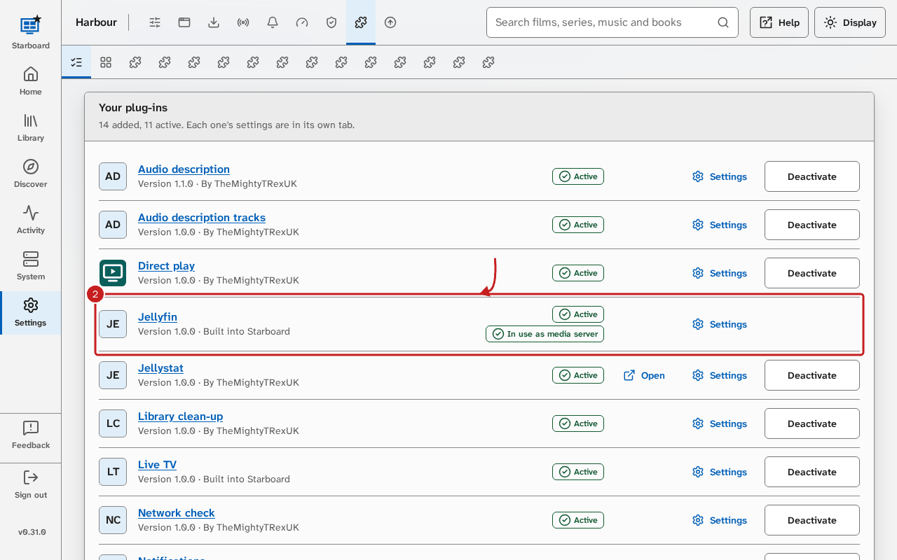
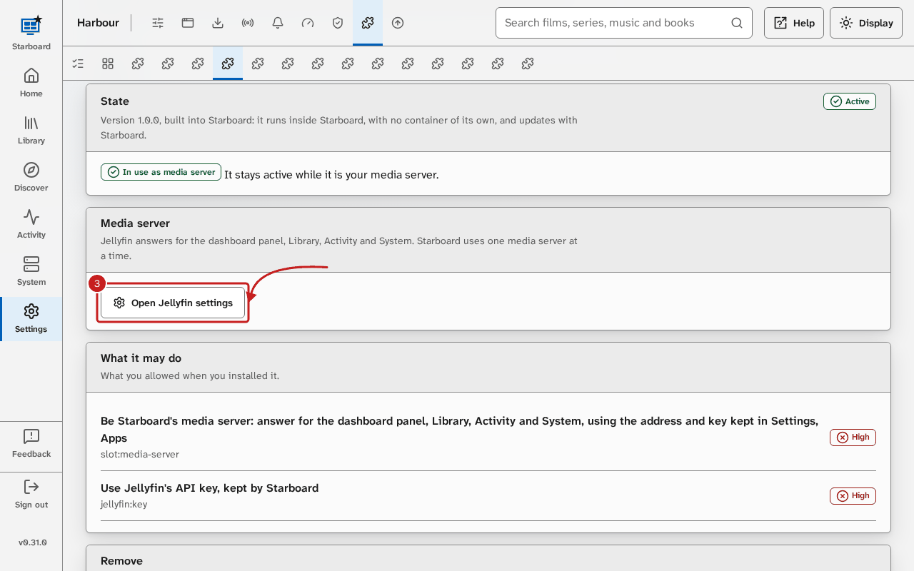

[Help centre](../README.md) · Jellyfin and Audiobookshelf · how-to
<!-- help: use / media -->

# Check which media server Starboard uses

Starboard shows one media server at a time: its panel on the dashboard, what is playing in Activity, Play and Watched in
Library, and its status in System. Jellyfin is that media server, as a plug-in built into Starboard. It is added for you,
with the address and key you already saved, so nothing about how Starboard works changes.

## Before you begin

- You can sign in to Starboard.

## Steps

### Find Jellyfin in your plug-ins

1. Go to **Settings**, then **Plug-ins**, then **Manage**.
2. Find **Jellyfin** in **Your plug-ins**. It says **Built into Starboard**, **Active** and **In use as media server**.

   

3. Select **Settings** beside it. The **Media server** card says what Jellyfin does for Starboard. Select
   **Open Jellyfin settings** for its address, your user, Live TV, metadata and its own plug-ins.

   

### Find the media servers Starboard has

1. Go to **Settings**, then **Plug-ins**, then **Catalogue**.
2. Select the **Media servers** tab. Jellyfin is **Recommended** and says **Added**.

   

Starboard uses one media server at a time. Adding another one to the list does not switch to it.

## What to expect

- Jellyfin stays active while it is your media server, so it has no **Deactivate** or **Remove** button. Starboard
  says why if something asks it to stop.
- **Deactivate all plug-ins** leaves it on.
- If you never had Jellyfin, the record is added but not active, and the dashboard panel says it is not set up.
- If you removed it on purpose, Starboard does not add it again.
- Nothing runs for it, so it uses no extra memory and no container. Your Jellyfin settings and backups restore as before.

## If it does not work

- **The dashboard says Jellyfin is not set up:** add its address and API key in **Manage apps**. Read
  [Find an app's API key](find-an-api-key.md).
- **Jellyfin is missing from Manage:** you removed it earlier. Select **Install** beside it in the catalogue's
  **Media servers**.

## Find out more

- [Add a plug-in](add-a-plugin.md)
- [Set up free Live TV in Jellyfin](set-up-live-tv.md)
- [Find an app's API key](find-an-api-key.md)

<!-- footer: download rights -->

---

**Download only what you have the right to.** Use the download apps only for files you have the right to download,
such as open-source software, works in the public domain and your own backups. Downloading films, series, music or
books without the copyright holder's permission is against the law in the UK and most other countries. Starboard
does not host or provide any files, and you are responsible for what you download.

**Need help?** Ask on the [Starboard Discord support server](https://discord.gg/xN9bf2H4vv).

<!-- /footer -->
