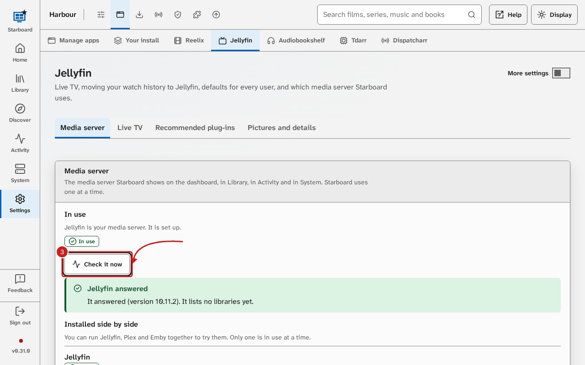
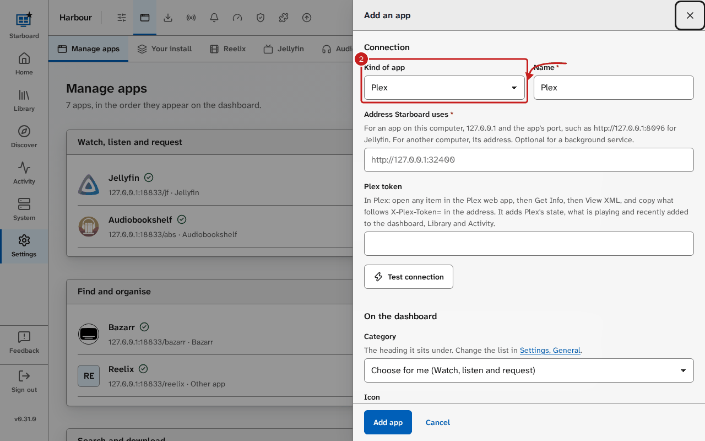
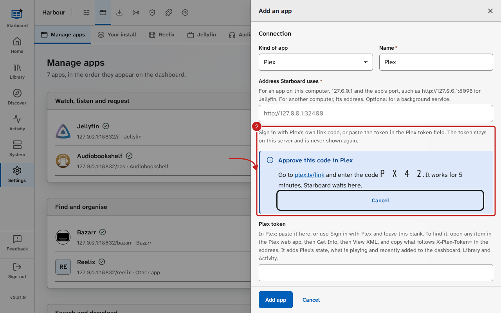
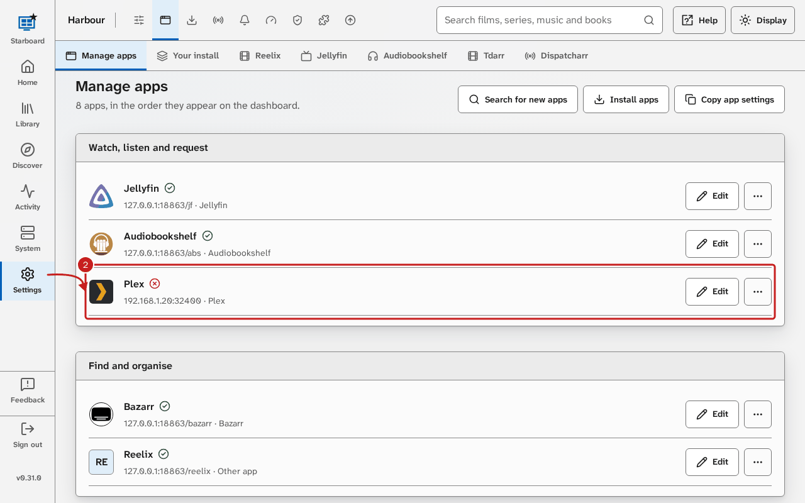
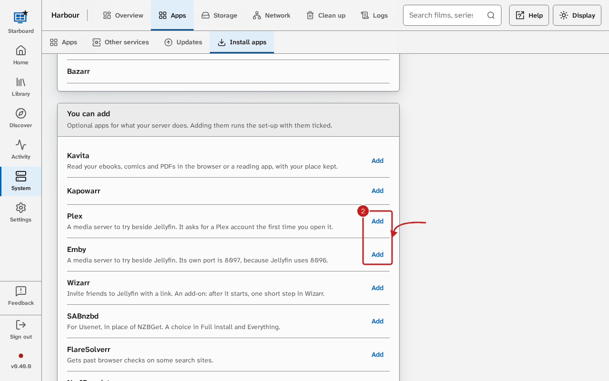
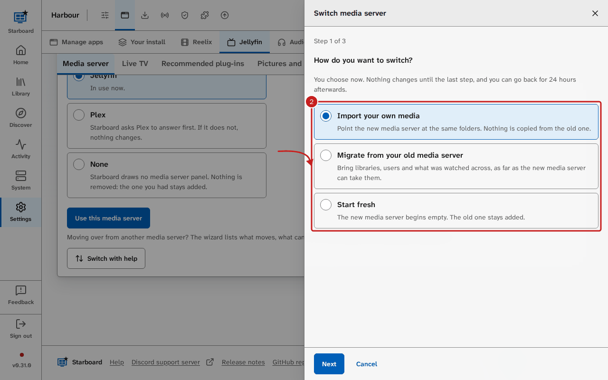
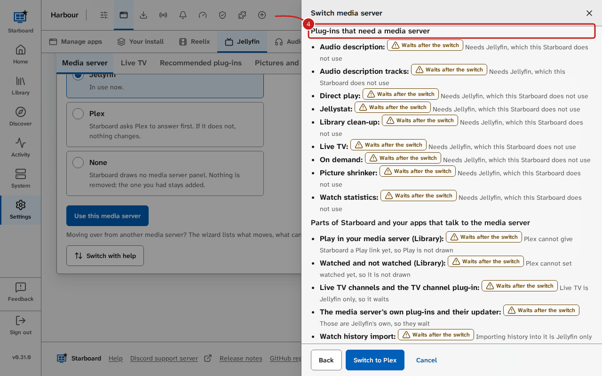

[Help centre](../README.md) · Jellyfin and Audiobookshelf · how-to
<!-- help: use / media -->

# Choose your media server

Starboard shows one media server at a time. It shows that server's panel on the dashboard, what is playing in
Activity, Play and Watched in Library, and its status in System. Jellyfin is that media server. It is a plug-in built
into Starboard, and Starboard adds it for you with the address and key you already saved. You can check that it
answers, choose another server or none, and go back in one step for 24 hours. Starboard never switches by itself.

## Before you begin

- You can sign in to Starboard.
- To use Emby or Plex, add the app itself in **Manage apps** with its address and key, as set out under **Use Emby or
  Plex**. Starboard then adds its plug-in for you, ready to choose. You can also add the plug-in first from the
  **Media servers** tab of the catalogue. Read [Add a plug-in](add-a-plugin.md).

## Steps

### Check that your media server answers

1. Go to **Settings**, then **Apps**, then the tab named for your media server: **Jellyfin**, **Plex** or **Emby**, or
   **Media server** when none is in use. Find **In use**.
2. Under **In use**, read the name and the state: **In use**, **Not set up** or **None**.
3. Select **Check it now**. Starboard asks the media server to answer and says what it found: its version and its libraries.

   

### Choose another media server, or none

1. Under **Choose a media server**, select the one to use. You cannot select a server that is not added yet, and the page says so.
2. Select **Use this media server**, then **Use** in the box that opens.
3. Starboard asks the new media server to answer first. If it does not, nothing changes and the page says why. If it does,
   it becomes your media server and the old one stays added, with its address and key.

   

### Use Emby or Plex

Emby and Plex are built into Starboard like Jellyfin. Each is a kind of app in Manage apps with its own form, check
and icon. On the dashboard, in Activity and in System, Starboard shows their status, libraries, what is playing and what
was added. In Library, **Play** opens a film or episode in the server's own web app, and **Watched** shows and sets what
you have watched. Live TV and the other Jellyfin tools stay with Jellyfin. Under **What each can do** on the media server
tab, a table lists every job for Jellyfin, Plex and Emby, and says why a job is not offered.

- **Play** needs the address you open the server with in your browser, in Manage apps under **Address to open in your
  browser**. Plex and Emby links need the server to answer, so Starboard asks it once an hour for its own name.
- **Watched** is the owner's in Plex, because Starboard holds the owner's token. In Emby it is the first administrator's.
- **Updates** to the container of the media server in use wait while anyone is watching. An update that Starboard makes by
  itself is tried again at the next update hours; in Install all updates, Starboard looks every minute for up to 3 hours.
  An update you start yourself with its own button goes ahead.
- After you change media server, Library builds its list of films again, from the new server, the next time you open it.
  Play links come back when that finishes.
- Starboard has only tried these calls against recorded answers from each server's documented interface, not against a
  real Plex or Emby. If a link does not open the right page, say so on the Starboard Discord support server.

1. Starboard adds the plug-in for you once the app is in **Manage apps**, so you can skip this step. To add it first,
   go to **Settings**, then **Plug-ins**, then **Catalogue**, then the **Media servers** tab. Select **Install** beside
   **Emby** or **Plex**, read **What it may do**, enter your Starboard password and select **Install**.
2. Go to **Settings**, then **Apps**, then **Manage apps** and select **Add an app**. In **Kind of app**, choose **Emby** or
   **Plex**. Starboard names it for you and shows the usual address. Enter the address Starboard uses to reach it and its
   key.
   - For Emby, make a key in its dashboard under **API keys**.
   - For Plex, select **Sign in with Plex**. Starboard shows a code. Go to plex.tv/link, enter the code and approve it.
     Starboard waits for five minutes, and **Cancel** stops it. When it says **Signed in with Plex**, select **Save**.
   - Or paste Plex's token instead. In Plex's web app, open an item, then **Get info**, then **View XML**. Copy the value
     after `X-Plex-Token=` from the address.
   - Starboard keeps the token on the server and never shows it again.

   

   

   Select **Test connection**. Starboard asks the server for its version. Then it asks for something only the key
   allows, so a wrong key shows as a problem here and not later. Select **Add app**.

   

3. Go to **Settings**, then **Apps**, then the media server tab, choose it and select **Use this media server**. Starboard
   checks that it answers first.

Starboard sends the key in a header, never in an address, so it does not reach a log.

### Install Plex or Emby with Starboard

You can run all three media servers side by side to try them. Only one is your media server at a time, and the others are
installed but not in use. Plex and Emby are not part of Basics or Full install; you add them here. Each shows as **Installed, not in use** under
**Installed side by side** on the media server tab, where **Check it now** asks it to answer.

1. Go to **System**, then **Apps**, then **Install apps**.
2. Under **You can add**, select **Add** beside **Plex** or **Emby**, then follow the set-up's steps to the end. Add the
   other one afterwards if you want both. Starboard gives each its own folders in your settings folder. It mounts your
   media folder in each as **read only**, so neither can change your files. Each can use at most 2 GB of memory and 4
   processors, or fewer if this computer has fewer. Plex uses port 32400 and Emby uses port 8097, because Jellyfin has 8096.

   

3. When the apps run, Starboard adds each to **Manage apps** as the kind **Plex** or **Emby**, with its address.
4. Finish each one's set-up, which Starboard lists under **Still to set up**:
   - **Plex** needs a Plex account for its first set-up. Open Plex on port 32400, sign in, and add your libraries from
     `/data/media`. Starboard cannot make or enter the account for you. Then sign in to Plex in **Manage apps**, with **Sign in with Plex** or its token.
   - **Emby** needs no account. Open it on port 8097, follow its first-run steps and add your libraries from
     `/data/media`. Then make an API key in its **Dashboard** and add it in **Manage apps**.
5. Choose the media server to use, as set out under **Choose another media server, or none**.

Emby's hardware video conversion and recording need Emby Premiere, and Plex's hardware conversion needs Plex Pass: Starboard
does not change that.

### Switch with the wizard

The wizard is for moving over from one media server to another. It changes nothing until its last button, and the way
back, set out under Go back, still lasts 24 hours.

1. Under **Choose a media server**, select **Switch with help**. A panel opens.
2. On **Step 1**, choose how to switch, then **Next**:
   - **Import your own media** adds libraries for your Films, Series and Music folders to the new media server. Nothing is copied from the old one.
   - **Migrate from your old media server** brings libraries, users and what was watched across, as far as the new media
     server can take them.
   - **Start fresh** starts the new media server empty.

   

3. On **Step 2**, choose the media server, or **None**, then **Next**. Only media servers that are added are listed.
4. On **Step 3**, read what Starboard found. It asks the new media server to answer first. Then it lists:
   - what moves;
   - what cannot move (collections, hand-made artwork, Live TV settings and each server's own plug-ins);
   - what keeps working with no change (your download apps, Reelix and anything else that saves into your media
     folders, and your files);
   - each plug-in that needs a media server, marked **Works after the switch** or **Waits after the switch**, with
     the reason.

   

5. Some parts keep their own link to the old media server, such as Reelix, Seerr, On demand and a forward for
   remote access. Starboard marks them **Needs pointing at the new media server**. Change them in those apps after
   the switch.
6. Select **Switch to** and the name, or **Carry across and switch to** when you ticked parts to carry across. If the new media server did not answer, the button is not available and nothing has changed.

   

A plug-in that waits is not stopped: it keeps its settings and carries on when its media server is back.

To carry your libraries, people and what was watched across, read [Move to another media server](move-to-another-media-server.md).

### Go back

For 24 hours after a change, **The way back** says which media server you had.

1. Select **Go back to** and its name. Starboard does not ask the old media server first, so you are never stuck.

   

### Find the media server plug-ins

1. Go to **Settings**, then **Plug-ins**, then **Manage**.
2. Find **Jellyfin** in **Your plug-ins**. It says **Built into Starboard**, **Active** and **In use as media server**.

   

3. Select **Settings** beside it. The **Media server** card says what Jellyfin does for Starboard. Select
   **Open Jellyfin settings** for the media server tab, where Jellyfin's address, your user, Live TV, metadata and its own plug-ins are.

   

4. For the list of media servers Starboard has, select **Catalogue**, then the **Media servers** tab. Jellyfin is
   **Recommended**. Adding another one does not switch to it.

   

## What to expect

- The media server in use stays active, so its plug-in has no **Deactivate** or **Remove** button until you choose another
  one or none. **Deactivate all plug-ins** leaves it on.
- With **None**, the dashboard panel, Library's **Play** and **Watched** and Activity's now playing are not drawn.
  Nothing is removed.
- If you added Plex or Emby earlier as an **Other app** with its icon, Starboard turns it into a Plex or Emby app
  when it starts. The name, address and key stay the same. A Starboard that never had one does not change.
- If you never had Jellyfin, it is added but not active, and says it is not set up. If you removed it on purpose,
  Starboard does not add it again.
- Nothing runs for a media server plug-in, so it uses no extra container and no memory of its own. Your Jellyfin settings and backups restore
  as before.

## If it does not work

- **The dashboard says Jellyfin is not set up:** add its address and API key in **Manage apps**. Read
  [Find an app's API key](find-an-api-key.md).
- **Jellyfin is missing from Manage:** you removed it earlier. Select **Install** beside it in the catalogue's
  **Media servers**.
- **A new media server did not answer:** nothing changed. Read the reason on the page, fix its address or key in
  **Manage apps**, then try again.

## Find out more

- [Add a plug-in](add-a-plugin.md)
- [Set up free Live TV in Jellyfin](set-up-live-tv.md)
- [Find an app's API key](find-an-api-key.md)

<!-- footer: download rights -->

---

**Download only what you have the right to.** Use the download apps only for files you have the right to download.
Examples are open-source software, works in the public domain and your own backups. Downloading films, series, music or
books without the copyright holder's permission is against the law in the UK and most other countries. Starboard
does not host or provide any files, and you are responsible for what you download.

**Need help?** Ask on the [Starboard Discord support server](https://discord.gg/xN9bf2H4vv).

<!-- /footer -->
