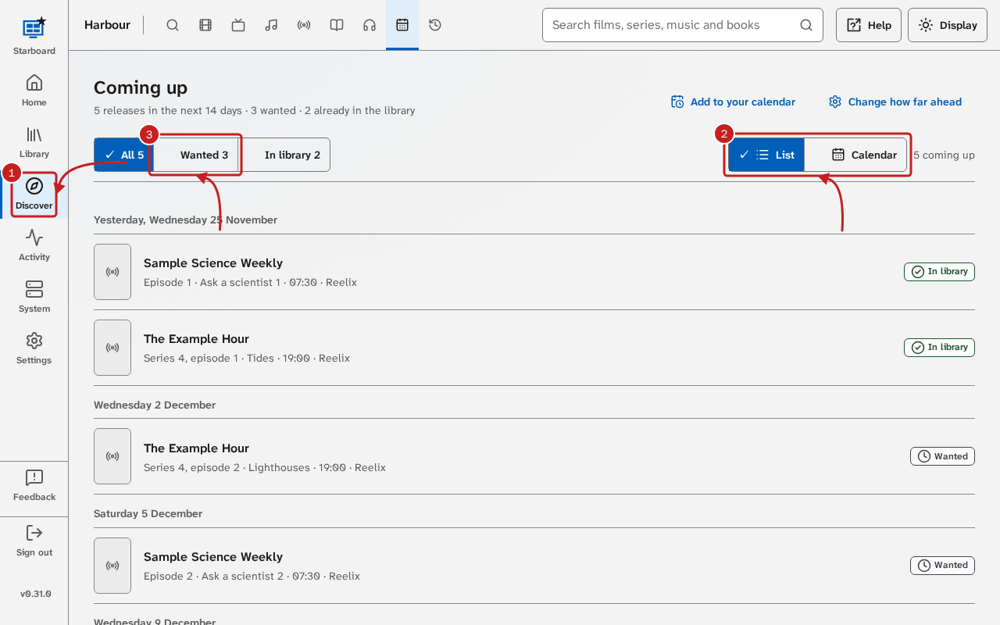
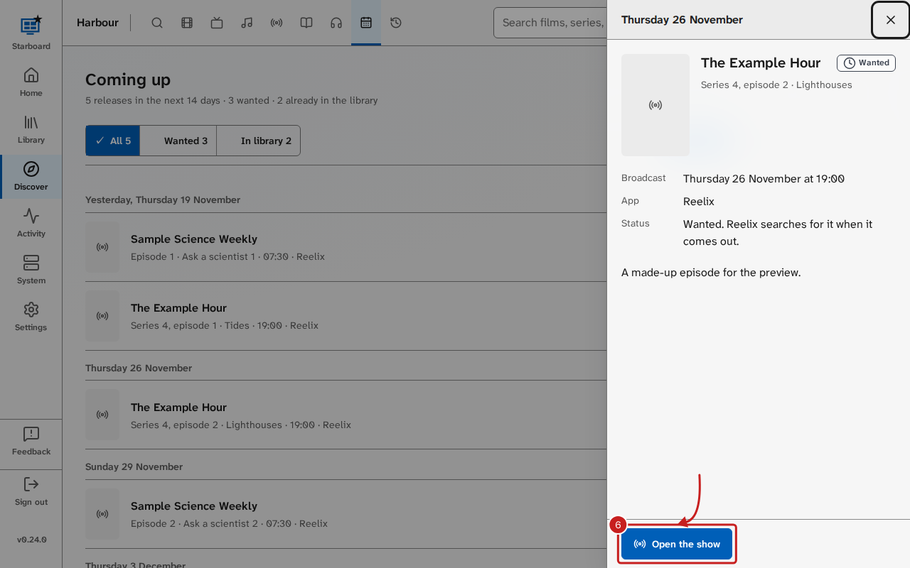
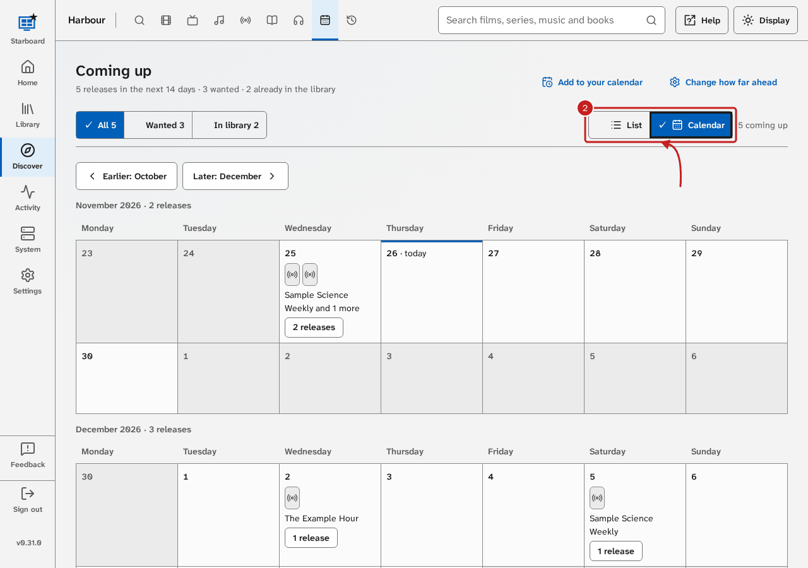
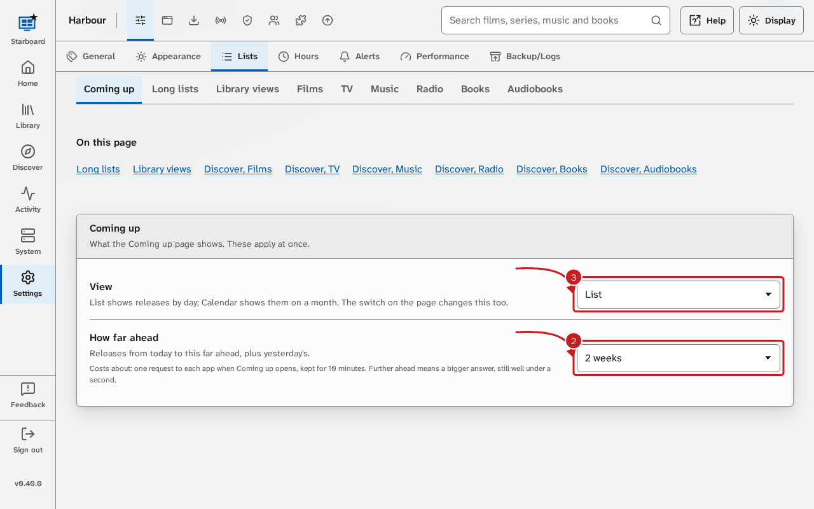

[Help centre](../README.md) · Everyday use · how-to
<!-- help: use / library -->

# Find out what is coming up

The Coming up page lists the new episodes, films, albums, books and radio episodes your apps expect, from
yesterday to as far ahead as you choose. You can show them as a list by day or on a month calendar.

## Before you begin

- Reelix is in Starboard; the default install has it. On an existing set-up, at least one of Sonarr, Radarr,
  Lidarr or Readarr will do. Read [Add an app](add-an-app.md).
  Radio comes from the shows you follow in Reelix. Read [Follow radio shows and podcasts](follow-radio-shows.md).

## Steps

### Check what is coming up

1. Go to **Discover**, then **Coming up**. The page says how many releases are due, how many are wanted and
   how many are already in the library.
2. Choose **List** to show releases day by day, or **Calendar** to show them on a month.
3. Optional: select **Wanted** to show only what you do not have yet, or **In library** to show only what you
   have. Select **All** to show everything again.

   

4. Optional: when releases come from more than one app, a button for each app shows. Select an app's name, such
   as **Sonarr**, to show that app only. Select it again to show every app. With Reelix alone, there are no app
   buttons.
5. Select a title to open its details: when it comes out, which app it is in and whether it is wanted.
6. Optional: select the button at the foot of the details, such as **Open the show**, to open it.

   

In **Calendar**, select **Earlier** or **Later** and the month's name to move by a month, and **Back to now**
to return.

### Change how far ahead it shows

1. On the Coming up page, select **Change how far ahead**. This opens **Settings**, then **General**, then
   **Pages and lists**. The **Coming up** section shows when **More settings** is active: activate it if the
   section is not there.
2. In **How far ahead**, choose **1 week**, **2 weeks**, **30 days**, **60 days** or **90 days**. The change
   applies at once.
3. Optional: in **View**, choose whether the page opens as **List** or **Calendar**.

   

### Add Coming up to your calendar

Your phone or computer calendar can show what is coming up, and update by itself.

1. On the Coming up page, select **Add to your calendar**.
2. Select **Make an address**. If you made one before, select **Make a new address**, then **Make a new address**
   again to confirm: the old address stops working.
3. Select **Copy the address**. Starboard shows the address only this once.
4. In your calendar app, add a calendar from an address. Apps call this **Subscribe**, **From URL** or
   **Add by URL**. Paste the address.

The calendar shows the films, episodes, albums, books and radio from Coming up, from a week ago to about 8 weeks
ahead. Films, albums and books are all-day events on their release date; episodes and radio are at the time they
air. Your calendar app checks for changes about once an hour.

To stop every calendar that uses the address, select **Add to your calendar**, then **Stop the address**.

### Show or hide posters

1. Go to **Settings**, then **Performance**, and activate **More settings**.
2. Select the **Background work** tab, then activate or deactivate **Posters on Coming up and the Library**. When it is
   inactive, each release shows its app's icon instead.

## Things to note

- Coming up shows 2 weeks ahead until you change it.
- Choosing **List** or **Calendar** on the page also saves it as the view the page opens with.
- Starboard fetches posters from your own apps and keeps copies for a week. Your browser loads them from
  Starboard, so no image site receives them.
- The **Small server** preset deactivates posters. Read
  [Make Starboard use less of your server](make-starboard-lighter.md).
- The calendar address opens Coming up as a calendar and nothing else in Starboard. Anyone with the address can
  read it, so give it only to your own devices. If it gets out, make a new address.
- The calendar address works where this page works. To use it away from home, Starboard must be reachable from
  outside your home: make the address while you use Starboard's outside address. Read
  [Use Starboard away from home safely](../guides/use-starboard-away-from-home.md).
- To get something wanted now, use **Activity**, then **Wanted**. Read
  [Find and get what is missing](get-what-is-missing.md).
- A wanted item that has already come out says the app has not found it yet. An item still to come says the
  app searches for it when it comes out.

## If it does not work

- **Nothing is due:** your apps have nothing due in that time. Choose a longer time in **How far ahead**.
- **Nothing matches these filters:** select the filter you chose again to clear it.
- **A warning about one app:** that app did not answer, so its releases are missing. Read
  [An app shows as not responding](app-not-responding.md).
- **The calendar stopped updating:** the address was replaced or stopped, or Starboard is not reachable from where
  the calendar app is. Make a new address and give it to the calendar app again.
- **The view changed here but was not saved:** the page shows your choice, but Starboard could not save it.
  Choose it again.

## Find out more

- [Search for and add films, series, music and books](search-and-add.md)
- [Pause, resume and remove downloads](manage-downloads.md)
- [Make Starboard use less of your server](make-starboard-lighter.md)

<!-- footer: download rights -->

---

**Download only what you have the right to.** Use the download apps only for files you have the right to download,
such as open-source software, works in the public domain and your own backups. Downloading films, series, music or
books without the copyright holder's permission is against the law in the UK and most other countries. Starboard
does not host or provide any files, and you are responsible for what you download.

<!-- /footer -->
