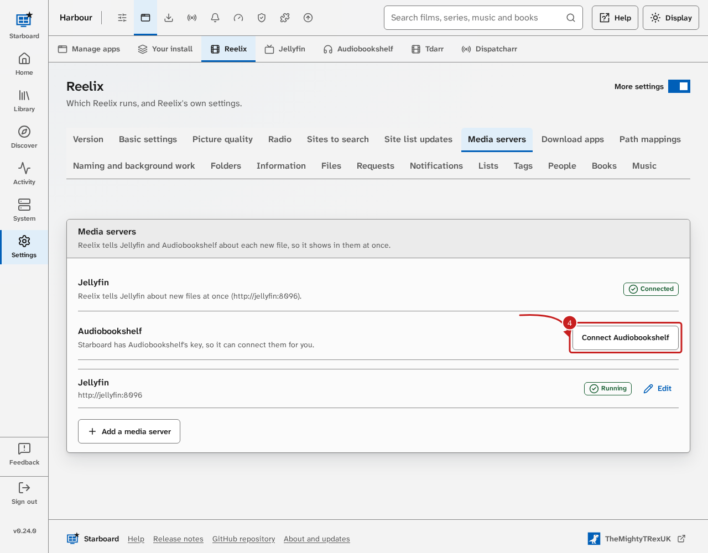
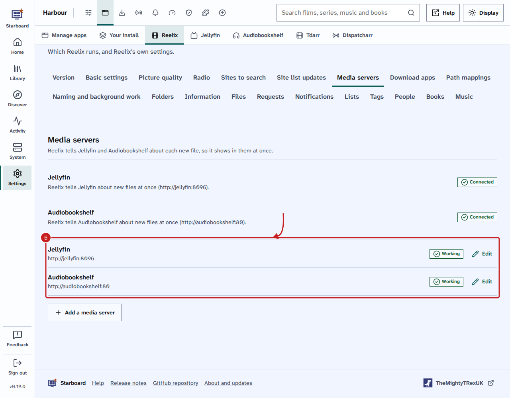
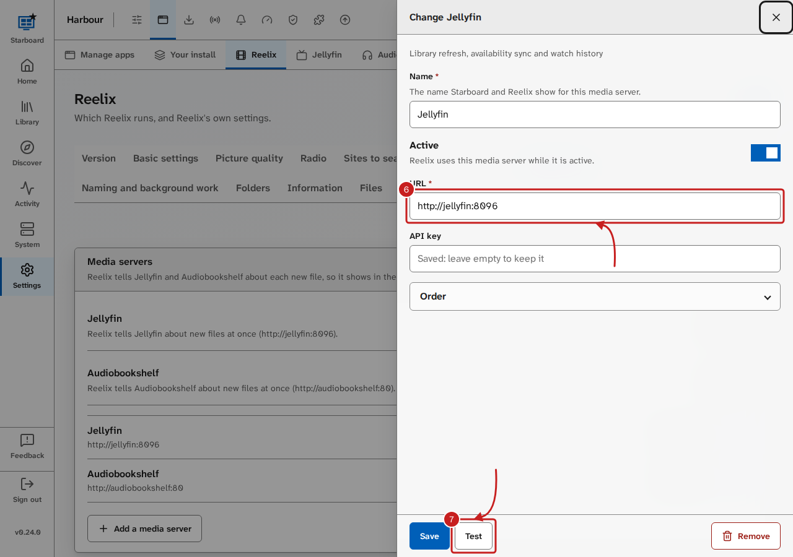

[Help centre](../README.md) · Apps · how-to
<!-- help: use / apps -->

# Connect Reelix to Jellyfin and Audiobookshelf

When Reelix adds a film, an episode or an audiobook, it can tell Jellyfin and Audiobookshelf at once. The new
file then shows in them straight away, not at their next scan. Starboard connects them with the API keys it
already has.

## Before you begin

- Jellyfin or Audiobookshelf is on **Settings**, **Apps**, **Manage apps**, with its API key. Read
  [Find an app's API key](find-an-api-key.md#where-each-app-keeps-its-key).
- You know Reelix's admin password. If Starboard set Reelix up, it is the same as your Starboard password.

## Steps

1. Go to **Settings**, then **Apps**, then **Reelix**.
2. Activate **More settings** at the right of the heading.
3. Select the **Media servers** tab, then **Show media servers**. Enter your Reelix password, then select
   **Continue**.
4. Select **Connect Jellyfin** or **Connect Audiobookshelf**. Starboard adds it to Reelix with its key, and
   tests it.

   

5. Check that it shows **Connected**, and that the list under it shows it as **Working**.

   

6. To change the address or key Reelix uses, select **Edit** beside it in the list. Change the **URL** or the key.
7. Select **Test**, then **Save**.

   

## Things to note

- [Install apps with Starboard](install-apps.md) connects them for you when Starboard already has their keys:
  when it sets Reelix up, and when you run it again later.
- When Starboard installed them, Reelix reaches them by name: `http://jellyfin:8096` and
  `http://audiobookshelf:80`. For one on another computer, Reelix uses its address in **Manage apps**.

## If it does not work

- **Add Jellyfin's API key first** or **Add Audiobookshelf's API key first:** Starboard has no key for that
  app. Add it in
  [Change an app's details](change-or-remove-an-app.md#change-an-apps-details).
- **The test did not pass:** Reelix cannot reach that address. Select **Change**, check the **URL**, then
  select **Test**.
- **Reelix's password is not the same as Starboard's** (in the log after Install apps): connect them on this
  page instead.

## Find out more

- [Change Reelix's settings in Starboard](change-reelix-settings.md)
- [Install apps with Starboard](install-apps.md)

<!-- footer: download rights -->

---

**Download only what you have the right to.** Use the download apps only for files you have the right to download,
such as open-source software, works in the public domain and your own backups. Downloading films, series, music or
books without the copyright holder's permission is against the law in the UK and most other countries. Starboard
does not host or provide any files, and you are responsible for what you download.

**Need help?** Ask on the [Starboard Discord support server](https://discord.gg/xN9bf2H4vv).

<!-- /footer -->
