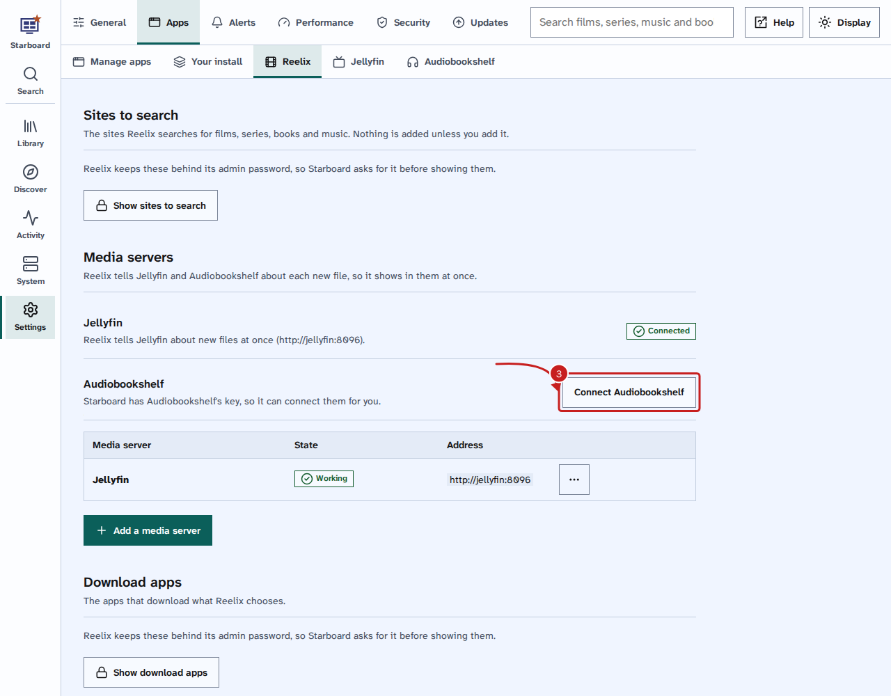
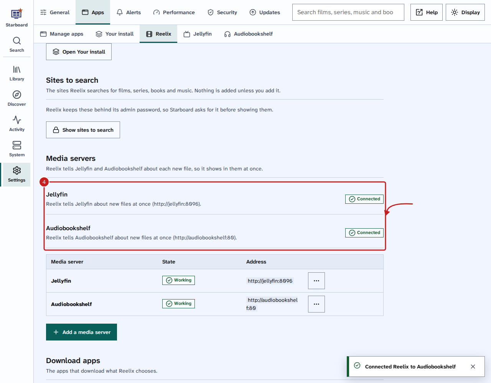
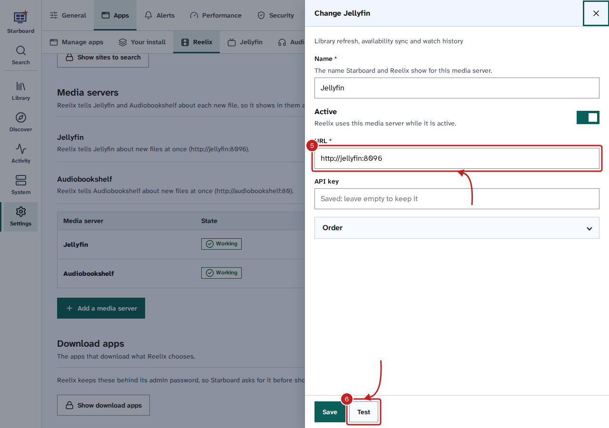

[Help centre](../README.md) · Apps · how-to

# Connect Reelix to Jellyfin and Audiobookshelf

When Reelix adds a film, an episode or an audiobook, it can tell Jellyfin and Audiobookshelf at once, so the new file
shows in them straight away instead of at their next scan. Starboard connects them with the API keys it already has
for Jellyfin and Audiobookshelf.

## Before you begin

- Starboard has Jellyfin's or Audiobookshelf's API key: they are on **Settings**, **Apps**, **Manage apps**, with a
  key. Read [Find an API key](find-an-api-key.md).
- You know Reelix's admin password. If Starboard set Reelix up, it is the same as your Starboard password.

## Steps

1. Go to **Settings**, then **Apps**, then **Reelix**.
2. Under **Media servers**, select **Show media servers**, then type your Reelix password and select **Continue**.
3. Beside Jellyfin or Audiobookshelf, select **Connect**. Starboard adds it to Reelix with its key, and tests it.

   

4. Check that it shows **Connected**.

   

5. To change the address or key Reelix uses, select the **More** button (three dots) beside it in the list, then
   **Change**, and change the **URL** or the key.
6. Select **Test**, then **Save**.

   

## Things to note

- **Install apps** connects them for you when Starboard already has their keys: when it sets Reelix up, and when you
  run it again later.
- Inside Starboard's set-up, Reelix reaches them by name: `http://jellyfin:8096` and `http://audiobookshelf:80`.
  For a Jellyfin or Audiobookshelf on another computer, Reelix uses the address on your dashboard.

## If it does not work

- **Add its API key first:** Starboard has no key for that app. Add it on **Settings**, **Apps**, **Manage apps**.
- **Its test did not pass:** Reelix cannot reach that address. Select **Change**, check the URL, then **Test**.
- **Reelix's password is not the same as Starboard's** (in the log after Install apps): connect them here instead.

## Find out more

- [Change Reelix's settings in Starboard](change-reelix-settings.md)
- [Install apps with Starboard](install-apps.md)

<!-- footer: download rights -->

---

**Download only what you have the right to.** Use the download apps only for files you have the right to download,
such as open-source software, works in the public domain and your own backups. Downloading films, series, music or
books without the copyright holder's permission is against the law in the UK and most other countries. Starboard
does not host or provide any files, and you are responsible for what you download.

<!-- /footer -->
