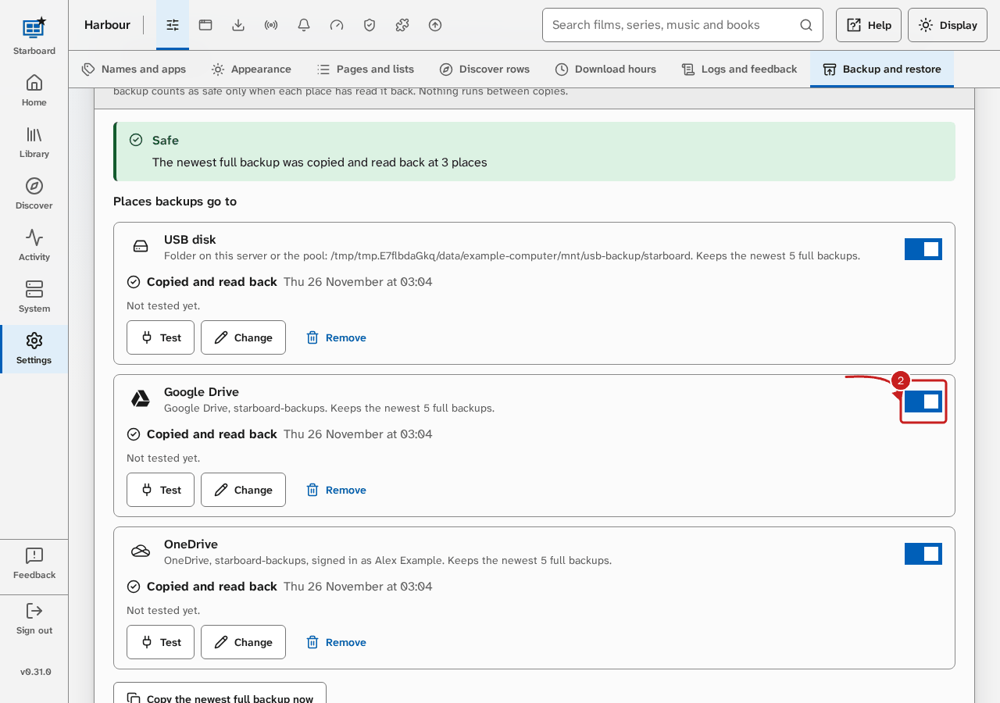
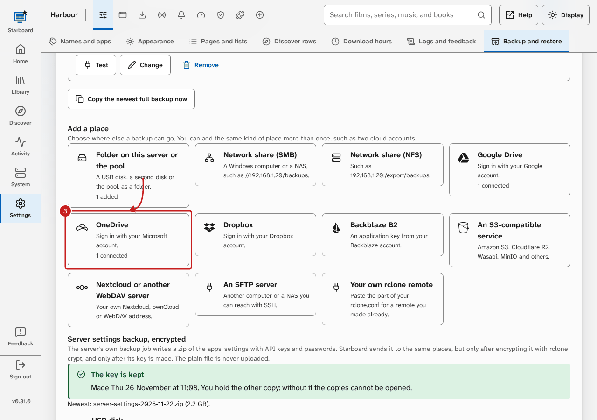
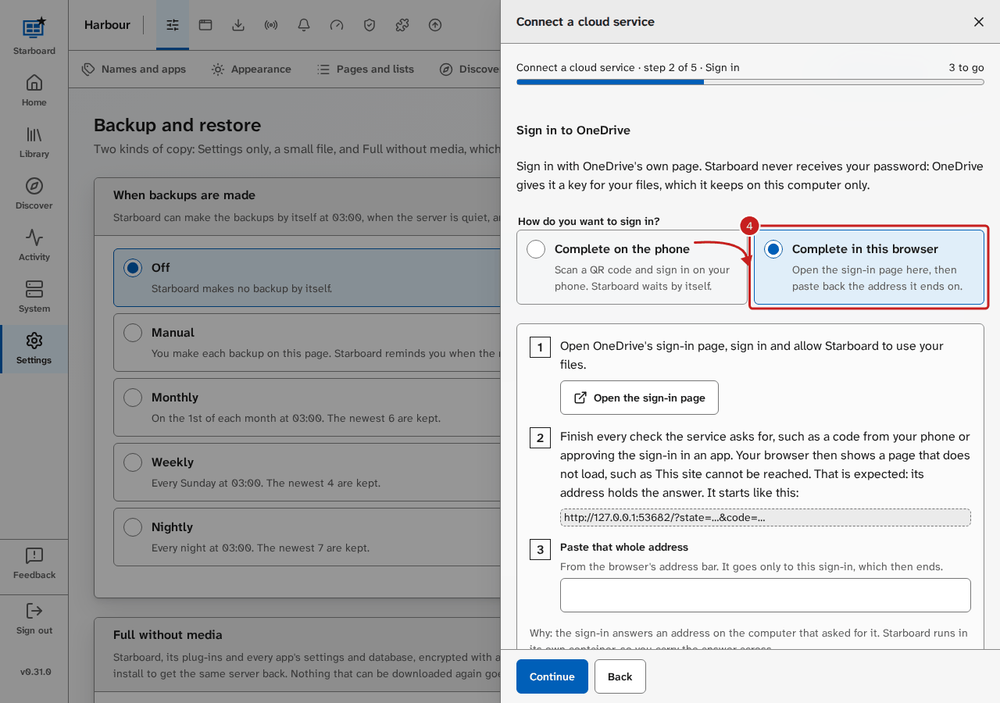
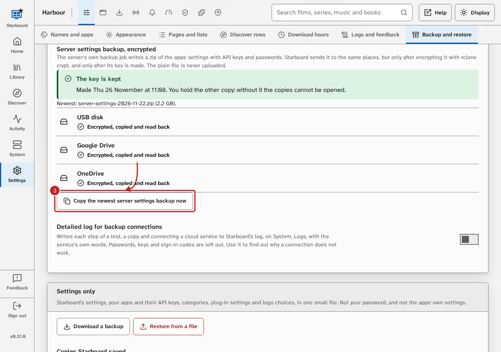

[Help centre](../README.md) · Backup and restore · how-to
<!-- help: use / backups -->

# Copy backups to a cloud service

Starboard can copy each new full backup to a cloud service, and to several other places at once, so a failed disk, a
theft or a fire does not take every copy. **Where backups go** lists every place: a folder on this server or the pool,
an SMB share, an NFS share, and each cloud service you connect. Each place has its own switch, its own number of
backups to keep, and its own last copy, shown in words and with a shape. The backups are encrypted with your backup
password before they leave this computer.

You can connect more than one cloud service, and the same service more than once. Each connection keeps its own rclone
remote, so connecting OneDrive never replaces Google Drive.

The services: Google Drive, OneDrive, Dropbox, Backblaze B2, an S3-compatible service (such as Amazon S3,
Cloudflare R2, Wasabi or MinIO), Nextcloud or another WebDAV server, and an SFTP server. If you already use rclone,
you can use your own remote instead.

## Before you begin

- You know Starboard's password. Starboard asks for it before it saves.
- Starboard makes full backups: read [Back up the whole server](back-up-the-server.md).
- An account with the service. For Backblaze B2, S3, WebDAV and SFTP, have its keys or password to hand.

## Steps

1. Go to **Settings**, then **General**, then **Backup and restore**.
2. Find **Where backups go**. Each place has a switch, **Test**, **Change** and **Remove**. A new Starboard has no
   places yet.

   

3. Under **Add a place**, select the service, such as **OneDrive**. A slide-out opens.

   

4. **Sign in.** For Google Drive and OneDrive, choose **Complete on the phone** or **Complete in this browser**. What
   you do depends on the service: read [Signing in to each service](#signing-in-to-each-service). You sign in on the
   service's own page. Starboard never receives your password.

   

5. **Choose the folder.** **Make a new folder (recommended)** is chosen, named `starboard-backups`. You can change
   the name, or choose a folder that is there already. Select **Continue to the test**.
6. **Test the connection.** Starboard makes the folder, writes a small file, reads it back and removes it. Each
   check shows **Done** when it works. Starboard then shows **Connected**. Select **Continue**.
7. **Check and save.** Enter how many backups to keep there in **Keep the newest** (5 unless you change it) and
   **Your Starboard password**. Select **Save and finish**.

The slide-out closes and the service is in the list, activated. Each new full backup is copied to it, and the oldest
there is removed once there are more than you keep. To add another service, select it under **Add a place** and go
through the steps again.

## When a backup counts as safe

At the top of **Where backups go**, Starboard says **Safe** or **Not yet safe**. A backup is safe only when every place
that is activated has copied it and read it back. If a place fails, the others are still made, and an alert says
which place failed.

## Change a place

- **Switch:** deactivate a place to leave it out of new backups. It keeps its settings.
- **Test:** checks the place again. It writes a small file, reads it back, removes it and checks there is room for the
  newest backup. The result shows beside the place: **Connected** with when it was tested, or **Not connected** with
  what to do. Starboard keeps the last result.
- **Change:** a cloud service opens its sign-in and folder steps again. A folder or a share opens its form.
- **Remove:** Starboard forgets the place's password or sign-in. Copies already there stay.
- **Copy the newest full backup now** copies to every place that is activated.

## Server settings backup, encrypted

The server's own backup job writes a zip of the apps' settings. It holds API keys and passwords, so Starboard sends it
to the same places only after encrypting it with rclone crypt. The plain file is never uploaded.

1. Under **Server settings backup, encrypted**, select **Make the key**. Starboard asks for your password.
2. Starboard shows the key once. Select **Copy the key** or **Save the key as a file**, store it in your password manager and
   on paper, then select **I have stored it**. Without it the copies cannot be opened.
3. The server's backup job asks Starboard to send each new zip. You can also select **Copy the newest server settings
   backup now**. Each place shows **Encrypted, copied and read back** or the reason it failed.

   

Each place keeps the newest 2 settings zips unless you change it with **Change**, because each is large.

## Signing in to each service

### Google Drive and OneDrive

You choose how to sign in: **Complete on the phone** or **Complete in this browser**. Starboard remembers your
choice for next time. When only **Complete in this browser** shows, follow that. Starboard never asks for your Google or Microsoft password: you sign in on Google's or
Microsoft's own page.

**Complete on the phone:**

1. Scan the QR code with your phone's camera. It opens Google's or Microsoft's page for signing in a device. You can
   also open the page written beside the QR code, on any device.
2. Enter the code Starboard shows. **Copy** copies it.
3. Sign in and allow Starboard to use your files.

Starboard waits by itself and moves to the next step when you have allowed it. The code works for 10 minutes. After
that, select **Try again** for a new one.

**Complete in this browser:**

1. Select **Open the sign-in page**. It opens in a new tab.
2. Sign in and allow Starboard to use your files. Finish every check the service asks for, such as a code from your
   phone or approving the sign-in in Microsoft Authenticator, in that same tab.
3. The tab then shows a page that does not load, such as "This site cannot be reached", with an address that starts
   `http://127.0.0.1:53682/` or `http://localhost:53682/`. This is expected: the address holds the answer from Google
   or Microsoft. It is not a failed sign-in.
4. Copy the whole address from the address bar, go back to Starboard and paste it into **Paste that whole address**.
5. Select **Continue**.

For Google Drive, Starboard asks only for the files and folders it makes itself. It cannot read your other files,
so the folder list shows only Starboard's own folders.

### Dropbox

Dropbox signs in in this browser only: follow **Complete in this browser** in the section before this one.

### Backblaze B2

1. In your Backblaze account, go to **Application keys** and select **Add a new application key**. Allow it to read
   and write the bucket for your backups.
2. In Starboard, enter the **Application key ID** and the **Application key**, then select **Continue**.
3. In **Choose the folder**, the first part of the folder is the bucket, such as `my-backups/starboard`.

### An S3-compatible service

1. Enter the **Address of the service**, such as `https://s3.eu-west-2.wasabisys.com`. Leave it empty for Amazon S3.
2. Enter the **Region** if the service uses one, such as `eu-west-2`.
3. Enter the **Access key ID** and the **Secret access key**, then select **Continue**.
4. In **Choose the folder**, the first part of the folder is the bucket.

### Nextcloud or another WebDAV server

1. In Nextcloud, go to **Files**, then **Files settings**, and copy the **WebDAV** address.
2. Make an app password for Starboard: **Personal settings**, then **Security**, then **Create new app password**.
3. In Starboard, enter the **WebDAV address**, choose the **Kind of server**, and enter your **User name** and the app
   password. Select **Continue**.

### An SFTP server

Enter the **Computer** (its name or address, such as `192.168.1.20`), the **Port** (usually 22), your **User name**
and **Password**, then select **Continue**.

### Your own rclone remote

If you made a remote with rclone already, choose **Your own rclone remote**. Enter it as `name:folder` and paste the
part of your `rclone.conf` from `[name]` to the next `[`. The command `rclone config file` shows where your
`rclone.conf` is. You can also paste it in the form that **Change** opens on a place you made that way.

## Things to note

- Starboard keeps the sign-in or the keys in its own folder, readable by Starboard only. They are never in a backup,
  and never sent back to the browser.
- Signing in, the folder list, the test and each copy run in a short-lived helper. It is removed when it finishes,
  and when you close the slide-out part way.
- Closing the slide-out before **Save and finish** saves nothing.
- To stop copying to a place, deactivate it, or select **Remove**. The copies already there stay.
- Each step of signing in goes to Starboard's log, on **System**, **Logs**: when it started, when the sign-in page was
  ready, when the address was pasted back, and why one did not finish. The sign-in's address, code and token are never
  written.

## Detailed log for backup connections

**Detailed log for backup connections**, at the end of **Where backups go**, adds the service's own words for
each step to Starboard's log: each **Test connection**, each copy, and each step of connecting a cloud service, such
as the reason Microsoft or Google gave for refusing a sign-in. Lines with a password, a key, a token or a sign-in code
are left out, and the log takes out addresses and names as it does everywhere. It is off unless you choose it, and it
saves as soon as you change it. Use it to find out why a connection does not work, then deactivate it.

## If it does not work

- **"That is not the address the sign-in ends on":** copy the address from the tab that did not load, after you
  allowed Starboard. It starts `http://127.0.0.1:53682/` or `http://localhost:53682/`.
- **"That address is from a different sign-in":** each sign-in page works once. Select **Open the sign-in page**
  again from the same step, then paste the new address.
- **"The time to sign in ran out":** select **Try again**. Each sign-in works for 10 minutes.
- **"You did not allow Starboard to use the account":** select **Try again** and allow access.
- **"The sign-in has expired or was taken back at the service":** select **Sign in again** beside the place. The
  slide-out opens at the sign-in step.
- **"The service did not accept those keys or that password":** check the keys at the service, then select **Try
  again**.
- **"Starboard could not reach the service":** check the address, and that the server or NAS is on.
- **The sign-in stops at a two-step check, or it is not clear why it did not work:** activate **Detailed log for
  backup connections**, try again, then read the lines for **cloud sign-in** and **backup connection** on **System**,
  **Logs**. They say which step it reached and what the service said.

## Find out more

- [Back up the whole server](back-up-the-server.md)
- [Back up and restore Starboard's settings](back-up-settings.md)

<!-- footer: download rights -->

---

**Download only what you have the right to.** Use the download apps only for files you have the right to download,
such as open-source software, works in the public domain and your own backups. Downloading films, series, music or
books without the copyright holder's permission is against the law in the UK and most other countries. Starboard
does not host or provide any files, and you are responsible for what you download.

**Need help?** Ask on the [Starboard Discord support server](https://discord.gg/xN9bf2H4vv).

<!-- /footer -->
