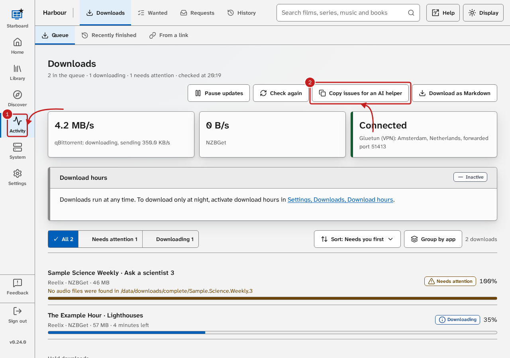
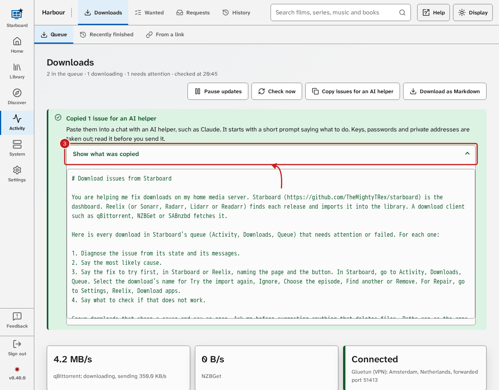
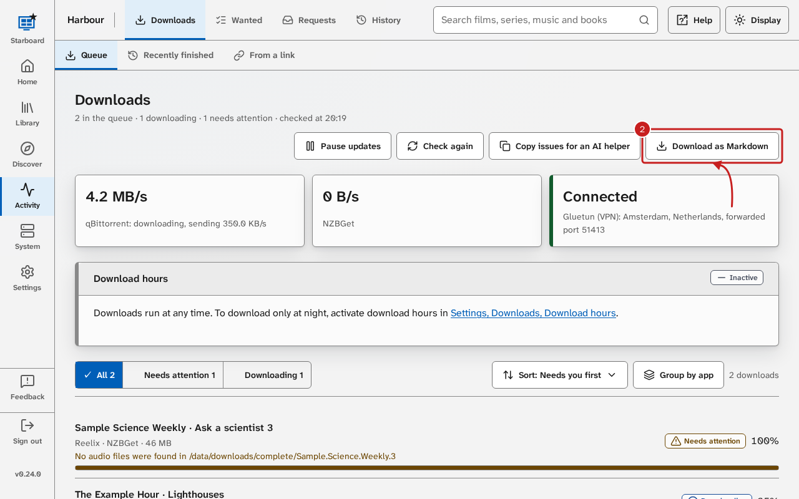

[Help centre](../README.md) · Everyday use · how-to
<!-- help: use / library -->

# Copy download issues for an AI helper

When downloads are stuck or failed, Starboard can copy every one of them, with all their details, ready to paste
into a chat with an AI helper such as Claude. The copy starts with a short prompt that asks the helper to diagnose
each issue, say the likely cause, the fix to try in Starboard or Reelix, and what to check if that does not work.

## Before you begin

- Reelix, or apps such as Sonarr and Radarr, are in Starboard with their API keys. Read [Add an app](add-an-app.md).
- An AI helper you already use, in a browser or an app.

## Steps

### Copy the issues

1. Go to **Activity**, then **Downloads**, then **Queue**.
2. Select **Copy issues for an AI helper**. Starboard asks each app for its queue once, and copies every download
   that needs attention or failed. It says **Copied** and the number of issues, such as **Copied 1 issue for an AI
   helper**.

   

3. Optional: select **Show what was copied** to read it first. Keys, passwords and private addresses are taken
   out.

   

4. Paste it into a chat with your AI helper and send it.

### Save the issues as a file

1. Go to **Activity**, then **Downloads**, then **Queue**.
2. Select **Download as Markdown**. Your browser saves a file whose name starts with `starboard-download-issues`.

   

3. Attach the file to a chat with your AI helper, or open it in any text editor.

## What the copy holds

For each download that needs attention or failed:

- its name, the film, episode, album, book or radio episode it is for, and its app
- the state Starboard shows and the app's own state words
- every message from the app
- its size, how far it got, the time left and how long ago it was added
- the indexer it came from, the protocol and the quality
- the download app, and the download's id in it
- where it downloaded to, as the path inside the app's container
- its ids in Reelix or in the app
- what Starboard already tried, such as **Try the import again** or **Choose the episode**, and since when the
  watch has found it needing attention

## Things to note

- Starboard takes out keys, passwords, tokens, email addresses, private addresses and full download addresses
  before it copies anything. Folders are only shown when they are media or download folders. Read the text before
  you send it all the same.
- What you paste into a chat leaves your network.
- Starboard asks the apps only when you select a button, never by itself, so the copy is as of that moment.
- When an app does not answer, the copy says so and leaves its downloads out.
- An AI helper can be wrong with confidence. Check each suggestion against the help before you act on it.
- Scripts and AI assistants can read the same with an API key: `GET /api/v1/downloads/issues`. Read
  [the API reference](../developers/api-reference.md#get-apiv1downloadsissues).

## If it does not work

- **It says No issues to copy:** nothing in the queue needs attention or failed. For everything in the queue, read
  [Pause, resume and remove downloads](manage-downloads.md).
- **It says the browser did not let Starboard copy:** select the text it shows and copy it yourself, or select
  **Download as Markdown**.

## Find out more

- [Pause, resume and remove downloads](manage-downloads.md)
- [Ask an AI assistant to help you set up](ask-an-ai-for-help.md)
- [Connect an AI assistant to Starboard](../developers/connect-an-ai-assistant.md)

<!-- footer: download rights -->

---

**Download only what you have the right to.** Use the download apps only for files you have the right to download,
such as open-source software, works in the public domain and your own backups. Downloading films, series, music or
books without the copyright holder's permission is against the law in the UK and most other countries. Starboard
does not host or provide any files, and you are responsible for what you download.

<!-- /footer -->
