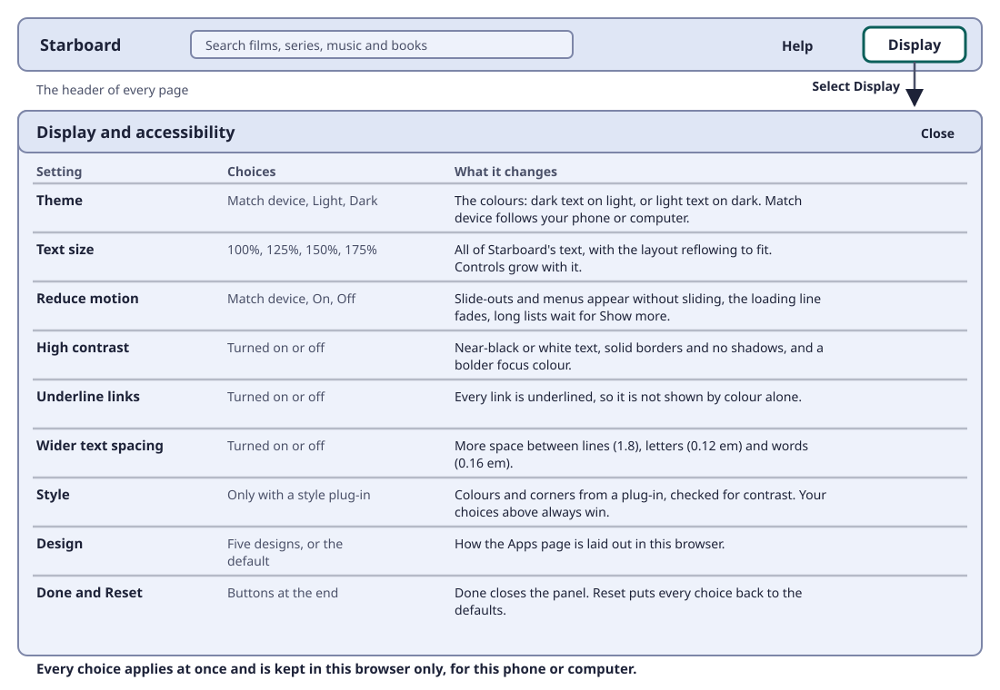

[Help centre](../README.md) · Everyday use · how-to

# Change text size, theme and other display settings

The **Display and accessibility** panel changes how Starboard looks and moves for you: light or dark, bigger text,
higher contrast, less movement, underlined links, wider spacing, the design of the Apps page and styles from
plug-ins. Each choice applies at once, is kept in the browser you use, and is undone the same way.

The diagram shows the Display button as the last item in the header, and each setting with its choices and what it
changes. The same information is in the table below.

## Steps

1. Select **Display** in the header of any page. It is the last item in the header, on every page, including
   Sign in and the set-up. A slide-out opens, called **Display and accessibility**, with focus on its **Close**
   button.
   
2. Make any of the choices in the table below. Each one applies at once, so you see the result behind the panel
   straight away.
3. Select **Done**, or press Escape. Focus goes back to **Display**.
   

To go back to the standard settings, select **Reset** at the end of the panel. Reset puts every choice in the panel
back to its default, including the design and the style, and says "Display settings reset" to screen readers.

## The choices

| Setting | Choices | What it changes | More |
|---|---|---|---|
| **Theme** | **Match device** (default), **Light**, **Dark** | Dark text on a light page, or light text on a dark page. | [Light, dark and high contrast](../accessibility/light-dark-and-high-contrast.md) |
| **Text size** | **100%** (default), **125%**, **150%**, **175%** | All of Starboard's text, with the page laid out again to fit. | [Text size and spacing](../accessibility/text-size-and-spacing.md) |
| **Reduce motion** | **Match device** (default), **On**, **Off** | Slide-outs, messages and lists appear without sliding, shimmering or loading by themselves. | [Reduce motion](../accessibility/reduce-motion.md) |
| **High contrast** | Activated or deactivated (default) | Near-black or white text, solid borders, no shadows and a bolder focus colour. | [Light, dark and high contrast](../accessibility/light-dark-and-high-contrast.md) |
| **Underline links** | Activated or deactivated (default) | Every link is underlined, not shown by colour alone. | [Underline links](../accessibility/underline-links.md) |
| **Wider text spacing** | Activated or deactivated (default) | More space between lines, letters and words. | [Text size and spacing](../accessibility/text-size-and-spacing.md) |
| **Style** | Only with a style plug-in | Colours and shape from a plug-in, checked for contrast. | [Choose a style from a plug-in](#choose-a-style-from-a-plug-in) |
| **Design** | Five designs, or the dashboard's default | How the Apps page is laid out in this browser. | [Choose a design for the Apps page](choose-a-design.md) |

### Make the same choices in Settings

The same choices, apart from the design and the style, are also in **Settings**, then **General**, then
**Appearance**, under **Accessibility**. They are the same settings: a change in one place shows in the other.
There, each change says **Saved** beside the control, and focus stays where it was.

## Choose a style from a plug-in

A style changes Starboard's colours and shape. Styles come from plug-ins, and Starboard checks each one for
accessibility before it can be chosen: every colour pair must meet WCAG 2.2 AA, in light and in dark. **Style**
shows in the Display panel only when an active plug-in has styles. Read [Add a plug-in](add-a-plugin.md).

1. Select **Display** in the header.
2. Under **Style**, choose a style. **Starboard's own style** is the standard look.
3. Select **Done**.

To go back to Starboard's own style, select **Reset style** under the list. **High contrast**, text size, wider
spacing, underlined links and reduced motion always win over a style.

## Things to note

- **Kept in this browser:** these settings, including the design and the style, are kept in the browser you use,
  not on the server and not with your sign-in. Each phone, computer and browser has its own. Set them again on each
  one you use.
- A private or incognito window may forget them when it closes. Clearing your browser's data for Starboard also
  clears them.
- **Settings for everyone on the server:** two related settings are kept on the server instead. The own style
  colours are in **Settings**, then **General**, then **Appearance**. **Load more as you scroll** is in
  **Settings**, then **General**, then **Pages and lists**, under **Long lists**.
- **Match device** uses the light, dark and motion settings of your phone or computer, so Starboard changes when
  they do.
- Starboard is built to WCAG 2.2 AA (Web Content Accessibility Guidelines), with large controls. Its typeface,
  Atkinson Hyperlegible Next, is designed to be easy to read for people with low vision, so there is no separate
  font setting.

## If it does not work

- **A setting goes back after closing the window:** the browser is in private mode, or blocks Starboard from
  keeping data. Use a normal window, or allow Starboard to keep data in your browser's settings.
- **The settings are different on another device:** they are kept per browser. Set them again there.
- **No Style in the panel:** no active plug-in has styles. Read [Add a plug-in](add-a-plugin.md).

## Find out more

- [Accessibility in Starboard](../accessibility/overview.md)
- [Use only a keyboard](../accessibility/use-only-a-keyboard.md)
- [Limits and known gaps](../accessibility/limits-and-known-gaps.md)
- [Choose a design for the Apps page](choose-a-design.md)
- [Add a plug-in](add-a-plugin.md)
- [Open Starboard from a phone or another computer](open-from-another-device.md)

<!-- footer: download rights -->

---

**Download only what you have the right to.** Use the download apps only for files you have the right to download,
such as open-source software, works in the public domain and your own backups. Downloading films, series, music or
books without the copyright holder's permission is against the law in the UK and most other countries. Starboard
does not host or provide any files, and you are responsible for what you download.

<!-- /footer -->
