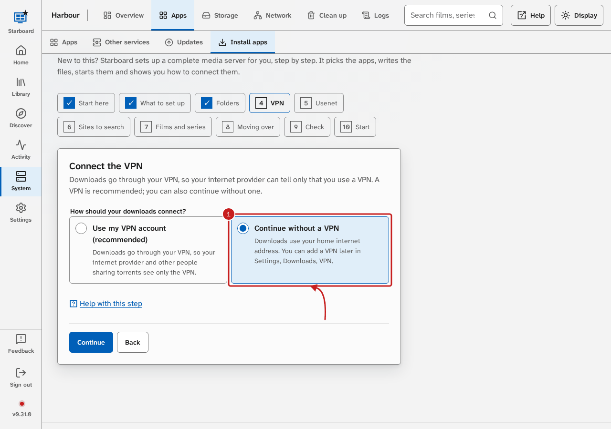
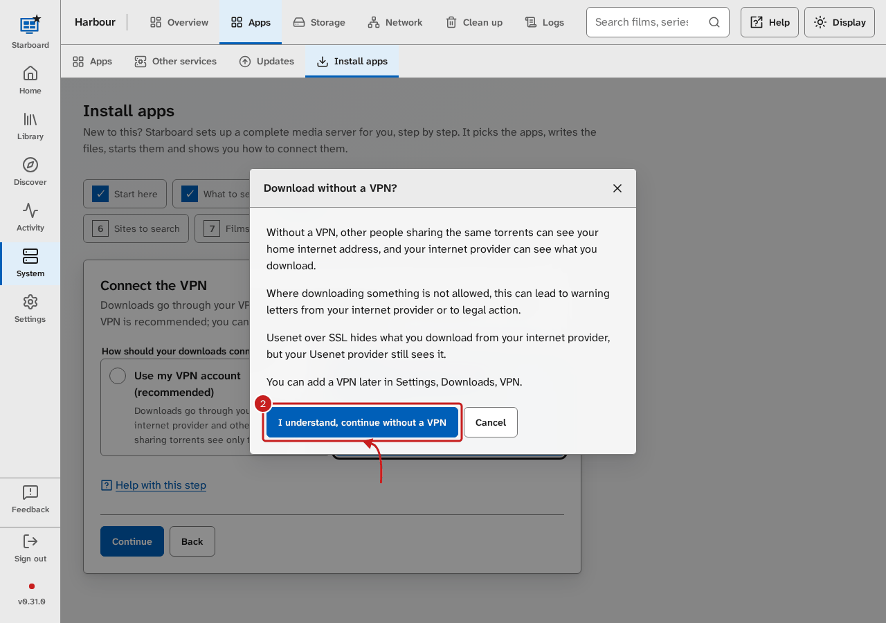
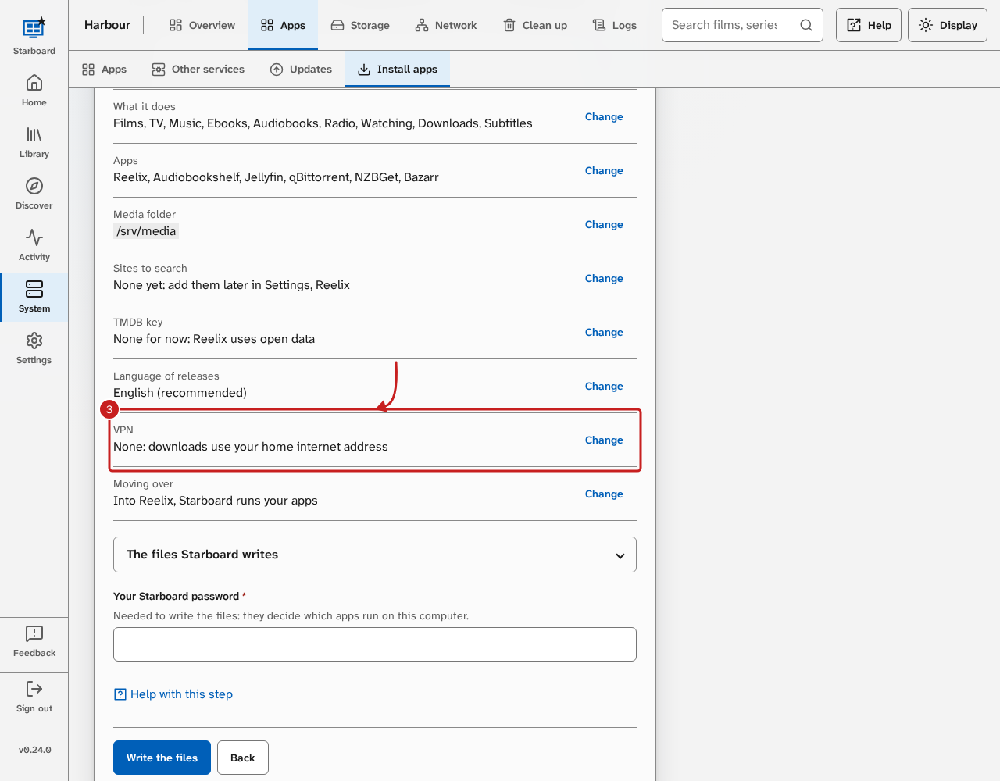
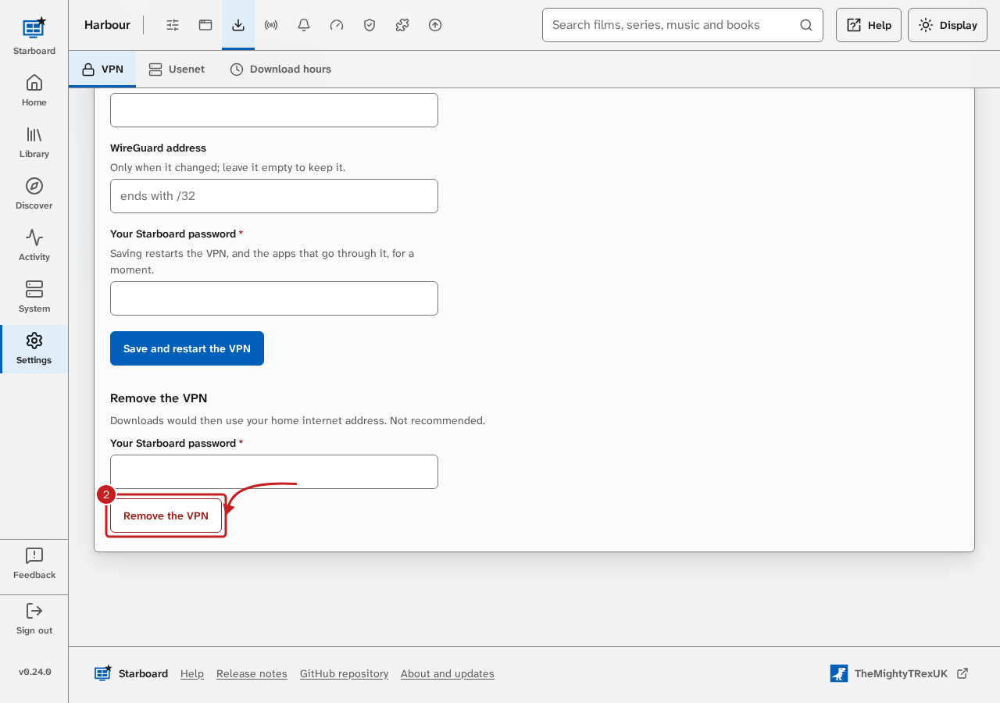

[Help centre](../README.md) · Everyday use · how-to
<!-- help: use / library -->

# Download without a VPN

A VPN (virtual private network) is recommended, but you can set up Starboard without one and add it later. This
page says what downloading without a VPN means, how to choose it, and how to add a VPN later in **Settings**.

## What it means

- Other people sharing the same torrents can find your home internet address.
- Your internet provider can tell what you download.
- Where downloading something is not allowed, this can lead to warning letters from your internet provider or to
  legal action.
- Usenet over SSL hides what you download from your internet provider, but your Usenet provider still knows it.

With a VPN, your internet provider and other people sharing torrents can tell only that you use a VPN. Read
[How Starboard keeps you safe](../basics/how-starboard-keeps-you-safe.md).

## Steps

1. In the set-up, on the **VPN** step, under **How should your downloads connect?**, choose **Continue without a
   VPN**, then select **Continue**.

   

2. Read the warning, **Download without a VPN?**. Select **I understand, continue without a VPN** to go on, or
   **Cancel** to go back and enter your VPN account.

   

3. Carry on with the set-up. On the **Check** step, **VPN** says **None: downloads use your home internet
   address**, and the apps have no Gluetun.

   

Starboard installs your apps without Gluetun. qBittorrent and NZBGet run on their own, with their own ports, and
Reelix connects to them by their names.

In the terminal set-up, the **VPN** step asks the same question first. Enter **2** for **Continue without a VPN**.
After the warning, press Enter to cancel, or enter **2** for **I understand, continue without a VPN**.

## Add a VPN later

1. Go to **Settings**, then **Downloads**, then **VPN**. It shows **No VPN**.
2. Select **Add a VPN**.
3. Choose your **VPN provider** and the **Connection**, **WireGuard** or **OpenVPN**. Enter the details from your
   provider's website.
4. Enter **Your Starboard password**, then select **Add the VPN**.

Starboard installs Gluetun, moves qBittorrent and NZBGet behind it, and points Reelix at them. Reelix's searches go
through the VPN too. The download apps restart for a moment.

## Remove the VPN

1. Go to **Settings**, then **Downloads**, then **VPN**.
2. Under **Remove the VPN**, enter **Your Starboard password**, then select **Remove the VPN**.

   

3. Read the warning. Select **I understand, remove the VPN**, or **Cancel** to keep it.

Starboard removes Gluetun, and qBittorrent and NZBGet run on their own with their own ports.

## Things to note

- While you download without a VPN, **Activity**, then **Downloads** shows **Downloading without a VPN**, with
  **Add a VPN**. Select **Hide for 90 days** to hide it. Starboard sends no alerts about it.
- The dashboard's **VPN** card says **No VPN**, with **Add a VPN**.
- Your VPN details go in the `.env` file on the server only, never in Starboard's settings or its logs.

## If it does not work

- **"Enter the WireGuard private key from your VPN provider"** or a similar message: a detail is missing. Copy it
  from your provider's WireGuard or OpenVPN configuration.
- **Gluetun shows as unhealthy after adding the VPN:** the details are not right, and the download apps wait for
  the VPN. Check them in **Settings**, then **Downloads**, then **VPN**.
- **Reelix does not reach qBittorrent after the change:** go to **Settings**, then **Reelix**, then
  **Download apps**, and select **Repair**.

## Find out more

- [Install apps with Starboard](install-apps.md)
- [Pause, resume and remove downloads](manage-downloads.md)
- [Change your install](change-your-install.md)
- [The apps Starboard works with](../basics/the-apps.md)

<!-- footer: download rights -->

---

**Download only what you have the right to.** Use the download apps only for files you have the right to download.
Examples are open-source software, works in the public domain and your own backups. Downloading films, series, music or
books without the copyright holder's permission is against the law in the UK and most other countries. Starboard
does not host or provide any files, and you are responsible for what you download.

**Need help?** Ask on the [Starboard Discord support server](https://discord.gg/xN9bf2H4vv).

<!-- /footer -->
