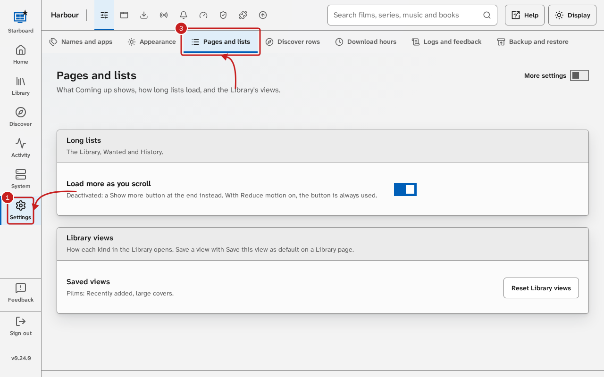
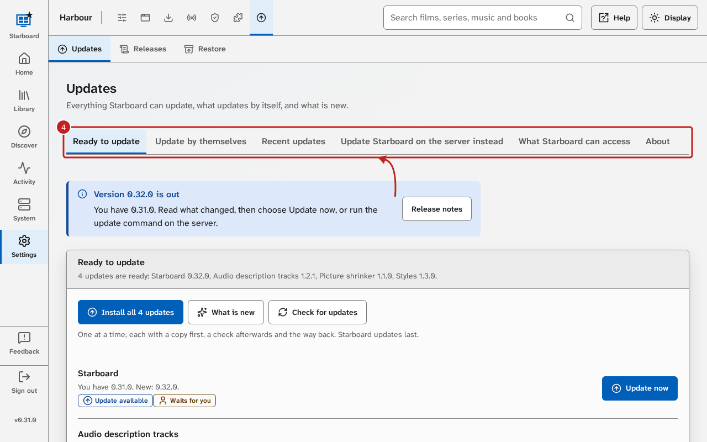
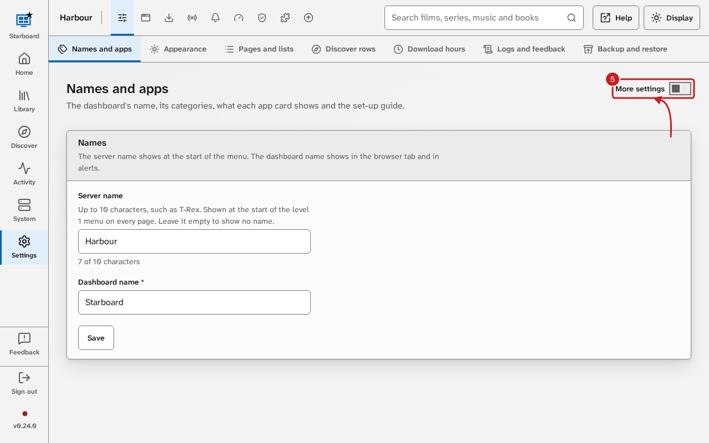
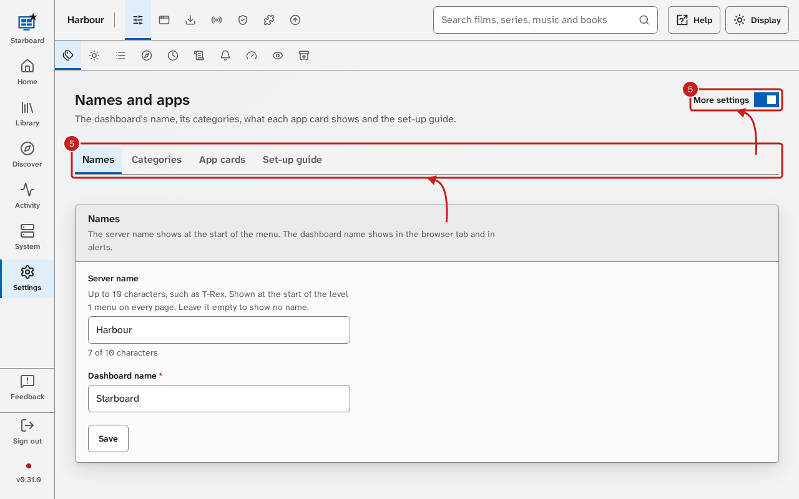

[Help centre](../README.md) · Everyday use · reference
<!-- help: use / apps -->

# What is in each Settings page

Each page under **Settings** in the side menu, what it holds, and the article that explains it. Use it to find
where a setting lives.

## Find your way

1. Select **Settings** in the side menu. **Sign out** is in the side menu too, under **Feedback**.
2. In the row of icons at the top, select an area: **General**, **Apps**, **Downloads**, **Radio**,
   **Security**, **Plug-ins** or **Updates**. Each icon's name shows when you point at it or move
   to it with the keyboard.
3. In the row under it, select a page, such as **Lists** under **General**.

   

4. On a page with four sections or more, a tab for each section shows under the heading. Select a tab to show
   that section.

   

5. Each page opens on its basic settings. To show the rest, activate the small **More settings** switch at the
   right of the heading. More sections and tabs appear. Your choice is saved for every Settings page.

   

   

## General

- **General:** the server and dashboard names. With **More settings**: categories, what app cards show
  and the set-up guide. Read [Organise apps into categories](organise-categories.md).
- **Appearance:** Starboard's own style and its colours, the default design and the accessibility choices for this
  browser. Read [Choose a design for the Apps page](choose-a-design.md).
- **Lists:** long lists and Library views. With **More settings**: Coming up. Read
  [Find out what is coming up](coming-up.md).
- **Discover:** which rows each Discover page shows.
- **Hours:** when downloads run. Read [Download only at certain hours](set-download-hours.md).
- **Alerts:** where alerts go. With **More settings**: what to alert on, a weekly summary and watching. Read
  [Activate alerts](activate-alerts.md) and [Get a weekly summary](weekly-summary.md).
- **Performance** and **Pictures:** **Performance** is for how much Starboard does. With **More settings**: each part
  of the background work, and how often pages update. Read [Make Starboard use less of your server](make-starboard-lighter.md).
- **Backup/Logs:** full backups of Starboard and every app's settings, the backup schedule, copies off this
  computer and restoring a backup, then the logs and **Send feedback**. Read [Back up Starboard's settings](back-up-settings.md),
  [Read the log](read-the-log.md) and [Send feedback about a page](send-feedback.md). **Updates**, **Restore** also
  restores a backup.

## Apps

- **Manage apps:** the apps on the Apps page, in order, with their addresses and API keys. Read
  [Add an app](add-an-app.md) and [Change or remove an app](change-or-remove-an-app.md).
- **Your install:** what Starboard installed, a bigger or smaller install, the Usenet app and which Reelix. Read
  [Change your install](change-your-install.md) and [Switch between the two versions of Reelix](switch-reelix-version.md).
- **Reelix:** Reelix's version, its sites to search, download apps, media servers and its own settings. Read
  [Change Reelix's settings in Starboard](change-reelix-settings.md).
- **Jellyfin:** a link to the Live TV plug-in's settings. With **More settings**: watch history from another
  server and the same defaults for every user. Read [Set up free Live TV in Jellyfin](set-up-live-tv.md),
  [Import watch history into Jellyfin](import-watch-history.md) and
  [Give every Jellyfin user the same defaults](jellyfin-user-defaults.md).
- **Audiobookshelf:** with **More settings**, where everyone is in each audiobook, copied from another
  server. Read [Copy listening progress into Audiobookshelf](copy-listening-progress.md).
- **Tdarr** and **Dispatcharr:** connect each one, when it is in your install. Read
  [Set up free Live TV in Jellyfin](set-up-live-tv.md) for Dispatcharr.

## Everything else

- **Downloads:** three pages: **VPN**, **Usenet**, with your Usenet provider's server and **Test the server**, and
  **Download hours**. Read [Choose a Usenet provider and add it](choose-a-usenet-provider.md),
  [Download without a VPN](download-without-a-vpn.md) and [Download only at certain hours](set-download-hours.md).
- **Radio:** **Sources**, **Add a show from a link**, **Your podcast library** and **Station logos**. Read
  [Follow radio shows and podcasts](follow-radio-shows.md).
- **Security:** four pages: **Who can open the dashboard**, **Password**, **API keys** and **Sign out everywhere**.
  Read [Choose who can open Starboard](choose-who-can-open-starboard.md),
  [Change your password](change-your-password.md), [Make an API key and use Starboard's API](use-starboards-api.md)
  and [Sign out everywhere](sign-out-everywhere.md).
- **Plug-ins:** **Manage**, **Catalogue** and a page for each plug-in you added. Read
  [Add a plug-in](add-a-plugin.md).
- **Updates:** **Updates** has Ready to update, Update by themselves, Recent updates and What Starboard can
  access. **Releases** lists what changed in each version. **Restore** puts back saved settings or an earlier
  version. Read [Update Starboard](update-starboard.md),
  [Change what Starboard can access](change-what-starboard-can-access.md) and
  [Go back to an earlier version](go-back-to-an-earlier-version.md).

## Find out more

- [Change text size, theme and other display settings](display-and-accessibility.md)
- [Use and change the dashboard](use-the-dashboard.md)
- [Everything Starboard does](everything-starboard-does.md)

<!-- footer: download rights -->

---

**Download only what you have the right to.** Use the download apps only for files you have the right to download,
such as open-source software, works in the public domain and your own backups. Downloading films, series, music or
books without the copyright holder's permission is against the law in the UK and most other countries. Starboard
does not host or provide any files, and you are responsible for what you download.

**Need help?** Ask on the [Starboard Discord support server](https://discord.gg/xN9bf2H4vv).

<!-- /footer -->
