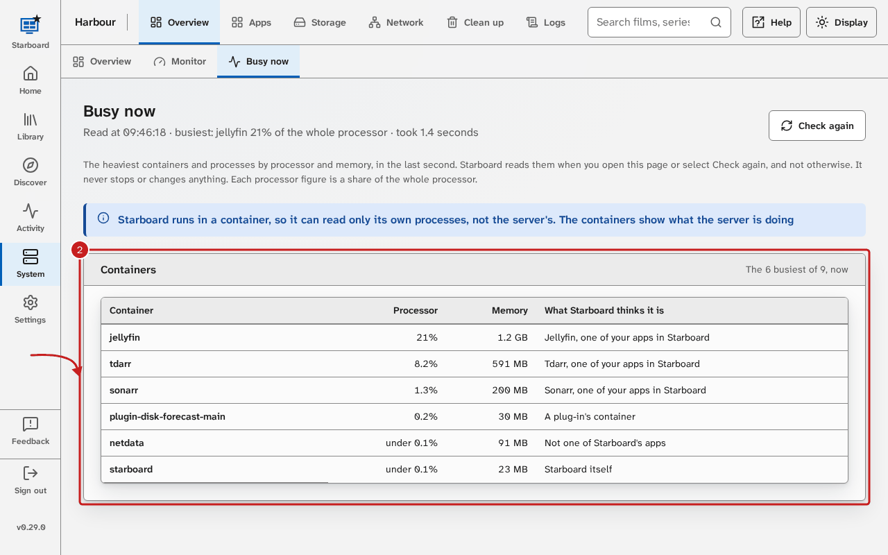
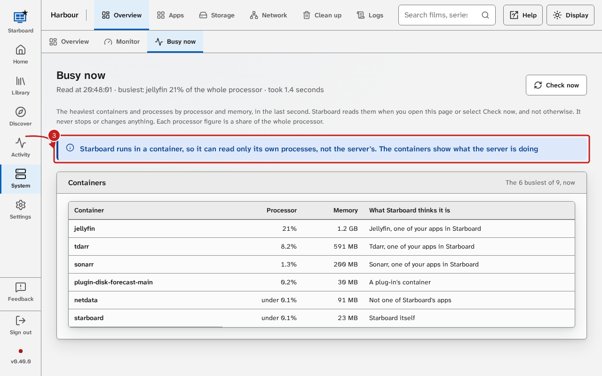
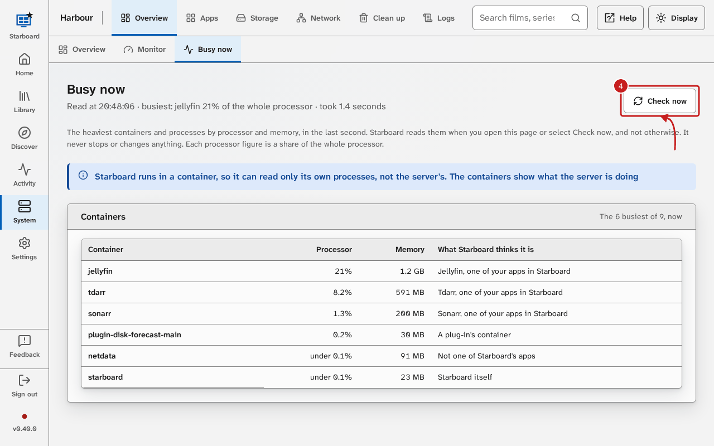

[Help centre](../README.md) · Your server · how-to
<!-- help: use / server -->

# Find out what is using the processor

When the server feels slow, **Busy now** lists the containers and processes that are using the most processor and
memory at that moment. It reads them once when you open the page, and again when you select **Check now**. It
never stops, restarts or changes anything: it only tells you.

## Before you begin

- For the list of containers, Starboard needs either Docker access or the option to show each app's processor and
  memory use. Read [Change what Starboard can access](change-what-starboard-can-access.md).
- The list of processes needs Starboard to run on the server itself. A Starboard that runs in a container, which is
  the usual way, can read only its own processes. The page says so, and the containers still show what is busy.

## Steps

1. Go to **System**, then **Overview**, then **Busy now**. Starboard reads for about a second and a half.
2. Read **Containers**. Each row has the container's name, its **Processor** (a share of the whole processor), its
   **Memory**, and **What Starboard thinks it is**: one of your apps, a plug-in, Starboard itself, or not one of
   Starboard's apps.

   

3. Read the notice at the top, if there is one. It says what Starboard could not read and why.

   

4. To read again, select **Check now**. The line under the title says when it was read, what was busiest and how
   long the reading took.

   

## Things to note

- Starboard reads only when you open the page or select **Check now**. It keeps nothing, and nothing runs when
  the page is closed. A reading takes about a second and a half and uses well under a quarter of one processor core
  for that time, and about 1 MB of memory.
- **Processor** is a share of the whole processor over the last second, as on the Monitor page. A container that
  uses one of four cores completely shows 25%.
- The lists are short on purpose: the busiest few by processor, and the biggest by memory, so a quiet container that
  holds a lot of memory still shows.
- A container that Docker does not answer for in time is left out, and the notice says how many.
- To watch the whole server change over minutes, use [Find out what each app is using](monitor-apps.md).

## Find out more

- [Find out what each app is using](monitor-apps.md)
- [Change what Starboard can access](change-what-starboard-can-access.md)
- [Check free space and what is using it](check-storage.md)

<!-- footer: download rights -->

---

**Download only what you have the right to.** Use the download apps only for files you have the right to download.
Examples are open-source software, works in the public domain and your own backups. Downloading films, series, music or
books without the copyright holder's permission is against the law in the UK and most other countries. Starboard
does not host or provide any files, and you are responsible for what you download.

**Need help?** Ask on the [Starboard Discord support server](https://discord.gg/xN9bf2H4vv).

<!-- /footer -->
