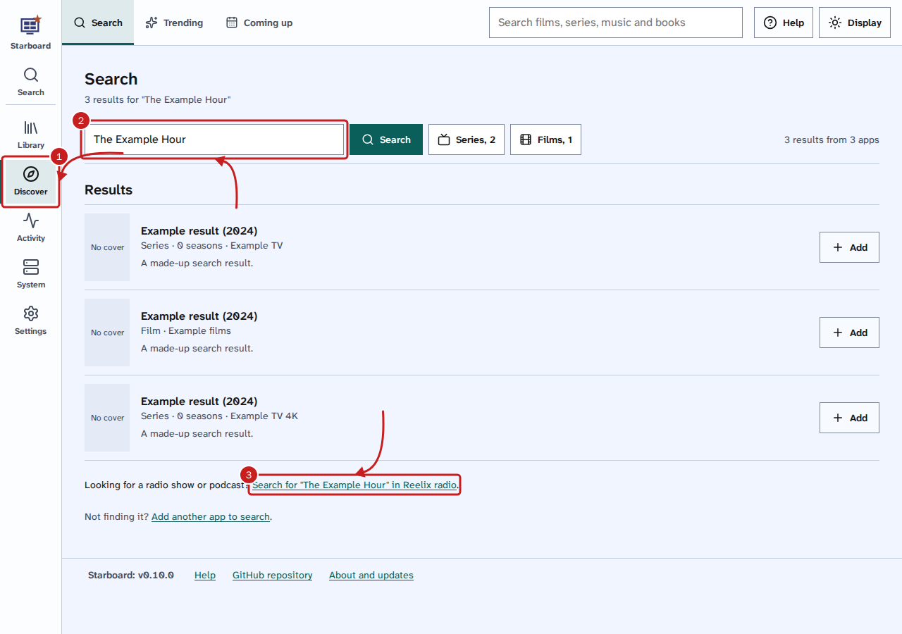
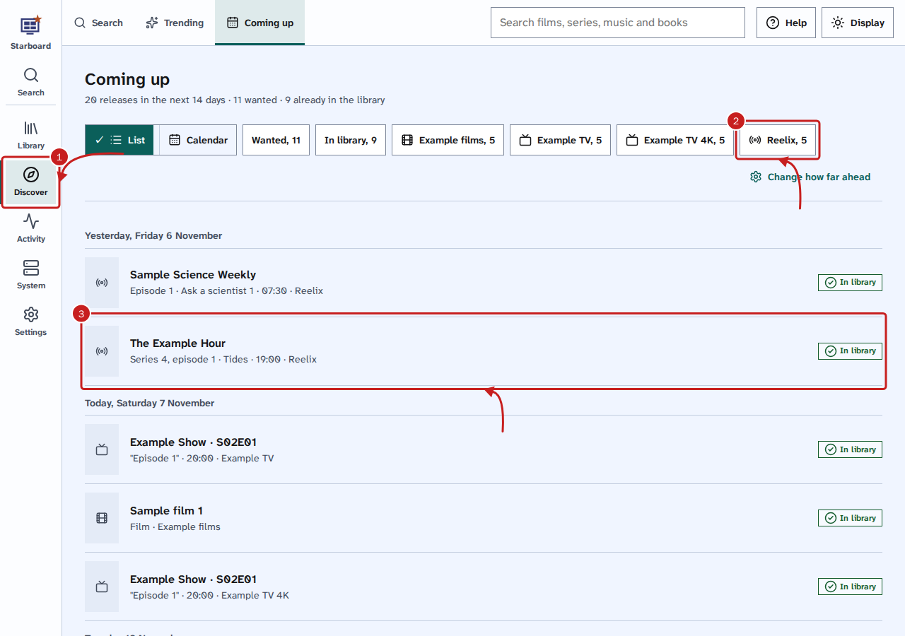
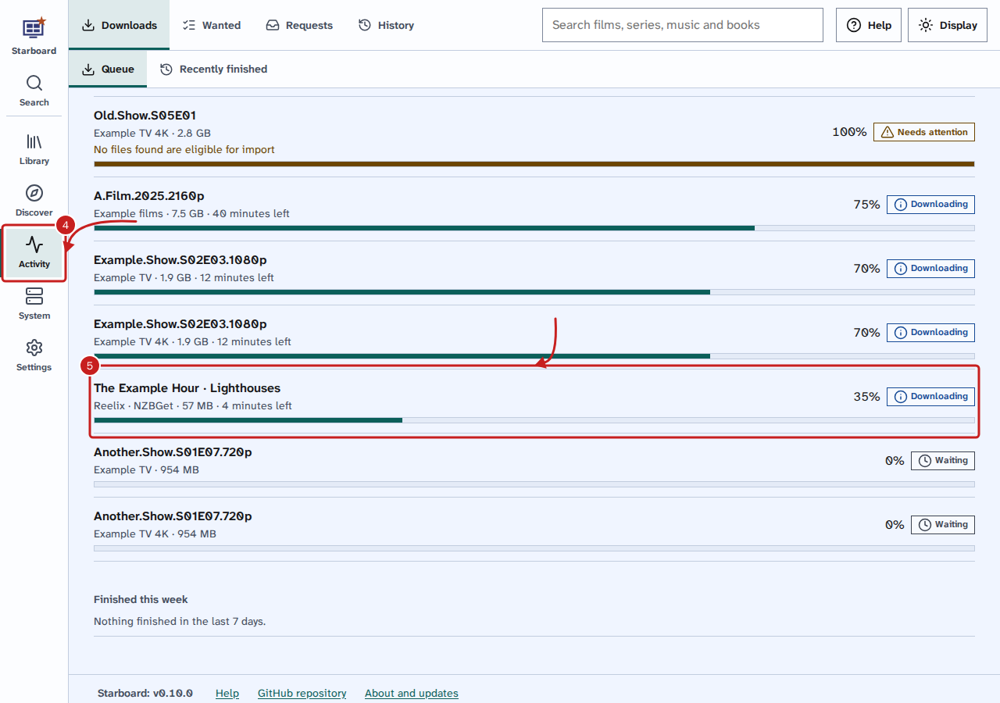

[Help centre](../README.md) · Everyday use · how-to

# Follow radio shows and podcasts

Reelix follows radio shows and podcasts for you: it downloads each new episode into the radio folder, and you
listen in Audiobookshelf. Starboard shows what is due in Coming up, and episodes downloading in Downloads.

## Before you begin

- Reelix and Audiobookshelf are installed. **Basics**, **Full install** and **Everything** install both, with
  the radio folder. If you chose the apps yourself, choose **Radio** in **Install apps**. Read
  [Install apps with Starboard](install-apps.md).
- To listen, Audiobookshelf needs a podcast library at the radio folder. The steps are below.

## Steps

### Find and follow a show

1. Go to **Discover**, then **Search**.
2. Type the show's name, such as `The Example Hour`, and select **Search**.
3. Under the results, select **Search for** and the show's name **in Reelix radio**. Reelix opens in a new
   tab, at **Add radio show**, with your words already searched.
4. In Reelix, select **Add** next to the show you want.
5. In **Follow**, choose **Episodes from now on**, or **Every episode, old and new** to fetch earlier ones too.
6. Select **Add show**. Reelix looks for each episode as it is broadcast.

### Listen in Audiobookshelf

Do this once. After that, every episode Reelix downloads appears in Audiobookshelf.

1. Open Audiobookshelf and sign in as its administrator.
2. Go to **Settings**, then **Libraries**, and select **Add Library**.
3. Give it a name, such as `Radio`, and choose **Podcasts** as the media type.
4. Add the folder `/media/radio`, then select **Create**.

### See what is due and what is downloading

1. Go to **Discover**, then **Coming up**. Episodes of the shows you follow are listed by the day and time they
   are broadcast, with a radio icon.
2. Optional: to see radio only, select **Reelix**. Select it again to see every app.
3. Select an episode to see its details. **Open in Reelix** opens the show's page in Reelix, in a new tab.

4. Go to **Activity**, then **Downloads**.
5. A radio episode shows the show's name and the episode's name, with **Reelix** as its app. Select it to see
   its details, find another copy or remove it, as for any download. Read
   [Pause, resume and remove downloads](manage-downloads.md).

## Things to note

- Reelix files each episode in `media/radio`, inside the data folder. Audiobookshelf sees the same folder as
  `/media/radio`.
- Coming up reads the 20 shows Reelix checked most recently. Shows beyond those are still followed and
  downloaded; they are not listed in Coming up.
- To stop following a show, change its **Follow** choice in Reelix, at **Radio**, then the show.
- Coming up and Downloads need the key Starboard made when it set up Reelix. A Reelix you added by hand shows no
  radio until you add its API key to the **Reelix** entry in **Settings**, **Apps**. Read
  [Find an app's API key](find-an-api-key.md).

## If it does not work

- **No link to Reelix radio under the results:** Starboard has no **Reelix** entry. Install Reelix in
  **Install apps**, or add it in **Settings**, **Apps**.
- **No radio in Coming up:** none of the shows you follow has an episode due in that time. Choose a longer time
  in **How far ahead**. Read [Find out what is coming up](coming-up.md).
- **Episodes download but are not in Audiobookshelf:** check the podcast library's folder is `/media/radio`.
  In Audiobookshelf, select the library, then **Scan**.
- **A warning about Reelix:** Reelix did not answer. Read [An app shows as not responding](app-not-responding.md).

## Find out more

- [Find out what is coming up](coming-up.md)
- [Pause, resume and remove downloads](manage-downloads.md)
- [Install apps with Starboard](install-apps.md)

<!-- footer: download rights -->

---

**Download only what you have the right to.** Use the download apps only for files you have the right to download,
such as open-source software, works in the public domain and your own backups. Downloading films, series, music or
books without the copyright holder's permission is against the law in the UK and most other countries. Starboard
does not host or provide any files, and you are responsible for what you download.

<!-- /footer -->
