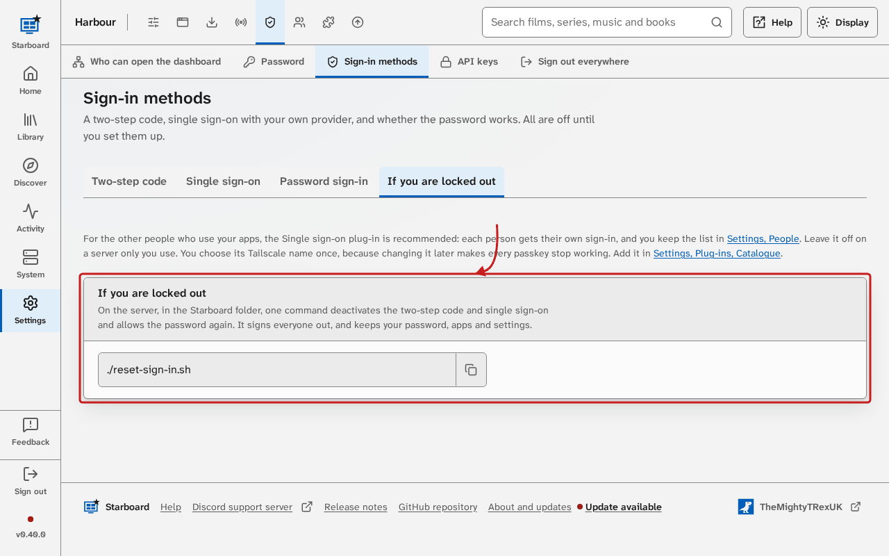
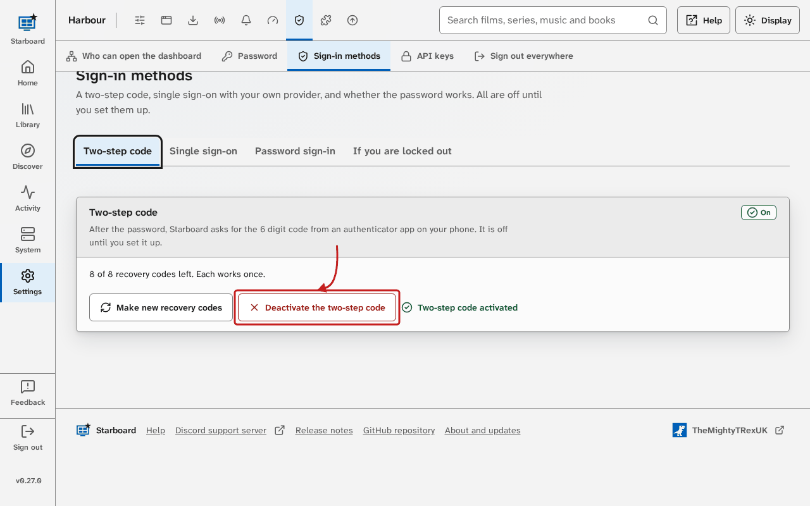
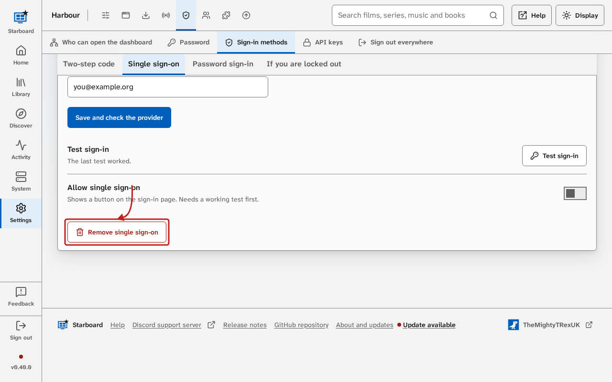

[Help centre](../README.md) · Security · how-to
<!-- help: use / security -->

# Get back in when sign-in is locked

If you cannot sign in because the two-step code or single sign-on is in the way, one command on the server turns both
off and allows the password again. Your password, apps and settings stay as they are.

## Before you begin

- You can enter commands on the server, at its keyboard or over SSH (secure shell). Read
  [The terminal: entering commands](../basics/the-terminal.md) and
  [Connect to your server from another computer](connect-with-ssh.md).
- You know how you installed Starboard: with the installer, or from the ready-made image.
- You still know the password. If not, read [Reset a forgotten password](reset-a-forgotten-password.md), which also
  turns off the two-step code and single sign-on.

## Steps

### If you used the installer

1. On the server, go to the folder you installed Starboard in. For example:

   ```bash
   cd ~/starboard
   ```

2. Run the script. It turns off the two-step code and single sign-on, allows the password, signs everyone out and
   restarts Starboard:

   ```bash
   ./reset-sign-in.sh
   ```

   It ends with "The two-step code and single sign-on are off, the password works again and everyone is
   signed out".
3. Open Starboard and sign in with your password.

### If you used the ready-made image

1. On the server, go to the folder that holds `compose.image.yaml`.
2. Leave a file that asks Starboard to do this when it next starts:

   ```bash
   touch data/reset-sign-in
   ```

3. Restart Starboard:

   ```bash
   docker restart starboard
   ```

4. Open Starboard and sign in with your password.

## Where the command is

The sign-in page tells you about it, and so does the **If you are locked out** tab in **Settings**, **Security**, **Sign-in methods**.







## Things to note

- Your provider's details stay saved, but single sign-on stays off until you turn it on again.
- The script does not change your password. Use it only on the server itself; nothing in the browser or the API
  can run it.
- Turning single sign-on off in Settings also allows the password again, so you are never left with no way in.

## If it does not work

- **"Stopped: no data folder here":** you are in the wrong folder. Go to the folder you installed Starboard in.
- **"Stopped: Starboard did not restart":** its log says why. Run `docker compose logs starboard`, or for
  `--native` installs, `journalctl --user -u starboard`.

## Find out more

- [Set up a two-step code](set-up-a-two-step-code.md)
- [Set up single sign-on](set-up-single-sign-on.md)
- [Reset a forgotten password](reset-a-forgotten-password.md)

<!-- footer: download rights -->

---

**Download only what you have the right to.** Use the download apps only for files you have the right to download.
Examples are open-source software, works in the public domain and your own backups. Downloading films, series, music or
books without the copyright holder's permission is against the law in the UK and most other countries. Starboard
does not host or provide any files, and you are responsible for what you download.

**Need help?** Ask on the [Starboard Discord support server](https://discord.gg/xN9bf2H4vv).

<!-- /footer -->
