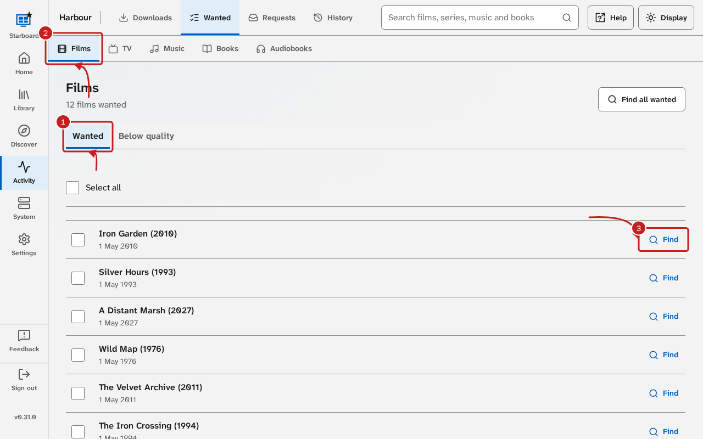
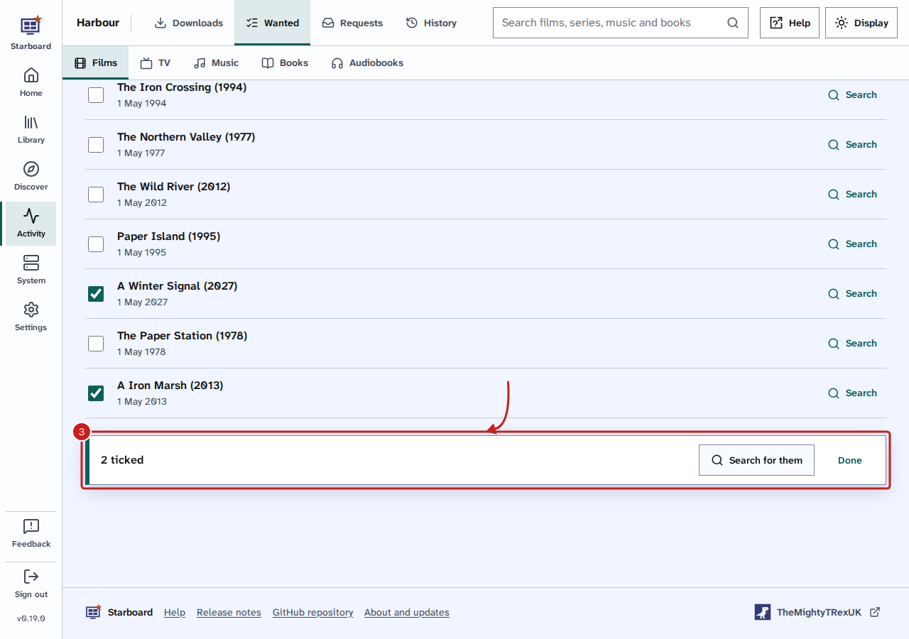
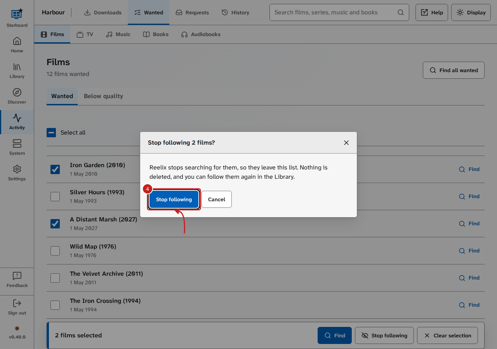
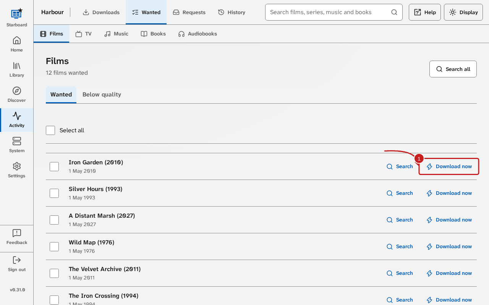

[Help centre](../README.md) · Everyday use · how-to
<!-- help: use / library -->

# Find and get what is missing

**Activity**, then **Wanted** lists the films and episodes Reelix follows but does not have yet, and those it has
at a lower quality than you want. You can ask Reelix to search for one, for a few you tick, or for the whole list,
and stop following the ones you no longer want.

## Before you begin

- Reelix is in Starboard with its key. Read [Install apps with Starboard](install-apps.md).
- Reelix has sites to search. Read [Choose the sites Reelix searches](choose-sites-to-search.md).

## Steps

1. Go to **Activity**, then **Wanted**. Choose **Not in library**, or **Below the quality wanted**.
2. Choose the kind: **Films**, **TV**, **Music**, **Books** or **Audiobooks**. The page says how many there are,
   such as **12 films missing**. Select a film or episode to open its details.
3. Search in one of these ways:
   - For one title, select **Search** beside it.
   - For a few, tick the box at the start of each row, then select **Search** in the bar at the foot of the
     list. Read [Act on several at once](#act-on-several-at-once).
   - For the whole list, select **Search all**, then **Search all** again to confirm. Reelix searches a few at a
     time, so a long list can take a while.

   

4. Starboard says what Reelix is doing. What Reelix finds appears in **Activity**, then **Downloads**. Read
   [Pause, resume and remove downloads](manage-downloads.md).

### Act on several at once

Use this to search for several titles together, or to stop following titles you no longer want.

1. Tick the box at the start of each row. To tick a run of rows, tick the first, then hold **Shift** and tick the
   last. To tick every row on the list, tick **Select all**.
2. A bar at the foot of the list says how many are selected and shows what you can do with them: **Search**,
   **Stop following** and **Clear selection**. While download hours pause downloads, films and episodes also have
   **Download now**.

   

3. Select an action. **Search** starts at once. **Stop following** and **Download now** ask first and say how
   many titles they act on.
4. For **Stop following**, select **Stop following** again to confirm.

   

5. Starboard says what was done, such as **Reelix no longer follows 2 films**.

After **Stop following**, Reelix stops searching for those titles, so they leave the list. Nothing is deleted, and
you can follow them again in the Library. Read
[Browse your library](browse-your-library.md#get-follow-or-delete-a-title).

**Select all** ticks the rows the page shows so far. Choosing the other list, **Not in library** or
**Below the quality wanted**, clears the ticks.

### Download one item outside download hours

While [download hours](set-download-hours.md) pause downloads, each item has **Download now**.

1. Select **Download now** beside the item.
2. Select **Download now** again to confirm.

   

Reelix searches for it now, and it downloads as soon as it is found. Everything else stays paused until the
hours start. The **Download hours** panel on the Queue page names what is downloading outside the hours.

## Things to note

- **Below the quality wanted** shows the quality each item has and the quality you want, such as **Has** 720p,
  **wants** 1080p.
- The list shows a page at a time. Select **Show more** for the next page.
- To choose a copy yourself, open the title in the Library and select **Choose a download**. Read
  [Browse your library](browse-your-library.md#get-follow-or-delete-a-title).

## If it does not work

- **Reelix could not be asked:** Reelix did not answer, or Starboard has no Reelix with its key. Check Reelix on
  the **Apps** page. Read [An app shows as not responding](app-not-responding.md).
- **Nothing is missing.** or **Everything is at the quality wanted.**: there is nothing to search for.

## Find out more

- [Search for and add films, series, music and books](search-and-add.md)
- [Download only at certain hours](set-download-hours.md)
- [Browse your library](browse-your-library.md)

<!-- footer: download rights -->

---

**Download only what you have the right to.** Use the download apps only for files you have the right to download.
Examples are open-source software, works in the public domain and your own backups. Downloading films, series, music or
books without the copyright holder's permission is against the law in the UK and most other countries. Starboard
does not host or provide any files, and you are responsible for what you download.

**Need help?** Ask on the [Starboard Discord support server](https://discord.gg/xN9bf2H4vv).

<!-- /footer -->
