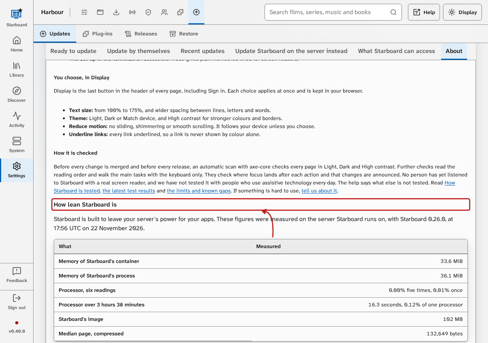
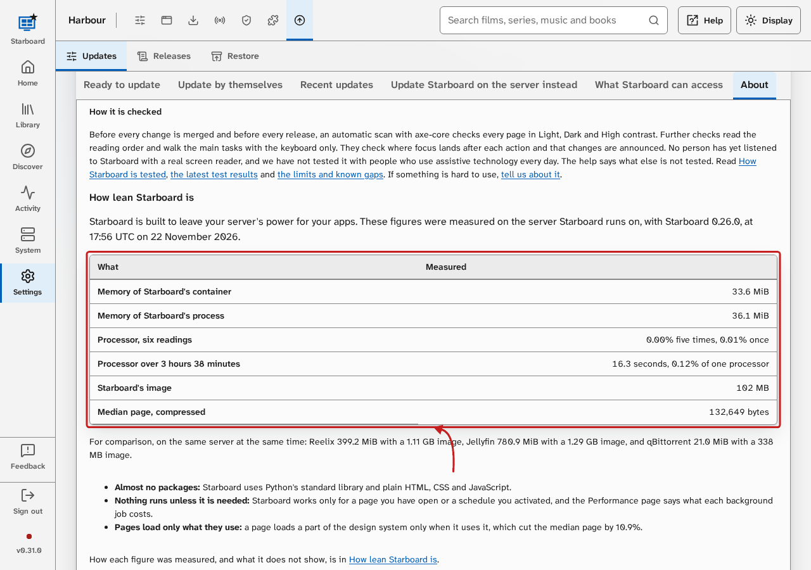
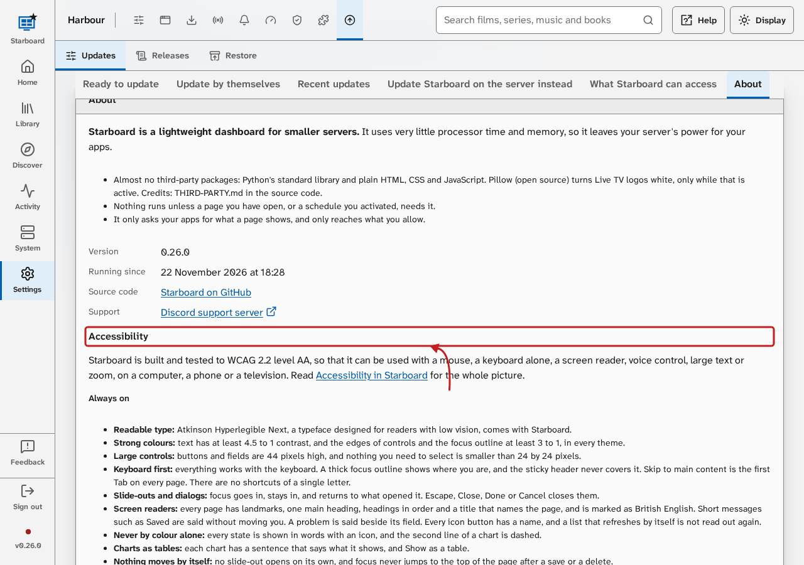

[Help centre](../README.md) · Your server · reference
<!-- help: use / server -->

# How lean Starboard is

Starboard aims to leave your server's power for your apps. This topic gives the figures that **Settings**,
**Updates**, **About** shows, how the measurements work and what they leave out. Then repeat them on your own
server.

## When would you use it

- You want to know what Starboard costs your server, in memory, processor, disk space and page size.
- You run a small server and want to know whether Starboard fits.
- You want to repeat the measurement on your own server.

## What was measured



These readings come from 17:56 UTC on 22 November 2026, on the home server that runs Starboard 0.26.0. That server
has 12 processors and 15.5 GiB of memory. It was doing its normal work during the readings: Gluetun used about 50% of
one processor and NZBGet about 17%. They are readings of one server, not a benchmark, so yours will differ.

| What | Measured | How |
|---|---|---|
| Memory of Starboard's container | 33.6 MiB | The memory column of `docker stats`, six readings 5 seconds apart, all the same |
| Memory of Starboard's process | 36.1 MiB | The resident size (RSS) of its one Python process, from `docker top` |
| Processor, six readings | 0.00% five times, 0.01% once | The processor column of `docker stats`, as a percentage of one processor |
| Processor over 3 hours 38 minutes | 16.3 seconds, 0.12% of one processor | The container's total processor time (`usage_usec` in its control group's `cpu.stat`) divided by the time since it started |
| Processor over 162 seconds | 0.05% of one processor | The same figure read twice, 162 seconds apart |
| Starboard's image | 102 MB | `docker images`, which shows the size on disk, uncompressed |
| Median page, compressed | 132,649 bytes | Read [Page size](#page-size) |

On the same server at the same time, the apps Starboard runs used this much memory:

- Reelix: 399.2 MiB, with a 1.11 GB image
- Jellyfin: 780.9 MiB, with a 1.29 GB image
- qBittorrent: 21.0 MiB, with a 338 MB image
- Bazarr: 174.7 MiB, with a 643 MB image
- Audiobookshelf: 87.2 MiB, with a 525 MB image



## Page size

Page size is the number of bytes a browser downloads for a page. That is its HTML, its styles and its scripts, as
Starboard sends them, compressed with gzip at its highest level.

The change that loads the design system's new parts
only on the pages that use them (DASH-507, 20 November 2026) came with a measurement. The median across Starboard's
pages fell from 148,865 to 132,649 bytes, which is 10.9% less. The Dashboard fell from 145,349 to 128,364 bytes.

The same figure, checked again from the files on 22 November 2026, gave a median of 132,627 bytes. That check applied
gzip level 9 to each of the 99 pages with the styles and scripts it names. The smallest page is 114,497 bytes and the
largest 219,800 bytes.

The 22 bytes between the two figures are 0.02% of the page. The figures leave out fonts and pictures.

## How to measure your own server

1. Memory and processor, as Docker counts them. On the server, run this and read the line for `starboard`:

   ```bash
   docker stats --no-stream
   ```

2. Run it a few times, a few seconds apart. A single reading of the processor is a snapshot of the moment.
3. The processor over a longer time. The first number is the container's processor time in microseconds, and the
   second is how long it has run, in seconds:

   ```bash
   docker inspect starboard --format '{{.State.StartedAt}}'
   cat /sys/fs/cgroup/system.slice/docker-$(docker inspect starboard --format '{{.Id}}').scope/cpu.stat | head -1
   ```

   Divide the processor time by the seconds, and by 1,000,000. On a server that does not use that folder for its
   control groups, the second command shows nothing.

4. The size of the image:

   ```bash
   docker images starboard
   ```

## What these figures do not show

- **A different day gives different figures.** Memory depends on what else the server is doing. Linux takes back its
  file cache when memory is short, and Docker counts part of that cache in a container's memory. The container's whole
  memory, cache included, was 41.2 MiB at the time of the readings.
- **Starboard's memory moves a little.** In an earlier set of readings, 31 minutes before, its container used 32.0
  MiB. In this set it used 33.6 MiB.
- **The page size leaves out pictures and fonts.** It is the code a page needs, not the posters it shows.
- **The comparison tests are separate.** [Memory and processor](../comparisons/memory-and-processor.md) compares
  whole stacks on a fresh, empty set-up, with its own method.

## How Starboard stays light



- It uses Python's standard library and plain HTML, CSS and JavaScript. The only package it needs, Pillow, turns Live
  TV logos white, and only while that is active.
- It does no work unless a page you have open, or a schedule you turned on, needs it. Read
  [Make Starboard use less of your server](make-starboard-lighter.md) for what each background job costs, and how to
  turn it off.
- It asks your apps only for what a page shows, and only reaches what you allow.
- A page loads a part of the design system only when it uses it.

## Find out more

- [Make Starboard use less of your server](make-starboard-lighter.md)
- [Memory and processor: Starboard against other stacks](../comparisons/memory-and-processor.md)
- [How the tests were run, and how to repeat them](../comparisons/how-the-tests-were-run.md)
- [What Starboard is](../basics/what-is-starboard.md)

<!-- footer: download rights -->

---

**Download only what you have the right to.** Use the download apps only for files you have the right to download.
Examples are open-source software, works in the public domain and your own backups. Downloading films, series, music or
books without the copyright holder's permission is against the law in the UK and most other countries. Starboard
does not host or provide any files, and you are responsible for what you download.

**Need help?** Ask on the [Starboard Discord support server](https://discord.gg/xN9bf2H4vv).

<!-- /footer -->
