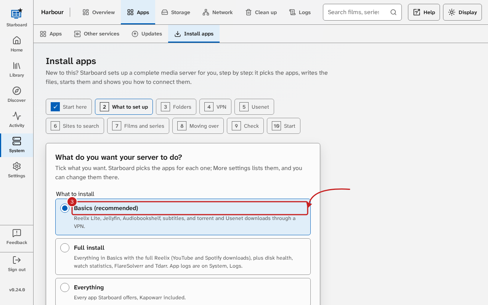
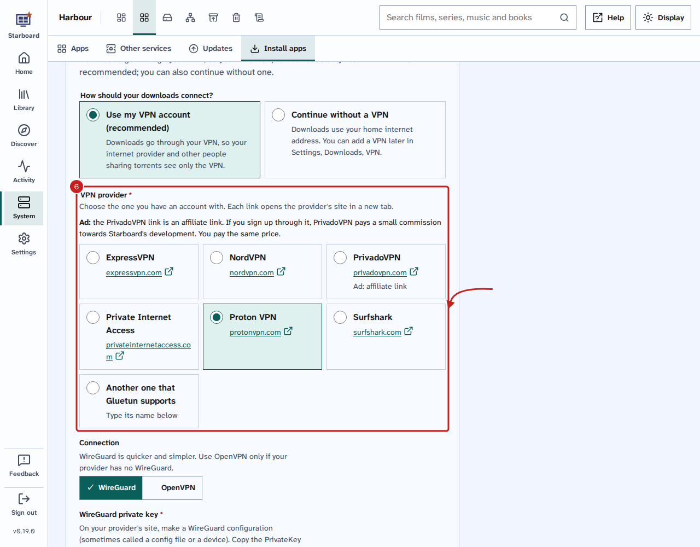
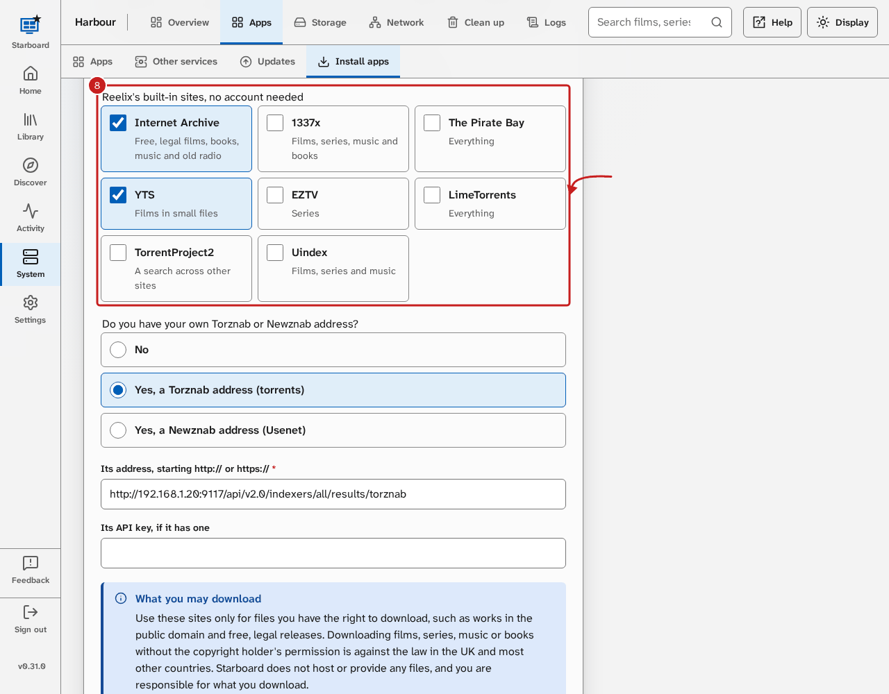
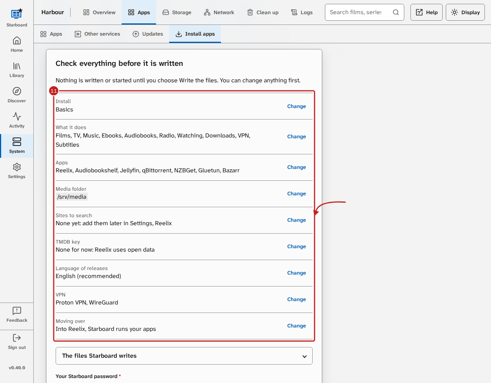

[Help centre](../README.md) · Apps · how-to
<!-- help: use / apps -->

# Install apps with Starboard

**Install apps** sets up a media server for you. It picks the apps for what you want, writes their set-up files,
starts them and sets most of them up. It takes about 15 minutes, and the first downloads take longer.

The steps use the default install, **Basics**: Starboard and Reelix Lite with the apps they need. Bigger installs
and other choices are in [Other installs and choices](#other-installs-and-choices).

## Before you begin

- Docker is installed on the server. Read [Install Docker](install-docker.md), and
  [What Docker is](../basics/what-is-docker.md) if it is new to you.
- You have a folder or disk with room for your media, such as `/srv/media`.
- An account with a VPN (virtual private network) provider is recommended. The default install sends downloads
  through it, to keep them private. You can continue without one: read
  [Download without a VPN](download-without-a-vpn.md).
- Optional: Docker access lets Starboard start the apps itself. Without it, you run one command. Read
  [Change what Starboard can access](change-what-starboard-can-access.md).
- If you are not sure what each app does, read [The apps Starboard works with](../basics/the-apps.md).

## Steps

1. Go to **System**, then **Apps**, then **Install apps**. If your server is set up already, the page lists what is
   installed: select **Run the set-up again**, or **Add** beside an app under 'You can add'.
2. On **Start here**, read how the apps work together, then select **Begin**.
3. On **What to set up**, under **What to install**, keep **Basics (recommended)**: Reelix Lite, Jellyfin,
   Audiobookshelf, Bazarr for subtitles, and qBittorrent and NZBGet through a VPN. About 1 GB of memory. You can
   choose a bigger install now or later: read [Other installs and choices](#other-installs-and-choices).

   

4. Under **Which Reelix?**, keep the one the install chose. Select **Continue**.
5. On **Folders**, enter your **Media folder**, such as `/srv/media`. If your other apps already use a media
   folder, Starboard offers it. Select **Continue**.
6. If your install has a VPN, the **VPN** step asks how your downloads should connect. Keep
   **Use my VPN account (recommended)**. It then asks for your **VPN provider**. Each provider's link opens its site
   in a new tab. If yours is not listed, choose **Another one that Gluetun supports** and enter its name as Gluetun's
   list writes it. Choose **WireGuard** or **OpenVPN**, enter the details from the provider's site, then select
   **Continue**.

   The PrivadoVPN link is an affiliate link, marked **Ad**. If you sign up through it, PrivadoVPN pays a small
   commission towards Starboard's development, and you pay the same price.

   

   Without a VPN account, choose **Continue without a VPN**, then **Continue**. A warning says what that means.
   Select **I understand, continue without a VPN** to go on without Gluetun, or **Cancel** to go back. Read
   [Download without a VPN](download-without-a-vpn.md).

7. If your install downloads from Usenet, the **Usenet** step asks 'Do you have a Usenet provider?'. Choose
   **Yes, I have one** to enter its server and select **Test the server**. Choose **No, show me some providers** for
   a list, or **Not now: torrents are enough for now**. Read
   [Choose a Usenet provider and add it](choose-a-usenet-provider.md). Select **Continue**.
8. On **Sites to search**, tick the sites Reelix should search. Nothing is ticked for you, and none needs an
   account. To add your own Torznab or Newznab address, choose it and enter its address and API key. Read
   [Choose the sites Reelix searches](choose-sites-to-search.md). Select **Continue**.

   

9. On **Films and series**, paste your **TMDB key** and select **Test the key**, or leave it empty to add it later.
   Choose the **Language of releases**. Select **Continue**.
10. Only on a computer that already runs media apps: the **Moving over** step asks what to bring across later.
    Tick what you want, then select **Continue**.
11. On **Check**, read the table of your answers. Select **Change** beside anything you want to change. When it is
    right, enter **Your Starboard password** and select **Write the files**.

    

12. On **Start**, select **Start the apps**. Starboard downloads and starts each app, and counts them, such as
    "5 of 7 installed". This can take several minutes the first time.
13. When Starboard shows **The apps are running**, it adds each app to Starboard as it answers. If **Add the ticked
    apps to Starboard** appears, select it.
14. Follow **Connect your apps, in this order** for anything left to do, then select **Go to Apps**.

Starboard sets up Reelix, Jellyfin, Audiobookshelf, Jellystat, qBittorrent, Bazarr and Gluetun for you. Reelix gets
your library folders, download apps, sites and TMDB key. Anything Starboard cannot do is listed under 'Still to set
up': read [Finish what is still to set up](finish-setting-up.md).

### If Starboard has no Docker access

Without Docker access, the Run first window starts the apps for Starboard. Keep it open until Starboard shows **The
apps are running**.

If you closed that window, Starboard shows **Run one command**. Select **Copy the command**, then paste it into a
terminal on the server:

```bash
cd ~/starboard && ./install.sh --start-apps
```

If Starboard is in another folder, use that folder instead of `~/starboard`. If the terminal says your user is not
allowed to use Docker yet, sign out of the server and back in, then paste it again.

Then go back to Starboard and select **Find the new apps**. Continue from step 13.

## Other installs and choices

The default install is complete on its own. These are for when you want more, or want to choose for yourself.

- **Full install:** everything in Basics with the full Reelix (YouTube and Spotify downloads), plus disk health,
  Jellystat, FlareSolverr and Tdarr. About 2 GB of memory. Under **Usenet app**, keep **NZBGet** or choose
  **SABnzbd**.
- **Everything:** every app Starboard offers. About 2.9 GB. The same Usenet choice.
- **Choose myself:** tick each group, and with **More settings** each app and folder. Changing a group makes it
  your own choice. An app also brings what it needs: Jellystat brings Jellyfin, and Reelix brings a download app.
- **Add-ons:** Wizarr, Dispatcharr and Dozzle can be ticked with any install, or added later with **Add** under
  'You can add'.
- **Which Reelix?:** Reelix, or Reelix with YouTube and Spotify downloads. Read
  [Switch between the two versions of Reelix](switch-reelix-version.md).
- **Several disks:** on **Folders**, select **Join several disks into one** to make a pool. Starboard gives you
  commands to run on the server first. Nothing on the disks is erased.

Read [Basics, Full install and Everything](install-types.md#at-a-glance) to compare the installs, and
[Change your install](change-your-install.md) to change it later.

## Things to note

- Nothing is written until you select **Write the files**, and nothing starts until you select **Start the
  apps** or run the command.
- Starboard writes two files into `data/stack`: `compose.yaml` lists the apps, and `.env` holds your settings
  and VPN details. Older copies are kept.
- Starboard makes `movies`, `tv`, `books` and `downloads` folders, and others you need, inside your media folder.
- If a port is already in use, the app uses the next free one, and the **Check** step says so.
- Starboard only starts apps from its own list, and only with folders it has checked.
- NZBGet signs in as `starboard`, with a password Starboard makes up (`NZBGET_PASS` in `data/stack/.env`).
- Reelix replaces Radarr, Sonarr, Lidarr, Bookshelf, Prowlarr and Seerr for new installs. A server that already
  runs them keeps them: read [Move from Radarr, Sonarr and the others to Reelix](move-your-apps-to-reelix.md).
- Starboard keeps searching for new apps for 30 minutes, even if you carry on with the set-up or it restarts.
- To change the install later, read [Change your install](change-your-install.md).
- Media you already have, on this computer, another disk or a network share, can be copied in as you set up, or
  later: read [Bring in media you already have](bring-in-media-you-already-have.md).

## If it does not work

- **Nothing to download with:** tick **Downloads** too, or select **Continue** again to go on without it.
- **Enter the full path of a folder, starting with /:** enter the whole path, such as `/srv/media`.
- **Something did not start:** select **Show the details**, change what they say, then select **Try again**.
- **You do not have a VPN account yet:** choose **Continue without a VPN** on the **VPN** step, and add one later.
  Read [Download without a VPN](download-without-a-vpn.md).
- **Gluetun shows as unhealthy, and the download apps do not open:** the VPN details are not right, and the download
  apps wait for the VPN. Go to **Settings**, then **Downloads**, and check the provider, the key and the address
  (ending in /32) under 'VPN'.
- **An app is missing from your apps after 30 minutes:** it had not answered by then. Read
  [Search for apps already on your server](search-for-new-apps.md).
- **Jellystat keeps restarting, and its log says "no pg_hba.conf entry":** its database did not finish setting
  up. Stop Jellystat and jellystat-db, and move the `jellystat-db` folder from the apps' settings folder to a holding
  folder. Then start the apps again: the database sets itself up afresh.
- **Reelix stops at once, and its log says "disk I/O error" (code 5386):** its settings folder is on a pool made
  with mergerfs, which Reelix's database cannot use. Put the apps' settings folder on a single disk, such as
  `/srv/config`, and keep only the media on the pool.

## Find out more

- [Bring in media you already have](bring-in-media-you-already-have.md)
- [Basics, Full install and Everything: what each one has](install-types.md)
- [Change your install](change-your-install.md)
- [Choose a Usenet provider and add it](choose-a-usenet-provider.md)
- [Finish what is still to set up](finish-setting-up.md)
- [Build a media server from nothing](../guides/build-a-media-server-from-nothing.md)
- [Switch between the two versions of Reelix](switch-reelix-version.md)
- [Update your apps](update-your-apps.md)
- [The terminal: entering commands](../basics/the-terminal.md)

<!-- footer: download rights -->

---

**Download only what you have the right to.** Use the download apps only for files you have the right to download,
such as open-source software, works in the public domain and your own backups. Downloading films, series, music or
books without the copyright holder's permission is against the law in the UK and most other countries. Starboard
does not host or provide any files, and you are responsible for what you download.

**Need help?** Ask on the [Starboard Discord support server](https://discord.gg/xN9bf2H4vv).

<!-- /footer -->
