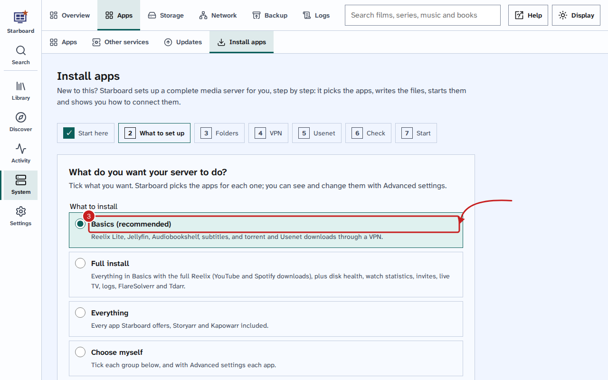
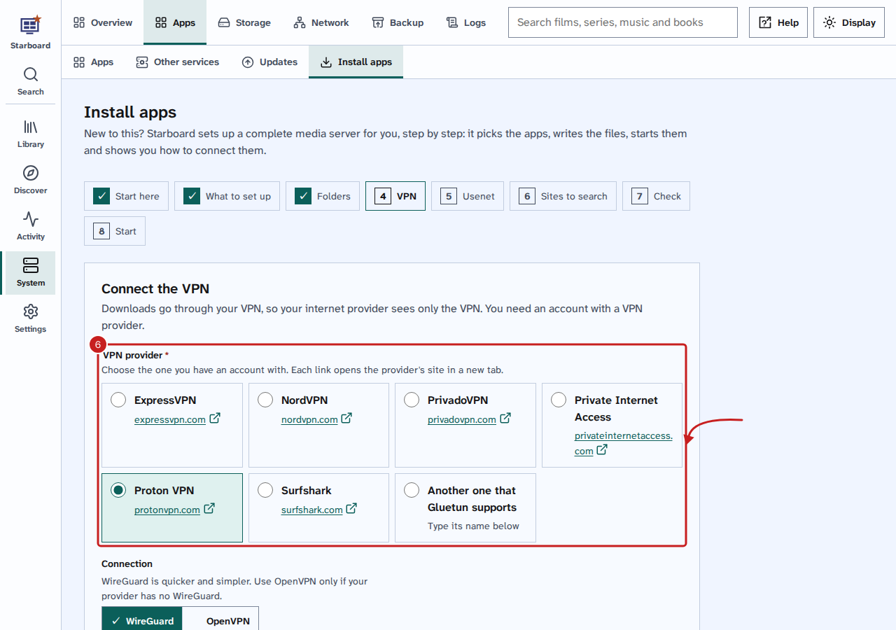
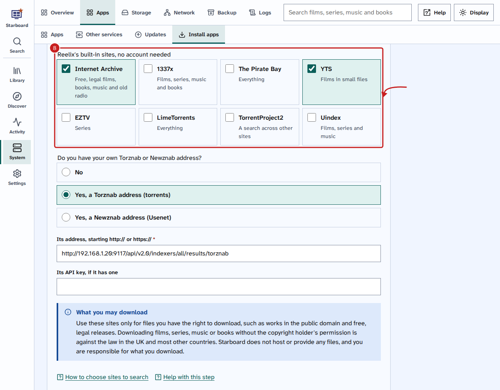
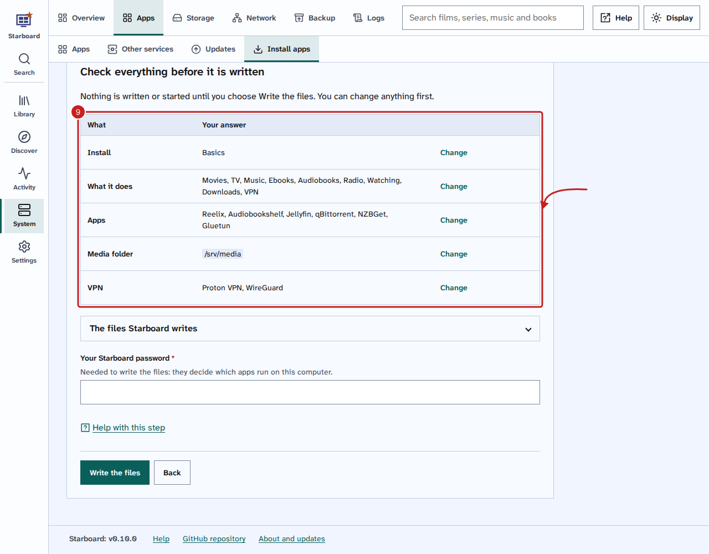

[Help centre](../README.md) · Apps · how-to

# Install apps with Starboard

**Install apps** sets up a media server for you: it picks the apps for what you want, writes their set-up files
and starts them. At the end, the apps are running and Starboard shows how to connect them. It takes about
15 minutes, and the first downloads take longer.

## Before you begin

- Docker is installed on the server. Read [Install Docker](install-docker.md), and [What Docker is](../basics/what-is-docker.md) if it is new to you.
- You have a folder or drive with room for your media, such as `/srv/media`.
- Optional: an account with a VPN (virtual private network) provider, to keep your downloads private.
- Optional: Docker access lets Starboard start the apps itself. Without it, you run one command. Read
  [Change what Starboard can access](change-what-starboard-can-access.md).
- If you are not sure what each app does, read [The apps Starboard works with](../basics/the-apps.md).

## Steps

1. Go to **Settings**, then **Apps**, then **Manage apps**, and select **Install apps**.
2. On **Start here**, read how the apps work together. Tick **Advanced settings** only if you want to choose
   each app and folder yourself. Select **Begin**.
3. On **What to set up**, under **What to install**, choose one:
   - **Basics (recommended):** Reelix Lite, Jellyfin, Audiobookshelf, Bazarr for subtitles, and qBittorrent and
     NZBGet through a VPN. About 1 GB of memory.
   - **Full install:** everything in Basics with the full Reelix (YouTube and Spotify downloads), plus disk health,
     Jellystat, FlareSolverr and Tdarr. About 2.5 GB. Wizarr, Dispatcharr and Dozzle are add-ons you can tick. Under **Usenet app**, keep **NZBGet**
     or choose **SABnzbd**.
   - **Everything:** every app Starboard offers. About 2.9 GB. The same Usenet choice.
   - **Choose myself:** tick each group below, and with **Advanced settings** each app.
   The groups below show what is ticked; changing one makes it your own choice. An app also brings what it needs:
   Jellystat brings Jellyfin, and Reelix brings a download app.

   

4. Under **Which Reelix?**, the install has chosen for you; change it if you like. Select **Continue**. You can
   change any of this later: read [Change your install](change-your-install.md).
5. On **Folders**, type your **Media folder**, such as `/srv/media`. If your other apps already use a media
   folder, Starboard offers it. Select **Continue**.
6. If your install has a VPN, the **VPN** step asks which **VPN provider** you have an account with. Choose it
   from the list: each name has a link to the provider's site, which opens in a new tab. If yours is not listed,
   choose **Another one that Gluetun supports** and type its name as Gluetun's list writes it. The PrivadoVPN link is
   an affiliate link, marked **Ad**: if you sign up through it, PrivadoVPN pays a small commission towards Starboard's
   development, and you pay the same price. Then choose
   **WireGuard** (quicker and simpler) or **OpenVPN**, and type the details from the provider's site. Fields marked
   with a star (*) are required. Select **Continue**.

   

7. If you ticked **SABnzbd**, the **Usenet** step lists some Usenet providers. They are affiliate links: if you
   sign up through one, the provider pays a small commission towards Starboard's development, and you pay the same
   price. Use Usenet only for files you have the right to download. Select **Continue**.
8. On **Sites to search**, tick the sites Reelix should search. Nothing is ticked for you. They all need no
   account. If you run Jackett or Prowlarr, or have an account with a Usenet search site, choose **Yes, a Torznab
   address** or **Yes, a Newznab address** and type its address and API key. Select **Continue**. Read
   [Choose the sites Reelix searches](choose-sites-to-search.md) for more.

   

9. If Starboard found apps you already have, the **Moving over** step asks what to bring across later. Tick what
   you want, then select **Continue**.
10. On **Check**, read the table of your answers. Select **Change** beside anything you want to change. When it is
    right, type **Your Starboard password** and select **Write the files**.

    

11. On **Start**, select **Start the apps**. Starboard downloads and starts each app. Beside the timer, it counts
    how many are installed, then how many are running, such as "5 of 7 installed". This can take several minutes
    the first time.
12. When Starboard shows **The apps are running**, select **Add the ticked apps to Starboard**.
13. Starboard sets Reelix up for you: its admin account (`admin`, with your Starboard password), the library
    folders (radio included, when you chose it), qBittorrent as its download app, the sites you chose, searches
    through the VPN when you have one, and Jellyfin and Audiobookshelf when Starboard has their API keys. To follow
    radio shows and podcasts, read [Follow radio shows and podcasts](follow-radio-shows.md).
14. Follow **Connect your apps, in this order**. It gives each app's address, folders and settings to type. In
    Reelix, add a TMDB API key (films and series need it). Once Starboard has Jellyfin's and Audiobookshelf's API
    keys, connect them in **Settings**, **Reelix**, **Media servers**: read
    [Connect Reelix to Jellyfin and Audiobookshelf](connect-reelix-to-media-servers.md).
15. Select **Go to Apps**.

### If Starboard has no Docker access

Docker access is off unless you said yes to it in the installer. Then the Run first window starts the apps for
Starboard: keep it open until Starboard shows **The apps are running**. The password and **Start the apps** work
as above.

If you closed that window, Starboard shows **Run one command** instead of a password. Select **Copy the command**,
then paste it into a terminal on the server. It makes the apps' folders, downloads the apps and starts them:

```bash
cd ~/starboard && ./install.sh --start-apps
```

If Starboard is in another folder, use that folder instead of `~/starboard`. If the terminal says your user is not
allowed to use Docker yet, sign out of the server and back in, then paste it again.

Then go back to Starboard and select **Find the new apps**. Continue from Step 12.

## Things to note

- Nothing is written until you select **Write the files**, and nothing starts until you select **Start the
  apps** or run the command.
- Starboard writes two files into `data/stack`: `compose.yaml` lists the apps, and `.env` holds your settings
  and VPN details. Older copies are kept.
- Starboard makes `movies`, `tv`, `books` and `downloads` folders, and others you need, inside your media folder.
- If a port is already in use, the app uses the next free one, and the **Check** step says so.
- Some apps, such as Unpackerr, need their own settings file first. Starboard writes them but does not start
  them yet.
- Several drives? On **Folders**, select **Join several drives into one** to make a pool. Starboard gives you
  commands to run on the server first. Nothing on the drives is erased.
- Starboard only starts apps from its own list, and only with folders it has checked.
- Starboard makes up NZBGet's password (`NZBGET_PASS` in `data/stack/.env`), sets its download folder to
  `/data/downloads/usenet` and connects it to Reelix. Add your Usenet provider in NZBGet, **Settings**,
  **News-Servers**.
- Reelix replaces Radarr, Sonarr, Lidarr, Bookshelf, Prowlarr and Seerr for new installs. A server that already
  runs them keeps them: Starboard does not remove anything.
- Starboard keeps a manager key for Reelix, not an admin key, to show its queue and calendar on your dashboard.
- After **The apps are running**, Starboard adds each app to your apps as soon as it answers. That can take
  several minutes when many apps start at once on a small server. Starboard keeps looking for 30 minutes, even if
  you carry on with the set-up or it restarts.

## If it does not work

- **Nothing to download with:** tick **Downloads** too, or select **Continue** again to go on without it.
- **Enter the full path of a folder, starting with /:** type the whole path, such as `/srv/media`.
- **Something did not start:** read the log Starboard shows, change what it says, then run **Install apps**
  again.
- **Gluetun shows as unhealthy, and qBittorrent or SABnzbd do not open:** the VPN details are not right. Both
  download apps go through the VPN, so they wait for it. Check the provider, the private key and the address
  (ending in /32) in **Settings, Install apps**, then start the apps again.
- **An app is missing from your apps after 30 minutes:** it had not answered by then. Go to **Settings, Manage
  apps**, select **Search for new apps**, then tick it.
- **Jellystat keeps restarting, and its log says "no pg_hba.conf entry":** its database did not finish setting
  up, which happened with Starboard 0.9.2 and earlier. Stop Jellystat and jellystat-db, move the `jellystat-db`
  folder from the apps' settings folder to a holding folder, then start the apps again. The database sets itself
  up afresh. Jellystat had no history yet, so nothing is lost.

- **Reelix stops at once, and its log says "disk I/O error" (code 5386):** its settings folder is on a pool made
  with mergerfs, which cannot share memory the way Reelix's database needs. Put the apps' settings folder on the
  system disk or another single disk, such as `/srv/config`, and keep only the media on the pool. A fix that lets
  Reelix run there, more slowly, has been offered to Reelix.

## Find out more

- [Choose a Usenet provider and add it](choose-a-usenet-provider.md)
- [Basics, Full install and Everything: what each one has](install-types.md)
- [Build a media server from nothing](../guides/build-a-media-server-from-nothing.md)
- [Add an app](add-an-app.md)
- [Copy settings from one app to another](copy-app-settings.md)
- [Update your apps](update-your-apps.md)
- [Change your install](change-your-install.md)
- [Switch between the two versions of Reelix](switch-reelix-version.md)
- [Move from Radarr, Sonarr and the others to Reelix](move-your-apps-to-reelix.md)
- [The terminal: typing commands](../basics/the-terminal.md)

<!-- footer: download rights -->

---

**Download only what you have the right to.** Use the download apps only for files you have the right to download,
such as open-source software, works in the public domain and your own backups. Downloading films, series, music or
books without the copyright holder's permission is against the law in the UK and most other countries. Starboard
does not host or provide any files, and you are responsible for what you download.

<!-- /footer -->
