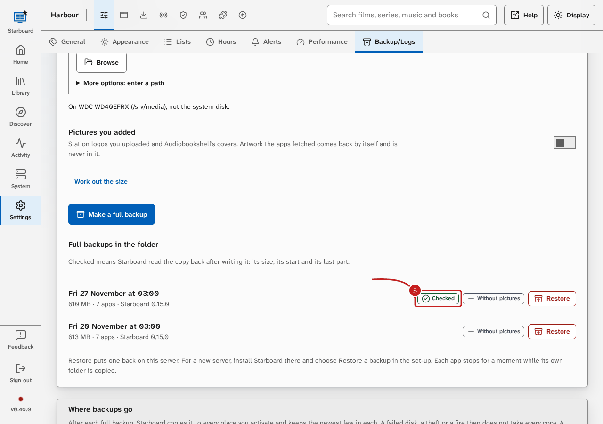
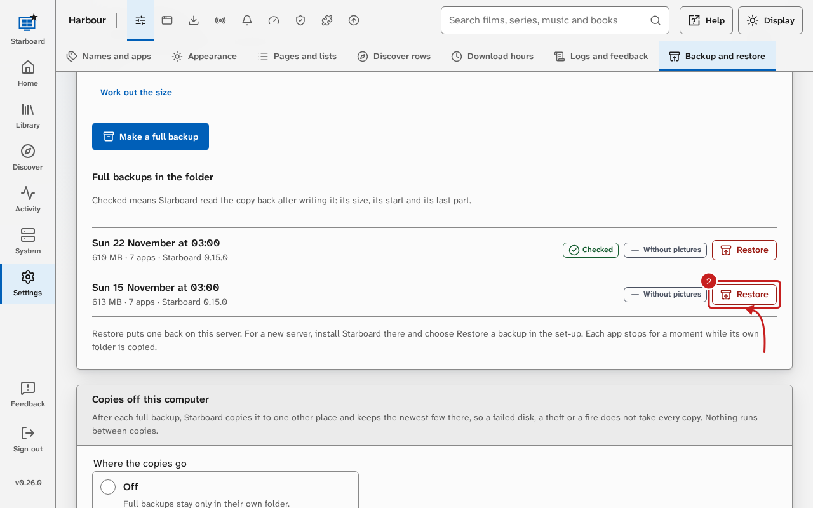
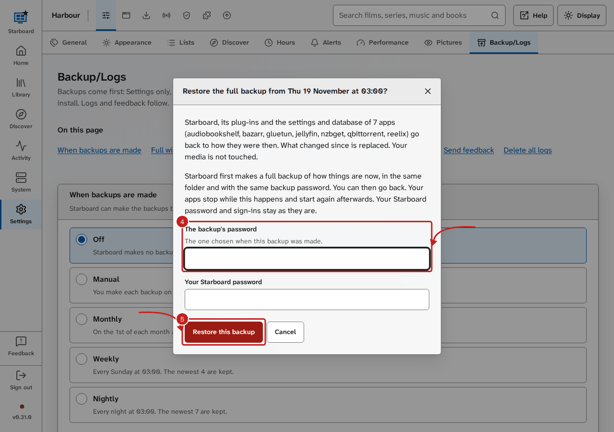
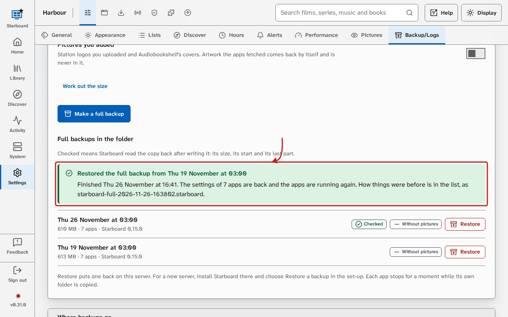
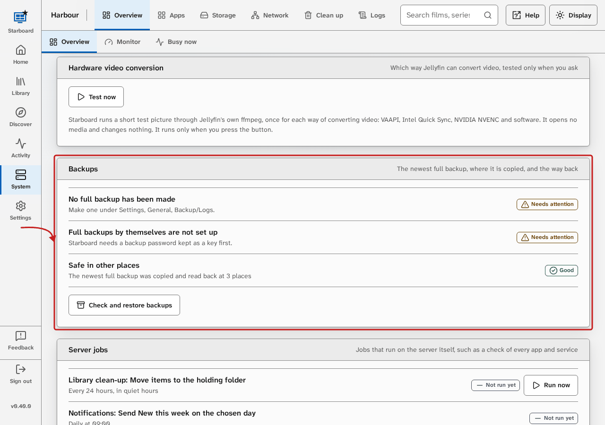
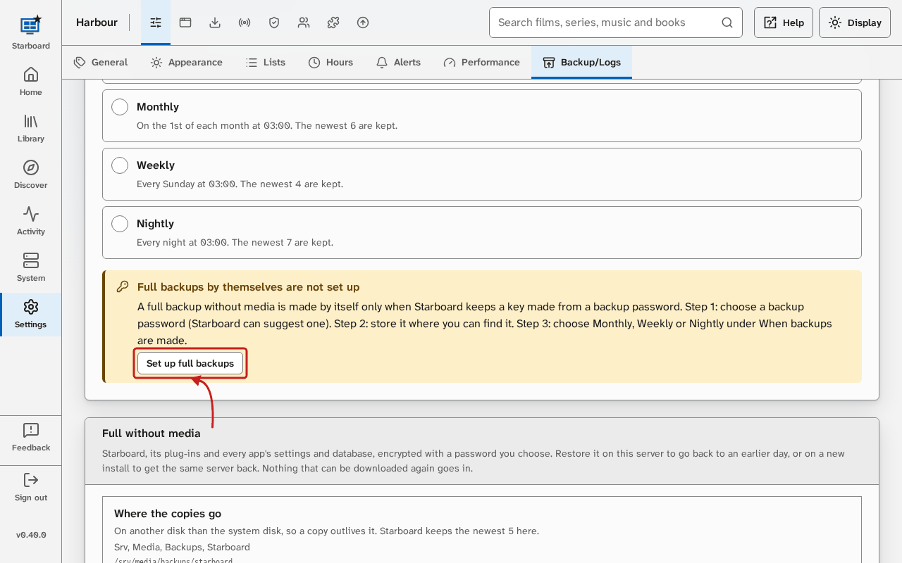
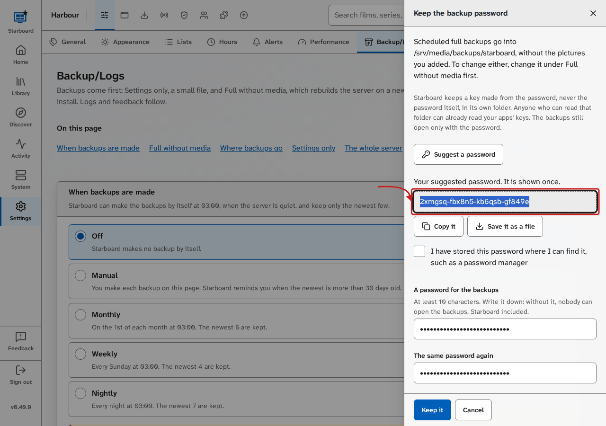

[Help centre](../README.md) · Backup and restore · how-to
<!-- help: use / backups -->

# Make and restore a full backup

A full backup, **Full without media**, is one encrypted file with Starboard, its plug-ins and every app's settings
and database. It never holds your media. Starboard checks each one after it is made, and you can restore one on the
same server to go back to an earlier day.

## Before you begin

- Starboard installed your apps. On a server set up by hand, the page says full backups are for servers Starboard
  set up.
- You know Starboard's password, and the backup password you chose when the backup was made. Nobody can open a
  full backup without its backup password, Starboard included.
- A restore stops your apps for a few minutes. Choose a time when nobody is watching or listening.

## Steps

### Make a full backup

1. Go to **Settings**, then **General**, then **Backup/Logs**.
2. Find **Full without media**.
3. Check **Where the copies go**. Starboard says which disk the folder is on, and warns you when it is the system
   disk.
4. Select **Make a full backup**. A slide-out opens.
5. Enter **A password for the backup** twice, then **Your Starboard password**, and select **Make it**.

Starboard copies each app's settings, stopping each app for a moment while its own folder is copied. It then reads
the new file back from the backup folder: its size, its start and its last part. When all three are right, the
backup shows **Checked** in **Full backups in the folder**.

### Restore a full backup on this server

1. Go to **Settings**, then **General**, then **Backup/Logs**.
2. Under **Full backups in the folder**, find the backup by its date and select **Restore** beside it.

   

3. Starboard asks **Restore the full backup from** that date. Read what it replaces.
4. Enter **The backup's password**, then **Your Starboard password**.
5. Select **Restore this backup**. To leave everything as it is, select **Cancel**.

   

Starboard then does these things in order, and says which one it is doing:

1. It makes a full backup of how things are now, in the same folder and with the same backup password.
2. It stops the apps whose settings are in the backup.
3. It puts the backup back: Starboard's files, then each app's settings and database.
4. It starts the apps again.

When it ends, the page shows **Restored the full backup**, how many apps came back and the name of the backup of
how things were before.

## Check your backups from System

System, Overview has a **Backups** panel. It says when the newest full backup was made and that it was read back, whether
full backups by themselves are set up or late, and whether the other places hold the newest one. Select **Check and
restore backups** to open the backup page, where each full backup says **Checked** and has **Restore** beside it.

## Things to note

- Nothing changes until both passwords are right and the whole backup file has been read. A damaged or cut-off
  backup leaves Starboard and your apps as they were.
- A restore replaces what changed since the backup was made: apps' settings, libraries, watch history and
  Starboard's own settings. Your media files are not touched.
- Your Starboard password and sign-ins stay as they are now.
- To undo a restore, restore the backup Starboard made first. It is in the same list, with the time the restore
  started.
- The backup made before a restore does not push an older one out of the folder. The next backup you make, or the
  next scheduled one, keeps the newest few again.
- A schedule makes a full backup only when Starboard keeps the backup password. Without it, Starboard says **No full
  backup was made**, raises an alert and shows **Full backups are not being made**. Select **Keep the backup password**.
- **Set up full backups by themselves, once:** on Settings, General, Backup/Logs, under **When backups are made**, a notice
  says **Full backups by themselves are not set up** until a key is kept. Select **Set up full backups**. Choose a backup
  password, or select **Suggest a password**: Starboard makes a long one in your browser and shows it once, with **Copy it**
  and **Save it as a file**. Tick that you have stored it, enter your Starboard password and select **Keep it**. Starboard
  keeps a key made from the password, never the password. Starboard cannot show the password again: store it in a
  password manager. Then choose Monthly, Weekly or Nightly.

  

  
- A backup that does not read back is not kept, and Starboard says **The full backup did not finish**. Older
  backups stay. Make it again; if it happens again, check the disk the folder is on.
- **Checked** is said for backups made from this version on. An older backup without it is not wrong: it was made
  before Starboard checked.
- An app you added after the backup was made keeps its settings as they are now.
- To restore on a new server instead, install Starboard there and choose **Restore a backup** in the set-up. Read
  [Move Starboard to a new computer](../guides/move-starboard-to-a-new-computer.md).

## If it does not work

- **"That password does not open this backup":** enter the backup password chosen when that backup was made. It
  can differ from one backup to the next.
- **"That password is not right":** this is your Starboard password. Check Caps Lock and enter it again.
- **"This backup is from a server that keeps its apps' settings in" another folder:** the backup was made on a
  server with a different layout. Restore it in the set-up of a new install.
- **"This backup was made by Starboard" with a newer version number:** update Starboard, then restore it.
- **"A backup is being made":** wait until it has finished, then select **Restore** again.
- **"The restore did not finish":** the message says why, and your apps are started again. When it names a backup
  of how things were, that backup is in the list.

## Find out more

- [Back up and restore Starboard's settings](back-up-settings.md)
- [Copy backups to a cloud service](copy-backups-to-a-cloud-service.md)
- [Reelix's own backups](reelix-backups.md)
- [Move Starboard to a new computer](../guides/move-starboard-to-a-new-computer.md)

<!-- footer: download rights -->

---

**Download only what you have the right to.** Use the download apps only for files you have the right to download.
Examples are open-source software, works in the public domain and your own backups. Downloading films, series, music or
books without the copyright holder's permission is against the law in the UK and most other countries. Starboard
does not host or provide any files, and you are responsible for what you download.

**Need help?** Ask on the [Starboard Discord support server](https://discord.gg/xN9bf2H4vv).

<!-- /footer -->
