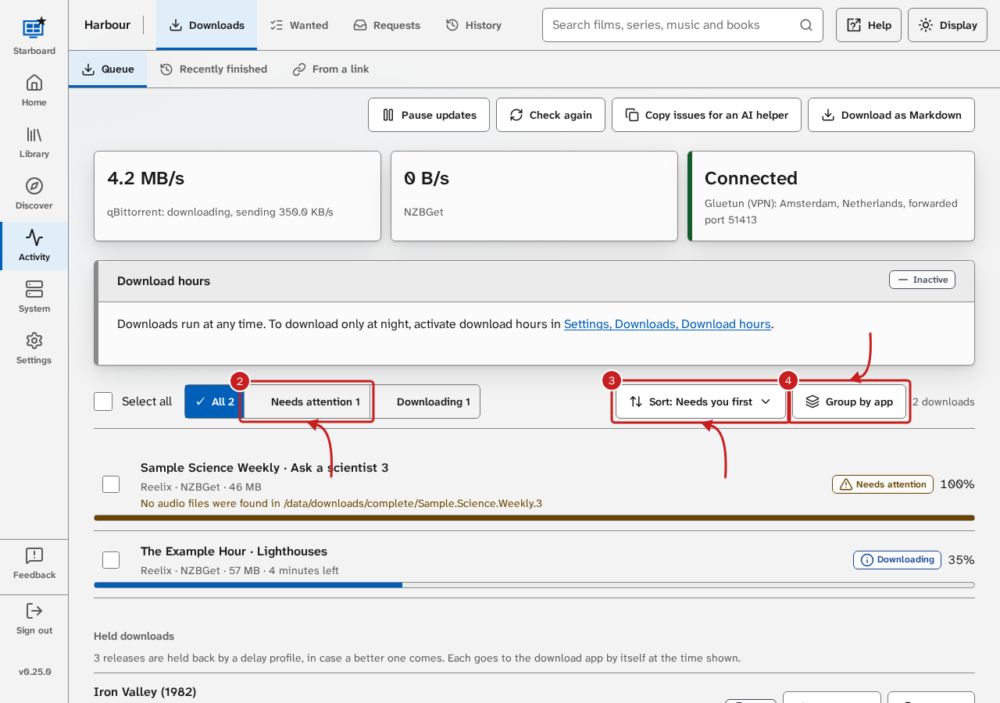
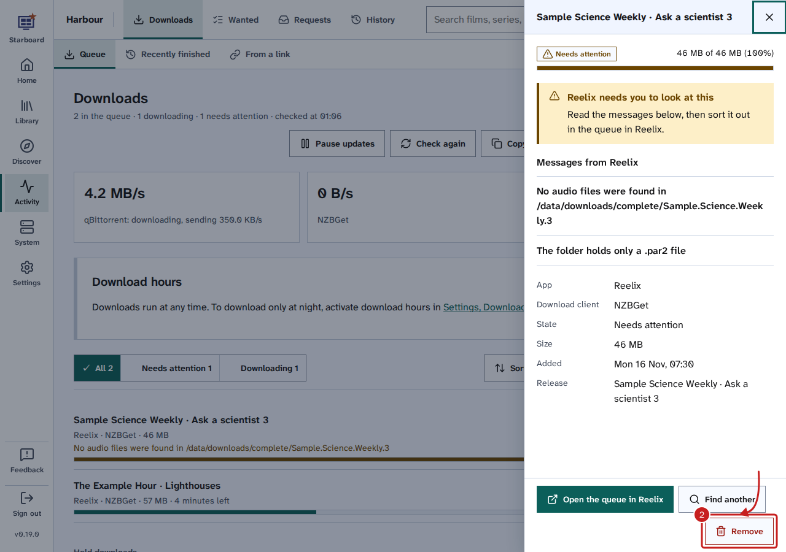
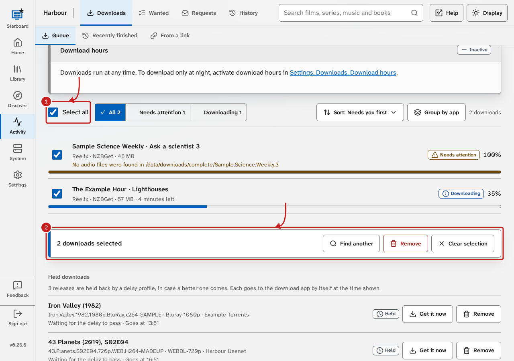
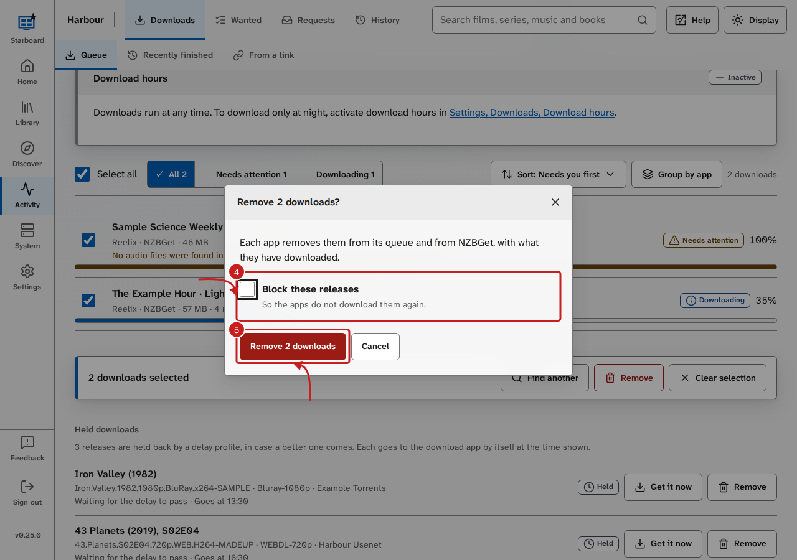
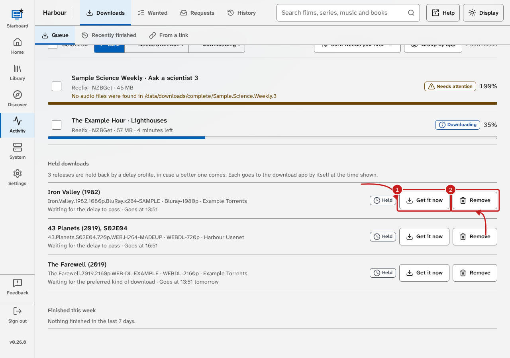
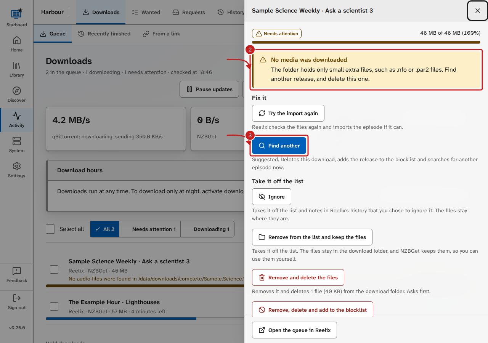
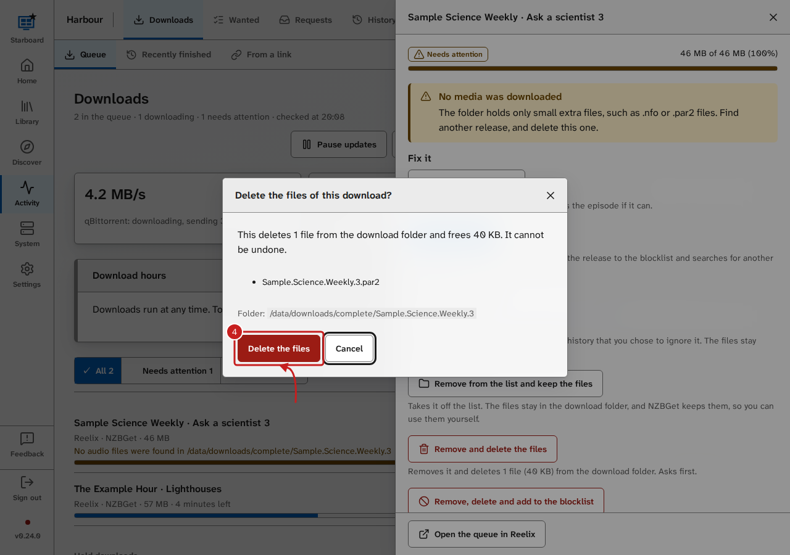

[Help centre](../README.md) · Everyday use · how-to
<!-- help: use / library -->

# Pause, resume and remove downloads

**Activity**, then **Downloads** shows the queues of all your apps in one list. From it you can pause and resume
all downloads, remove one download or several at once, or ask an app to find a different copy.

## Before you begin

- Reelix and qBittorrent, or on an existing set-up apps such as Sonarr and Radarr, are in Starboard with their API keys. Read
  [Add an app](add-an-app.md).
- To pause and resume all downloads, download hours must be active. Read
  [Download only at certain hours](set-download-hours.md).

## Steps

### Check what is downloading

1. Go to **Activity**, then **Downloads**, then **Queue**. Each download shows its name, its app, its size and
   the time left. Its state, such as **Downloading**, **Waiting** or **Needs attention**, is a chip before how far
   it has got.
2. Optional: to show only one state, select its filter, such as **Needs attention**. Select it again to show
   everything.
3. Optional: select **Sort** to change the order: **Needs you first**, **Time left**, **Name** or **Queue order**.
4. Optional: select **Group by app** to show one list for each app.

   

### Remove a download

1. Select the download's name. A side panel opens with its details and any messages from the app. A download that
   needs attention opens a wider panel with every action that fits: read
   [Fix a download that needs attention](#fix-a-download-that-needs-attention).
2. Select **Remove**. Starboard asks **Remove this download?**

   

3. Optional: tick **Block this release** so the app never downloads this copy again.
4. Select **Remove download**. The app removes it from the queue and from the download app, with what it has
   downloaded so far.

### Find another copy of a download

Use this when a download is stuck or the wrong one.

1. Select the download's name.
2. Select **Find another**. Starboard asks **Block this release and find another?**
3. Select **Block and search**. The app removes this copy, never downloads it again and searches for another
   now.

### Act on several downloads at once

Use this to remove, ignore or import many downloads together, such as a whole season that is not an upgrade.

1. Tick the box at the start of each download's row. To tick a run of rows, tick the first, then hold **Shift**
   and tick the last. To tick every download on the list, tick **Select all**.
2. A bar at the foot of the list says how many downloads you selected. It also shows what you can do with them:
   - **Try the import again** and **Ignore**, for Reelix downloads waiting to import
   - **Find another**
   - **Remove**
   - **Clear selection**

   

3. Select an action. Starboard asks first and says how many downloads it acts on.
4. Optional: for **Remove**, tick **Block these releases** so the apps do not download them again.
5. Select the button that names the action, such as **Remove 2 downloads**.

   

6. Starboard sends each download to its app in turn and counts them in the bar. Then it says what it did, such as
   **Removed 12 downloads.** It names any download it could not deal with, with the app's reason.

**Try the import again** and **Ignore** act only on the selected downloads that are waiting to import. The
question says how many others stay as they are. A download that the filter hides is not selected, so choose the
filter first, such as **Needs attention**, then select **Select all**.

### Get a held download now, or remove it

Reelix can hold a release back for a while, in case a better one comes. This is a delay profile. Held releases
show under **Held downloads** on the Queue page. Each one shows **Held**, why it waits (such as **Waiting for the
delay to pass**) and when it goes to the download app.

1. To send one to the download app straight away, select **Get it now** beside it.
2. To drop one, select **Remove**, then **Remove** again. Nothing is downloaded, and Reelix may find it again at its
   next search.

   

### Fix a download that needs attention

A download can finish but not move into your library. It then shows **Needs attention** or **Failed**.

1. Select the download's name. A side panel opens. Starboard asks the app what is wrong and reads the download
   folder, which takes a moment.
2. Read what is wrong at the top, in plain words, such as **The files are inside archives** or **This download
   holds a program, not media**.
3. Choose an action. Each one has a line under it that says what it does, and the one Starboard suggests says
   **Suggested**. **Fix it** lists the actions that try to get it into your library; **Take it off the list**
   lists the ones that take it away.

   

4. For an action that deletes files, Starboard asks first and names the files, the folder and the space it frees.
   Select **Delete the files**, or **Delete and block**, to go on.

   

5. The result shows in the panel, such as **Removed. 14 files deleted, 1.4 GB freed.** Close the panel to go
   back to the queue.

The actions, and when each one fits:

- **Unpack the archives, then import**: the media is packed in RAR or zip archives. Starboard unpacks them into
  the same folder, archives inside archives too, then Reelix imports what is inside. It can take a few minutes for
  a large download. The archives stay until you delete the download.
- **Choose the episode**: the release numbers its episodes another way to the series in Reelix. Tell Reelix which
  episode each file is.
- **Choose the film**: Reelix could not tell which film it is. Search your library and choose the film.
- **Try the import again**: the app checks the files again and imports them if it can.
- **Find another**: deletes this download, adds the release to the blocklist and searches for another.
- **Ignore**: takes it off the list and notes in Reelix's history that you chose to ignore it. The files stay.
- **Remove from the list and keep the files**: takes it off the list. The files stay in the download folder, so
  you can use them yourself.
- **Remove and delete the files**: takes it off the list and deletes its files. Use it for a download you already
  have, or one that holds only a sample.
- **Remove, delete and add to the blocklist**: for a fake or harmful release, such as an .exe posing as an
  episode. Never open such a file.

### Pause or resume all downloads

While download hours are active, the **Download hours** panel on the Queue page has these buttons:

- **Resume downloads now**: starts downloads outside your hours, until the next time they would pause.
- **Pause downloads until** and a time: stops downloads until your hours start again.
- **Follow the hours**: goes back to your hours after you paused or resumed by hand.

### Download from a YouTube or Spotify link

This needs the full version of Reelix. Read [Switch between the two versions of Reelix](switch-reelix-version.md).

1. Go to **Activity**, then **Downloads**, then **From a link**.
2. In **Link**, paste a link from youtube.com, youtu.be or open.spotify.com.
3. In **What to keep**, choose **Sound only (music, podcasts)** or **Video**.
4. Optional: select **Show what it holds** to list what the link has.
5. Select **Download**. If Starboard asks, enter Reelix's admin password.

**Downloads from links** lists each one, newest first, with **Cancel** or **Try again**.

## Things to note

- The page updates itself while it is open. Select **Pause updates** to stop that while you read, and select it
  again to carry on. **Check again** asks the apps straight away. To change how often it updates, go to
  **Settings**, then **General**, then **Performance**, activate **More settings**, and change **Downloads page updates**.
- **Open the queue in** and the app's name opens the app's own queue in a new tab, for anything Starboard
  cannot do.
- The tiles show each download app's speed. With a VPN (Gluetun), a tile shows whether it is connected. Without
  one, **Downloading without a VPN** appears on the Downloads page, with **Add a VPN**. Select **Hide for 90 days** to hide
  it. Read [Download without a VPN](download-without-a-vpn.md).
- **Finished this week** on the Queue page lists what your apps imported in the last 7 days.
  **Recently finished** in the menu does not list anything yet.
- Pausing all downloads pauses qBittorrent, NZBGet, SABnzbd and Soulseek. Seeding is left alone.

## If it does not work

- **Needs attention:** open the download, read what is wrong and choose an action. Read
  [Fix a download that needs attention](#fix-a-download-that-needs-attention).
- **The download folder could not be read:** Starboard reads the folder through Docker. Without the Docker
  connection, the panel still says what the app reported and offers the actions, but not **Unpack the archives**.
  The installer asks about the Docker connection.
- **Unpack the archives is not offered for RAR files:** the Reelix on your server has no RAR tool. Update Reelix
  from **Apps**, then **Updates**.
- **Removed, but some files could not be deleted:** Starboard deletes what is left only when the folder is the
  download's own. Delete the rest in the download app, or in the folder yourself.
- **Not done** and a message: the app refused the action. Check the app is running and try again.
- **Download hours says Off, with no buttons:** activate download hours first. Read
  [Download only at certain hours](set-download-hours.md#steps).
- **The VPN tile says Not connected:** downloads may stop. Check Gluetun on the **Apps** page.
- **This needs the full version of Reelix** on From a link: switch to the full version in **Settings**, then
  **Apps**, then **Your install**.

## Find out more

- [Copy download issues for an AI helper](copy-download-issues.md)
- [Download only at certain hours](set-download-hours.md)
- [Find and get what is missing](get-what-is-missing.md)
- [Approve or decline requests](approve-requests.md)
- [Make Starboard use less of your server](make-starboard-lighter.md#while-a-page-is-open)

<!-- footer: download rights -->

---

**Download only what you have the right to.** Use the download apps only for files you have the right to download,
such as open-source software, works in the public domain and your own backups. Downloading films, series, music or
books without the copyright holder's permission is against the law in the UK and most other countries. Starboard
does not host or provide any files, and you are responsible for what you download.

**Need help?** Ask on the [Starboard Discord support server](https://discord.gg/xN9bf2H4vv).

<!-- /footer -->
