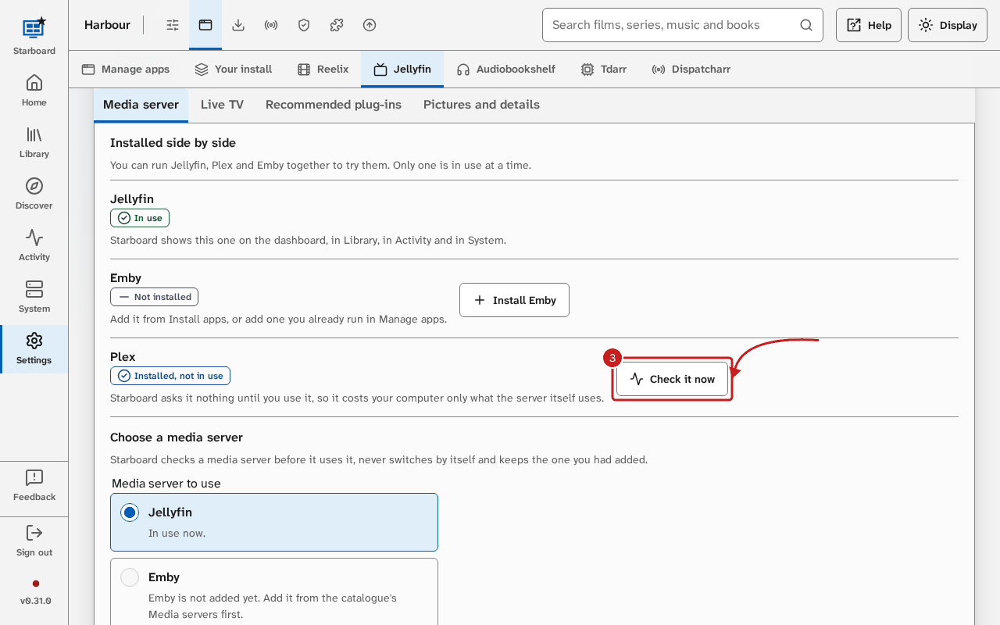
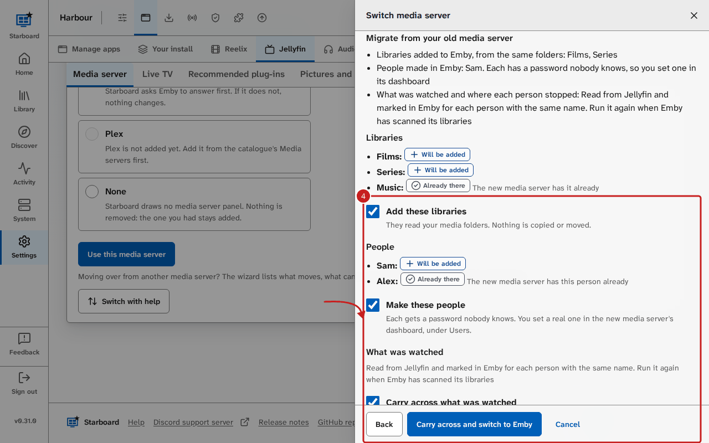
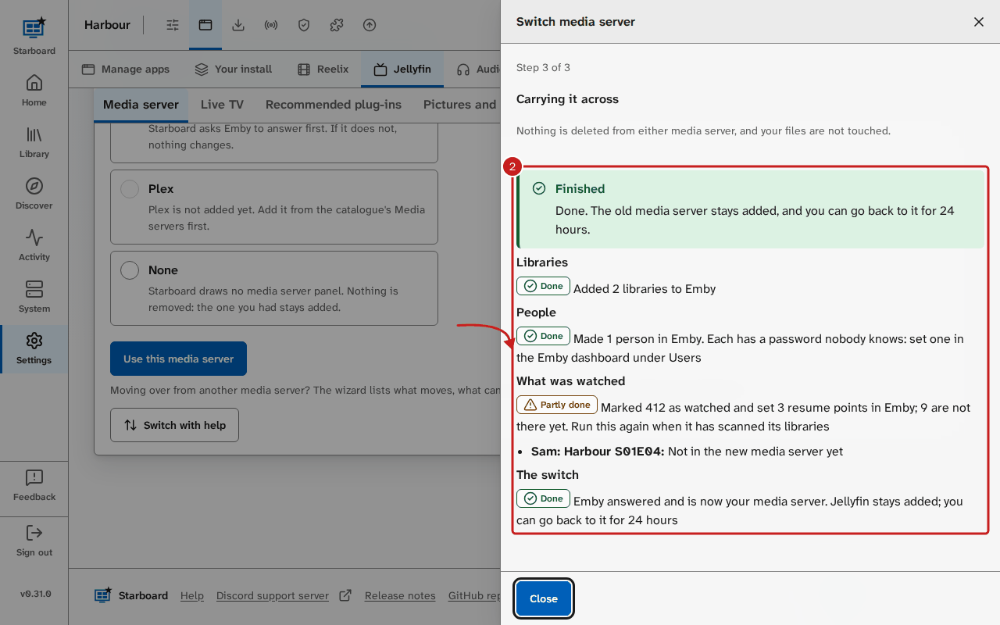

[Help centre](../README.md) · Jellyfin and Audiobookshelf · how-to
<!-- help: use / media -->

# Move to another media server

Starboard can move you from one media server to another. You choose what comes across: your libraries, your people
and what each person watched. Starboard reads both servers first and changes nothing until you confirm. Your files
stay where they are, and your download apps keep working.

## Before you begin

- Add both media servers in **Manage apps**, each with its address and key. For Plex, select **Sign in with Plex**.
- Make sure the new media server can reach your media folders. Starboard mounts them **read only** when it installs Plex or Emby.

## Steps

### Try the servers side by side

1. Add **Plex** or **Emby** beside Jellyfin in **Install apps**. Read
   [Choose your media server](choose-your-media-server.md#install-plex-or-emby-with-starboard) for the first-run steps.
2. Go to **Settings**, then **Apps**, then the media server tab. Under **Installed side by side**, each server shows its state:
   **In use**, **Installed, not in use**, **Added, not set up** or **Not installed**.
3. Select **Check it now** beside a server that is not in use. Starboard asks it to answer and changes nothing.

   

### Plan the move

1. Under **Choose a media server**, select **Switch with help**.
2. On **Step 1**, choose one way, then select **Next**:
   - **Import your own media** adds libraries for your Films, Series and Music folders to the new server.
   - **Migrate from your old media server** carries libraries, people and what was watched across.
   - **Start fresh** adds nothing. The new server begins empty.
3. On **Step 2**, choose the new media server, then select **Next**.
4. On **Step 3**, read the plan. Starboard has asked both servers and shows each library and person as **Will be
   added**, **Already there** or **Left out**, with the reason. It also lists what cannot move and which plug-ins
   wait. Untick any part you do not want.

   

Nothing has changed yet. Select **Cancel** to stop.

### Carry it across

1. Select **Carry across and switch to** and the name. Starboard does each part you ticked, then switches last.
2. Read each part as it finishes. It says **Done**, **Partly done** or **Did not work**, and names what failed and why.
3. Select **Close** when it says **Finished**.

   

If a whole part fails, Starboard does not switch. What it already added stays in the new server, and nothing is
removed from either. Fix the cause, then run the wizard again: anything already there is kept, never made twice.

### After the switch

For 24 hours, **Go back to** the old server in one step, as set out in [Choose your media server](choose-your-media-server.md#go-back).
Some apps keep their own link to the old server. The wizard marks them **Needs pointing at the new media server**:
Reelix, Seerr, On demand and a forward for remote access. Change each one in its own app.

## What to expect

- **Libraries** read the same folders as the old server. Nothing is copied or moved.
- **People** get a password nobody knows. Set a real one in the new server's dashboard, under **Users**.
  Plex accounts belong to plex.tv, so Starboard cannot make them. Invite each person from Plex.
- **What was watched** goes into Jellyfin through the watch history import, with **Keep applying** so later films are
  marked too. For Emby, Starboard marks it for each person with the same name. For Plex, only the account that owns
  the token can take it, and the watched dates become today.
- **Run it again** when the new server has scanned your libraries. Films it did not have yet are then marked. Anything
  already watched is left as it is.
- **Collections, playlists, hand-made artwork, Live TV settings and each server's own plug-ins** do not move.

## If it does not work

- **A library did not work:** the new server cannot reach that folder. Mount your media folder in it, then run the wizard again.
- **Watched marks are missing:** the new server had not found those films yet. Wait for its scan, then run the wizard again.

## Find out more

- [Choose your media server](choose-your-media-server.md)
- [Import watch history into Jellyfin](import-watch-history.md)
- [Find an app's API key](find-an-api-key.md)

<!-- footer: download rights -->

---

**Download only what you have the right to.** Use the download apps only for files you have the right to download.
Examples are open-source software, works in the public domain and your own backups. Downloading films, series, music or
books without the copyright holder's permission is against the law in the UK and most other countries. Starboard
does not host or provide any files, and you are responsible for what you download.

**Need help?** Ask on the [Starboard Discord support server](https://discord.gg/xN9bf2H4vv).

<!-- /footer -->
