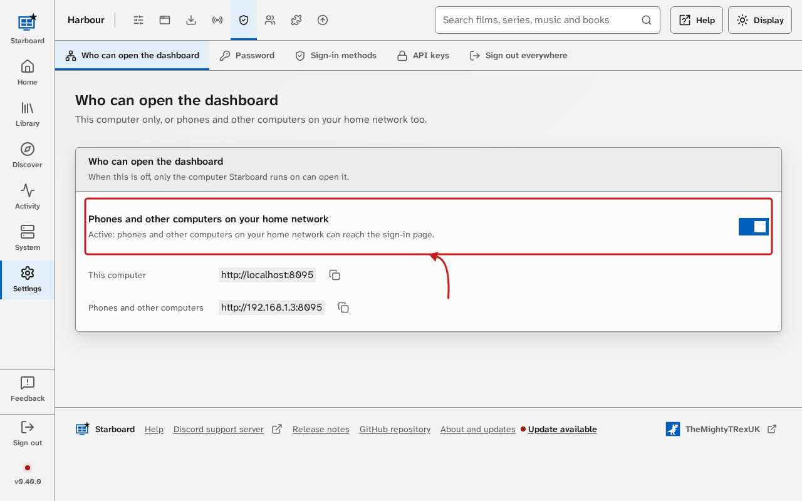
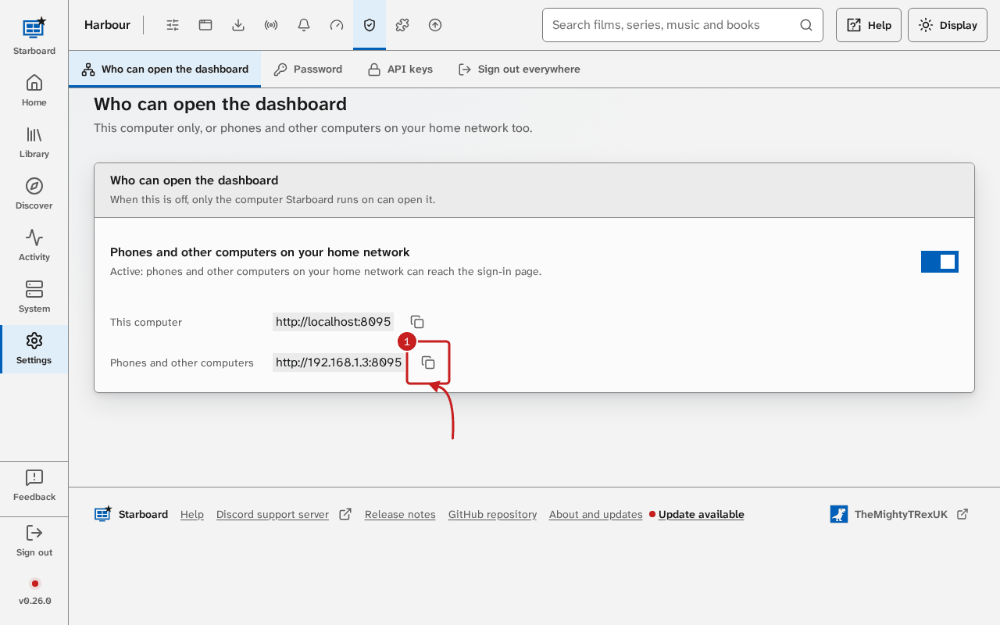
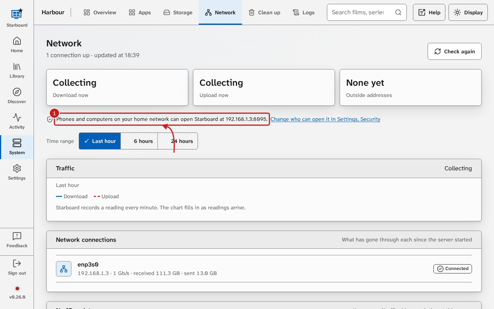

[Help centre](../README.md) · Install and update · how-to
<!-- help: start / devices -->

# Open Starboard from a phone or another computer

Any phone, tablet or computer on your home network can open Starboard, using the server's address and port 8095, such
as `http://192.168.1.20:8095`. At the end, Starboard opens in the device's browser and you sign in with your password.

## Before you begin



- Starboard is installed and you have chosen a password. Read
  [Create your password and sign in](create-your-password.md).
- Starboard lets your home network open it. This is active unless you turned it off. Read
  [Choose who can open Starboard](choose-who-can-open-starboard.md).
- The phone or computer is on the same home network as the server. For a phone, that means connected to your home
  Wi-Fi, not using mobile data.

## Steps

1. Find the server's address in one of these places:
   - **The installer's last lines:** the address after **On other devices**.
   - **Starboard on the server:** go to **System**, then **Network**. The address is in the line that starts "Phones
     and computers on your home network can open Starboard at". It is also in **Settings**, **Security**, under
     **Who can open the dashboard**, with a copy button.
   - **A terminal on the server:** this command prints the server's addresses. Use the first one, such as
     `192.168.1.20`:

     ```bash
     hostname -I
     ```

   

2. On the phone or other computer, connect to your home Wi-Fi.

   

3. Open a browser, such as Safari, Chrome or Firefox.
4. In the address bar, enter `http://`, the server's address, then `:8095`. For example:

   ```
   http://192.168.1.20:8095
   ```

5. Go to the address. Starboard shows **Sign in to Starboard**.
6. Enter your password and select **Sign in**.

## Things to note

- Enter the address with `http://` and the `:8095` at the end. Without the port, the browser opens a different app.
- On a phone, you can add Starboard to your home screen so it opens like an app. In the browser's share or menu
  button, choose **Add to Home Screen** or **Install app**.
- Your router can give the server a new address, for example after a power cut. If the address stops working, find it
  again with step 1. To keep it the same, read [Addresses and ports](../basics/addresses-and-ports.md).
- On some home networks, the server's name also works in place of its address, such as `http://homeserver:8095`.
- This works at home only. To use Starboard away from home, read
  [Use Starboard away from home safely](../guides/use-starboard-away-from-home.md). Never open port 8095 on your
  router to the internet.

## If it does not work

- **It works on the server but not on the phone:** check the phone is on your home Wi-Fi, not mobile data or a guest
  network. Guest networks often cannot reach other devices.
- **"This site cannot be reached" from every other device:** in Starboard on the server, go to **Settings**, then
  **Security**, and check **Phones and other computers on your home network** is active. Read
  [Choose who can open Starboard](choose-who-can-open-starboard.md).
- **The server has a firewall:** a firewall on the server can block port 8095. Follow
  [Open the port in the firewall](starboard-does-not-open.md#open-the-port-in-the-firewall).

- **"Starboard does not answer to the name":** you used a name that Starboard does not know. Use the server's
  number address instead, such as `http://192.168.1.20:8095`.
- **None of these:** read [Starboard does not open](starboard-does-not-open.md).

## Find out more

- [Addresses and ports](../basics/addresses-and-ports.md)
- [Choose who can open Starboard](choose-who-can-open-starboard.md)
- [Use Starboard away from home safely](../guides/use-starboard-away-from-home.md)
- [Change text size, theme and other display settings](display-and-accessibility.md)

<!-- footer: download rights -->

---

**Download only what you have the right to.** Use the download apps only for files you have the right to download.
Examples are open-source software, works in the public domain and your own backups. Downloading films, series, music or
books without the copyright holder's permission is against the law in the UK and most other countries. Starboard
does not host or provide any files, and you are responsible for what you download.

**Need help?** Ask on the [Starboard Discord support server](https://discord.gg/xN9bf2H4vv).

<!-- /footer -->
