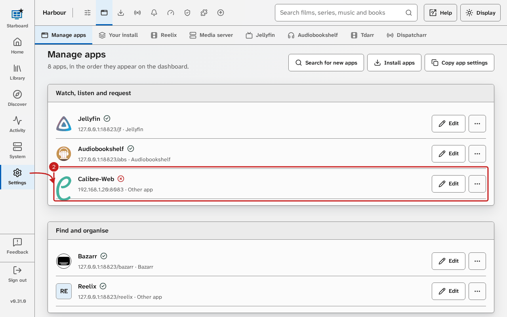
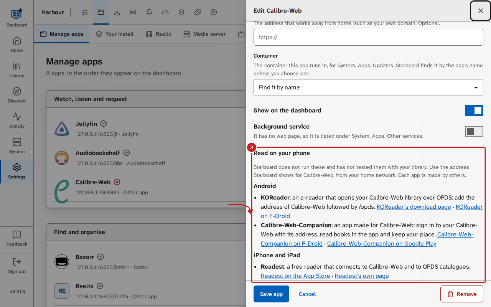
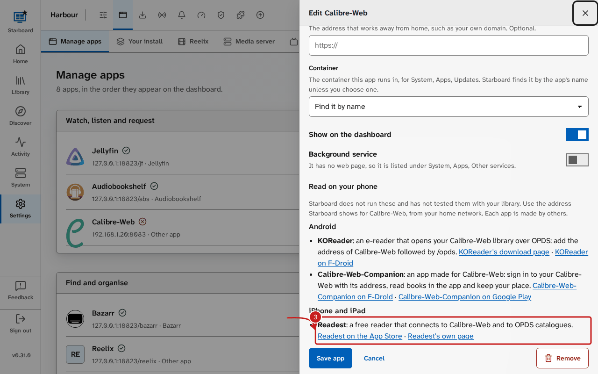

[Help centre](../README.md) · Apps · how-to
<!-- help: use / apps -->

# Read your Calibre-Web books on your phone

Starboard names the phone apps that work well with Calibre-Web: KOReader and Calibre-Web-Companion for Android, and
Readest for iPhone and iPad. The names and links are in Starboard where Calibre-Web is set up. Starboard does not run
these apps, they are made by others, and Starboard has not tested them with your library.

## Before you begin

- Calibre-Web is set up in Starboard, either as the [Calibre-Web plug-in](../plugins/calibre-web/README.md) or as an app
  you added in **Manage apps**. Read [Add an app](add-an-app.md).
- Your phone is on your home network, or you have a way to reach it from outside, such as a VPN.
- You know the address of Calibre-Web, such as `http://192.168.1.20:8083`. Starboard shows it on the app's card, or with
  **Open Calibre-Web** on the plug-in's page.

## Steps

### Find the apps in Starboard

1. Go to **Settings**, then **Apps**, then **Manage apps**.
2. Select **Edit** beside Calibre-Web.

   

3. Under **Read on your phone**, read the apps and select a link to open its page in a new tab.

   

   If you use the plug-in, the same list is on **Settings**, then **Plug-ins**, **Manage**, then **Settings** beside
   Calibre-Web, under **Read on your phone**.

### Use an app on your phone

1. Install the app from the link on your phone.
2. For KOReader, add an OPDS catalogue with the address of Calibre-Web followed by `/opds`, and your Calibre-Web user
   name and password.
3. For Calibre-Web-Companion and Readest, enter the address of Calibre-Web and sign in with your Calibre-Web user.

   

## What to expect

- Starboard does not store your Calibre-Web password for these apps, and it is not involved when the phone talks to
  Calibre-Web.
- Calibre-Web in Starboard reads your books folder only, so apps that upload or change books cannot.

## If it does not work

- **The app cannot reach Calibre-Web:** check that the phone is on the same network, and that the address uses the port
  Starboard shows, such as `:8083`.
- **KOReader shows no books:** the catalogue address must end in `/opds`.
- **Sign-in is refused:** use the user name and password of a Calibre-Web user, not your Starboard password.

## Find out more

- [Add an app](add-an-app.md)
- [Calibre-Web](../plugins/calibre-web/README.md)

<!-- footer: download rights -->

---

**Download only what you have the right to.** Use the download apps only for files you have the right to download,
such as open-source software, works in the public domain and your own backups. Downloading films, series, music or
books without the copyright holder's permission is against the law in the UK and most other countries. Starboard
does not host or provide any files, and you are responsible for what you download.

**Need help?** Ask on the [Starboard Discord support server](https://discord.gg/xN9bf2H4vv).

<!-- /footer -->
