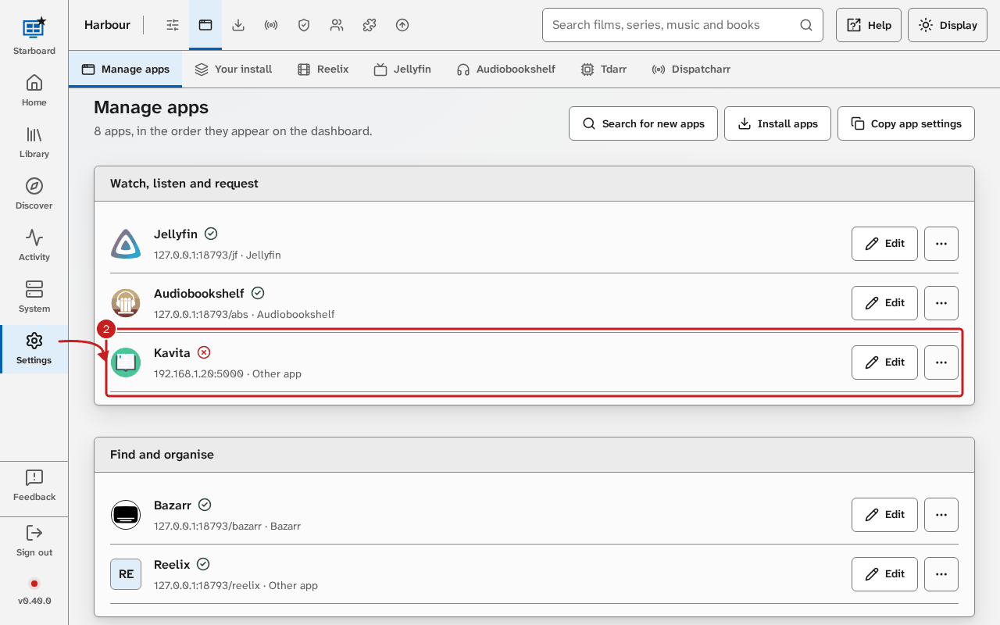
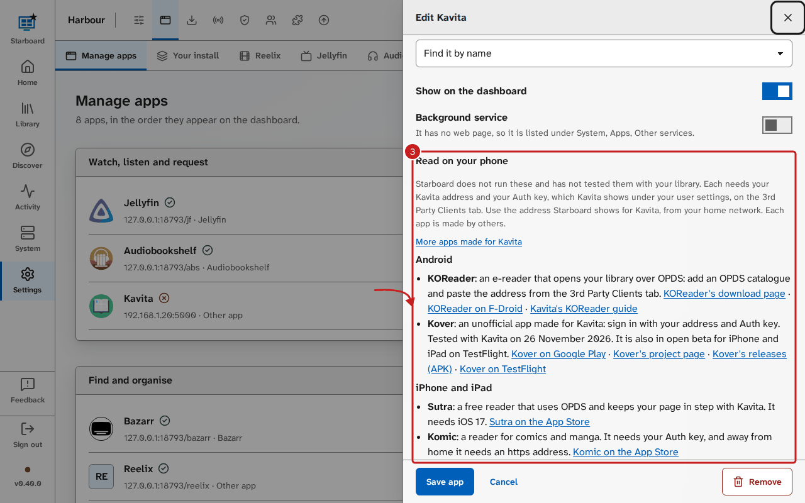
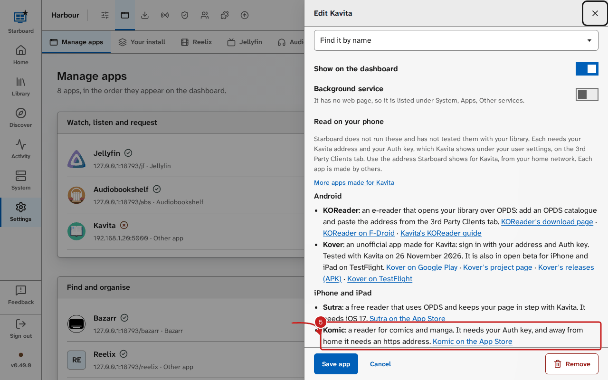

[Help centre](../README.md) · Apps · how-to
<!-- help: use / apps -->

# Read your Kavita books and comics on your phone

Starboard names four phone apps that work well with Kavita. KOReader and Kover are for Android. Sutra and Komic are for iPhone and iPad. Starboard shows the names and links where Kavita is set up. Other people make these apps. Starboard does not run them. We tested Kover with Kavita; we have not tested the others.

## Before you begin

- Kavita is set up in Starboard, either as the [Kavita plug-in](../plugins/kavita/README.md) or as an app you added in **Manage apps**. Read [Add an app](add-an-app.md).
- Your phone is on your home network, or you have a way in from outside, such as a VPN.
- You know the address of Kavita, such as `http://192.168.1.20:5000`. Starboard shows it on the app's card, or with **Open Kavita** on the plug-in's page.
- You have your Kavita **Auth key**. Kavita shows it, and the address for apps, under your user settings on the **3rd Party Clients** tab, with a copy button. Each person has their own. Read [Kavita's page on the Auth key and OPDS address](https://wiki.kavitareader.com/guides/user-settings/3rdpartyclients/).

## Steps

### Find the apps in Starboard

1. Go to **Settings**, then **Apps**, then **Manage apps**.
2. Select **Edit** beside Kavita.

   

3. Under **Read on your phone**, read about each app. Select a link to open its page in a new tab.

   

   If you use the plug-in, the same list is on **Settings**, then **Plug-ins**, **Manage**, then **Settings** beside Kavita, under **Read on your phone**.

### Use an app on your phone

1. Install the app from its link.
2. **KOReader:** add an OPDS catalogue. Paste the address from the **3rd Party Clients** tab. [Kavita's KOReader guide](https://wiki.kavitareader.com/guides/3rdparty/koreader/) has the steps.
3. **Kover:** sign in with your Kavita address and Auth key. We tested Kover with Kavita on 26 November 2026. Get it from [Google Play](https://play.google.com/store/apps/details?id=com.rodonisi.kover), [its project page](https://github.com/rodonisi/kover) or [its releases](https://github.com/rodonisi/kover/releases). It is also in open beta for iPhone and iPad on [TestFlight](https://testflight.apple.com/join/UsCtQUeY).
4. **Sutra:** it uses OPDS and keeps your page in step with Kavita. It needs iOS 17.
5. **Komic:** it is for comics and manga. It needs your Auth key. Away from home it needs an `https` address.

   

Kavita's wiki lists [more apps made for Kavita](https://wiki.kavitareader.com/guides/3rdparty/kavita-dedicated).

## What to expect

- Starboard does not keep your Auth key for these apps. The phone talks to Kavita, not to Starboard.
- Kavita in Starboard reads your books and comics folders only, so an app cannot change or delete a file.

## If it does not work

- **The app cannot reach Kavita:** check that the phone is on the same network. Check that the address uses the port Starboard shows, such as `:5000`.
- **KOReader shows no books:** use the full address from the **3rd Party Clients** tab. It starts with the host name your Kavita admin set in **Admin Settings**, **General**.
- **Komic does not connect away from home:** use an `https` address.
- **Sign-in is refused:** use your Kavita Auth key, not your Starboard password.

## Find out more

- [Add an app](add-an-app.md)
- [Kavita](../plugins/kavita/README.md)
- [Read your Calibre-Web books on your phone](read-calibre-web-books-on-your-phone.md)

<!-- footer: download rights -->

---

**Download only what you have the right to.** Use the download apps only for files you have the right to download,
such as open-source software, works in the public domain and your own backups. Downloading films, series, music or
books without the copyright holder's permission is against the law in the UK and most other countries. Starboard
does not host or provide any files, and you are responsible for what you download.

**Need help?** Ask on the [Starboard Discord support server](https://discord.gg/xN9bf2H4vv).

<!-- /footer -->
