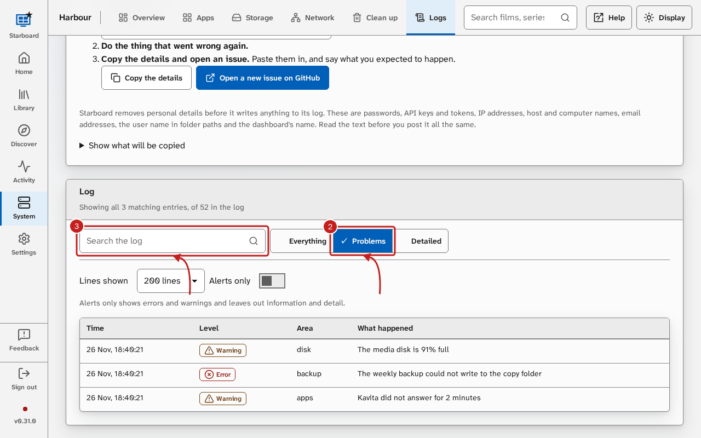
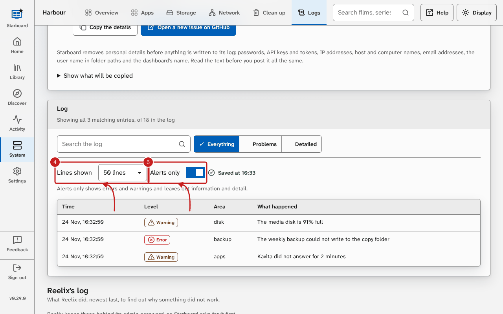
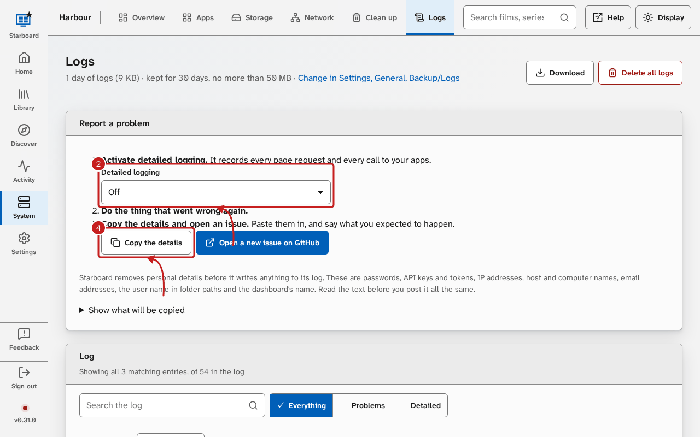
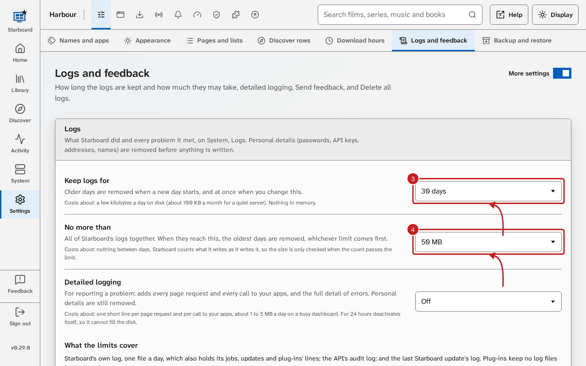

[Help centre](../README.md) · When something is wrong · how-to
<!-- help: fix / report -->

# Read the log and report a problem

Starboard's log lists what it did and every problem it met, newest first. When something goes wrong, the
**Report a problem** steps gather the details a bug report needs, with personal details removed.

```flow
title: Find your answer
start: Something went wrong in Starboard
q: Does Starboard open?
  No -> starboard-does-not-open.md
  Yes -> q2
q2: What do you want to do?
  Find out what happened -> 1
  Send it to someone to check -> 2
  Keep the logs smaller -> 3
  Remove every log now -> 4
  Read one app's own log -> 5
1: Read the log #read-the-log
2: Report a problem #report-a-problem
3: Limit how much is kept #limit-how-much-is-kept
4: Delete all logs #delete-all-logs
5: Read an app's log #read-an-apps-log
```

## Read the log

1. Go to **System**, then **Logs**.
2. In **Log**, choose what to show:
   - **Everything**: every entry.
   - **Problems**: errors and warnings only.
   - **Detailed**: the extra entries detailed logging adds.
3. To find something, enter a word in **Search the log**, such as the name of an app.

   

4. In **Lines shown**, choose 50, 100, 200, 500 or 1,000 lines. Starboard shows the newest ones and says how many
   there are beside **Log**, such as "Showing the newest 200 of 3,412 entries". It shows "Saved at" and the time
   beside your choice, and keeps it for your account. It starts at 200.
5. To leave out information and detail, activate **Alerts only**. Starboard shows only errors and warnings, and
   keeps your choice in the same way.

   

Each entry shows its **Time**, its **Level** (Error, Warning, Info or Detail), the **Area** of Starboard it
came from and **What happened**. Select an entry's message to show more, when it has more. To go further back,
choose more in **Lines shown**.

**Lines shown** and **Alerts only** work with **Everything**, **Problems**, **Detailed** and the search. With a
search or **Alerts only**, the count is of the entries that match, out of all the log holds, such as "Showing the
newest 50 matching entries, of 3,412 in the log". Alerts only with **Detailed** shows nothing, as detail entries
are not alerts. They change only what is shown: the stored log (how long it is kept and how much it may take) is
not changed.

## Read an app's log

**App logs** shows the latest lines from each app on this computer, such as Jellyfin or qBittorrent, with keys,
passwords and addresses hidden.

1. Go to **System**, then **Logs**, and find **App logs**.
2. In **App**, choose the app. In **How many**, choose the last 100, 300 or 1,000 lines.
3. Select **Show**. The newest line is at the end.
4. To find something, enter a word in **Only lines with**. Each match is marked, and Starboard says how many lines
   match.
5. To show only some levels, select **Errors**, **Warnings**, **Info** or **Debug** to turn each one off or on. Each
   one shows how many lines it has.

Select **Wrap lines** to read long lines without scrolling sideways, **Download the lines (TXT)** to keep them in a
file, or **Copy** to paste them somewhere else.

## Report a problem

1. Go to **System**, then **Logs**, and find **Report a problem**.
2. In **Detailed logging**, choose **For 24 hours**. This records every page request and every call to your
   apps.
3. Do the thing that went wrong again.
4. Select **Copy the details**. Starboard shows "Copied. Paste it into the issue".

   

5. Select **Open a new issue on GitHub**. Paste the details into the issue, and say what you expected to
   happen.
6. When you have finished, set **Detailed logging** back to **Off**.

To check what will be copied before you share it, select **Show what will be copied**.

## Limit how much is kept

Starboard keeps its logs for 30 days and lets them take no more than 50 MB, unless you change it. Whichever
limit comes first removes the oldest days.

1. Go to **Settings**, then **General**, then **Logs and feedback**.
2. Activate **More settings**, at the right of the page's heading.
3. In **Logs**, choose in **Keep logs for**: 7, 14, 30, 60, 90 or 180 days, or a year.
4. Choose in **No more than**: 10, 25, 50, 100, 250 or 500 MB.

   

Starboard shows "Saved" beside each one. Older days go at once, and from then on when a new day starts or the logs
reach the size. **What the limits cover** says what the logs take now and since when.

The limits cover Starboard's own log, which also holds its jobs, updates and plug-ins' lines, the API's audit log,
and the last Starboard update's log. Plug-ins keep no log files in Starboard.

**The apps' own logs** says how much Docker keeps for each app, such as "3 files of 10 MB". Docker's settings on
the server set that, and Starboard cannot change them. Apps and plug-ins Starboard installs get 3 files of 10 MB
each in their own set-up, so they stay small even without that setting.

## Delete all logs

1. Go to **Settings**, then **General**, then **Logs and feedback**, and activate **More settings**. Or go to
   **System**, then **Logs**.
2. Select **Delete all logs**. It is in its own section at the end of the page, or at the top of System, Logs.
3. Starboard asks **Delete all logs?** and says how much goes. Enter your Starboard password.
4. Select **Delete all logs** to go ahead, or **Cancel** to keep them.

Starboard says "All logs deleted" and how much was freed. Today's file and the API's audit log are emptied, not
removed, so Starboard keeps logging. Their first new line says the logs were deleted, from which browser or API
key, and when. This cannot be undone. The apps' own logs, which Docker keeps, are not deleted.

## Things to note

- Starboard removes personal details before anything is written to its log: passwords, API keys and tokens,
  IP addresses, host and computer names, email addresses, the user name in folder paths and the dashboard's
  name. Read the text before you post it all the same.
- **Download** saves the newest lines as a text file, for example to attach it to an issue: as many as **Lines
  shown** says, and only errors and warnings when **Alerts only** is active. Its first line says how many it holds.
  **Copy the details** gives the same number of lines.
- To suggest something or report a problem with one page, use **Feedback** in the side menu instead. Read
  [Send feedback about a page](send-feedback.md).
- **Detailed logging** is also in **Settings**, **General**, **Logs and feedback**, in the **Logs** section.
- A Starboard installed before version 0.20 keeps the days it was set to (60 by default then). Choose again in
  **Keep logs for** to keep fewer.
- If Starboard installed Reelix, **System**, **Logs** also has **Reelix's log** and **Reelix's scheduled tasks**.
  Starboard asks for Reelix's password first.
- If you cannot open Starboard at all, read the server's copy of the log. On the server, in the Starboard
  folder, run this command:

  ```bash
  docker compose logs starboard
  ```

  Then read [Starboard does not open](starboard-does-not-open.md).

## If it does not work

- **"Could not copy. Use Download instead":** your browser did not allow copying. Select **Download**, then
  attach the file or copy the text from it.
- **"That password is not right":** enter the password you sign in to Starboard with, then select **Delete all
  logs** again.
- **The logs take more than No more than says:** today's file is never removed, so a busy day with detailed
  logging can go over the limit until the next day starts. Set **Detailed logging** back to **Off**.
- **"Set STARBOARD_REPO on the server to link straight to the issue page":** Starboard does not know where
  to report problems. Go to the Starboard project on GitHub and open a new issue there.

## Find out more

- [Starboard does not open](starboard-does-not-open.md)
- [An app shows as not responding](app-not-responding.md)
- [Send feedback about a page](send-feedback.md)
- [Activate alerts](activate-alerts.md)

<!-- footer: download rights -->

---

**Download only what you have the right to.** Use the download apps only for files you have the right to download.
Examples are open-source software, works in the public domain and your own backups. Downloading films, series, music or
books without the copyright holder's permission is against the law in the UK and most other countries. Starboard
does not host or provide any files, and you are responsible for what you download.

**Need help?** Ask on the [Starboard Discord support server](https://discord.gg/xN9bf2H4vv).

<!-- /footer -->
