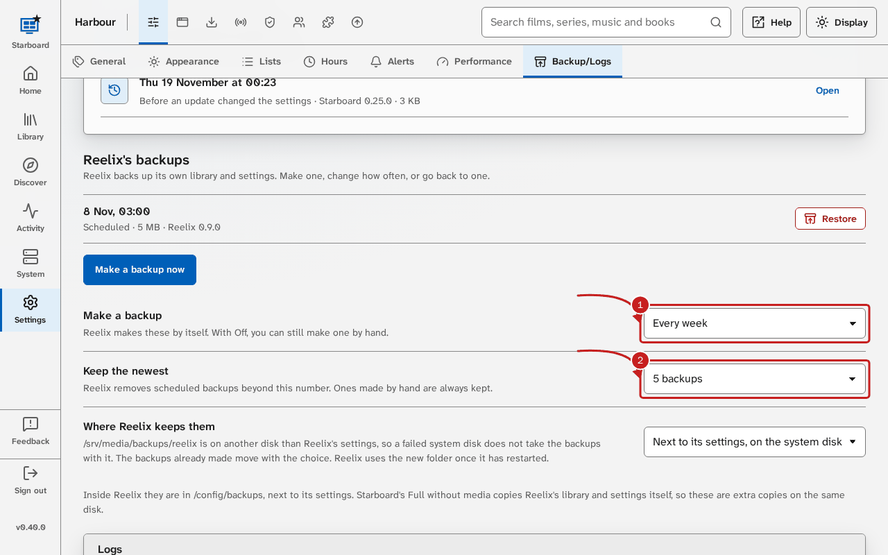
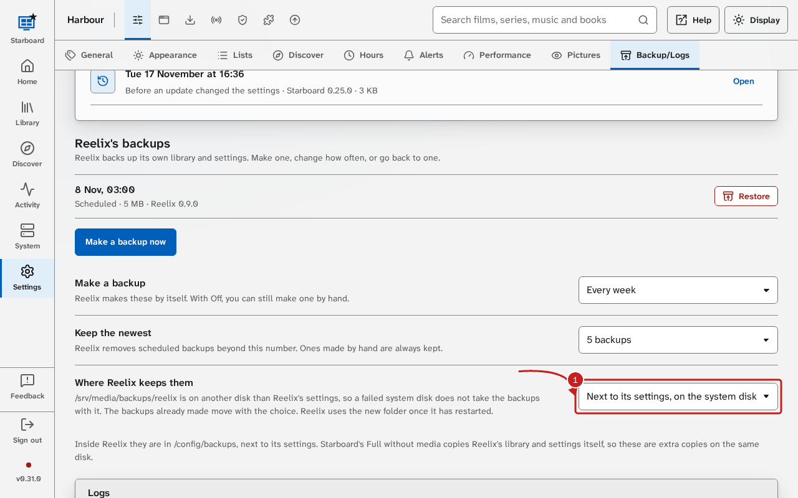
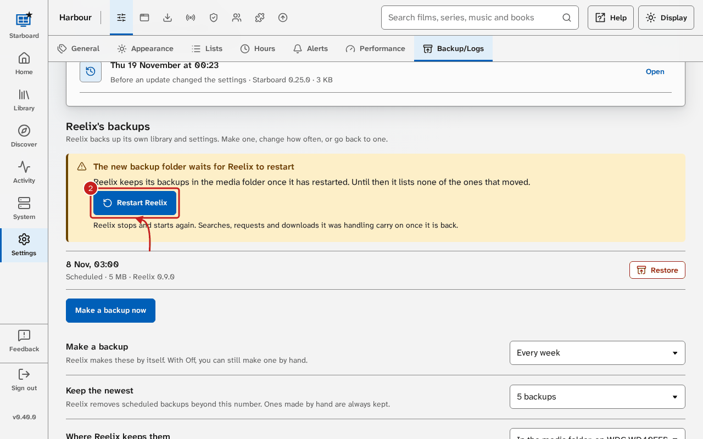

[Help centre](../README.md) · Backup and restore · how-to
<!-- help: use / backups -->

# Reelix's own backups

Reelix backs up its own library and settings. In Starboard you choose how often it makes one, how many it keeps and
which disk they are on, make one now, or go back to one.

## Before you begin

- Starboard runs Reelix, and you know Reelix's password. If Starboard set Reelix up, it is the same as your
  Starboard password.
- To restart Reelix from this page, Reelix is in **Manage apps**.

## Steps

### Open Reelix's backups

1. Go to **Settings**, then **General**, then **Backup/Logs**.
2. Find **Reelix's backups** and select **Show Reelix's backups**.
3. Enter the **Reelix password** and select **Continue**. The page remembers it for 5 minutes.

### Choose how often and how many

1. In **Make a backup**, choose how often, from **Every day** to **Every 30 days**, or **Off**.
2. In **Keep the newest**, choose how many scheduled backups Reelix keeps.

Each choice saves as soon as you make it, and Starboard shows "Saved" with the time beside it. There is no Save
button.

### Keep the backups on another disk

Reelix keeps its backups next to its settings, which is usually the system disk. When your media folder is on
another disk, Reelix can keep them there instead, so a failed system disk does not take the backups with it.

1. In **Where Reelix keeps them**, choose **In the media folder**. The choice names the disk it is on.

   

2. Starboard moves the backups already made and shows **The new backup folder waits for Reelix to restart**.
   Select **Restart Reelix**, then **Restart Reelix** again in the dialog.

   

When Reelix answers again, the page shows **Done** and the folder Reelix now uses.

### Go back to a backup

1. Select **Restore** beside the backup.
2. Starboard asks **Restore this Reelix backup?** Select **Restore**.
3. Select **Restart Reelix** in **A restore is waiting for Reelix to start again**. Nothing changes until Reelix
   restarts.

## Things to note

- **Where Reelix keeps them** shows only when the media folder is on another disk than Reelix's settings. When both
  are on one disk, the page says so.
- Reelix can reach two folders of your computer: its settings and the media folder. That is why there are two
  places to choose from.
- In the media folder, the backups are in `backups/reelix`.
- Backups made by hand, with **Make a backup now**, are always kept.
- A full backup holds Reelix's library and settings too. Read
  [Make and restore a full backup](make-and-restore-a-full-backup.md).

## If it does not work

- **"A restore is waiting for Reelix to start again":** select **Restart Reelix** first, then choose where the
  backups go.
- **Still the old folder:** Reelix answered again and still uses the folder from before. Read Reelix's log on
  **System**, **Logs**.
- **A backup "could not be moved":** it stays in the folder it was in. Reelix lists the ones in the folder it uses
  now.

## Find out more

- [Make and restore a full backup](make-and-restore-a-full-backup.md)
- [Back up and restore Starboard's settings](back-up-settings.md)

<!-- footer: download rights -->

---

**Download only what you have the right to.** Use the download apps only for files you have the right to download.
Examples are open-source software, works in the public domain and your own backups. Downloading films, series, music or
books without the copyright holder's permission is against the law in the UK and most other countries. Starboard
does not host or provide any files, and you are responsible for what you download.

**Need help?** Ask on the [Starboard Discord support server](https://discord.gg/xN9bf2H4vv).

<!-- /footer -->
