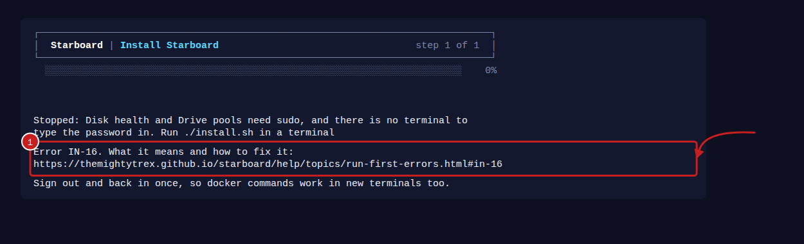
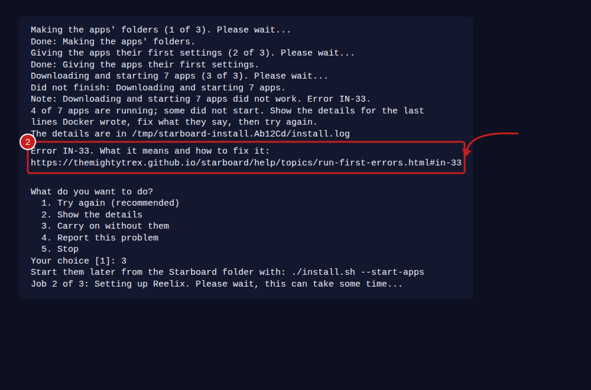
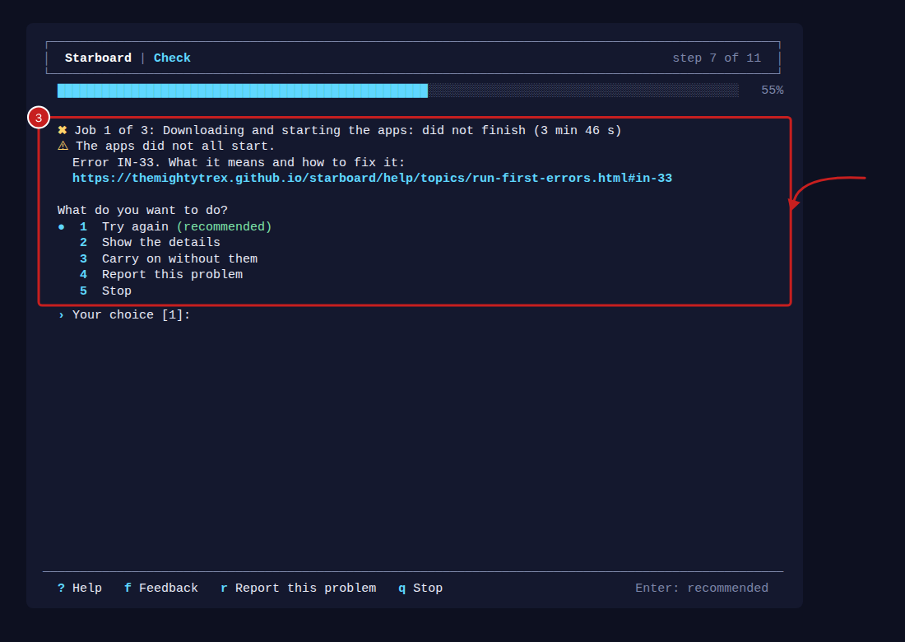

[Help centre](../README.md) · When something is wrong · reference

# Run first and installer error numbers

When the Run first script or Starboard's installer (`./install.sh`) stops, it shows an error number, such as
`Error RF-11` or `Error IN-21`, with a link to this page. RF numbers come from the Run first script, IN numbers from
the installer and the terminal set-up. When the installer stops while the Run first script runs it, the Run first
script ends on the installer's number, so you only have one number to look up. Find the number below to see what it means and how to put it right. Then run the script again: it carries on from what
is missing, and nothing that already worked is done twice.

If you ask for help or report a problem, give the error number. The script's log has it too: the message gives
where the log is, a file called `run-first.log` in a `starboard-run-first` folder in `/tmp`.

## How an error looks

1. When the script or the installer stops, the last lines say why, then the error number and the address of its
   help on this page.

   

2. In accessible mode, the same lines come as plain text: the error number, then the address on a line of its own.

   

3. When one job does not finish, such as starting the apps, the line under it says what went wrong, then the error
   number and the address of its help, as when it stops. Then it asks what to do: **Try again** is recommended. **Show the details** shows the last lines of the job's log, and **Report this problem** helps you send a
   report about it (read [Send feedback](send-feedback.md)).

   

## Before it starts

### RF-01

**An option the script does not know.** The command has a word after `bash` that the script does not use, often a
typing mistake. Run it with no options, or with one of `--browser`, `--terminal`, `--plain`, `--yes`, `--dir` or
`--check`. To see what each does, run it with `--help`.

### RF-02

**No terminal to type in.** The script was started somewhere it cannot ask questions, such as from another
program or a scheduled job. Run it in a terminal window, or add `--yes` to accept every safe answer without being
asked.

### RF-03

**Run as root or with sudo.** Run it as your normal user, without `sudo` in front. It asks for your password
itself when it needs to install something.

### RF-04

**No temporary folder.** The script could not make a folder in `/tmp`. Usually the disk is full: free some
space, then run it again.

### RF-05

**A version of Linux the script does not know.** It knows Debian, Ubuntu, Linux Mint, Fedora and Raspberry Pi OS.
Install Docker by hand with [Install Docker](install-docker.md), then run the script again.

## Installing what is missing

These happen while the script installs Docker and the other things Starboard needs. Each time, the script offers
**Try again**, **Show the details** or **Stop**.

### RF-10

**curl is installed as a snap.** The snap version of curl is sandboxed and cannot save Docker's installer where
the script needs it. Choose **Stop**, then install the usual curl and run the script again:

```bash
sudo apt install curl
```

### RF-11

**No internet.** This computer could not reach the internet to download something. Check the network cable or
Wi-Fi, then choose **Try again**.

### RF-12

**Another program is installing updates.** This often happens just after Linux is installed, when it updates
itself. Wait a few minutes, then choose **Try again**.

### RF-13

**A software source has a signing key Linux no longer accepts.** The list of software could not be updated.
Choose **Show the details** to see which source. Install that source's new key, or turn the source off, then
choose **Try again**.

### RF-14

**The disk is full.** Free some space, then choose **Try again**.

### RF-15

**This version of Linux does not offer something the script installs.** Update Linux to its newest version, or
install Docker by hand with [Install Docker](install-docker.md).

### RF-16

**Your user is not allowed to install software.** Run the script as the user you made when installing Linux, or
ask whoever looks after this computer to add you to the `sudo` group.

### RF-17

**sudo did not accept the password.** Type the password you use to sign in to this computer. Nothing shows as
you type on most systems. Then choose **Try again**.

### RF-19

**Something else went wrong.** Choose **Try again**. If it happens again, choose **Show the details**, and give
the last lines when you ask for help.

### RF-20

**Still missing after installing.** The jobs finished, but Docker, or your permission to use it, is still not in
place. Run the script again. If it stops here again, restart the computer, then run it once more.

## Downloading Starboard

### RF-30

**A folder called starboard is in the way.** A `starboard` folder is already in your home folder, and it is not a
Starboard download. Move or rename it, or choose another folder with `--dir`, then run the script again.

### RF-31

**The Starboard folder cannot be opened.** It was downloaded but cannot be entered, usually because its
permissions were changed. Move it aside, then run the script again to download a fresh copy.

## Installing Starboard and starting the apps

### RF-40

**Starboard's installer stopped without giving an error number.** The Run first script ends on the installer's own
number (starting IN) whenever it gives one, so you only see RF-40 when it gave none: it stopped suddenly, for example
because the computer ran out of memory or the connection to it closed. The lines just above are the last it wrote.
Run the script again: it carries on from what is missing. If RF-40 comes back, choose **Report this problem**, or
[read the log and report a problem](read-the-log.md), with those lines.

If the line above says `sg: command not found`, your copy of the script is from before 7 November 2026. Run the
script again: the current one works without `sg`.

If you stop the installer yourself, by typing `q` or pressing Ctrl+C, that is not an error and there is no number.

### RF-50

**The apps did not start.** The set-up in the browser asked this window to download and start your apps, and
that did not finish. The line just above the error number says why. Most often this computer could not reach the
internet, or the disk is full. Put that right, then select **Try again** in the browser.

## Starboard's installer

The installer is `./install.sh`, in the Starboard folder. The Run first script starts it for you; you can also run it
yourself to change what Starboard may access.

### IN-01

**An option the installer does not know.** Run `./install.sh --help` to see the options, then run it again.

### IN-02

**--terminal needs a terminal to type in.** Run it in a terminal window, or leave out `--terminal` and finish in a
browser.

### IN-03

**The port is not a number from 1 to 65535.** Give `--port` a number such as `8095`.

### IN-04

**Run as root.** Run it as your normal user, without `sudo` in front.

### IN-05

**git is not installed.** Install git (`sudo apt install git`), then run it again. The Run first script does this
for you.

### IN-06

**Not in a Starboard download.** Run `./install.sh` from the folder git downloaded Starboard into, usually
`~/starboard`, so `./update.sh` can update it later.

### IN-07

**Docker is not installed.** Install it with [Install Docker](install-docker.md), or run the Run first script,
which installs it for you.

### IN-08

**Docker Compose is not installed.** Install the Docker Compose plugin with [Install Docker](install-docker.md).

### IN-09

**Python 3.10 or newer is missing.** Only `--native` needs it. Install Python 3.10 or newer, or leave out
`--native` to run Starboard with Docker.

### IN-10

**--native needs systemd.** This computer does not use systemd. Leave out `--native` to run Starboard with Docker.

### IN-11

**No Docker socket.** You said yes to app updates, but Docker's socket is not at `/var/run/docker.sock`. Start
Docker (`sudo systemctl start docker`), or answer No to app updates.

### IN-12

**The Live TV folder does not exist.** Make the folder Jellyfin reads its Live TV files from, or type another.

### IN-13

**You cannot write in the Live TV folder.** Give your user that folder, for example
`sudo chown -R $USER /srv/jellyfin/config/iptv`, then run the installer again.

### IN-14

**A character Starboard cannot use.** A folder's name or path has one of `| & \ " ' $` or a backtick. Rename the
folder, or move Starboard to a folder without them.

### IN-15

**A folder to show is written wrongly or does not exist.** Write each one as `Name=/path`, such as
`Media=/mnt/media`, with no commas, and check the folder exists.

### IN-16

**sudo did not accept the password, or there is nowhere to type it.** Disk health and Drive pools need sudo. Run
`./install.sh` in a terminal and type the password you use to sign in to this computer.

### IN-17

**smartmontools did not install.** Disk health needs it. Install it yourself (`sudo apt install smartmontools`),
then run the installer again.

### IN-18

**Disk health did not set up.** Choose **Show the details** to see why, put it right, then choose **Try again**.

### IN-19

**The pool helper did not install.** Choose **Show the details** to see why, put it right, then choose **Try
again**.

### IN-20

**The disk is full.** Building Starboard needs space. Free some, then choose **Try again**.

### IN-21

**No internet while building.** This computer could not download what Starboard is built from. Check the network,
then choose **Try again**.

### IN-22

**Your user is not allowed to use Docker yet.** Sign out and back in, so your new Docker access counts, then run
the installer again.

### IN-23

**Starboard did not build or start.** Choose **Show the details** for the last lines of the build. Most often it is
the network or the disk. Put it right, then choose **Try again**.

### IN-24

**Starboard did not answer after starting.** Read what it says with `docker compose logs starboard` in the
Starboard folder (or `journalctl --user -u starboard` with `--native`). See also
[Starboard does not open](starboard-does-not-open.md).

### IN-29

**Something else went wrong in a job.** Choose **Show the details**, and give the last lines when you ask for help.

### IN-30

**The apps' folder is not one Starboard can use.** The set-up wrote a folder Starboard does not accept. Run the
set-up again and choose another media folder.

### IN-31

**Starboard could not make the apps' folders.** Check the disk is not full and is mounted, then choose **Try
again**.

### IN-32

**The apps' file has things Starboard did not write.** Starboard checks it before starting the apps. If you
changed it yourself, run `./install.sh --start-apps` in a terminal and choose to start it anyway. If not, run the
set-up again to write it afresh.

### IN-33

**Some apps did not start.** Choose **Show the details** for the last lines Docker wrote, put that right, then
choose **Try again**.

### IN-34

**Starboard could not give Jellyfin its Live TV fix.** Jellyfin runs FFmpeg through a small file in its settings
folder, `jellyfin/ffmpeg-wrap`, so free channels such as U&Laughs play. Check the disk is not full and the
settings folder is mounted, then choose **Try again**.

### IN-35

**The Starboard folder cannot be opened.** The installer could not go into its own folder, usually because its
permissions were changed. Move the folder aside and run the Run first script again to download a fresh copy.

### IN-36

**No temporary folder.** The installer keeps its log in a temporary folder in `/tmp`, and could not make one. The
disk is usually full: free some space (`df -h /tmp` shows how much is left), then run it again.

### IN-37

**The terminal set-up stopped on a problem.** The line above the number says what it was, often that Starboard is
not answering on its port. Check Starboard is running (`docker ps` lists `starboard`), then run the set-up again
with `python3 -m starboard.terminal_setup` in the Starboard folder, or finish in a browser.

### IN-38

**The terminal set-up stopped on a fault of its own.** Python wrote what went wrong just above the number. Run the
set-up again with `python3 -m starboard.terminal_setup` in the Starboard folder, or finish in a browser, and
choose **Report this problem** with those lines so it can be fixed.

## Find out more

- [Set up everything with the Run first script](run-first.md)
- [Install Docker](install-docker.md)
- [Read the log and report a problem](read-the-log.md)
- [Starboard does not open](starboard-does-not-open.md)

<!-- footer: download rights -->

---

**Download only what you have the right to.** Use the download apps only for files you have the right to download,
such as open-source software, works in the public domain and your own backups. Downloading films, series, music or
books without the copyright holder's permission is against the law in the UK and most other countries. Starboard
does not host or provide any files, and you are responsible for what you download.

<!-- /footer -->
