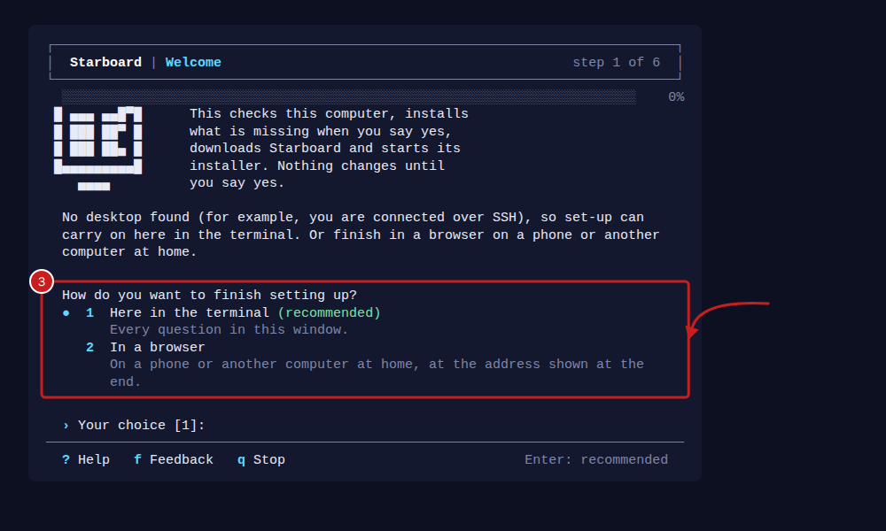
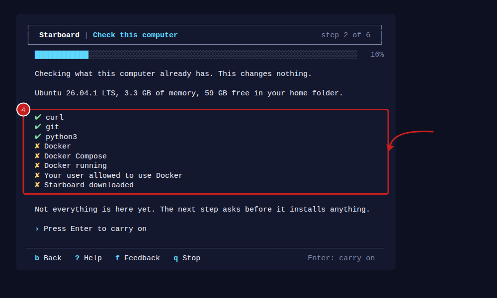
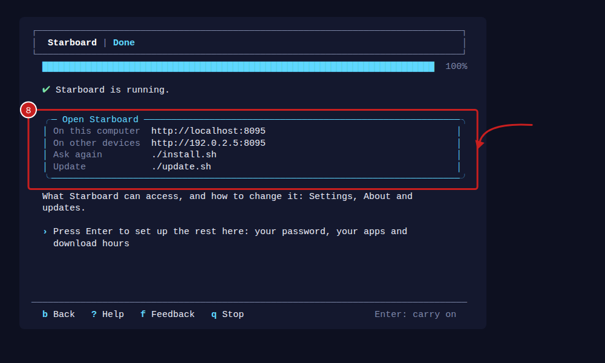

[Help centre](../README.md) · Install and update · how-to

# Set up everything with the Run first script

Once Linux is installed, the Run first script sets up everything else. It checks the computer, installs Docker and
anything else that is missing, downloads Starboard and starts its installer. Then the set-up opens in your browser,
or carries on in the terminal. It takes about 15 minutes.

## Before you begin

- A computer with Linux installed: Linux Mint 22.3 (recommended), Debian 13, Ubuntu Server 26.04 or Raspberry Pi
  OS (64-bit), or a later version, with or without a desktop. Read [Install Linux on a computer](install-linux.md).
  Each system has its own page: [Linux Mint](start-on-linux-mint.md), [Debian](start-on-debian.md),
  [Ubuntu Server](start-on-ubuntu-server.md) and [Raspberry Pi OS](start-on-raspberry-pi-os.md).
- The computer is connected to the internet. Read
  [Connect to the internet, by cable or Wi-Fi](connect-to-the-internet.md).
- The password you use to sign in to that computer. It is asked for when something needs installing.
- A terminal open on that computer, or connected to it. Read [The terminal: typing commands](../basics/the-terminal.md).

## Steps

1. Copy this command into the terminal and press Enter:

   ```bash
   curl -fsSL https://raw.githubusercontent.com/TheMightyTRex/starboard/main/run-first.sh | bash
   ```

   Copy and paste it if you can. `main/run-first.sh` is in small letters, with a hyphen, and the GitHub account is
   `TheMightyTRex`. A difference gives "error: 404", which means "not found". Read
   [Capital letters matter](../basics/the-terminal.md#capital-letters-matter).

   The `|` is the vertical bar. Its key is in different places on different keyboards. Read
   [Symbols that are in different places on different keyboards](../basics/the-terminal.md#symbols-that-are-in-different-places-on-different-keyboards).
   These two commands do the same with no `|`:

   ```bash
   curl -fsSL -o run-first.sh https://raw.githubusercontent.com/TheMightyTRex/starboard/main/run-first.sh
   bash run-first.sh
   ```

2. The first question is about how it looks. Press Enter for the standard look. For **accessible mode**, enter `a`
   and press Enter: plain lines with no boxes or colour, for software that reads text aloud. Your choice is kept for
   the whole installation.
3. **Welcome:** choose how to finish setting up. **In a browser** is recommended when the computer has a desktop.
   **Here in the terminal** is recommended when it has none, such as over SSH. Press Enter for the recommended answer.
   

4. **Check this computer:** it lists what is already there, with a tick, and what is missing. This changes nothing.
   

5. **Install what is missing:** it shows the commands it will run. Press Enter to install them. When sudo asks for
   your password, enter it and press Enter. Nothing shows as you enter it.

   If Linux is installing its own updates, which is common soon after Linux is installed, the script waits for them.
   A progress bar called **Waiting for Linux to finish installing its updates** shows what is installing, how many
   are done and how much is downloaded. The script then carries on by itself. If updates start part-way through, it
   waits and tries again by itself.
6. **Download Starboard:** it downloads Starboard into a folder called `starboard` in your home folder, or updates
   it if it is already there.
7. **Ready to install:** check the summary and press Enter to start Starboard's installer.
8. **Install Starboard:** answer the installer's questions. If you are unsure, press Enter for the recommended answer.
   Read [What the installer asks](what-the-installer-asks.md#the-access-it-asks-for). The script tells the set-up
   what it found on this computer, such as drives and apps already running, so it can recommend the right answers.
9. Finish setting up:
   - **In a browser, on a computer with a desktop:** the set-up page opens by itself with the setup code filled in.
     Read [Create your password and sign in](create-your-password.md).
   - **In a browser, with no desktop:** open the address it shows on a phone or another computer at home, and
     enter the setup code it shows.
   - **Here in the terminal:** answer the set-up questions. Read
     [Set up Starboard in the terminal, with no browser](set-up-in-the-terminal.md#steps).

   At the end, the script makes the set-up's changes to this computer, such as disk health. It asks for your password
   again if sudo needs it.

   

## How to answer

- Press Enter on its own to take the recommended answer.
- Enter `b` to go back a step, `?` for help with the step, or `q` to stop. Stopping changes nothing more, and you can
  run the script again at any time.
- Each step starts on an empty terminal window. The heading and progress bar stay at the top of the window, and the
  keys stay on its last line.

## Things to note

- You can run it again at any time. It installs only what is missing, and updates Starboard if it is already
  downloaded.
- To check the computer with no changes, add `--check`:

  ```bash
  curl -fsSL https://raw.githubusercontent.com/TheMightyTRex/starboard/main/run-first.sh | bash -s -- --check
  ```

- To read the script before running it, download it, read it with `less`, then run it:

  ```bash
  curl -fsSL -o run-first.sh https://raw.githubusercontent.com/TheMightyTRex/starboard/main/run-first.sh
  less run-first.sh
  bash run-first.sh
  ```

- It never runs as administrator by itself and never keeps your password. sudo asks for it, only when something is
  being installed.
- It allows your user to use Docker. This is the same as administrator control of the computer, so run it only as
  your own user. Sign out and back in once afterwards, so `docker` commands work in new terminals too.

## If it does not work

- **An error number, such as "Error RF-11":** find it in
  [Run first and installer error numbers](run-first-errors.md), which says what it means and how to put it right.
- **"The requested URL returned error: 404":** the address has a difference. Copy and paste it instead.
- **"Command 'curl' not found" or "curl: command not found":** a new Debian does not include curl. Use the same
  command with `wget` instead:

  ```bash
  wget -qO- https://raw.githubusercontent.com/TheMightyTRex/starboard/main/run-first.sh | bash
  ```

  If `wget` is missing too, install curl with `sudo apt install curl`, then run the first command again. Do not use
  the `sudo snap install curl` that Ubuntu suggests. Read [RF-10](run-first-errors.md#rf-10).
- **"This Linux is not one this script knows how to install on":** install Docker by hand with
  [Install Docker](install-docker.md), then run the script again.
- **"exists but is not a Starboard download":** read [RF-30](run-first-errors.md#rf-30).

## Find out more

- [Run first and installer error numbers](run-first-errors.md)
- [Get Starboard up and running, from a bare computer](../guides/get-up-and-running.md)
- [Install Linux on a computer](install-linux.md)
- [Install Docker](install-docker.md), to do it by hand
- [Install Starboard with the installer](install-with-the-installer.md), to do it by hand

<!-- footer: download rights -->

---

**Download only what you have the right to.** Use the download apps only for files you have the right to download,
such as open-source software, works in the public domain and your own backups. Downloading films, series, music or
books without the copyright holder's permission is against the law in the UK and most other countries. Starboard
does not host or provide any files, and you are responsible for what you download.

<!-- /footer -->
