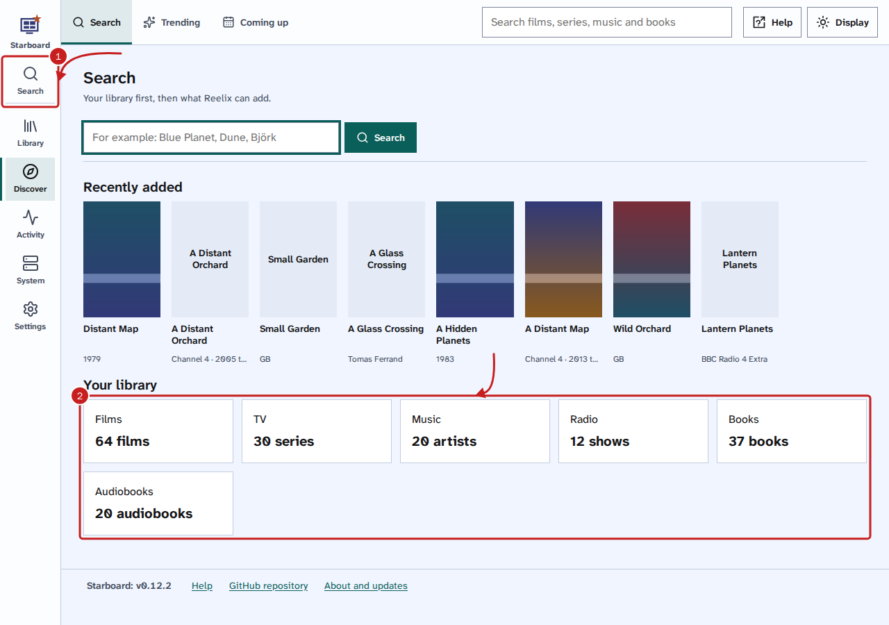
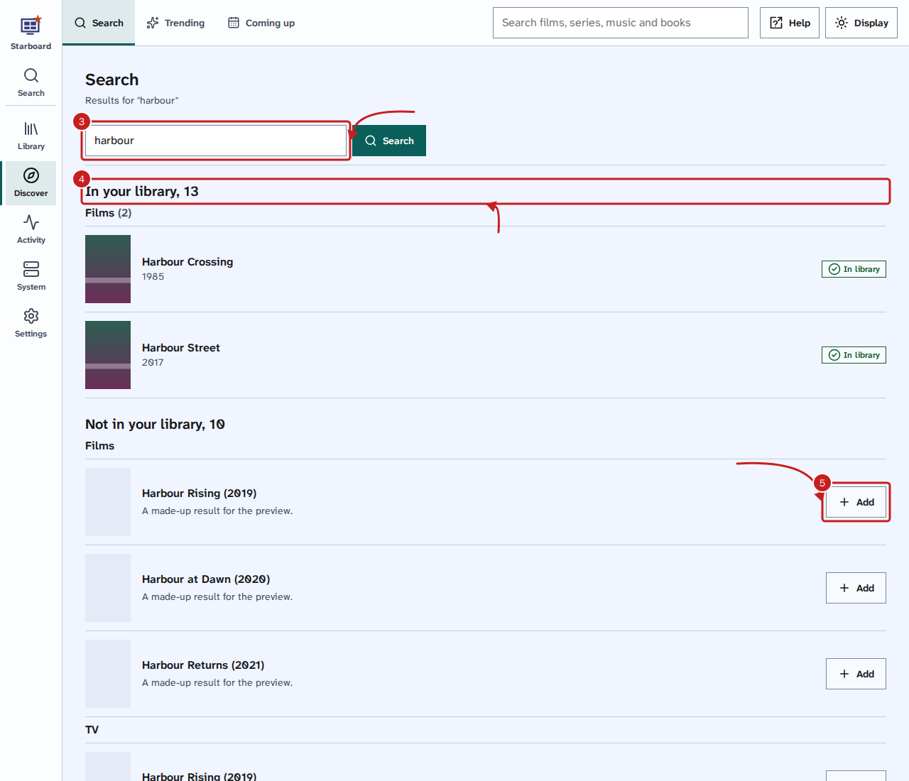
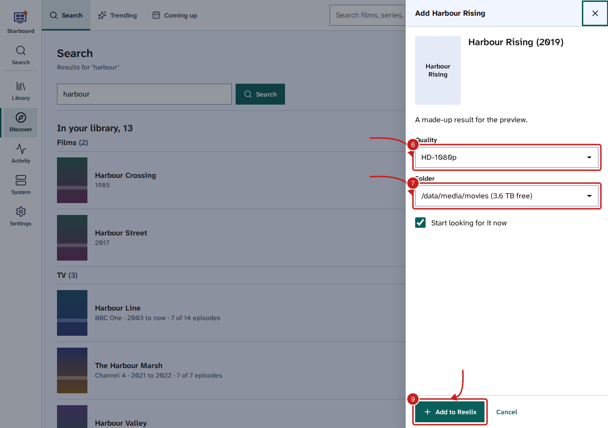

[Help centre](../README.md) · Everyday use · how-to

# Search for and add films, series, music and books

Search checks your library first, so you know straight away whether you already have something. After that,
under **Not in your library**, it lists what Reelix can find, and you add it with one button. Radio shows and
podcasts have **Follow** instead.

## Before you begin

- Reelix is in Starboard with its key. Install apps adds it for you. Read [Install apps](install-apps.md).
- Without Reelix, Search looks in Sonarr, Radarr, Lidarr and Readarr instead. Read
  [Without Reelix](#without-reelix).

## Steps

1. Select **Search** in the side menu. Or enter a name in the search box in the header of any page. On a phone,
   select **Search** in the header, or use the search box in the menu.
2. Before you type, Search shows your library: **Recently added**, then each kind with how many you have, such as
   **Films** and **64 films**. Select a kind to open it in the Library.

3. Enter at least two letters of the name, such as `harbour`. Results appear as you type.
4. **In your library** lists what you already have, by kind, with whether each one is in your library, wanted or
   not released yet. Select a title to open its page, or **See all** to list every match in the Library.
5. **Not in your library** lists what Reelix finds that you do not have, by kind. Select **Add** beside the one you
   want. For a radio show or podcast, select **Follow**. Read
   [Follow radio shows and podcasts](follow-radio-shows.md).

6. In the panel, choose the **Quality**: how good a copy Reelix looks for.
7. Choose the **Folder** it goes in. Each folder shows the free space on its drive. For a book, in **Get it as**,
   choose **Ebook**, **Audiobook** or both.
8. Leave **Start looking for it now** activated, so Reelix looks for it straight away. Deactivate it to add it now
   and search later.
9. Select **Add to Reelix**. The button beside it changes to **Added**, and it appears in the Library within a few
   minutes.

## Things to note

- Each search has its own address, such as `http://192.168.1.20:8095/search.html?q=harbour`, so you can bookmark
  or share a search.
- **Not in your library** asks Reelix, which asks sites such as TMDB (The Movie Database) and Open Library. It
  can take a few seconds. Each kind appears as soon as it is ready.
- Reelix needs a TMDB key to look up films and series. Books, music and radio need no key.
- To get what you follow but do not have yet, use **Activity**, then **Wanted**. Read
  [Find and get what is missing](get-what-is-missing.md).
- Covers come through Starboard, so your browser never contacts the image sites.

## Without Reelix

When Starboard has no Reelix with a key, Search looks in every Sonarr, Radarr, Lidarr and Readarr you have added.
Enter the name and select **Search**. Select **Add** beside a result, check the **Quality profile**, **Folder** and
**Start searching for it now**, then select **Add to** and the app's name, such as **Add to Radarr**. A result you
already have says **In library**. Read [Add an app](add-an-app.md).

## If it does not work

- **Nothing in your library matches:** check the spelling, or try fewer words. The Library may still be reading
  from Reelix: wait a minute and type again.
- **Reelix found nothing else:** check the spelling, or try fewer words.
- **Reelix cannot look up films until it has a TMDB key:** add a TMDB key to Reelix in **Settings**, then
  **Apps**, then **Reelix**. Read [Change Reelix's settings in Starboard](change-reelix-settings.md).
- **Reelix has no folder for this kind yet:** Reelix needs a folder for films, series, books or music before it
  can add one. Add one in **Settings**, then **Apps**, then **Reelix**. Read
  [Change Reelix's settings in Starboard](change-reelix-settings.md).
- **Some results may be missing** (without Reelix): one of your apps did not answer. Select **View apps** to
  find out which one. Read [An app shows as not responding](app-not-responding.md).

## Find out more

- [Browse your library](browse-your-library.md)
- [Follow radio shows and podcasts](follow-radio-shows.md)
- [Pause, resume and remove downloads](manage-downloads.md)
- [Find out what is coming up](coming-up.md)

<!-- footer: download rights -->

---

**Download only what you have the right to.** Use the download apps only for files you have the right to download,
such as open-source software, works in the public domain and your own backups. Downloading films, series, music or
books without the copyright holder's permission is against the law in the UK and most other countries. Starboard
does not host or provide any files, and you are responsible for what you download.

<!-- /footer -->
