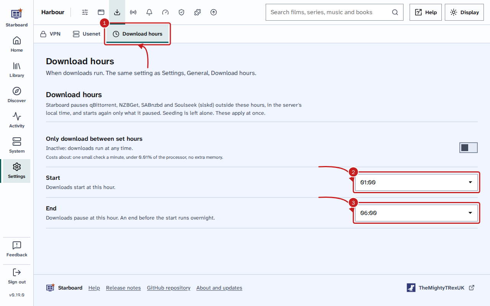
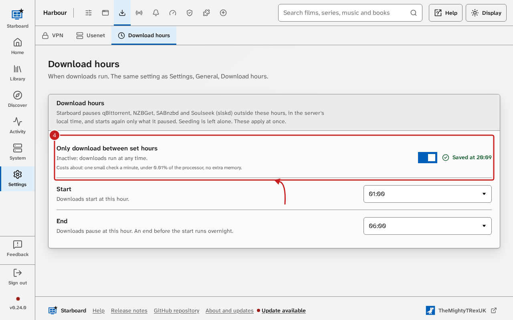
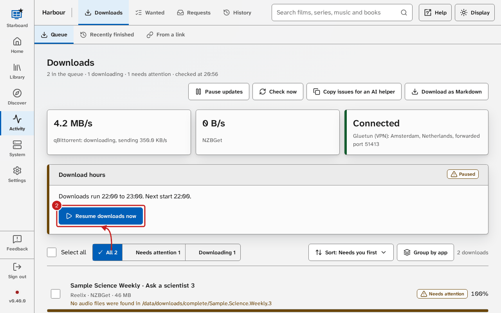

[Help centre](../README.md) · Everyday use · how-to
<!-- help: use / library -->

# Download only at certain hours

Starboard can pause your download apps outside the hours you choose, for example to keep your internet free
during the day. It pauses qBittorrent, NZBGet, SABnzbd and Soulseek. You can still resume or pause them by hand.

## Before you begin

- Your download apps are in Starboard with their API keys. Read [Add an app](add-an-app.md) and
  [Find an app's API key](find-an-api-key.md#where-each-app-keeps-its-key).
- qBittorrent must be version 5.2 or later, because older versions have no API key.

## Steps

1. Go to **Settings**, then **Downloads**, then **Download hours**. If it says **No download apps yet**, add a
   download app with its API key first.
2. In **Start**, choose the hour downloads start, such as **01:00**.
3. In **End**, choose the hour downloads pause, such as **07:00**.

   

4. Activate **Only download between set hours**. Starboard says **Saved at** and the time beside it.

   

Each change applies at once. There is no save button. Outside the hours, Starboard pauses qBittorrent, NZBGet,
SABnzbd and Soulseek (slskd).

**Settings**, then **General**, then **Download hours** is the same setting in a second place: a change in one shows
in the other. **Settings**, then **Downloads** also holds your VPN and your Usenet provider's server. Read
[Choose a Usenet provider and add it](choose-a-usenet-provider.md).

### Resume or pause by hand

1. Go to **Activity**, then **Downloads**, then **Queue**.
2. In **Download hours**, select **Resume downloads now**, or **Pause downloads until** a time.

   

3. To go back to your hours, select **Follow the hours**. Otherwise Starboard goes back to them at the next
   start or end time.

### Get one item outside the hours

While download hours pause downloads, **Activity**, then **Wanted** shows **Download now** beside each item.
Starboard downloads that one item and keeps everything else paused. Read
[Find and get what is missing](get-what-is-missing.md).

## Things to note

- An end time before the start time runs overnight. For example, 23:00 to 07:00 downloads through the night.
- The hours use the server's own time. With the ready-made image, the `TZ` line in `compose.image.yaml` sets
  the time zone, such as `TZ=Europe/London`.
- Starboard starts again only what it paused. Anything you paused yourself stays paused. Seeding is left alone.
- Soulseek is paused by disconnecting it from the Soulseek network until the hours start.
- Starboard checks every minute while download hours are active. To check less often, go to **Settings**, then
  **Performance**, activate **More settings**, and change **Download hours check**. Read [Make Starboard use less of your server](make-starboard-lighter.md#background-work).

## If it does not work

- **No qBittorrent, NZBGet or SABnzbd with an API key is set up yet:** add the app's API key. Read
  [Change or remove an app](change-or-remove-an-app.md#change-an-apps-details).
- **qBittorrent has no API key:** update qBittorrent to version 5.2 or later.
- **Downloads pause at the wrong hour:** the server's time zone may be wrong. With the ready-made image, check
  the `TZ` line in `compose.image.yaml`. Then, in the folder with that file, run this command to start
  Starboard again with the new setting:

  ```bash
  docker compose -f compose.image.yaml up -d
  ```
- **Downloads resumed, with problems:** one download app did not answer. Check it is running, then select
  **Follow the hours** again.

## Find out more

- [Pause, resume and remove downloads](manage-downloads.md)
- [Find and get what is missing](get-what-is-missing.md)
- [Make Starboard use less of your server](make-starboard-lighter.md)

<!-- footer: download rights -->

---

**Download only what you have the right to.** Use the download apps only for files you have the right to download.
Examples are open-source software, works in the public domain and your own backups. Downloading films, series, music or
books without the copyright holder's permission is against the law in the UK and most other countries. Starboard
does not host or provide any files, and you are responsible for what you download.

**Need help?** Ask on the [Starboard Discord support server](https://discord.gg/xN9bf2H4vv).

<!-- /footer -->
