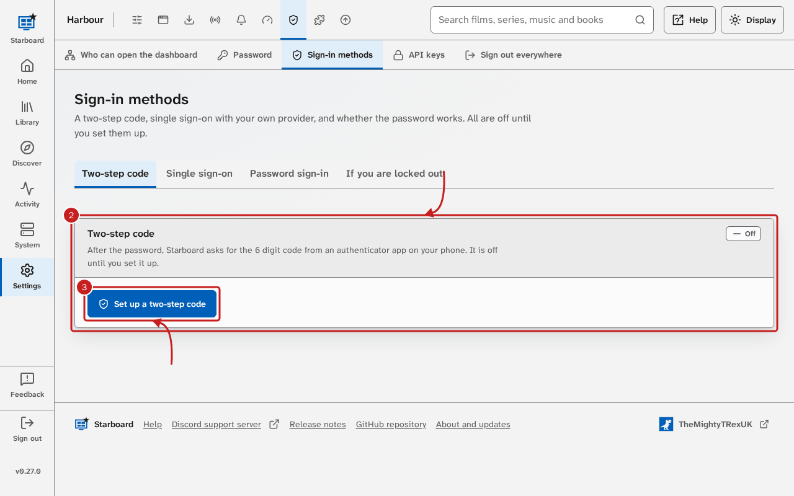
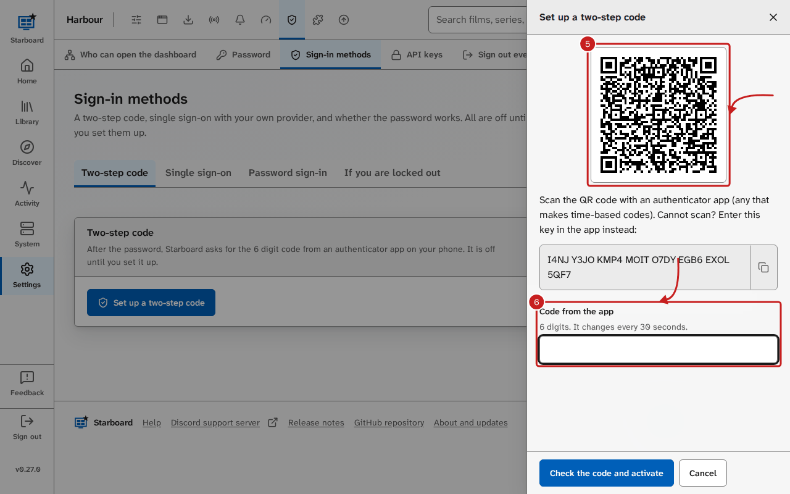
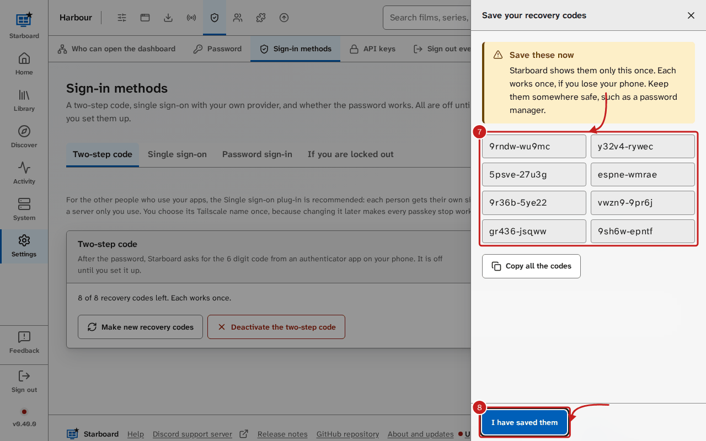
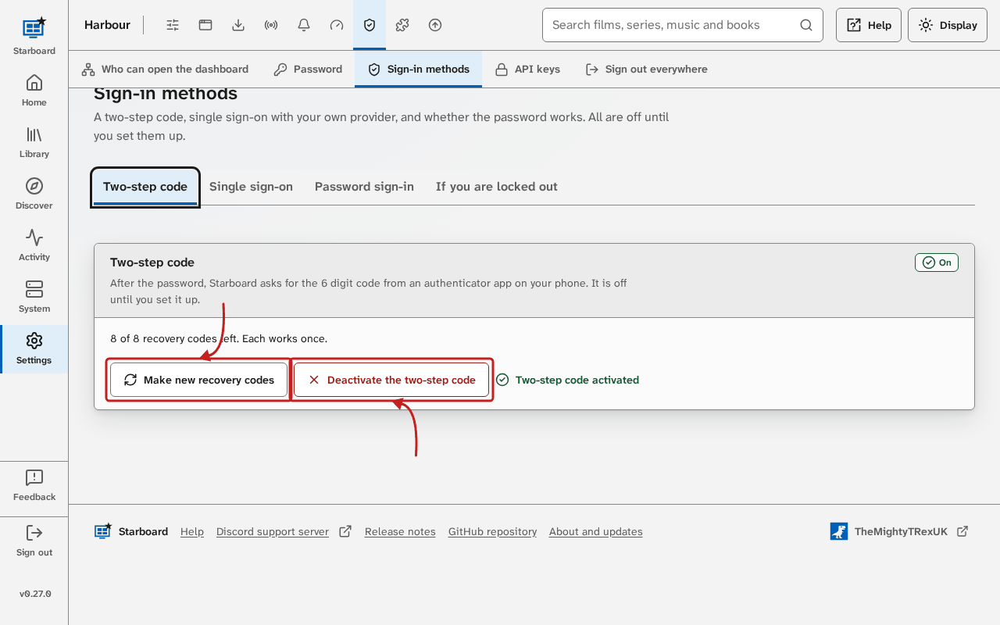

[Help centre](../README.md) · Security · how-to
<!-- help: use / security -->

# Set up a two-step code

A two-step code adds a second check to signing in. After your password, Starboard asks for a 6 digit code from an
authenticator app on your phone. Someone who finds out your password still cannot sign in without your phone. It is
off until you set it up, and you can turn it off again whenever you like.

## Before you begin

- You have an authenticator app on your phone. Any app that makes time-based codes (TOTP) works, such as the ones
  from your password manager, Aegis, Google Authenticator or Microsoft Authenticator.
- You know Starboard's password. Setting up asks for it.
- The clock on the server and on your phone are about right. Codes depend on the time.
- You have somewhere safe for 8 recovery codes, such as a password manager. Starboard shows them once.

## Steps

1. Go to **Settings**, then **Security**, then **Sign-in methods**.
2. Select the **Two-step code** tab. It is the first one.
3. Select **Set up a two-step code**.

   

4. In **Your Starboard password**, enter the password, then select **Continue**.
5. In your authenticator app, add an account and scan the QR code. If you cannot scan it, enter the key shown beside
   it.
6. In **Code from the app**, enter the 6 digit code the app now shows, then select **Check the code and turn on**.

   

7. Starboard shows your 8 recovery codes. Select **Copy all the codes** and keep them somewhere safe. Each code works
   once, if you lose your phone. Starboard shows them only this once, and keeps only a scrambled copy.
8. Select **I have saved them**.

   

The section now says **On**, and shows how many recovery codes are left.

## Sign in with the code

1. On the sign-in page, enter your password and select **Sign in**.
2. In **Code from your authenticator app**, enter the 6 digit code, then select **Verify**. If you cannot get to the
   app, enter one of your recovery codes instead. Each works once.

Starboard limits wrong codes: 5 wrong codes from one address in 15 minutes, and 10 from anywhere. A code that has
been used is never accepted again. Each use, and each refusal, is written to the audit log.

## Make new recovery codes, or turn it off

- Select **Make new recovery codes** when you have used several. Starboard asks for your password and a code from
  the app, and the old codes stop working.
- Select **Turn off the two-step code** to go back to the password alone. Starboard asks for your password.

## Things to note

- The two-step code is for the password. Single sign-on has its own checks at your provider. Read
  [Set up single sign-on](set-up-single-sign-on.md).
- A backup of Starboard's settings never holds the two-step code, so after a restore you set it up again.
- API keys do not use the code, and they cannot read or change any of these settings.

## If it does not work

- **"That code is not right":** check the code in the app now, not the last one, and check that the clocks are right.
  Codes change every 30 seconds.
- **Lost the phone and the recovery codes:** on the server, run `./reset-sign-in.sh`. Read
  [Get back in when sign-in is locked](get-back-in-when-sign-in-is-locked.md).

## Find out more

- [Set up single sign-on](set-up-single-sign-on.md)
- [Get back in when sign-in is locked](get-back-in-when-sign-in-is-locked.md)
- [Change your password](change-your-password.md)
- [Sign out everywhere](sign-out-everywhere.md)

<!-- footer: download rights -->

---

**Download only what you have the right to.** Use the download apps only for files you have the right to download.
Examples are open-source software, works in the public domain and your own backups. Downloading films, series, music or
books without the copyright holder's permission is against the law in the UK and most other countries. Starboard
does not host or provide any files, and you are responsible for what you download.

**Need help?** Ask on the [Starboard Discord support server](https://discord.gg/xN9bf2H4vv).

<!-- /footer -->
