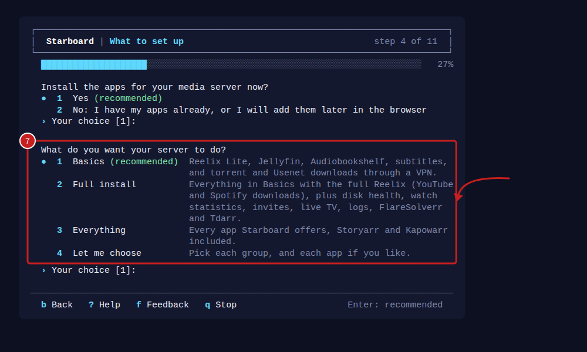
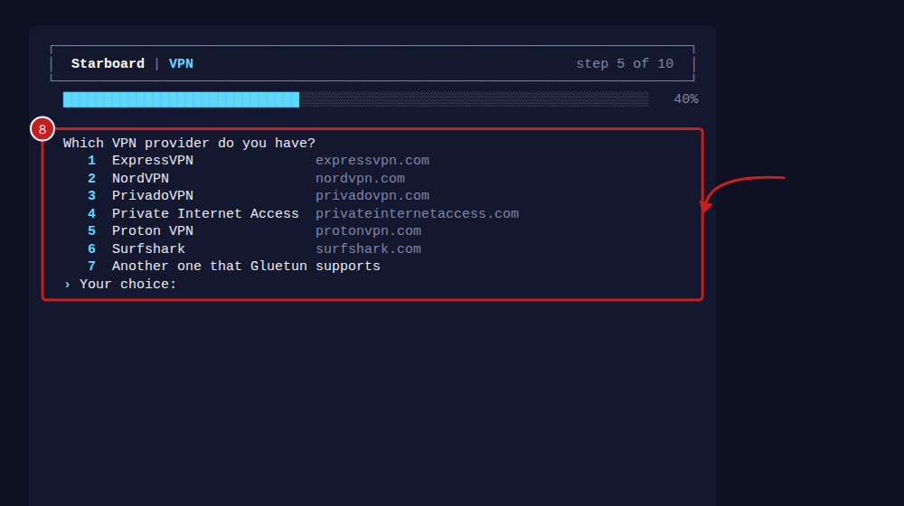
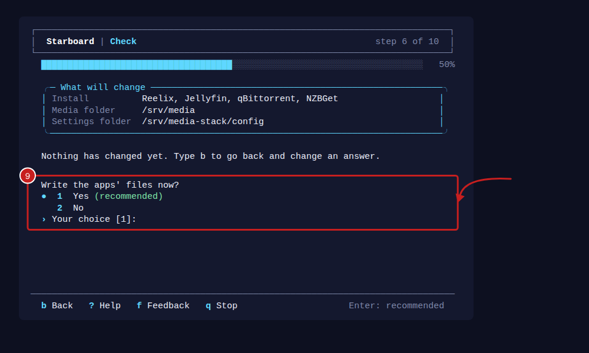

[Help centre](../README.md) · Install and update · how-to

# Set up Starboard in the terminal, with no browser

For a server with no desktop, and no phone or other computer to finish on. The installer asks every set-up question
in the terminal instead of the browser: your password, the apps for your media server and your download hours. It
takes about 10 minutes, plus the time to download the apps.

## Before you begin

- Everything in [Install Starboard with the installer](install-with-the-installer.md), up to the step that starts
  the installer.
- For the apps to start by themselves, answer yes to the installer's question about Docker access. Otherwise the
  terminal shows one command to start them.
- If you want a VPN: your VPN provider's details for WireGuard or OpenVPN, from the provider's website.

## Steps

1. In the Starboard folder, start the installer with `--terminal`:

   ```bash
   ./install.sh --terminal
   ```

2. Answer the installer's questions: on a new install, only your home network and Docker access. When Starboard is
   running, the set-up questions follow in the same terminal, in the same order as the set-up in a browser.
3. **Your password:** choose one of at least 10 characters and type it again. Nothing shows as you type. You do not
   need the setup code: you are on the server itself. Then name your dashboard, or press Enter to keep "Starboard".
4. **How to start:** **New install**, **Move from apps you already run** or **Restore a backup**. The recommended one
   depends on what Starboard finds on this computer. To restore, type where the backup file is.
5. **Storage**, for a new install: choose where your media goes: this computer's main disk, a separate disk, or a
   pool of several disks. Press Enter to take the media folder shown; it is made for you when the apps start.
6. **Your drives**, only when you chose the pool: which drives join it, and a backup drive.
7. **What to set up:** choose **Basics** (recommended), **Full install**, **Everything** or **Let me choose**.
   Full install and Everything then ask **Which app downloads from Usenet?**: NZBGet (recommended) or SABnzbd.
   Starboard lists the apps and memory; press Enter to install them. With **Let me choose**, type the numbers of
   what you want, such as Movies, TV and Watching, separated by commas. Read
   [Change your install](change-your-install.md) for what each install has.
   

8. **VPN**, if you chose it (every install has one): type the number of your provider. Each is listed with its
   website. Nothing is chosen for you here, so Enter on its own asks again. If yours is not listed, choose
   **Another one that Gluetun supports** and type its name as Gluetun's list writes it. Then its details: the
   password or key does not show as you type. Then **Usenet**, for NZBGet or SABnzbd: some providers, and what Usenet may be used for.
   

9. **Check:** read the list, then press Enter (**Yes**) to write the apps' files, and again to start them.
   Downloading them can take several minutes.
   

10. **Jellyfin extras**, when you have Jellyfin: Starboard's Jellyfin extras, such as Live TV.
11. **Download hours:** set hours are recommended, because downloading slows the internet for everyone else.
12. **Alerts and disk health:** where alerts go, if anywhere, and whether to check each disk's health.
13. **How much it does:** Balanced, Small server or Everything, with the recommended one first. Small server is
    recommended on a computer with less than 1 GB of memory.
14. When it finishes, it prints the addresses to open Starboard from any device, and the one installer command for
    the changes to this computer, such as free space for your media folder and disk health. The
    [Run first script](run-first.md) runs that command for you. If it needs sudo and sudo has forgotten your
    password, it asks for it again in the same window.

## How to answer

- Type a number and press Enter. Press Enter on its own to take the answer in the brackets, which is the recommended
  one. A question with no brackets, such as your VPN provider, has no recommended answer: type a number.
- Keys you press while Starboard is working, or before a question appears, do not show until the next question.
  If an answer is not one Starboard can use, it says why under the question and asks again.
- Type `b` and press Enter to go back a step. Your last answers are in the brackets, so Enter keeps each one. A
  password or key you typed before is kept too, if you press Enter. Once the apps are written, you cannot go back
  past the check: change them later in **Settings**, **Install apps**.
- Type `?` and press Enter for help with any question. Help opens in a box over the step. Press Enter to close it.
- Type `f` and press Enter to send feedback about the step you are on. See [Send feedback from the
  terminal](#send-feedback-from-the-terminal).
- Type `q` and press Enter to stop. Nothing else changes, and you can finish in a browser later.
- Each step starts on an empty terminal window. The step's heading and progress bar always stay at the top, and
  the keys you can use always stay on the bottom line. When a step is longer than the window, only the part in
  between scrolls. If you make the window larger or smaller, the step is drawn again to fit.
- Headings have a border and a bar that shows how far through you are. Recommended answers are marked with a dot
  and say "recommended" too, so nothing depends on colour.
- If you use software that reads text aloud, such as Orca, start it with `STARBOARD_PLAIN=1 ./install.sh --terminal`.
  It then prints plain lines with no borders or colour, and never empties the window or draws over it. It does the
  same by itself in a window narrower than 60 characters or shorter than 20 lines.

## Send feedback from the terminal

1. At any question, type `f` and press Enter. A box opens over the step.
2. Choose what it is about, such as **Something is broken** or **A new feature**, by typing its number.
3. Answer the one or two questions. Press Enter to skip a question that says so.
4. Read the whole report. It says which step you were on, Starboard's version, the system, the size of the
   terminal window and the last error, if there was one.
5. Choose how to send it:
   - **Show as a QR code** draws a code in the terminal. Scan it with your phone's camera to open the report
     there. It opens a new issue on Starboard's GitHub page with the report filled in, and you send it from your
     own GitHub account. The code holds a short version of the report, so the whole report is saved in a file
     in your home folder at the same time.
   - **Show the link** shows the address of the same new issue, to open in a browser on any device.
   - **Save to a file** saves the whole report and the link in your home folder, in a file called
     `starboard-feedback-` followed by the date and time.
   - **Cancel** sends nothing.
6. Choose **Done: back to the set-up** to carry on. The step is shown again as you left it.

When something fails, such as Starboard not answering or the apps not starting, the terminal shows **Type r to
report this problem**. Type `r` and press Enter to send the same report with the error already filled in.

Type `q` at any feedback question to close it and go back to the step.

## Things to note

- To run the set-up questions again later, go to the Starboard folder and run
  `python3 -m starboard.terminal_setup --port 8095`. It asks for your password first.
- Your answers are checked by Starboard exactly as the browser checks them, and saved in the same place.
- VPN details are saved in `data/stack/.env`, which only you can read.
- A feedback report never holds your answers to the set-up questions, your password, VPN details or the setup
  code. Email addresses, network addresses, user names in folder paths and anything that looks like a key are
  replaced. You see the whole report before you choose how to send it.
- Do not type a password or key into your feedback. The report only takes out text that looks like one, such as
  "password=…", so a password typed on its own could stay in it. You see the whole report before it is sent: if
  something private is in it, type q to close it, and start again.
- The QR code is made to fit your window, and a larger window fits more of the report in it. In a window 80
  characters wide and 24 lines tall, the usual size, it holds the title of the report. At 80 by 30 it holds a short
  report, and at 140 by 60 the report without its technical details. The line above the code says what it holds,
  and the whole report is always saved on the server. To fit more in, make the window larger, or make the text
  smaller, and choose **Show as a QR code** again.
- With `STARBOARD_PLAIN=1`, feedback never draws a QR code, because software that reads text aloud cannot read
  one. It shows the link, and offers **Save to a file**.
- When you choose SABnzbd, **Usenet** lists some Usenet providers with their full addresses. They are
  affiliate links: if you sign up through one, the provider pays a small commission towards Starboard's development,
  and you pay the same price. Use Usenet only for files you have the right to download.

## If it does not work

- **"Stopped: --terminal needs a terminal to type in":** the installer was not started in a terminal, for example
  from a script. Run it in a terminal, or leave out `--terminal` and finish in a browser.
- **"Starboard said: ..."**: Starboard refused an answer and says why. Type the answer again.
- **"Starboard cannot start apps itself":** Starboard has no Docker access. Run the command it shows, or run
  `./install.sh` again and answer yes to Docker access.
- **"The apps did not all start":** the lines below it are Docker's own. Read [An app is not responding](app-not-responding.md).

## Find out more

- [Install Starboard with the installer](install-with-the-installer.md)
- [Create your password and sign in](create-your-password.md)
- [Connect to your server with SSH](connect-with-ssh.md)
- [The terminal: typing commands](../basics/the-terminal.md)

<!-- footer: download rights -->

---

**Download only what you have the right to.** Use the download apps only for files you have the right to download,
such as open-source software, works in the public domain and your own backups. Downloading films, series, music or
books without the copyright holder's permission is against the law in the UK and most other countries. Starboard
does not host or provide any files, and you are responsible for what you download.

<!-- /footer -->
