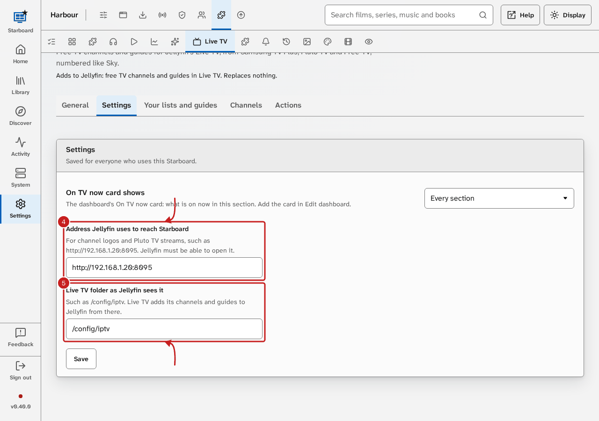
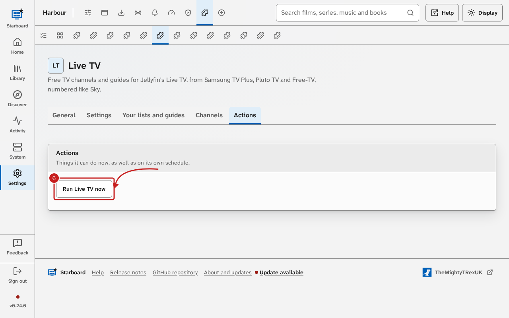
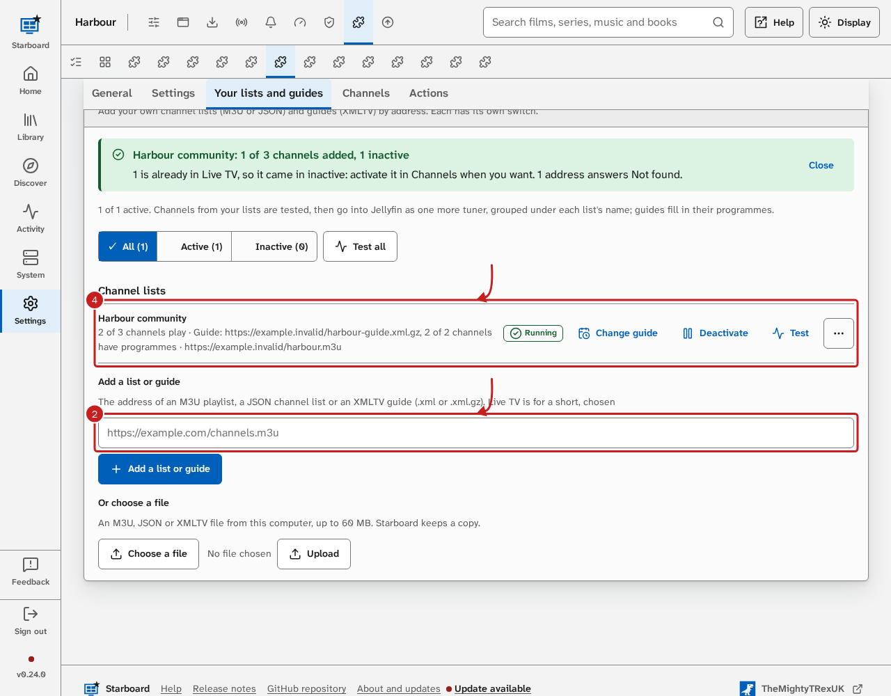
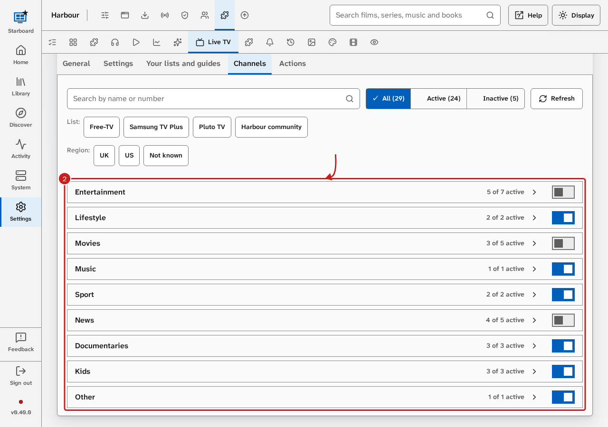

[Help centre](../README.md) · Jellyfin and Audiobookshelf · how-to
<!-- help: use / media -->

# Set up free Live TV in Jellyfin

Live TV gives Jellyfin free TV channels with a TV guide, from Samsung TV Plus, Pluto TV and Free-TV. Channels are
numbered the way Sky numbers them. Live TV is a plug-in built into Starboard, so you add it only if you want it.

## Before you begin

- Jellyfin is in **Manage apps** with its API key, so Live TV can add the channels to Jellyfin. Read
  [Find an app's API key](find-an-api-key.md).
- The installer gave Starboard a Live TV folder. It asks "Give Starboard a Live TV folder?". To change your answer,
  read [Change what Starboard can access](change-what-starboard-can-access.md#change-access-with-the-installer).
- Starboard can run containers (Docker access).
- Starboard is open to your home network, because Jellyfin fetches Pluto TV streams from it.
  Read [Choose who can open Starboard](choose-who-can-open-starboard.md).

## Steps

### Add Live TV

1. Go to **Settings**, then **Plug-ins**.
2. Under **Built into Starboard**, select **Add Live TV**.
3. Read **What it may do**, enter **Your Starboard password** and select **Add Live TV**. Starboard shows
   "Live TV added and active".
4. Live TV's own page opens, under **Settings**, then **Plug-ins**. Select its **Settings** tab and check **Address
   Jellyfin uses to reach Starboard**, such as `http://192.168.1.20:8095`.
5. Check **Live TV folder inside Jellyfin**, such as `/config/iptv`, then select **Save**.

   

6. Select the **Actions** tab, then **Run Live TV now**. The first run tests every channel, so it takes a few
   minutes.

   

Live TV adds its channel lists and guides to Jellyfin itself, then starts Jellyfin's guide refresh. It reads
the folder from Jellyfin's own tuners first, so nothing is added twice.

To follow it on the dashboard, add the **Live TV** card with **Edit dashboard**. Read
[Use and change the dashboard](use-the-dashboard.md). The card says when Live TV last ran and what it did.

If you used Live TV before Starboard 0.15.0, Starboard moved it into the plug-in by itself, with the same
settings. Your channels and guides in Jellyfin did not change.

### Add your own lists and guides

Live TV can also take your own channel lists and guides, by address or as a file.

1. On Live TV's page, select the **Your lists and guides** tab.
2. Under **Add a list or guide**, enter the address of an M3U playlist, a JSON channel list or an XMLTV guide
   (`.xml` or `.xml.gz`), then select **Add a list or guide**. To use a file from your computer instead, choose it
   under **Or choose a file** and select **Upload**.
3. Starboard tests the channels and says what it added, such as "Harbour community: 1 of 3 channels added, 1
   inactive". A channel already in Live TV comes in inactive: activate it in **Channels** when you want it.
4. Each list has its own **Deactivate**, so an inactive list is not fetched. **Change guide** gives it a guide, and
   **Test** tests it again. **Test all** tests every list.

   

### Choose the channels

1. On Live TV's page, select the **Channels** tab. Under **Activate or deactivate in bulk**, each list, **Every
   channel** and each region has its own switch. Each switch applies at once.
2. Under the search and the **List** and **Region** chips, the channels are in folding sections, such as
   **Entertainment**, each with how many are active and its own switch. Select a section to open it and switch
   single channels.

   

A channel you deactivate stays inactive when the lists are rebuilt.

### Add the channels and guides in Jellyfin

Do this only if the **Live TV** card says Jellyfin did not take the channels.

1. Open Jellyfin and go to **Dashboard**, then **Live TV**.
2. Add a tuner of type M3U for each playlist in the Live TV folder: `channels.m3u`, `samsung.m3u` and
   `pluto.m3u`.
3. Add an XMLTV guide for each guide file in the same folder: `guide.xml`, `guide-samsung.xml` and
   `guide-pluto.xml`.
4. Let Jellyfin refresh its guide data.

Use the folder's path inside Jellyfin's container. If `/srv/jellyfin/config` on the server is `/config` for Jellyfin, the
first playlist is `/config/iptv/channels.m3u`.

## Things to note

- Live TV checks once an hour. It refreshes the guides once a day, and rebuilds a channel list only when its
  source changes, or once a week to drop channels that stopped playing. **Run Live TV now** rebuilds every
  list.
- Only free channels are included. Live TV skips channels that need DRM (digital rights management), adult
  channels and anything that does not play from your connection.
- Channels are numbered in blocks: 101 Entertainment, 401 Lifestyle, 451 Movies, 501 Music, 601 Sport,
  701 News, 801 Documentaries, 1001 Kids and 1101 Other.
- Each channel shows its own logo, in its own colours. A channel with no logo shows its name in Jellyfin.
- Starboard itself still serves the Pluto TV links to Jellyfin.
- Where the plug-in cannot run, **Built into Starboard** says why, after "Not here". Live TV then runs inside
  Starboard, in **Settings**, **Apps**, **Jellyfin**, **Live TV**, with the same settings and its own
  **Run Live TV now**.
- What the plug-in may do and what it runs are listed in
  [The plug-in collection](../basics/plugin-collection.md#live-tv).
- To make Live TV open on the Guide for everyone, read
  [Give every Jellyfin user the same defaults](jellyfin-user-defaults.md).

## If it does not work

- **"Not here" next to Live TV:** Starboard has no Docker access or no Live TV folder. Run `./install.sh`
  again and say yes to both. Read
  [Change what Starboard can access](change-what-starboard-can-access.md#change-access-with-the-installer).
- **The card says "Last run failed":** read the reason next to it. If it names the address, enter it in the
  **Live TV** section in **Settings**, **Plug-ins**.
- **"Jellyfin: add its API key":** add the key to Jellyfin in **Manage apps**, then select **Run Live TV now**.
- **Pluto TV channels do not play:** Jellyfin cannot reach Starboard. Read
  [A Live TV channel will not play](live-tv-channel-will-not-play.md).

## Find out more

- [A Live TV channel will not play](live-tv-channel-will-not-play.md)
- [Add a plug-in](add-a-plugin.md)
- [Give every Jellyfin user the same defaults](jellyfin-user-defaults.md)
- [Make Starboard use less of your server](make-starboard-lighter.md)

<!-- footer: download rights -->

---

**Download only what you have the right to.** Use the download apps only for files you have the right to download.
Examples are open-source software, works in the public domain and your own backups. Downloading films, series, music or
books without the copyright holder's permission is against the law in the UK and most other countries. Starboard
does not host or provide any files, and you are responsible for what you download.

**Need help?** Ask on the [Starboard Discord support server](https://discord.gg/xN9bf2H4vv).

<!-- /footer -->
