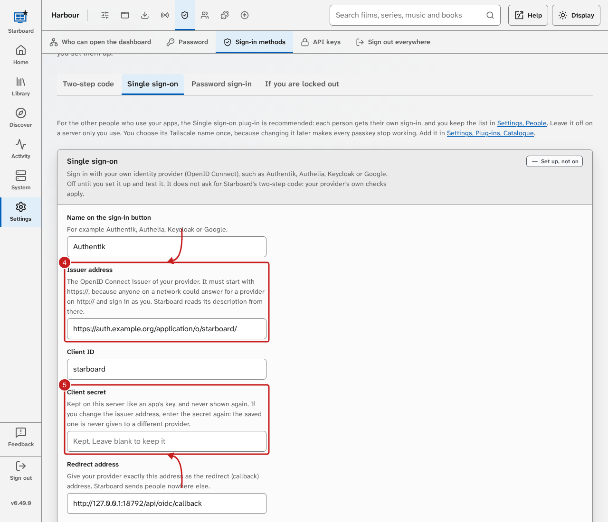
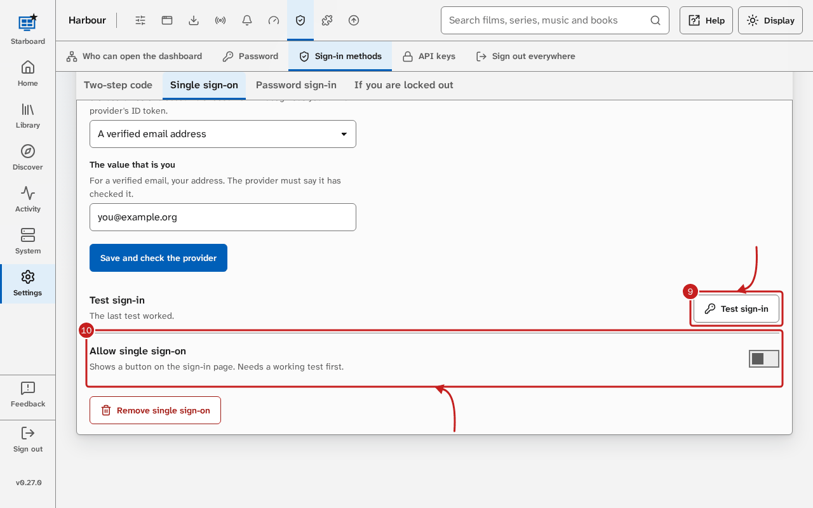
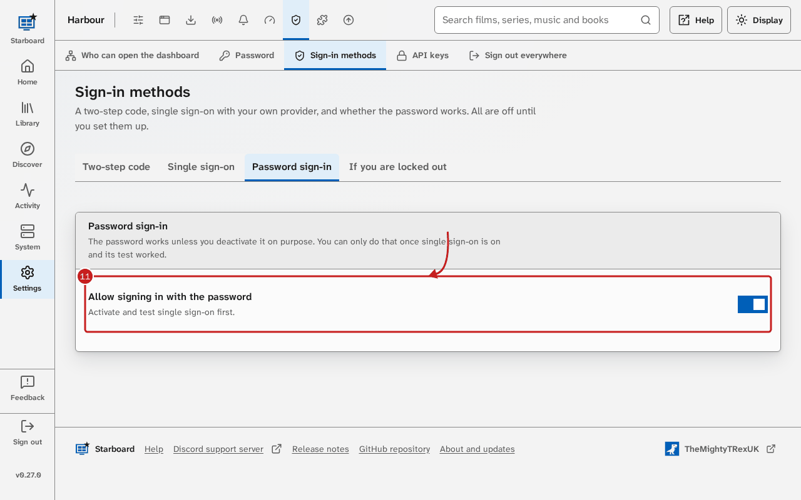

[Help centre](../README.md) · Security · how-to
<!-- help: use / security -->

# Set up single sign-on

Single sign-on lets you sign in to Starboard with an identity provider you already run or use, such as Authentik,
Authelia, Keycloak or Google, using OpenID Connect. It is off until you set it up and test it. The password keeps
working unless you deactivate it on purpose.

## Before you begin

- Your provider supports OpenID Connect and has an application (a client) for Starboard. In it, the redirect address
  (also called the callback address) is the address this page shows in **Redirect address**.
- You have the provider's issuer address, the client ID and the client secret.
- You know Starboard's password. Every change here asks for it.
- Starboard has one account, so you choose how it recognises you: by a verified email address, or by another value
  in the provider's token, such as your username.

Starboard uses the authorisation code flow with PKCE. It checks the state and the nonce of every sign-in, and the
signature of the provider's ID token against the keys the provider publishes.

## Steps

1. Go to **Settings**, then **Security**, then **Sign-in methods**.
2. Select the **Single sign-on** tab.
3. In **Name on the sign-in button**, enter what the button says, such as Authentik.
4. In **Issuer address**, enter the provider's issuer. Starboard reads the provider's description from there, and
   says if the address is wrong.
5. In **Client ID** and **Client secret**, enter the details from the provider. Starboard keeps the secret on the
   server like an app's key, and never shows it again.

   

6. In **Redirect address**, check that the address is the one you gave your provider.
7. In **Who may sign in**, choose **A verified email address** and, in **The value that is you**, enter your
   address. The provider must say it has checked it.
8. Select **Save and check the provider**, enter your password, and select **Save**.
9. Select **Test sign-in**. Starboard sends you to your provider and back. When it works, a message says so, and
   nobody is signed in by a test.

   

10. Activate **Allow single sign-on**, and enter your password. The sign-in page now shows a button for your
    provider beside the password.

## Turn the password off

Only when single sign-on is activated and its test worked, the **Password sign-in** tab lets you deactivate the password.

11. Deactivate **Allow signing in with the password** and enter your password.

Think before you do this. If the provider stops working, nobody can sign in until you run `./reset-sign-in.sh` on
the server. Read [Get back in when sign-in is locked](get-back-in-when-sign-in-is-locked.md).

## Things to note

- Changing the issuer, client, secret, redirect address or who may sign in turns single sign-on off, and the
  password back on, until you test it again.
- Single sign-on does not ask for Starboard's two-step code. Your provider decides whether you need a second step, so
  activate its own checks there. Starboard's code is asked for with the password only.
- Matching by a verified email address or by the subject (`sub`) is the strongest choice. A username
  (`preferred_username`), a name or another claim is weaker, because some providers let people choose or change it
  themselves. Use the email, which Starboard accepts only when the provider says it has checked it.
- Starboard calls only the provider you entered. The issuer must start with `https://`. An `http://` address is
  refused, except `localhost` or `127.0.0.1` for testing, because anyone on your home network could answer for a
  provider on `http://`, hand out their own keys and sign in as you, and the client secret would cross the network
  in the open.
- If you change the issuer address, Starboard clears the saved client secret, so it is never given to a different
  provider. Enter it again.
- A backup of Starboard's settings never holds these details.

## If it does not work

- **"The provider says its issuer is ...":** enter the issuer exactly as the provider says, including a slash at the
  end if it has one.
- **"That account is not the one allowed":** the email or value in the provider's token is not the one you entered,
  or the provider has not verified the email.
- **The test does not come back:** the redirect address at the provider must be the one Starboard shows, exactly.
- **The log:** System, Logs says why on Starboard's side, without any secret.

## Find out more

- [Set up a two-step code](set-up-a-two-step-code.md)
- [Get back in when sign-in is locked](get-back-in-when-sign-in-is-locked.md)
- [Change what Starboard can access](change-what-starboard-can-access.md)

<!-- footer: download rights -->

---

<!-- footer: download rights -->

---

**Download only what you have the right to.** Use the download apps only for files you have the right to download,
such as open-source software, works in the public domain and your own backups. Downloading films, series, music or
books without the copyright holder's permission is against the law in the UK and most other countries. Starboard
does not host or provide any files, and you are responsible for what you download.

**Need help?** Ask on the [Starboard Discord support server](https://discord.gg/xN9bf2H4vv).

<!-- /footer -->
