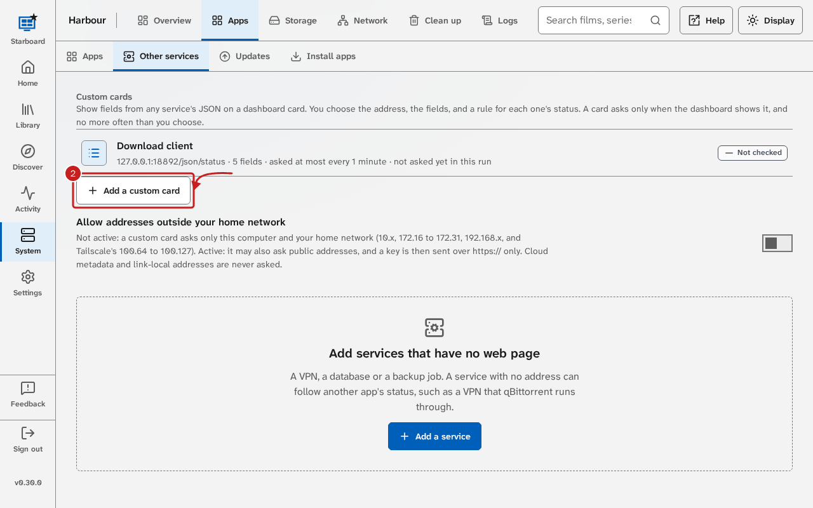
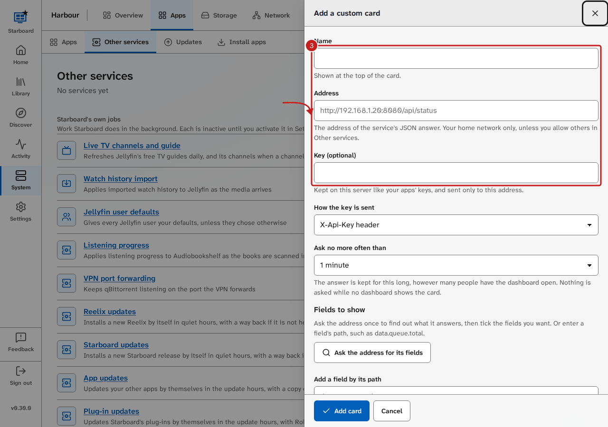
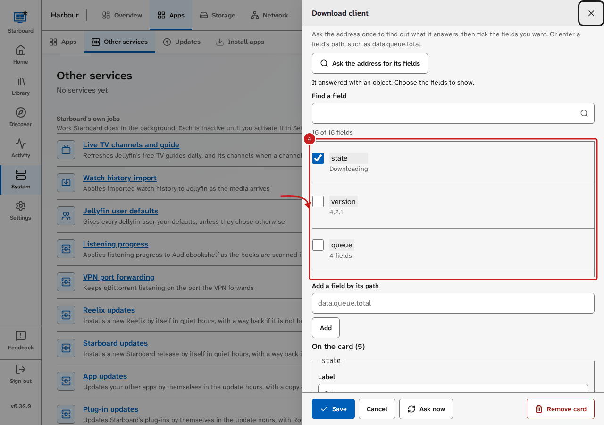
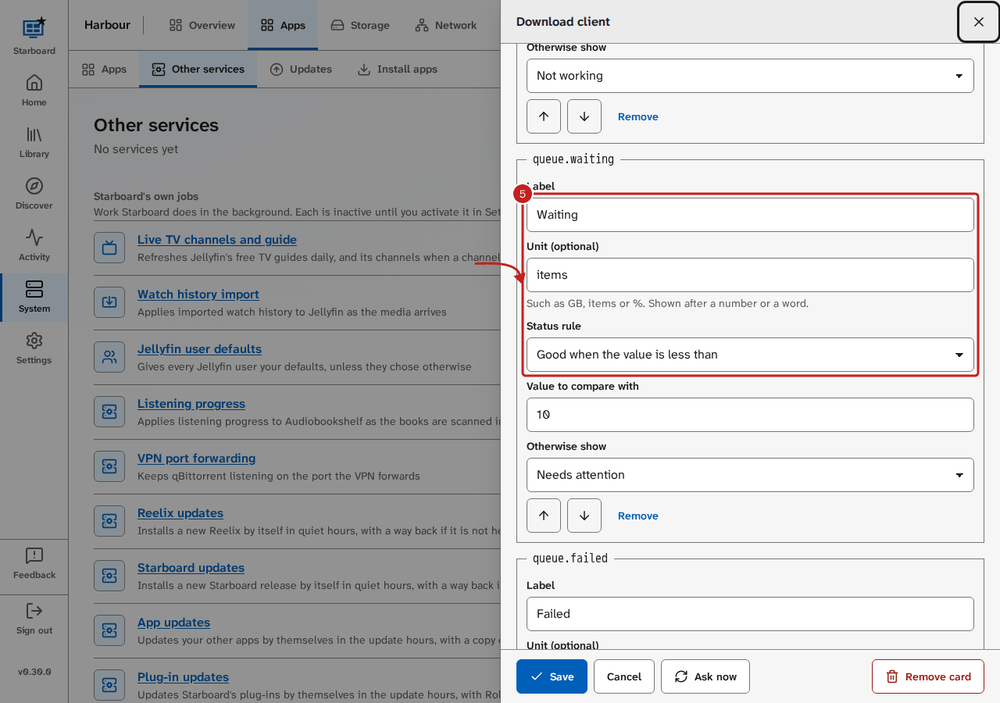
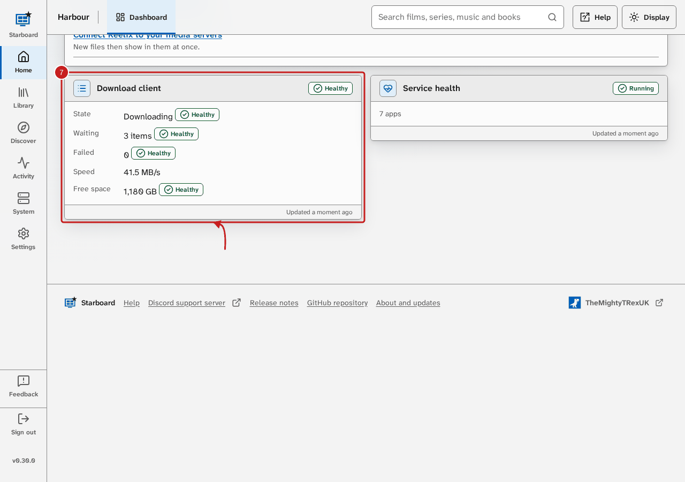

[Help centre](../README.md) · Apps · how-to
<!-- help: use / apps -->

# Show any service's JSON on a dashboard card

Many services answer a web address with JSON, a plain list of names and values. Examples are a download app's queue,
a router's status and a home automation hub. A custom card shows the fields you choose from that answer. It appears
on your dashboard as a small table of labels and values, with a status for each field that you define. You do not
need a plug-in.

## Before you begin

- Know the address of the JSON. It is in the service's own help, often ending in `/api/status` or similar. You can
  test it in your browser first: it should show names and values in curly brackets.
- If the service wants a key, have it ready. Starboard sends it in a header, as an **X-Api-Key** header or as a
  **Bearer token**, whichever the service documents.
- The address must be on your home network, unless you allow others, as Things to note explains.

## Steps

1. Go to **System**, then **Apps**, then **Other services**.
2. Under **Custom cards**, select **Add a custom card**. A side panel opens.

   

3. Enter a **Name** for the card, the **Address** of the JSON, and the **Key** if the service needs one. Starboard
   keeps the key on your server, like your apps' keys, and never shows it again. Choose **How the key is sent** and
   **Ask no more often than**.

   

4. Select **Ask the address for its fields**. Starboard asks the address once and lists every field it answered
   with, and an example of each value. Tick the fields you want. Use **Find a field** to narrow the list, or enter
   a path such as `data.queue.total` in **Add a field by its path**. A path reaches into the answer with dots. A number picks an entry in a list, such as `items.0.name`. A path that reaches a list shows how many entries it has.

   

5. Under **On the card**, give each field a **Label** and, if you like, a **Unit** such as GB or items. Choose a
   **Status rule** to show whether the value is good, for example **Good when the value is more than** 100. When the rule
   does not hold, choose whether the field shows **Needs attention** or **Not working**. The card's own status is the
   worst of its fields. With **No rule**, a field shows its value only. Use the arrow buttons to change the order.

   

6. Select **Add card**. Starboard saves the card, and it appears under **Custom cards** with its last known status. Select
   **Ask now** in the card's panel to check what it shows right now.
7. Go to **Home**, select **Edit dashboard**, choose your card in **Add a card**, then **Save**.

   

## Things to note

- **It costs nothing at rest.** A card asks its address only when the dashboard shows it. It never asks while the
  page is closed or the tab is hidden. Starboard keeps the answer for the time you chose (one minute to one hour),
  however many people have the dashboard open. It keeps only the fields you chose, never the whole answer. If a
  service fails, Starboard does not ask it again for 30 seconds.
- **Home network only, by default.** Starboard asks this computer and your home network (addresses starting 10., 172.16
  to 172.31, 192.168., and 100.64 to 100.127 as Tailscale uses). To ask a public address, activate **Allow addresses
  outside your home network** under **Custom cards**; the key is then sent over `https://` only. Cloud metadata and
  link-local addresses are never asked.
- **Safe by design.** Starboard resolves the address once and connects to that very address. It never follows a
  redirect, waits at most 8 seconds, and reads at most 256 KB. If the service answers with a redirect, use the address
  it redirects to.
- **Your key stays on the server.** The page never gets it back. If you change the address to a different server,
  Starboard does not send the saved key there. Enter the key again, or select **Remove the saved key**. Fields that resemble
  secrets (a name with token or password in it) show no example value in the list.
- **A field that has gone.** If the service stops sending a field, the card says **Not in the answer** and shows
  **Needs attention**.
- **Remove a card** with **Remove card** in its panel. It also leaves the dashboard. The service is not touched.
- Custom cards are included in a settings backup, keys too, so keep the file as private as your apps' keys.
- The card is a table that a screen reader can read. Each status is written in words and also shown with a shape and
  colour.

## Find out more

- [Add a background service](add-a-background-service.md)
- [Change what Starboard can access](change-what-starboard-can-access.md)
- [Find an app's API key](find-an-api-key.md)

<!-- footer: download rights -->

---

**Download only what you have the right to.** Use the download apps only for files you have the right to download,
such as open-source software, works in the public domain and your own backups. Downloading films, series, music or
books without the copyright holder's permission is against the law in the UK and most other countries. Starboard
does not host or provide any files, and you are responsible for what you download.

**Need help?** Ask on the [Starboard Discord support server](https://discord.gg/xN9bf2H4vv).

<!-- /footer -->
