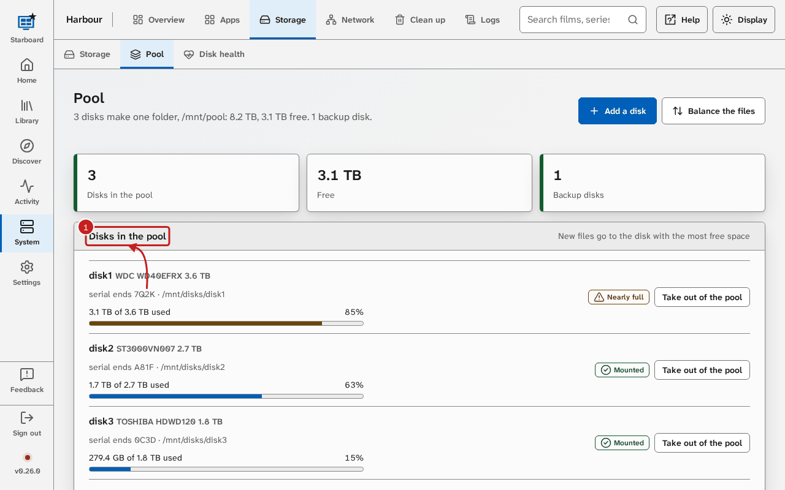
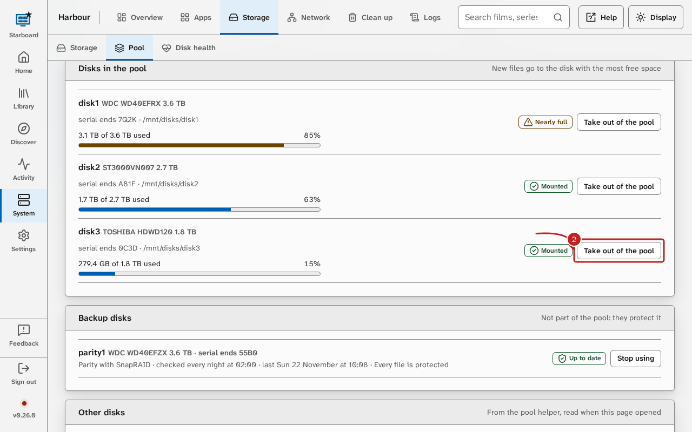
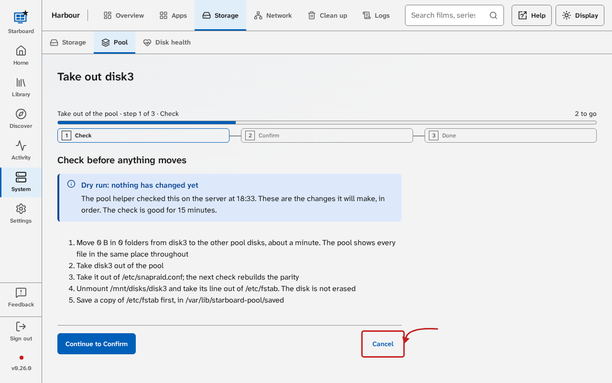

[Help centre](../README.md) · Your server · how-to
<!-- help: use / server -->

# Take a disk out of the pool

Taking a disk out moves its files to the other disks in the pool first, then takes the disk out. The disk is
not erased. Do this before you replace an old disk or move it to another computer.

## Before you begin

- The other disks in the pool have room for everything on this disk.
- Have your Starboard password ready.
- It can take hours: about 1 hour for each 280 GB on the disk.

## Steps

1. Go to **System**, then **Storage**, then **Pool**.

   

2. Under **Disks in the pool**, select **Take out of the pool** beside the disk.

   

3. Read the check: how much it moves, and every change, in order. Nothing has changed yet.

   

4. Select **Continue to Confirm**, enter your Starboard password, and select **Take it out**.
5. Wait for **Finished**. The disk is then unmounted, and you can switch the computer off and remove it.

## Things to note

- The pool shows every file in the same place throughout, so the apps notice nothing.
- With a parity disk, the next nightly check rebuilds the parity without the disk.
- A backup disk is not in the pool. To stop using one, read
  [Use a disk as a backup disk](use-a-drive-as-a-backup-drive.md#things-to-note).
- You can stop it with **Stop after this folder**. Folders already moved stay moved, and the disk stays in the
  pool.

## If it does not work

- **This is the only disk in the pool:** add another disk first, so its files have somewhere to go.
- **The other pool disks do not have room:** add a disk, or make room, then try again.
- **Folders are still on the disk:** they changed while being moved, such as a download still running. Take it
  out again later.

## Find out more

- [Balance the files](balance-the-files.md)
- [A pool disk has failed](a-pool-drive-has-failed.md)

<!-- footer: download rights -->

---

**Download only what you have the right to.** Use the download apps only for files you have the right to download,
such as open-source software, works in the public domain and your own backups. Downloading films, series, music or
books without the copyright holder's permission is against the law in the UK and most other countries. Starboard
does not host or provide any files, and you are responsible for what you download.

**Need help?** Ask on the [Starboard Discord support server](https://discord.gg/xN9bf2H4vv).

<!-- /footer -->
