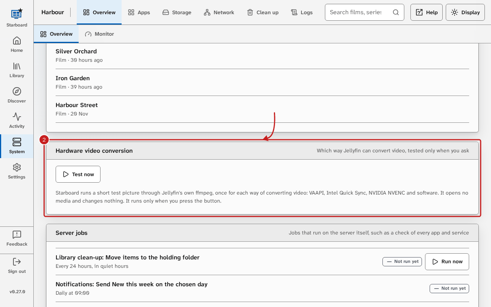
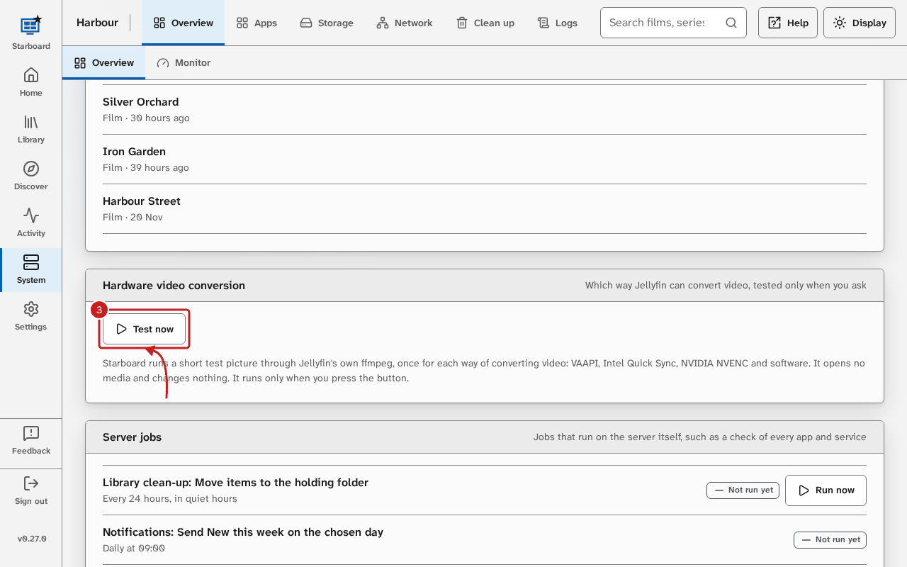
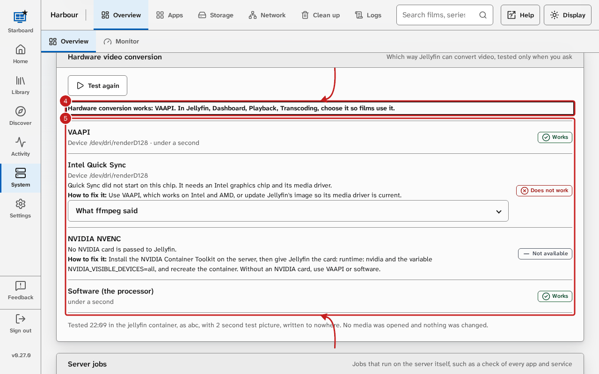

[Help centre](../README.md) · Your server · how-to
<!-- help: use / server -->

# Test hardware video conversion

Jellyfin converts video when a device cannot play a file as it is. A graphics chip does this much faster, and
with less power, than the processor. The Hardware video conversion test on System tells you which way Jellyfin
can convert video on your server, which device it used, and, when one does not work, why and how to fix it.

## Before you begin

- Jellyfin is added in **Settings**, then **Apps**, and it is running.
- Starboard can control Docker. The test runs inside Jellyfin's container. Read
  [Change what Starboard can access](change-what-starboard-can-access.md) if the page says it cannot reach Docker.

## Steps

1. Go to **System**, then **Overview**.
2. Find **Hardware video conversion**.

   

3. Select **Test now**. The button stays unavailable while the test runs, which takes a few seconds, and at most a
   minute.

   

4. Read the sentence at the top of the result. It says whether hardware conversion works, only software
   conversion works, or nothing does.
5. Read the list. Each way of converting video has a row: **Works**, **Does not work** or **Not available**.
   A row that works names the device it used. A row that does not work says why, and **How to fix it** says what
   to change.

   

## What the test does

- It runs only when you select **Test now**. Nothing runs when you do not ask, and Starboard keeps the last result
  in memory only, until it restarts.
- It uses Jellyfin's own ffmpeg, as the same user Jellyfin runs as, so a missing device or permission shows here
  just as it would when someone plays a film.
- It encodes a 2 second test picture that ffmpeg makes up, and writes the result to nowhere. It opens none of your
  media, writes no file and changes no setting, in Starboard or in Jellyfin.
- Each check is written to the audit log as `transcode_check`.

## The four ways to convert video

- **VAAPI:** works on most Intel and AMD graphics chips.
- **Intel Quick Sync:** Intel chips only. VAAPI usually works on the same chip.
- **NVIDIA NVENC:** NVIDIA cards, with their driver and the NVIDIA Container Toolkit on the server.
- **Software:** the processor. It always works, and it is the slowest.

The test only reports. To make Jellyfin use one, open Jellyfin, then **Dashboard**, **Playback**, **Transcoding**,
and choose the way that works.

## If it does not work

- **There is no /dev/dri:** Jellyfin cannot see the graphics chip. In **Install apps**, choose the graphics chip,
  or add `/dev/dri:/dev/dri` under `devices` for Jellyfin in `compose.yaml`, then recreate the container.
- **Jellyfin's user may not open the device:** add the device's group under `group_add` for Jellyfin in
  `compose.yaml`. The row gives the number. Then recreate the container.
- **The graphics driver could not start, or the chip cannot encode H.264:** update Jellyfin's image in
  **Settings**, then **Updates**. An older chip cannot encode at all, so software conversion stays.
- **No NVIDIA card is passed to Jellyfin:** install the NVIDIA Container Toolkit, give Jellyfin `runtime: nvidia`
  and `NVIDIA_VISIBLE_DEVICES=all`, then recreate the container.
- **Starboard cannot reach Docker:** run `./install.sh` again and answer Yes to the Docker question.
- **Starboard could not find Jellyfin's container:** add Jellyfin in **Settings**, then **Apps**, or name its
  container there if it is not called `jellyfin`.
- **A check is already running:** wait for it to finish.

## Find out more

- [Change what Starboard can access](change-what-starboard-can-access.md)
- [Make Starboard use less of your server](make-starboard-lighter.md)

<!-- footer: download rights -->

---

<!-- footer: download rights -->

---

**Download only what you have the right to.** Use the download apps only for files you have the right to download,
such as open-source software, works in the public domain and your own backups. Downloading films, series, music or
books without the copyright holder's permission is against the law in the UK and most other countries. Starboard
does not host or provide any files, and you are responsible for what you download.

**Need help?** Ask on the [Starboard Discord support server](https://discord.gg/xN9bf2H4vv).

<!-- /footer -->
