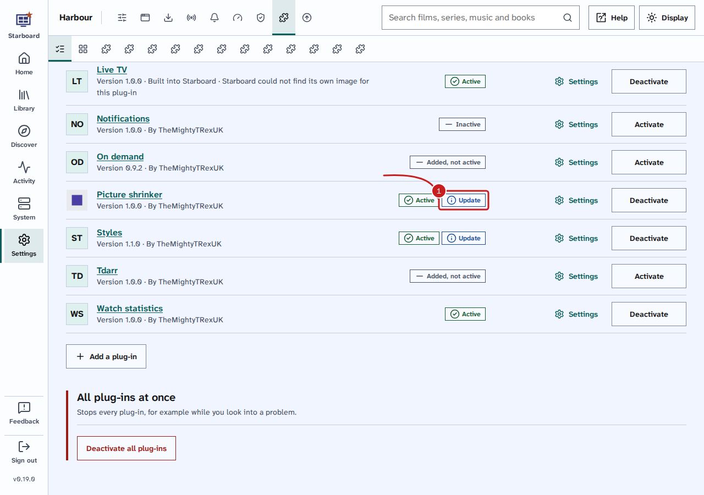
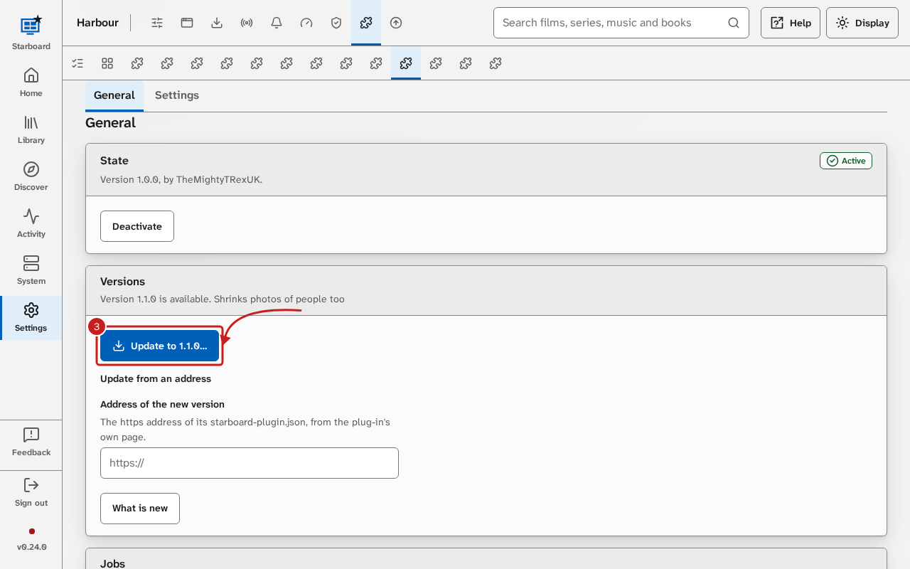
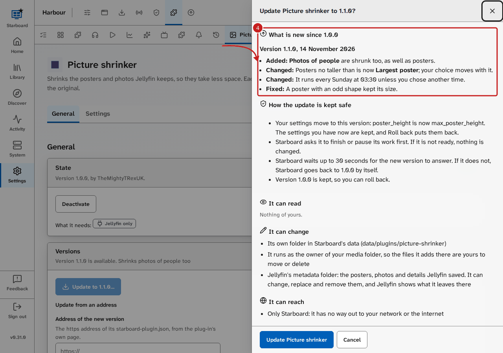
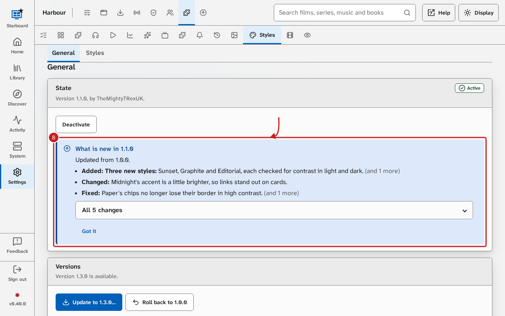
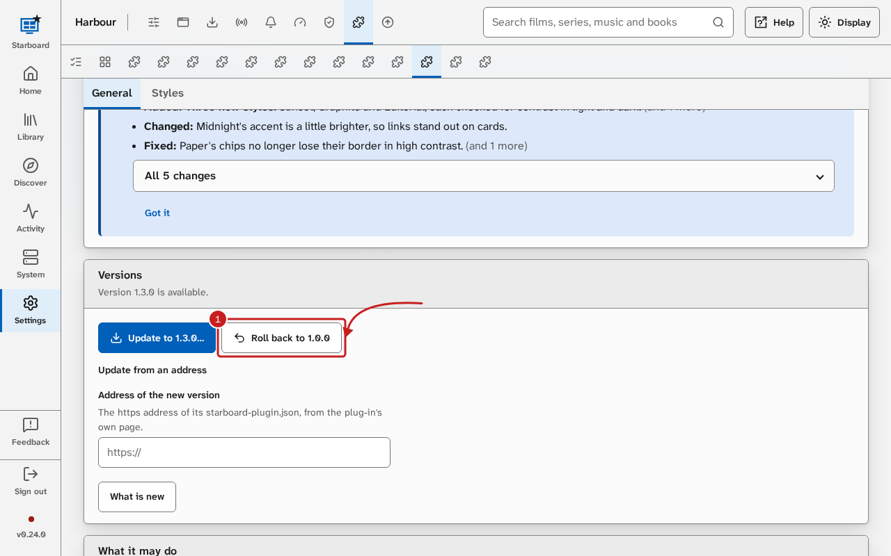

[Help centre](../README.md) · Plug-ins · how-to
<!-- help: plugins / looking-after -->

# Update a plug-in and roll it back

When a plug-in has a newer version, update it from its own page. Starboard shows what is new and how the update is
kept safe before anything changes, keeps the version you had, and goes back to it by itself if the new one does not
work. You can roll back to the version you had at any time.

## Before you begin

- The plug-in is added. Read [Add a plug-in](add-a-plugin.md) if it is not.
- You know your Starboard password. Updating and rolling back ask for it.
- Starboard reads the catalogues at most once a day. To check again now, open **Settings**, then **Plug-ins**, then
  **Catalogue**.

## Update a plug-in

1. Go to **Settings**, then **Plug-ins**. A plug-in with a newer version has an **Update** chip in **Manage**.

   

2. Select the plug-in's name to open its page.
3. In the **General** tab, go to **Versions**, then select **Update to** and the new version, such as **Update to 1.1.0…**.

   

4. A slide-out opens with the same warning as when you added it. Anything the new version may do that the one you
   have may not is marked **New**. Read the rest:
   - **What is new since** your version: each version's changes, under **Added**, **Changed**, **Fixed** and other
     headings.
   - **How the update is kept safe**: which of your settings move to the new version, whether Starboard asks the
     plug-in to finish its work first, and how long Starboard waits for the new version to answer.

   

5. To go ahead, enter your Starboard password and select **Update** and the plug-in's name. To stop, select
   **Cancel**: nothing changes.
6. A dialog shows each step with its state: **Asking it to get ready**, **Moving its settings**, **Installing the
   new version**, **Waiting for it to answer** and **Asking it to tidy up**. A step the plug-in does not need is left
   out. It takes a few seconds, or up to a few minutes for a large plug-in.
7. When it ends, the dialog says **is updated** and the plug-in's name. Select **Done**.
8. The plug-in's **State**, in **General**, shows **What is new** and the new version. Select **Got it** when you have read it: it is
   then hidden on every device.

   

Closing the dialog does not stop the update. The page says it is still running, with **Show progress**.

## Roll back to the version you had

1. On the plug-in's page, select **Roll back to** and the version you had, such as **Roll back to 1.0.0**. It is in
   **Versions** and, when the plug-in stopped working soon after an update, on **State**, both in **General**.

   

2. Enter your Starboard password and select **Roll back**.
3. A dialog shows each step. When it ends, it says **is back on** and the version. Select **Done**.

Rolling back needs no download. Your settings go back to how they were before the update. The newer version is kept,
so **Update** brings it back when you are ready.

## Update a plug-in from an address or a zip file

For a plug-in that is not in a catalogue, such as one from its maker's own page:

1. On the plug-in's page, in **General**, **Versions**, go to **Update from an address**.
2. Paste the address of the new version's `starboard-plugin.json` into **Address of the new version**.
3. Select **What is new**. The same slide-out opens: go on from step 4 of
   [Update a plug-in](#update-a-plug-in).

A plug-in you added from a zip file has **Update from a zip file** there instead: choose the new version's zip, then
select **What is new**. Read [Add a plug-in from a zip file](add-a-plugin-from-a-zip-file.md#update-it-from-a-newer-zip).

## Things to note

- **If the new version does not work:** when it does not start, or does not answer within the time its maker set,
  Starboard goes back to the version you had by itself, with your settings as they were. The dialog says
  **went back to** and why, the plug-in's **State** says so, and you get an alert if alerts are active. Nothing is
  lost: the plug-in carries on as before.
- **If the plug-in is not ready:** a plug-in can ask Starboard to wait, for example while it is half way through a
  job. Nothing changes, and the dialog says why. Try again later.
- **Your settings:** when a setting is renamed or removed in the new version, its maker says how it moves, and the
  slide-out lists it before you update. A setting you never changed may take the new version's default.
- **Only one earlier version is kept.** Updating again replaces it with the version you are on now.
- **Inactive plug-ins** are updated straight away, with no steps: the new version starts when you activate it.
- **Plug-ins built into Starboard,** such as Live TV, update with Starboard. Read [Update Starboard](update-starboard.md).
- One update runs at a time, for Starboard, its apps and its plug-ins. To install every waiting update in one go, read
  [Install all updates at once](update-starboard.md#install-all-updates-at-once).
- **System**, **Logs** lists each update and roll back, and how it ended.

## If it does not work

- **"An update is already running":** wait for it to finish, then try again.
- **"No newer version is known":** open **Settings**, then **Plug-ins**, then **Catalogue**, so Starboard reads the
  catalogues again, then open the plug-in's page again.
- **"The file changed since the catalogue listed it":** the catalogue and the file do not match, so Starboard did not
  use it. Try again tomorrow, or tell the plug-in's maker, at its support address.
- **The plug-in says Not answering after an update:** select **Roll back to** and the version you had, then tell the
  plug-in's maker.

## If a plug-in says Needs an update

This Starboard cannot run that plug-in as it is, so Starboard has stopped it. The plug-in's page says why. Its settings and data are kept. Select **Check for an update**. If a newer version fits, update it and select **Activate**. If none fits yet, the plug-in stays stopped until its maker updates it. [Our promise to plug-in developers](../developers/compatibility-promise.md) explains when this can happen.

## Find out more

- [Add a plug-in](add-a-plugin.md)
- [Update Starboard](update-starboard.md)
- [Update your apps](update-your-apps.md)
- [Go back to an earlier version](go-back-to-an-earlier-version.md)
- [What a plug-in can change](../basics/what-plugins-can-change.md)

<!-- footer: download rights -->

---

**Download only what you have the right to.** Use the download apps only for files you have the right to download.
Examples are open-source software, works in the public domain and your own backups. Downloading films, series, music or
books without the copyright holder's permission is against the law in the UK and most other countries. Starboard
does not host or provide any files, and you are responsible for what you download.

**Need help?** Ask on the [Starboard Discord support server](https://discord.gg/xN9bf2H4vv).

<!-- /footer -->
